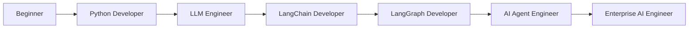

# AI Agent Engineering Academy

> A complete, open learning path for designing, building, evaluating, deploying and maintaining AI agents with Python, LangChain, LangGraph, RAG and MCP.

| | |
|---|---|
| **Level** | Beginner → Advanced → Enterprise |
| **Primary language** | Python |
| **Core ecosystem** | LangChain, LangGraph, LangSmith |
| **Additional technologies** | RAG, MCP, Vector Databases, FastAPI, Docker, AWS |
| **Audience** | Beginners, Python developers, AI engineers and software engineers |

## Learning Path



## Tracks

| # | Track | Difficulty | Modules | Topics | Projects |
|---|---|---|---|---|---|
| 01 | [AI and LLM Fundamentals](docs/01-AI-FUNDAMENTALS/README.md) | Beginner | 6 | 58 | 4 |
| 02 | [Python for AI Engineering](docs/02-PYTHON-FOR-AI/README.md) | Beginner | 5 | 64 | 4 |
| 03 | [LangChain from Beginner to Advanced](docs/03-LANGCHAIN/README.md) | Intermediate | 9 | 86 | 5 |
| 04 | [LangGraph from Beginner to Advanced](docs/04-LANGGRAPH/README.md) | Intermediate | 7 | 57 | 5 |
| 05 | [Advanced RAG and Vector Databases](docs/05-RAG/README.md) | Intermediate | 7 | 62 | 5 |
| 06 | [Model Context Protocol (MCP)](docs/06-MCP/README.md) | Intermediate | 6 | 43 | 5 |
| 07 | [Agent Architectures and Context Engineering](docs/07-AGENT-ENGINEERING/README.md) | Advanced | 5 | 43 | 4 |
| 08 | [Evaluation, Testing and Observability](docs/08-EVALUATION-AND-OBSERVABILITY/README.md) | Advanced | 5 | 37 | 4 |
| 09 | [Enterprise AI Engineering](docs/09-ENTERPRISE-AI/README.md) | Advanced | 5 | 47 | 4 |
| 10 | [Cloud, AWS and Deployment](docs/10-CLOUD-AND-DEPLOYMENT/README.md) | Intermediate | 6 | 51 | 4 |
| 11 | [End-to-End AI Agent Projects](docs/11-PRACTICAL-PROJECTS/README.md) | Mixed | 0 | 0 | 22 |
| 12 | [AI Engineering Career and Interview Preparation](docs/12-CAREER-AND-INTERVIEWS/README.md) | Intermediate | 4 | 40 | 0 |

**Total:** 588 topic lessons and 66 projects. See the full checklist in [the roadmap](docs/roadmap.md).

## Website

The `docs/` folder is published as a website with [MkDocs Material](https://squidfunk.github.io/mkdocs-material/). After GitHub Pages is enabled, the site is available at `https://<your-username>.github.io/AI-AGENT-ENGINEERING-ACADEMY/`.

Preview it locally:

```bash
pip install -r requirements.txt
mkdocs serve
```

Then open <http://127.0.0.1:8000>. In GitHub Codespaces use `mkdocs serve --dev-addr=0.0.0.0:8000` and open the forwarded port.

## Repository Structure

```text
AI-AGENT-ENGINEERING-ACADEMY/
├── README.md                  # this file (GitHub landing page)
├── CONTRIBUTING.md
├── LICENSE
├── mkdocs.yml                 # website configuration and navigation
├── requirements.txt           # website build dependencies
├── .github/workflows/deploy.yml
└── docs/                      # all website content
    ├── index.md               # website home page
    ├── roadmap.md
    ├── projects.md
    ├── references.md
    ├── content-guidelines.md
    ├── original-roadmap.md
    ├── prompts/
    ├── 01-AI-FUNDAMENTALS/
    ├── 02-PYTHON-FOR-AI/
    ├── 03-LANGCHAIN/
    ├── 04-LANGGRAPH/
    ├── 05-RAG/
    ├── 06-MCP/
    ├── 07-AGENT-ENGINEERING/
    ├── 08-EVALUATION-AND-OBSERVABILITY/
    ├── 09-ENTERPRISE-AI/
    ├── 10-CLOUD-AND-DEPLOYMENT/
    ├── 11-PRACTICAL-PROJECTS/
    └── 12-CAREER-AND-INTERVIEWS/
```

Each track folder contains a `README.md` with its table of contents, one folder per module (each with its own `README.md`), and one Markdown file per topic. Practical projects live in each track's `projects/` folder, and Track 11 groups them by level.

## How to Use This Repository

1. Follow the tracks in order, starting with [Track 01](docs/01-AI-FUNDAMENTALS/README.md).
2. Every topic page links to the previous lesson, the module overview and the next lesson.
3. Complete the practical projects listed in [projects.md](docs/projects.md) as you go.
4. Contributors: generate articles with [the master prompt](docs/prompts/BLOG_GENERATION_MASTER_PROMPT.md) and follow [the content guidelines](docs/content-guidelines.md).

## Guiding Principle

> *Don't just teach people how to use AI frameworks. Teach them how to think, design, build, debug and engineer reliable AI agent systems.*

## Contributing and License

- [CONTRIBUTING.md](CONTRIBUTING.md)
- [LICENSE](LICENSE)
