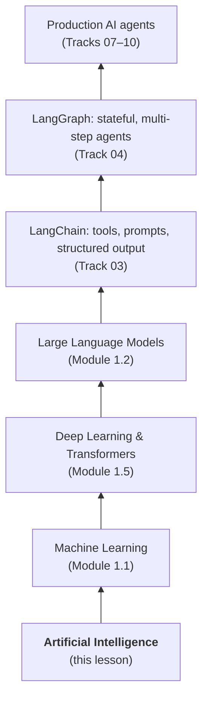
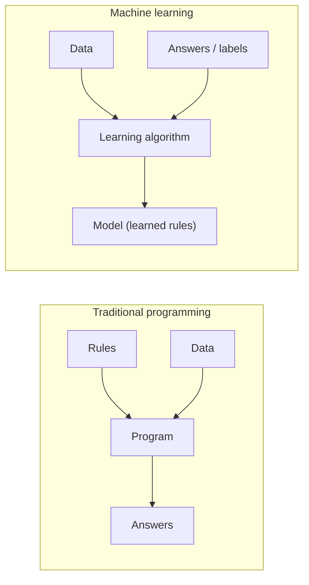
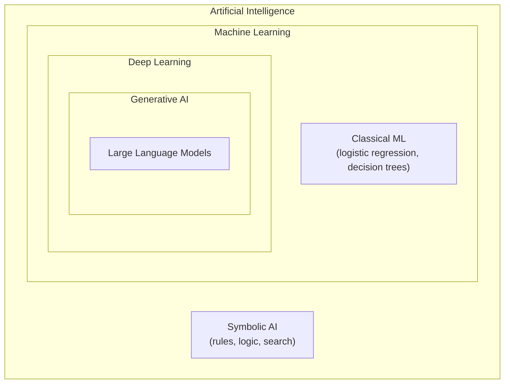
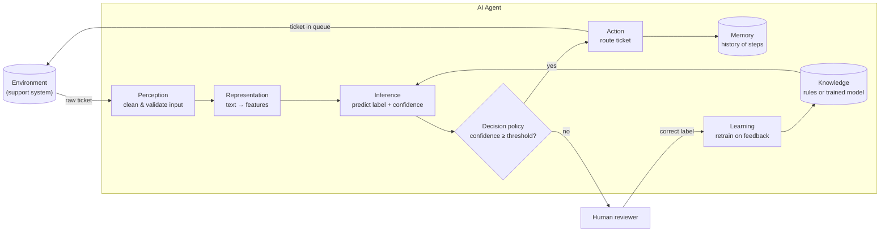
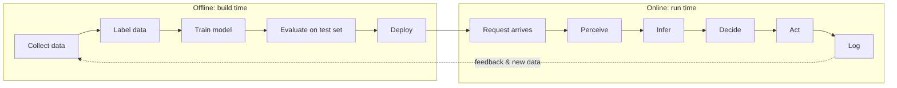
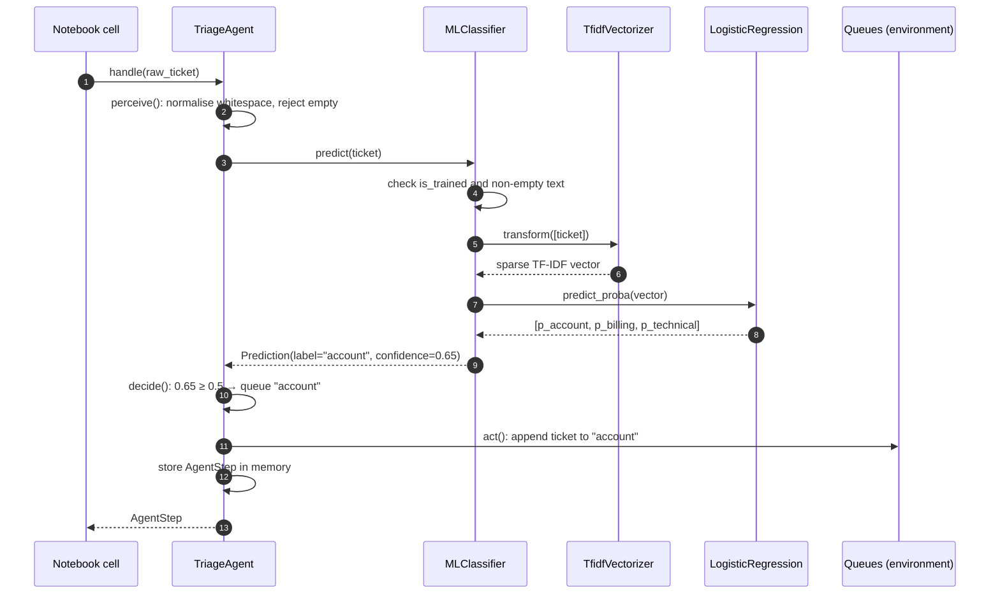
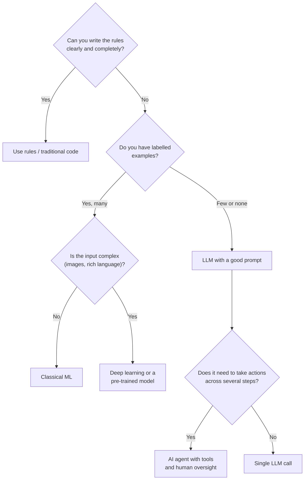

[Academy](../../index.md) › [Track 01: AI and LLM Fundamentals](../README.md) › [Module 1.1: Introduction to Artificial Intelligence](README.md)

# What is Artificial Intelligence? From Rules to Learning to Agents

| Field | Value |
|---|---|
| **Track** | Track 01: AI and LLM Fundamentals |
| **Module** | Module 1.1: Introduction to Artificial Intelligence |
| **Difficulty** | Beginner |
| **Estimated reading time** | 50–60 minutes (plus 30 minutes for the hands-on project) |
| **Prerequisites** | Basic computer literacy. Python basics help for the project. |
| **Technologies** | Python, scikit-learn, Jupyter |
| **Framework versions** | Python 3.14.5, scikit-learn 1.9.1, ipykernel 7.4.0 |
| **Last verified date** | 2026-11-17 |
| **Companion notebook** | [`what_is_ai_playbook.ipynb`](../../../examples/01-AI-FUNDAMENTALS/01-what-is-artificial-intelligence/what_is_ai_playbook.ipynb): the complete project, cell by cell, with explanations |

> ✅ **Code status:** The companion notebook was run top to bottom on Windows 11 with the versions above. Every code block in Section 8 is copied from the notebook, and every output block marked **"Actual output"** is copied from that run. Blocks marked **"Illustrative"** are examples written by hand.

---

## Table of Contents

1. [Introduction](#1-introduction)
2. [Learning Objectives](#2-learning-objectives)
3. [Prerequisites](#3-prerequisites)
4. [Fundamental Concepts](#4-fundamental-concepts)
5. [Internal Architecture](#5-internal-architecture)
6. [Installation and Environment Setup](#6-installation-and-environment-setup)
7. [Project Folder Structure](#7-project-folder-structure)
8. [Step-by-Step Implementation](#8-step-by-step-implementation)
9. [Execution and Expected Output](#9-execution-and-expected-output)
10. [Internal Execution Flow](#10-internal-execution-flow)
11. [Advanced Concepts](#11-advanced-concepts)
12. [Real-World Use Cases](#12-real-world-use-cases)
13. [Best Practices](#13-best-practices)
14. [Common Errors and Troubleshooting](#14-common-errors-and-troubleshooting)
15. [Comparison and Alternatives](#15-comparison-and-alternatives)
16. [Hands-on Exercises](#16-hands-on-exercises)
17. [Interview Preparation](#17-interview-preparation)
18. [Summary](#18-summary)
19. [Next Learning Step](#19-next-learning-step)
20. [References](#20-references)

---

## 1. Introduction

### What is artificial intelligence?

**Artificial intelligence (AI)** is the field of computer science that builds systems able to perform tasks that normally need human intelligence: understanding language, recognising images, making decisions, planning, and learning from experience.

A practical working definition, which we will use throughout this academy:

> **An AI system is software that takes in information about its situation, works out what that information means, and produces an output (a prediction, a decision, a piece of content or an action) that helps achieve a goal, often improving with data or experience.**

International bodies such as the OECD and regulators such as the European Union use definitions along the same lines: a machine-based system that *infers* from its inputs how to generate outputs such as predictions, content, recommendations or decisions that influence a physical or virtual environment. The key word is **infers**. An AI system is not just following a fixed recipe that a programmer typed out step by step for every case; it works out an answer for inputs it has never seen exactly before.

### Why does AI exist?

Traditional programs follow instructions written by a person:

```text
IF the temperature is above 25 °C THEN turn on the fan
```

That works when a human can write down every rule. It breaks down when:

- **The rules are too many.** Recognising a cat in a photo involves millions of pixel combinations. Nobody can write a rule for each.
- **The rules are unknown.** Doctors recognise patterns in X-rays that they cannot fully put into words.
- **The rules keep changing.** Spam emails change their wording every week.
- **The input is messy.** People write "pls refund me", "I want my money back" and "charged 2x??" to mean roughly the same thing.

AI exists to handle exactly these situations: tasks where writing explicit instructions is impractical, so the system must **generalise** from knowledge or examples.

### What problem does it solve?

AI turns *unstructured, ambiguous, high-volume* information into *useful decisions or content* at a speed and scale humans cannot match. Examples:

- Reading 50,000 support emails a day and sending each to the right team.
- Spotting a fraudulent card transaction within milliseconds.
- Translating a web page into 100 languages.
- Answering a question by reading a company's internal documents.

### Why should developers learn it?

1. **AI is becoming a standard software component**, like databases or web servers. Most new applications include at least one AI feature.
2. **The job is shifting.** Engineers increasingly *integrate, orchestrate and evaluate* AI models rather than write every rule by hand.
3. **AI agents are software systems.** They still need APIs, error handling, testing, security, logging and deployment. Those are developer skills.
4. **Understanding the foundations prevents expensive mistakes**, such as trusting a model's confident but wrong answer, or using a large language model where a simple rule would be cheaper and more reliable.

### Where is AI used in real-world applications?

| Domain | Example |
|---|---|
| Email | Spam filtering, smart replies |
| E-commerce | Product recommendations, search ranking |
| Finance | Fraud detection, credit risk scoring |
| Healthcare | Medical image analysis, clinical note summarisation |
| Transport | Route optimisation, driver assistance |
| Customer support | Ticket routing, chatbots, AI agents that resolve requests |
| Software development | Code completion, code review assistants |

### How does AI fit into AI Agent Engineering?

This academy teaches you to build **AI agents**: software that uses an AI model (usually a large language model) to decide what to do next, call tools such as APIs and databases, and work toward a goal over several steps.

An agent is built from layers, and this lesson is the bottom layer:



*Diagram: The learning path. Each layer is built on the one below it. You are starting at the foundation.*

Even in this first lesson, you will build a tiny agent. It will not use a large language model yet, but it will have the same skeleton every agent in this academy has: **perceive → decide → act → learn**.

---

## 2. Learning Objectives

By the end of this lesson you will be able to:

**Concepts**

- Define artificial intelligence in plain language and in technical terms.
- Explain why AI is needed when traditional programming is not enough.
- Describe the four classic ways of thinking about AI (thinking or acting, humanly or rationally).
- Distinguish **symbolic (rule-based) AI**, **machine learning**, **deep learning**, **generative AI** and **AI agents**.
- Explain the roles of **data**, **models**, **features**, **training**, **inference** and **evaluation**.
- Describe the **perceive → decide → act → learn** loop of an intelligent agent.
- Explain why confidence scores and human escalation matter.

**Practical skills**

- Set up an isolated Python environment for an AI project.
- Build a rule-based classifier and a machine-learning classifier for the same problem.
- Measure and compare their accuracy on unseen data.
- Wrap a model in a simple agent with a decision policy, memory and feedback-based learning.
- Write automated tests for AI components, including tests that use a fake model.

---

## 3. Prerequisites

| Requirement | Details |
|---|---|
| **Programming knowledge** | None for the concept sections. For the project: Python variables, functions, lists, dictionaries and classes. If these are new, read [Module 2.1: Python Fundamentals](../../02-PYTHON-FOR-AI/01-python-fundamentals/README.md) alongside this lesson. |
| **Frameworks** | None required beforehand. We install **scikit-learn**, a widely used machine-learning library, during setup. |
| **Tools** | Python 3.10 or newer (scikit-learn 1.7+ requires Python 3.10+), a terminal, a code editor such as VS Code. |
| **Environment setup** | Covered step by step in [Section 6](#6-installation-and-environment-setup). |
| **Accounts / API keys** | **None.** Everything runs locally and for free. |
| **Previous lessons** | None. This is the first lesson of the academy. |

---

## 4. Fundamental Concepts

We will introduce one concept at a time. Each one has a definition, the reason it exists, how it works, an analogy, a technical explanation and a practical example.

### 4.1 Intelligence

- **Definition:** The ability to achieve goals in a range of situations by perceiving, reasoning, learning and acting.
- **Why it matters:** We need some idea of "intelligence" before we can talk about making it artificial.
- **How it works (in people):** We observe the world, compare it with what we know, decide, act, and adjust based on what happens.
- **Analogy:** A new employee on the first day follows the manual. After a month, they handle situations the manual never mentioned. That ability to handle the *new* case is the essence of intelligence.
- **Technical explanation:** In AI, intelligence is usually measured by **performance on a task**, for example "routes 92 % of tickets correctly", not by whether the system "thinks" like a person.
- **Practical example:** A spam filter is "intelligent" at one narrow task: it decides correctly on emails it has never seen before.

### 4.2 The four views of AI

Researchers have defined AI's goal in four different ways. Russell and Norvig's textbook *Artificial Intelligence: A Modern Approach* arranges them in a 2 × 2 grid:

| | **Like humans** | **Rationally (optimally)** |
|---|---|---|
| **Thinking** | *Thinking humanly*: model how the human mind works (cognitive science). | *Thinking rationally*: use formal logic to derive correct conclusions. |
| **Acting** | *Acting humanly*: behave so that people cannot tell it is a machine (the **Turing test**, proposed by Alan Turing in 1950). | *Acting rationally*: act to achieve the best expected outcome given what is known (the **rational agent** view). |

- **Why it matters:** Modern AI engineering, and this whole academy, uses the **acting rationally** view. We care whether the agent *does the right thing*, not whether it imitates a human brain.
- **Analogy:** A satnav does not drive like a human; it computes the best route. That is acting rationally.
- **Practical example:** Our ticket triage agent is judged by whether tickets end up in the right queue.

### 4.3 Agent and environment

- **Definition:** An **agent** is anything that **perceives** its **environment** through **sensors** (inputs) and **acts** on that environment through **actuators** (outputs).
- **Why it is needed:** It gives us one simple frame that fits a thermostat, a chess program, a self-driving car and an LLM-based assistant.
- **How it works:** A repeated loop: perceive → decide → act. Intelligent agents add a fourth step: learn.
- **Analogy:** A football goalkeeper watches the ball (perceive), predicts where it will go (decide), dives (act), and remembers the striker's habits for next time (learn).
- **Technical explanation:** The agent's behaviour is described by an **agent function** that maps the history of what it has perceived to an action. The program that implements it is the **agent program**. A **performance measure** says how good its behaviour is.
- **Practical example:**

| Agent | Environment | Perceives (input) | Acts (output) | Performance measure |
|---|---|---|---|---|
| Thermostat | A room | Temperature | Heating on/off | Comfort, energy use |
| Spam filter | An inbox | Email text | Move to spam or not | Spam caught, real mail kept |
| Ticket triage agent (our project) | A support system | Ticket text | Place in a queue | Correct routing rate |
| LLM coding agent | A code repository | Files, test results | Edits files, runs commands | Tests pass, task completed |

### 4.4 Symbolic AI (rule-based systems)

- **Definition:** AI where humans encode knowledge as explicit **symbols and rules**, for example `IF text contains "refund" THEN billing`.
- **Why it is needed:** Many problems have clear rules. Rules are predictable, explainable and need no training data.
- **How it works:** A **knowledge base** (the rules) plus an **inference engine** (code that applies the rules to the input).
- **Analogy:** A recipe book. Excellent if your dish is in the book; useless if it is not.
- **Technical explanation:** This approach dominated AI from the 1950s to the 1980s, most famously as **expert systems**. Its weakness is the **knowledge acquisition bottleneck**: experts must write and maintain every rule, and the rules are **brittle**, failing on wording nobody anticipated.
- **Practical example:** In our project, `"Where can I download my receipts"` fails the rules because the rule list contains `receipt` but not `receipts`.

### 4.5 Machine learning (ML)

- **Definition:** A branch of AI where the system **learns patterns from data** instead of being given explicit rules.
- **Why it is needed:** It solves the knowledge acquisition bottleneck. You provide *examples of correct answers*; the algorithm discovers the rules.
- **How it works:**
  1. Collect **labelled data**: inputs paired with correct outputs.
  2. Turn inputs into numbers (**features**).
  3. A learning algorithm adjusts a **model**'s internal numbers (**parameters**) so its outputs match the labels (**training**).
  4. Use the trained model on new inputs (**inference** or **prediction**).
- **Analogy:** Learning to recognise ripe mangoes by looking at hundreds of mangoes someone has already labelled "ripe" or "not ripe", instead of reading a rulebook about colour and firmness.
- **Technical explanation:** Traditional programming is *rules + data → answers*. Machine learning flips it to *data + answers → rules (a model)*.



*Diagram: In traditional programming, a human writes the rules. In machine learning, the rules are learned from data and labels.*

- **Practical example:** Our `MLClassifier` learns from 30 labelled tickets. Nobody tells it that "log in" means an account problem; it works that out from the examples and routes `"I cannot log in after changing my phone"` to `account`.

The three main styles of machine learning (each gets its own lesson later in this module):

| Style | Learns from | Example |
|---|---|---|
| **Supervised learning** | Inputs with correct labels | Ticket → queue (our project) |
| **Unsupervised learning** | Inputs without labels; finds structure | Grouping customers into segments |
| **Reinforcement learning** | Rewards and penalties from trial and error | A robot learning to walk |

### 4.6 Data, features and labels

- **Definition:** **Data** is the raw material (texts, images, numbers). A **feature** is a measurable property of the input that the model uses. A **label** is the correct answer for a training example.
- **Why it is needed:** Models only understand numbers. Features are the bridge between the real world and mathematics.
- **How it works:** A **feature extraction** step converts each input into a **vector**, which is simply a list of numbers.
- **Analogy:** A doctor does not use "the whole patient" as input; they use features: temperature, blood pressure, age.
- **Technical explanation:** In our project, **TF-IDF** (term frequency–inverse document frequency) gives each word a weight that is high when the word appears in this ticket but is rare across all tickets. The word "the" gets a low weight; "refund" gets a high weight.
- **Practical example (illustrative):**

```text
Ticket:  "refund my invoice"
Vector:  [... refund: 0.58, invoice: 0.58, my: 0.40, crash: 0.0, password: 0.0 ...]
Label:   billing
```

### 4.7 Model, parameters and training

- **Definition:** A **model** is a mathematical function with adjustable numbers called **parameters** (or **weights**). **Training** finds parameter values that make the model's predictions match the labels.
- **Why it is needed:** The model *is* the learned knowledge. Once trained, it can be saved, shared and used anywhere.
- **How it works:** The algorithm measures how wrong the model is (the **loss**) and repeatedly nudges the parameters to reduce it.
- **Analogy:** Tuning a guitar: pluck (predict), hear how off it is (loss), turn the peg a little (update), repeat.
- **Technical explanation:** Our project uses **logistic regression**, which learns one weight per (feature, class) pair. Positive weights push toward a class; negative weights push away. A function called **softmax** turns the totals into probabilities that add up to 1. Large language models work on the same principle but with billions of parameters.
- **Practical example:** After training, the weight of "refund" for the class `billing` will be strongly positive.

### 4.8 Inference and confidence

- **Definition:** **Inference** is using a trained model to make a prediction on new input. Many models also return a **confidence score**, usually a probability between 0 and 1.
- **Why it is needed:** Training happens once (or occasionally); inference happens every time a user sends a request. Confidence tells us *how much to trust* each prediction.
- **How it works:** Input → features → model → probabilities for each class → pick the highest.
- **Analogy:** A weather forecast says "70 % chance of rain", not just "rain". You decide whether to take an umbrella based on that number.
- **Technical explanation:** Probabilities from a model are not guaranteed to be **calibrated**: a model saying 0.9 is not necessarily right 90 % of the time. Treat confidence as a useful signal, not a promise.
- **Practical example:** Our agent acts on its own only when confidence is ≥ 0.5; otherwise it sends the ticket to a human.

### 4.9 Generalisation, overfitting and evaluation

- **Definition:** **Generalisation** is performing well on data the model has never seen. **Overfitting** is memorising the training data instead of learning general patterns. **Evaluation** measures performance on a held-out **test set**.
- **Why it is needed:** A model that scores 100 % on its training data might fail completely on real users.
- **How it works:** Split data into a **training set** (to learn from) and a **test set** (kept hidden until the end). Report metrics such as **accuracy** on the test set.
- **Analogy:** A student who memorises past exam answers passes the mock exam but fails the real one.
- **Practical example:** Our project keeps 9 test tickets separate from the 30 training tickets.

### 4.10 Deep learning, generative AI and LLMs

- **Deep learning** is machine learning using **neural networks** with many layers. It learns its own features directly from raw data (pixels, characters), which is why it transformed image recognition and language processing.
- **Generative AI** produces *new content* (text, images, code, audio) rather than only choosing among labels.
- A **large language model (LLM)** is a deep-learning model, usually based on the **Transformer** architecture, trained on very large amounts of text to predict the next piece of text. LLMs are the "brain" of most modern AI agents.



*Diagram: The family of AI approaches. Every LLM is a deep-learning model; every deep-learning model is a machine-learning model; all of these are AI. The reverse is not true. A rule-based system is AI but not machine learning.*

You will study each layer in its own lesson. For now, remember the nesting.

### 4.11 Narrow AI vs general AI

- **Narrow AI** (also called weak AI) does one task or a related set of tasks. Every AI system in production today is narrow, including our triage agent.
- **Artificial general intelligence (AGI)** would match humans across essentially all cognitive tasks. It is a research goal and a subject of active debate, not something you will deploy in this course.

*This topic has its own lesson: [Narrow AI vs General AI](04-narrow-ai-vs-general-ai.md).*

### 4.12 Human-in-the-loop

- **Definition:** A design where a human reviews, approves or corrects some of the AI system's decisions.
- **Why it is needed:** AI makes mistakes, sometimes confidently. For high-impact or uncertain decisions, a human safety net reduces harm and produces corrected examples the system can learn from.
- **Analogy:** A trainee pilot flies the plane, but the captain watches and takes over when needed.
- **Practical example:** Our agent sends low-confidence tickets to a `human-review` queue, and the human's correction is used to retrain the model.

---

## 5. Internal Architecture

Every AI system, from a 1980s expert system to a modern LLM agent, can be described with the same building blocks.

### 5.1 Architecture components

| Component | Responsibility | In our project |
|---|---|---|
| **Environment** | The world the system observes and changes. | The support system: incoming tickets and queues. |
| **Perception (input processing)** | Receive raw input, clean and validate it. | `TriageAgent.perceive()` |
| **Representation (features)** | Convert input into a form the model can compute with. | TF-IDF vectoriser, or keyword matching. |
| **Knowledge / model** | Stored knowledge used for decisions: rules or learned parameters. | `DEFAULT_RULES` or the trained logistic regression. |
| **Reasoning / inference** | Apply the knowledge to the current input to get a prediction. | `predict()` |
| **Decision policy** | Turn a prediction into an action, considering confidence, risk and goals. | `TriageAgent.decide()` with `confidence_threshold`. |
| **Action (actuators)** | Change the environment. | `TriageAgent.act()` appends to a queue. |
| **Memory** | Record what happened for auditing, debugging and context. | `TriageAgent.memory` |
| **Learning** | Improve the knowledge from new data or feedback. | `MLClassifier.learn()` |
| **Evaluation** | Measure quality so you know whether changes help. | `evaluate.accuracy()` and the test suite. |

### 5.2 Architecture diagram



*Diagram: The agent receives a raw ticket from the environment, turns it into features, asks its knowledge (rules or model) for a prediction, and uses a decision policy to either act alone or escalate to a human. Human corrections flow back into the learning component, which updates the knowledge. Every action is stored in memory.*

### 5.3 Data flow

1. **Raw input:** `"  I cannot   log in after changing my phone "`
2. **After perception:** `"I cannot log in after changing my phone"` (whitespace normalised, empty input rejected)
3. **Features:** a sparse vector of TF-IDF weights for words and word pairs such as `log`, `log in`, `phone`.
4. **Model output:** probabilities per class, for example `{account: 0.65, billing: ..., technical: ...}`
5. **Prediction:** `Prediction(label="account", confidence=0.65, ...)`
6. **Decision:** 0.65 ≥ 0.5 → act alone.
7. **Action:** ticket appended to the `account` queue.
8. **Memory:** an `AgentStep` record stores the ticket, prediction and action.

### 5.4 Execution lifecycle

An AI system has two distinct lifecycles:



*Diagram: Training and evaluation happen offline before deployment. Inference happens online for every request. Feedback collected at run time becomes new training data, closing the loop.*

### 5.5 Communication between components

In our project, components communicate through **plain Python method calls** and one shared data type, `Prediction`. The agent depends only on a **protocol** (an interface): "anything with a `predict(text)` method". This means you can swap a rule-based classifier for an ML model, or later for an LLM, without changing the agent. That design idea, **depend on an interface, not an implementation**, is exactly how LangChain lets you swap model providers, which you will see in Track 03.

### 5.6 Important internal mechanisms

- **Vectorisation:** `TfidfVectorizer` builds a **vocabulary** from the training texts. Words never seen during training are ignored at prediction time. This is why the model was unsure about "billed": it had only seen "billing".
- **Probability estimation:** Logistic regression computes a score per class and converts the scores into probabilities with the softmax function.
- **Thresholding:** The confidence threshold is a **policy**, not part of the model. Changing it trades automation rate against error rate without retraining.
- **Retraining:** Our `learn()` method retrains from scratch on all examples plus the correction. That is fine for 31 examples; large systems batch feedback and retrain on a schedule (see [Section 11](#11-advanced-concepts)).

---

## 6. Installation and Environment Setup

### 6.1 Required software

| Software | Version used in this lesson | Notes |
|---|---|---|
| Python | 3.14.5 | Any Python **3.10 or newer** works with scikit-learn 1.9.x. |
| pip | Bundled with Python | Python's package installer. |
| scikit-learn | 1.9.1 | Machine-learning library. Installs NumPy and SciPy automatically. |
| ipykernel | 7.4.0 | Lets Jupyter and VS Code run notebook cells with your virtual environment's Python. |
| pytest, nbformat, nbclient | 9.2.0, 5.11.1, 0.11.0 | Run the notebook automatically as a test. |
| VS Code with the Jupyter extension, or JupyterLab | Any recent version | To open and run the notebook. |
| Git (optional) | Any recent version | To clone the academy repository. |

Download Python from the official site, <https://www.python.org/downloads/>. On Windows, tick **"Add python.exe to PATH"** in the installer.

### 6.2 Check your Python version

```bash
python --version
```

On macOS and Linux the command may be `python3`. You should see `Python 3.10` or higher.

### 6.3 Get the code

Either clone the academy repository and move into the project folder:

```bash
git clone <YOUR-REPOSITORY-URL>
cd AI_AGENT_ENGINEERING/examples/01-AI-FUNDAMENTALS/01-what-is-artificial-intelligence
```

…or create an empty notebook yourself and type in the cells from [Section 8](#8-step-by-step-implementation).

### 6.4 Create and activate a virtual environment

A **virtual environment** is a private folder of packages for one project, so that projects do not break each other with different versions.

```bash
python -m venv .venv
```

Activate it:

```powershell
# Windows PowerShell
.venv\Scripts\Activate.ps1
```

```bash
# macOS / Linux
source .venv/bin/activate
```

Your prompt should now start with `(.venv)`.

> If PowerShell says *"running scripts is disabled on this system"*, see [Section 14](#14-common-errors-and-troubleshooting).

### 6.5 Install packages

```bash
pip install -r requirements.txt
```

`requirements.txt` pins exact versions so you get the same results as this article:

```text
numpy==2.5.5
scikit-learn==1.9.1
pytest==9.2.0
nbformat==5.11.1
nbclient==0.11.0
ipykernel==7.4.0
```

- `scikit-learn` (with `numpy`) is the machine-learning library used in the notebook.
- `ipykernel` connects notebooks to your virtual environment's Python.
- `pytest`, `nbformat` and `nbclient` power the automated check in `tests/test_playbook.py`, which runs the whole notebook from top to bottom and fails if any cell raises an error.

### 6.6 Environment variables and API keys

**None are needed for this lesson.** Everything runs locally.

From Module 1.2 onwards you will call hosted models, which require API keys. The rule you will follow from then on: **keep secrets in environment variables or a `.env` file that is listed in `.gitignore`, and never write them in source code.** This repository's `.gitignore` already excludes `.env` files.

---

## 7. Project Folder Structure

The whole project lives in **one Jupyter notebook**. A notebook mixes explanation (Markdown cells) and runnable code (code cells), so you can read a concept, run the code for it, and see the result immediately.

```text
01-what-is-artificial-intelligence/
├── what_is_ai_playbook.ipynb   # The complete project: explanations, code and saved outputs
├── tests/
│   └── test_playbook.py        # Runs the whole notebook and fails if any cell errors
├── pytest.ini                  # pytest settings
├── requirements.txt            # Pinned dependencies
└── README.md                   # How to open, run and test the notebook
```

| Path | Responsibility |
|---|---|
| `what_is_ai_playbook.ipynb` | Everything: data, rule-based classifier, ML classifier, evaluation, agent, experiments, in-notebook tests and a playground cell. Saved outputs are visible on GitHub without running anything. |
| `tests/test_playbook.py` | An automated **smoke test**: executes every cell with `nbclient` so a library upgrade that breaks the notebook is caught immediately. |
| `pytest.ini` | Tells pytest where the tests are and hides a harmless Windows warning from the notebook kernel. |
| `requirements.txt` | Pins library versions so your results match this article. |
| `README.md` | Quick-start instructions for VS Code, JupyterLab and testing. |

### How the notebook is organised

| Notebook section | What it builds | Concept from this article |
|---|---|---|
| 0. Setup | Installs and checks scikit-learn | Reproducible environments |
| 1. The problem | `Prediction`, `TicketClassifier`, the dataset | Interfaces, labelled data, train/test split |
| 2. Rule-based AI | `RuleBasedClassifier` | Symbolic AI ([4.4](#44-symbolic-ai-rule-based-systems)) |
| 3. Machine learning | TF-IDF demo, `MLClassifier`, model inspection | Features, training, inference ([4.5](#45-machine-learning-ml)–[4.8](#48-inference-and-confidence)) |
| 4. Evaluation | `accuracy()` and a side-by-side table | Generalisation and evaluation ([4.9](#49-generalisation-overfitting-and-evaluation)) |
| 5. The agent | `TriageAgent`, memory, feedback | Agent loop and human-in-the-loop ([4.3](#43-agent-and-environment), [4.12](#412-human-in-the-loop)) |
| 6. Threshold experiment | Automation vs safety table | Decision policy ([11.3](#113-choosing-the-confidence-threshold)) |
| 7. Testing | Assertion-based tests with a fake classifier | Testing AI components |
| 8. Try it yourself | A playground cell | Exploration |
| 9–10. Exercises and summary | Practice tasks | Review |

> **Notebook or Python package?** A notebook is ideal for learning and experimenting. Production code is normally split into modules (`data.py`, `model.py`, `agent.py`, …) with a test suite run by a tool such as pytest. You will move to that layout in Track 02 and the framework tracks. The *ideas* (interfaces, separate data, evaluation, a single place for side effects) are the same in both.

---

## 8. Step-by-Step Implementation

Each step below matches a section of the notebook. Run the cells in order with `Shift + Enter`; later cells use names defined by earlier ones.

### Step 1: Install and check the libraries (notebook section 0)

**What we are building:** A working environment with scikit-learn.

**Why this step is necessary:** AI libraries change often. Printing versions makes your results reproducible and helps others debug.

**Notebook cell (0.1):**

```python
%pip install -q scikit-learn==1.9.1
```

`%pip` is a Jupyter *magic command*: it installs the package into the same Python environment the notebook kernel is running in. Plain `pip` in a notebook can install into a different Python by mistake.

**Notebook cell (0.2):**

```python
import sys
import sklearn

print("Python      :", sys.version.split()[0])
print("scikit-learn:", sklearn.__version__)
```

**Actual output:**

```text
Python      : 3.14.5
scikit-learn: 1.9.1
```

### Step 2: Define the shared types (notebook section 1.1)

**What we are building:** A `Prediction` data type and a `TicketClassifier` interface.

**Why this step is necessary:** The agent should not care whether a decision comes from rules, a trained model or an LLM. A shared contract makes the components swappable and testable.

```python
from dataclasses import dataclass
from typing import Protocol


@dataclass(frozen=True)
class Prediction:
    # The result of classifying one ticket.
    label: str          # e.g. "billing"
    confidence: float   # 0.0 (no idea) .. 1.0 (very sure)
    reason: str         # short human-readable explanation


class TicketClassifier(Protocol):
    # Anything with a `name` and a `predict(text) -> Prediction` method.
    name: str

    def predict(self, text: str) -> Prediction: ...


# Quick check: create a Prediction by hand and print it.
example = Prediction(label="billing", confidence=0.9, reason="just an example")
print(example)
```

**Important statements**

- `@dataclass(frozen=True)` auto-generates `__init__`, `__repr__` and `__eq__`. `frozen=True` makes instances **immutable**, so a prediction cannot be changed accidentally after it is made.
- `class TicketClassifier(Protocol)` is a **structural interface**: any class with a `name` attribute and a `predict(text) -> Prediction` method satisfies it, *without inheriting from it*.
- **Return value:** `predict` returns a `Prediction` with `label`, `confidence` and `reason`. The `reason` field is a first step toward **explainability**.

### Step 3: Create the dataset (notebook section 1.2)

**What we are building:** 30 labelled training tickets and 9 separate test tickets for three queues.

**Why this step is necessary:** Machine learning needs labelled examples to learn from, and evaluation needs examples the model has *never seen*.

```python
LABELS = ("billing", "technical", "account")

TRAINING_DATA = [
    # billing
    ("I was charged twice for my subscription this month", "billing"),
    ("Please send me the invoice for last quarter", "billing"),
    ("How do I get a refund for the annual plan", "billing"),
    ("My credit card payment was declined", "billing"),
    ("Why did my monthly price go up", "billing"),
    ("I want to change my payment method to PayPal", "billing"),
    ("There is an unknown charge on my bank statement", "billing"),
    ("Can I get a discount if I pay yearly", "billing"),
    ("The receipt shows the wrong company name", "billing"),
    ("Cancel my plan and stop billing me", "billing"),
    # technical
    ("The app crashes every time I open the dashboard", "technical"),
    ("I get error 500 when uploading a file", "technical"),
    ("The page is very slow to load since the update", "technical"),
    ("Export to CSV produces an empty file", "technical"),
    ("Notifications stopped working on Android", "technical"),
    ("The search bar returns no results for anything", "technical"),
    ("Images are not displaying in the report", "technical"),
    ("The API returns a timeout after 30 seconds", "technical"),
    ("Sync between my laptop and phone is broken", "technical"),
    ("The button does nothing when I click save", "technical"),
    # account
    ("I forgot my password and cannot log in", "account"),
    ("How do I change the email address on my profile", "account"),
    ("Please delete my account and personal data", "account"),
    ("My account is locked after too many attempts", "account"),
    ("I want to add a new team member to our workspace", "account"),
    ("Two-factor authentication code is not arriving", "account"),
    ("How can I change my username", "account"),
    ("Someone else may have accessed my account", "account"),
    ("I need admin permissions for my colleague", "account"),
    ("Sign in with Google is not linking to my profile", "account"),
]

TEST_DATA = [
    ("I paid but my order still shows unpaid", "billing"),
    ("You billed my card after I cancelled", "billing"),
    ("Where can I download my receipts", "billing"),
    ("The application freezes when I scroll the table", "technical"),
    ("Uploading a photo gives me a strange error", "technical"),
    ("Charts are blank after the latest release", "technical"),
    ("I cannot reset my password, the link has expired", "account"),
    ("Please remove a former employee from our team", "account"),
    ("My login keeps failing even with the right password", "account"),
]

from collections import Counter

print("Training examples:", len(TRAINING_DATA), dict(Counter(label for _, label in TRAINING_DATA)))
print("Test examples    :", len(TEST_DATA), dict(Counter(label for _, label in TEST_DATA)))
```

**Actual output:**

```text
Training examples: 30 {'billing': 10, 'technical': 10, 'account': 10}
Test examples    : 9 {'billing': 3, 'technical': 3, 'account': 3}
```

**Important statements**

- Each example is a tuple `(text, label)`, the basic unit of **supervised learning**.
- The dataset is **balanced** (10 examples per queue). Unbalanced data makes a model favour the majority class.
- `TEST_DATA` uses *different wording* from the training data, so it measures generalisation rather than memorisation.
- `Counter` counts how many examples each label has, a quick sanity check you should always run on new data.

### Step 4: Build the rule-based classifier (notebook section 2)

**What we are building:** A classifier that uses human-written keyword lists, our **symbolic AI** baseline.

**Why this step is necessary:** It is the simplest form of AI and the baseline we compare machine learning against. In real projects, always build a simple baseline first; it tells you whether a complex model is worth its cost.

```python
import re

DEFAULT_RULES = {
    "billing": (
        "charge", "charged", "invoice", "refund", "payment", "price",
        "billing", "bill", "discount", "receipt", "plan", "card",
    ),
    "technical": (
        "crash", "crashes", "error", "slow", "bug", "broken", "timeout",
        "not working", "stopped working", "empty", "api", "load",
    ),
    "account": (
        "password", "log in", "login", "sign in", "account", "username",
        "email", "profile", "permissions", "locked", "two-factor", "team",
    ),
}

FALLBACK_LABEL = "technical"


class RuleBasedClassifier:
    # Classify tickets by counting keyword matches per queue.

    name = "rule-based"

    def __init__(self, rules=None):
        self.rules = rules if rules is not None else DEFAULT_RULES

    @staticmethod
    def _matches(keyword: str, text: str) -> bool:
        return re.search(rf"\b{re.escape(keyword)}\b", text) is not None

    def predict(self, text: str) -> Prediction:
        if not text or not text.strip():
            raise ValueError("Ticket text must not be empty.")

        normalized = text.lower()
        # e.g. {"billing": ["refund"], "technical": [], "account": []}
        hits = {
            label: [kw for kw in keywords if self._matches(kw, normalized)]
            for label, keywords in self.rules.items()
        }
        total_hits = sum(len(found) for found in hits.values())

        if total_hits == 0:
            return Prediction(FALLBACK_LABEL, 0.0, "no rule matched; used fallback queue")

        best_label = max(hits, key=lambda label: len(hits[label]))
        confidence = len(hits[best_label]) / total_hits
        return Prediction(best_label, round(confidence, 2), f"matched keywords {hits[best_label]}")


rules = RuleBasedClassifier()
print("Classifier ready:", rules.name)
```

**Important statements**

- `DEFAULT_RULES` is the **knowledge base**. All the "intelligence" lives here, written by a person.
- `__init__(self, rules=None)` accepts custom rules, which makes the class reusable and testable (**dependency injection**).
- `_matches()` uses a regular expression with `\b` **word boundaries**, so `card` does not match inside `discarded`. `re.escape()` treats special characters (such as `-` in `two-factor`) literally.
- The dictionary comprehension builds `hits`, for example `{"billing": ["refund"], "technical": [], "account": []}`. This is the **inference engine**.
- **Confidence** = share of matched keywords that belong to the winner; `0.0` when nothing matched, with a fallback to `technical`.
- Empty text raises `ValueError`: **fail fast** rather than guess.

**Try it (notebook section 2.1):**

```python
for ticket in [
    "Please refund my last invoice",       # clear billing keywords
    "The app crashes with an error",       # clear technical keywords
    "Refund me, the app crashed",          # two topics at once
    "Where can I download my receipts",    # 'receipts' is not in the list, only 'receipt'
]:
    print(f"{ticket!r:40} -> {rules.predict(ticket)}")
```

**Actual output:**

```text
'Please refund my last invoice'          -> Prediction(label='billing', confidence=1.0, reason="matched keywords ['invoice', 'refund']")
'The app crashes with an error'          -> Prediction(label='technical', confidence=1.0, reason="matched keywords ['crashes', 'error']")
'Refund me, the app crashed'             -> Prediction(label='billing', confidence=1.0, reason="matched keywords ['refund']")
'Where can I download my receipts'       -> Prediction(label='technical', confidence=0.0, reason='no rule matched; used fallback queue')
```

Two lessons hide in this output:

- `"Refund me, the app crashed"` is about two topics, yet the rules say `billing` with confidence `1.0`. The rule list has `crash` and `crashes` but not `crashed`, so the technical half is invisible. The rules are **confidently wrong**.
- `"receipts"` matches nothing because only `receipt` is listed. Every fix needs a human to edit the rules: the **knowledge acquisition bottleneck**.

### Step 5: Turn text into numbers (notebook section 3.1)

**What we are building:** A small TF-IDF demonstration, before we hide it inside a pipeline.

**Why this step is necessary:** Models only understand numbers. Seeing the numbers makes the idea of a **feature** concrete.

```python
from sklearn.feature_extraction.text import TfidfVectorizer

demo_vectorizer = TfidfVectorizer(lowercase=True)
demo_vectorizer.fit([text for text, _ in TRAINING_DATA])   # learn the vocabulary

print("Vocabulary size:", len(demo_vectorizer.vocabulary_), "words")

vector = demo_vectorizer.transform(["Please refund my invoice"])
words = demo_vectorizer.get_feature_names_out()
for index, weight in zip(vector.indices, vector.data):
    print(f"  {words[index]:<10} {weight:.2f}")
```

**Actual output:**

```text
Vocabulary size: 150 words
  invoice    0.58
  my         0.26
  please     0.52
  refund     0.58
```

- `fit()` learns the **vocabulary**: one column per distinct word in the training texts.
- `transform()` turns new text into a **sparse vector**: only non-zero weights are stored. `vector.indices` are the column numbers and `vector.data` the weights.
- `please` and `my` are common, so they get lower weights than the rarer, more informative `refund` and `invoice`.

### Step 6: Build the machine-learning classifier (notebook section 3.2)

**What we are building:** A classifier that **learns** from the labelled examples.

**Why this step is necessary:** It demonstrates the core idea of modern AI: learning patterns from data instead of writing them by hand.

```python
from sklearn.linear_model import LogisticRegression
from sklearn.pipeline import Pipeline


class MLClassifier:
    # A text classifier that learns from labelled examples.

    name = "machine-learning"

    def __init__(self):
        self.pipeline = Pipeline(steps=[
            ("vectorizer", TfidfVectorizer(lowercase=True, ngram_range=(1, 2))),
            ("model", LogisticRegression(C=10.0, max_iter=1000)),
        ])
        self._examples = []
        self.is_trained = False

    def train(self, examples):
        if len({label for _, label in examples}) < 2:
            raise ValueError("Training needs examples from at least two labels.")
        self._examples = list(examples)
        texts = [text for text, _ in self._examples]
        targets = [label for _, label in self._examples]
        self.pipeline.fit(texts, targets)        # <-- the actual learning happens here
        self.is_trained = True

    def learn(self, text, correct_label):
        self.train([*self._examples, (text, correct_label)])

    def predict(self, text: str) -> Prediction:
        if not self.is_trained:
            raise RuntimeError("Call train() before predict().")
        if not text or not text.strip():
            raise ValueError("Ticket text must not be empty.")

        probabilities = self.pipeline.predict_proba([text])[0]   # one row, one column per queue
        classes = self.pipeline.classes_                         # queue names, in column order
        best = int(probabilities.argmax())
        return Prediction(str(classes[best]), round(float(probabilities[best]), 2),
                          "learned from labelled examples")


model = MLClassifier()
model.train(TRAINING_DATA)
print("Trained on", len(TRAINING_DATA), "examples. Classes:", list(model.pipeline.classes_))
```

**Actual output:**

```text
Trained on 30 examples. Classes: [np.str_('account'), np.str_('billing'), np.str_('technical')]
```

**Important statements**

- `Pipeline(steps=[...])` chains the vectoriser and the model so `fit()` and `predict_proba()` always apply the **same** preprocessing. Mismatched preprocessing between training and inference is one of the most common real-world ML bugs.
- `TfidfVectorizer(lowercase=True, ngram_range=(1, 2))` uses single words (**unigrams**) and word pairs (**bigrams**), so `"log in"` becomes a feature.
- `LogisticRegression(C=10.0, max_iter=1000)`: `C` controls **regularisation**, a penalty that keeps weights small to avoid overfitting; smaller `C` means a stronger penalty. The scikit-learn default `C=1.0` made every prediction look unsure on only 30 examples. `C` is a **hyperparameter**: chosen by the engineer, not learned. `max_iter` gives the optimiser enough steps to converge.
- `train()` refuses data with fewer than two labels, then calls `fit()`. That single line is where the **learning** happens: the vectoriser learns the vocabulary and the model learns its weights.
- `learn()` adds a corrected example and retrains from scratch: simple and correct for small data.
- `predict()`:
  - `predict_proba([text])` returns one row per input and one column per class; we take row `[0]`.
  - `classes_` gives the class names in column order (scikit-learn sorts them alphabetically: `account`, `billing`, `technical`).
  - `argmax()` picks the highest probability; `float()` and `str()` convert NumPy types to plain Python types.
- **Errors:** `RuntimeError` if used before training; `ValueError` for empty text.

**Try it (notebook section 3.3):**

```python
for ticket in [
    "Please refund my last invoice",
    "The app crashes with an error",
    "Refund me, the app crashed",
    "I cannot log in after changing my phone",
]:
    print(f"{ticket!r:42} -> {model.predict(ticket)}")
```

**Actual output:**

```text
'Please refund my last invoice'            -> Prediction(label='billing', confidence=0.61, reason='learned from labelled examples')
'The app crashes with an error'            -> Prediction(label='technical', confidence=0.69, reason='learned from labelled examples')
'Refund me, the app crashed'               -> Prediction(label='billing', confidence=0.48, reason='learned from labelled examples')
'I cannot log in after changing my phone'  -> Prediction(label='account', confidence=0.65, reason='learned from labelled examples')
```

Unlike the rules, the model gives the mixed ticket `"Refund me, the app crashed"` a **low** confidence (below 0.5): it "notices" signals for two queues. That honest uncertainty is exactly what the agent will use later.

### Step 7: Look inside the model (notebook sections 3.4 and 3.5)

**What we are building:** Two inspection tools: the top-weighted words per queue, and the words of a ticket that the model actually knows.

**Why this step is necessary:** Inspecting a model is how you catch it learning nonsense. Simple linear models make this easy.

```python
import numpy as np

vectorizer = model.pipeline.named_steps["vectorizer"]
classifier = model.pipeline.named_steps["model"]
feature_names = vectorizer.get_feature_names_out()

for row, label in enumerate(classifier.classes_):
    top = np.argsort(classifier.coef_[row])[-6:][::-1]     # indices of the 6 biggest weights
    print(f"{label:<10}", ", ".join(feature_names[i] for i in top))
```

**Actual output:**

```text
account    account, my account, my, my profile, profile, is not
billing    payment, plan, me, was, get, for
technical  the, file, when, returns, working, working on
```

- `named_steps[...]` reaches inside the pipeline. `coef_` has one row of weights per class (in `classes_` order); `np.argsort(...)[-6:][::-1]` gives the indices of the six largest weights, biggest first.
- Some words are sensible (`account`, `profile`, `payment`, `plan`); others are **noise** (`the`, `when`, `me`, `was`, `for`) that happened to occur more often in one queue's 10 examples. With little data, models learn **accidental patterns** as well as real ones.

```python
def known_words(text: str) -> list[str]:
    analyzer = vectorizer.build_analyzer()          # the same tokenizer the model uses
    return [w for w in analyzer(text) if w in vectorizer.vocabulary_]

for ticket in ["I paid but my order still shows unpaid", "Where can I download my receipts"]:
    print(f"{ticket!r:42} known words: {known_words(ticket)}")
```

**Actual output:**

```text
'I paid but my order still shows unpaid'   known words: ['my', 'shows']
'Where can I download my receipts'         known words: ['can', 'my']
```

- `build_analyzer()` returns the exact tokenizer the model uses; words not in `vocabulary_` are silently ignored. (The default tokenizer also skips one-letter words such as "I".)
- For `"I paid but my order still shows unpaid"` the model only knows `my` and `shows`. You will see in Step 8 why that matters.

### Step 8: Evaluate both approaches (notebook section 4)

**What we are building:** An accuracy function and a side-by-side comparison on the hidden test set.

**Why this step is necessary:** "It seems to work" is not evidence. Evaluation turns opinions into numbers you can compare.

```python
def accuracy(classifier, examples) -> float:
    if not examples:
        raise ValueError("Cannot compute accuracy on an empty dataset.")
    correct = sum(1 for text, expected in examples if classifier.predict(text).label == expected)
    return correct / len(examples)


for clf in (rules, model):
    print(f"{clf.name:<18} accuracy: {accuracy(clf, TEST_DATA):.0%}  ({len(TEST_DATA)} test tickets)")
```

**Actual output:**

```text
rule-based         accuracy: 78%  (9 test tickets)
machine-learning   accuracy: 89%  (9 test tickets)
```

```python
print(f"{'ticket':<52} {'expected':<10} {'rules':<12} {'ml':<12}")
print("-" * 88)
for text, expected in TEST_DATA:
    r = rules.predict(text).label
    m = model.predict(text).label
    mark = lambda label: ("✅ " if label == expected else "❌ ") + label
    print(f"{text:<52} {expected:<10} {mark(r):<12} {mark(m):<12}")
```

**Actual output:**

```text
ticket                                               expected   rules        ml          
----------------------------------------------------------------------------------------
I paid but my order still shows unpaid               billing    ❌ technical  ✅ billing   
You billed my card after I cancelled                 billing    ✅ billing    ✅ billing   
Where can I download my receipts                     billing    ❌ technical  ❌ account   
The application freezes when I scroll the table      technical  ✅ technical  ✅ technical 
Uploading a photo gives me a strange error           technical  ✅ technical  ✅ technical 
Charts are blank after the latest release            technical  ✅ technical  ✅ technical 
I cannot reset my password, the link has expired     account    ✅ account    ✅ account   
Please remove a former employee from our team        account    ✅ account    ✅ account   
My login keeps failing even with the right password  account    ✅ account    ✅ account   
```

**How to read this**

- **Accuracy** = correct predictions ÷ total. It is easy to understand but can mislead on unbalanced data (see [Section 11](#11-advanced-concepts)).
- `"I paid but my order still shows unpaid"`: the rules match no keyword and fall back to `technical`. The ML model says `billing`, which is correct, but only because `shows` appeared once in training, in the billing ticket "The receipt **shows** the wrong company name". **The model was right for a weak reason.** That is why we evaluate on many examples instead of trusting a few lucky ones.
- `"Where can I download my receipts"`: both are wrong. The model has never seen `receipts`, and its only known words, `can` and `my`, lean toward `account`. **Learning is not magic: a model cannot use information it has never seen.** Embeddings and LLMs, covered later, handle this far better.

### Step 9: Build the agent (notebook section 5)

**What we are building:** A `TriageAgent` that wraps any classifier and adds perception, a decision policy, actions, memory and learning from feedback.

**Why this step is necessary:** A model only *predicts*. An agent *decides and acts* toward a goal, and knows when to ask for help. This is the core idea of the entire academy.

```python
from collections import defaultdict
from dataclasses import field

HUMAN_REVIEW_QUEUE = "human-review"


@dataclass
class AgentStep:
    # One record in the agent's memory.
    ticket: str
    prediction: Prediction
    action: str


@dataclass
class TriageAgent:
    classifier: TicketClassifier
    confidence_threshold: float = 0.5
    queues: dict = field(default_factory=lambda: defaultdict(list))
    memory: list = field(default_factory=list)

    def perceive(self, raw_ticket: str) -> str:
        text = " ".join(raw_ticket.split())        # collapse extra spaces
        if not text:
            raise ValueError("Received an empty ticket.")
        return text

    def decide(self, ticket: str):
        prediction = self.classifier.predict(ticket)
        if prediction.confidence >= self.confidence_threshold:
            return prediction, prediction.label     # confident -> act alone
        return prediction, HUMAN_REVIEW_QUEUE       # unsure -> ask a human

    def act(self, ticket: str, queue: str) -> str:
        self.queues[queue].append(ticket)
        return f"routed to '{queue}'"

    def handle(self, raw_ticket: str) -> AgentStep:
        ticket = self.perceive(raw_ticket)
        prediction, queue = self.decide(ticket)
        action = self.act(ticket, queue)
        step = AgentStep(ticket, prediction, action)
        self.memory.append(step)
        return step

    def receive_feedback(self, ticket: str, correct_label: str) -> bool:
        learn = getattr(self.classifier, "learn", None)
        if callable(learn):
            learn(ticket, correct_label)
            return True
        return False


print("TriageAgent defined.")
```

**Important statements**

- `classifier: TicketClassifier`: the agent depends on the **protocol**, not a concrete class.
- `confidence_threshold`: the **decision policy's** key setting. Raise it for safety (more human reviews); lower it for automation (more risk).
- `field(default_factory=lambda: defaultdict(list))`: each agent gets its *own* fresh queues; dataclasses must not share one mutable default. `defaultdict(list)` creates an empty list the first time a queue name is used.
- `perceive()`: `" ".join(raw_ticket.split())` collapses whitespace; empty tickets are rejected. Real agents also detect language, redact personal data and check for prompt injection here.
- `decide()`: returns both the prediction and the chosen queue, so we can log *why* a decision was made.
- `act()`: the only method with a **side effect**. Keeping side effects in one place makes them easy to audit, test and protect with permissions.
- `handle()`: runs one full loop and stores an `AgentStep` in `memory`, the agent's short-term memory and audit log.
- `receive_feedback()`: `getattr(..., "learn", None)` checks whether the classifier *can* learn. The difference between symbolic AI and machine learning, in one line.

### Step 10: Run the agent, inspect its memory and teach it (notebook sections 5.1–5.3)

```python
agent = TriageAgent(classifier=model, confidence_threshold=0.5)

incoming = [
    "I was billed twice and need my money back",
    "The app shows error 403 when I open settings",
    "I cannot log in after changing my phone",
    "Hello, quick question about your product",
]

for ticket in incoming:
    step = agent.handle(ticket)
    print(f"Ticket : {step.ticket}")
    print(f"Model  : {step.prediction.label} (confidence {step.prediction.confidence:.2f})")
    print(f"Action : {step.action}\n")

print("Queue sizes:", {queue: len(items) for queue, items in agent.queues.items()})
```

```python
for number, step in enumerate(agent.memory, start=1):
    print(f"{number}. {step.action:<26} label={step.prediction.label:<10} "
          f"conf={step.prediction.confidence:.2f}  ticket={step.ticket!r}")
```

```python
ticket = "I was billed twice and need my money back"

print("Before feedback:", model.predict(ticket))
learned = agent.receive_feedback(ticket, correct_label="billing")
print("Classifier learned from the correction:", learned)
print("After feedback :", model.predict(ticket))
```

```python
rule_agent = TriageAgent(classifier=RuleBasedClassifier())
print("Rule-based agent learned:", rule_agent.receive_feedback(ticket, "billing"))
```

The outputs are shown and explained in [Section 9](#9-execution-and-expected-output).

### Step 11: Experiment with the threshold (notebook section 6)

**What we are building:** A table showing how the threshold changes the split between automatic handling and human review.

**Why this step is necessary:** The threshold is a **policy** choice, not part of the model, and it can be tuned without retraining.

```python
fresh_model = MLClassifier()
fresh_model.train(TRAINING_DATA)
all_tickets = [text for text, _ in TEST_DATA] + incoming

print(f"{'threshold':<10} {'handled automatically':<24} {'sent to a human'}")
for threshold in (0.3, 0.4, 0.5, 0.6, 0.7, 0.8):
    test_agent = TriageAgent(classifier=fresh_model, confidence_threshold=threshold)
    for text in all_tickets:
        test_agent.handle(text)
    to_human = len(test_agent.queues[HUMAN_REVIEW_QUEUE])
    print(f"{threshold:<10} {len(all_tickets) - to_human:<24} {to_human}")
```

A *fresh* model is trained so the feedback from Step 10 does not influence the experiment. All 13 tickets (9 test + 4 incoming) are pushed through a new agent for each threshold.

### Step 12: Test the code (notebook section 7)

**What we are building:** Small test functions using `assert`, plus a fake classifier.

**Why this step is necessary:** AI components are still software. Test the deterministic parts (validation, routing, errors) exactly, and isolate the agent's policy from the model with a **test double**.

```python
class FixedClassifier:
    # A fake classifier that always returns the same answer.
    name = "fixed"

    def __init__(self, label, confidence):
        self._prediction = Prediction(label, confidence, "fixed for testing")

    def predict(self, text):
        return self._prediction


def test_rules_match_keywords():
    p = RuleBasedClassifier().predict("Please refund my last invoice")
    assert p.label == "billing" and p.confidence == 1.0

def test_rules_use_word_boundaries():
    assert RuleBasedClassifier().predict("My draft was discarded").confidence == 0.0

def test_ml_requires_training():
    try:
        MLClassifier().predict("anything")
    except RuntimeError:
        return
    raise AssertionError("expected RuntimeError")

def test_ml_returns_valid_prediction():
    p = fresh_model.predict("I was charged twice")
    assert p.label in LABELS and 0.0 <= p.confidence <= 1.0

def test_agent_acts_when_confident():
    a = TriageAgent(FixedClassifier("billing", 0.9))
    step = a.handle("  refund   please ")
    assert step.ticket == "refund please"
    assert a.queues["billing"] == ["refund please"]

def test_agent_escalates_when_unsure():
    a = TriageAgent(FixedClassifier("billing", 0.2))
    a.handle("unclear message")
    assert a.queues[HUMAN_REVIEW_QUEUE] == ["unclear message"]


tests = [test_rules_match_keywords, test_rules_use_word_boundaries, test_ml_requires_training,
         test_ml_returns_valid_prediction, test_agent_acts_when_confident, test_agent_escalates_when_unsure]
for test in tests:
    test()
    print("PASSED", test.__name__)
```

**Actual output:**

```text
PASSED test_rules_match_keywords
PASSED test_rules_use_word_boundaries
PASSED test_ml_requires_training
PASSED test_ml_returns_valid_prediction
PASSED test_agent_acts_when_confident
PASSED test_agent_escalates_when_unsure
```

**Important statements**

- `FixedClassifier` always returns the same prediction, so agent tests check the *policy* without depending on what the ML model predicts. You will use the same trick to test LLM agents without paying for API calls.
- ML tests check **properties** (valid label, confidence between 0 and 1) rather than exact numbers, because probabilities can shift slightly between library versions.
- A failing `assert` raises `AssertionError` and stops the cell, so if you see all six `PASSED` lines, every check passed.

### Step 13: Try it yourself (notebook section 8)

```python
my_ticket = "My invoice shows the wrong amount and the page keeps crashing"   # <-- edit me

playground = TriageAgent(classifier=fresh_model, confidence_threshold=0.5)
step = playground.handle(my_ticket)
print("Rules :", rules.predict(my_ticket))
print("ML    :", step.prediction)
print("Agent :", step.action)
print("Known words:", known_words(my_ticket))
```

**Actual output:**

```text
Rules : Prediction(label='billing', confidence=1.0, reason="matched keywords ['invoice']")
ML    : Prediction(label='billing', confidence=0.56, reason='learned from labelled examples')
Agent : routed to 'billing'
Known words: ['my', 'invoice', 'shows', 'the', 'wrong', 'and', 'the', 'page', 'shows the', 'the wrong', 'the page']
```

Edit `my_ticket` and re-run the cell as often as you like. Notice that `crashing` is not in the model's known words, so the technical half of this ticket is ignored by both approaches.

---

## 9. Execution and Expected Output

### 9.1 Open and run the notebook

From the project folder, with your virtual environment active, choose one option:

**VS Code (recommended for beginners):** open `what_is_ai_playbook.ipynb`, click **Select Kernel** in the top-right corner, choose your `.venv`, then click **Run All**. If VS Code asks to install `ipykernel`, accept.

**JupyterLab in the browser:**

```bash
pip install jupyterlab
jupyter lab what_is_ai_playbook.ipynb
```

Then choose **Run → Run All Cells**, or step through with `Shift + Enter`.

**Just reading:** open the notebook on GitHub. The outputs saved from our test run are displayed without running anything.

All outputs below are **actual output** from running the notebook top to bottom on Windows 11 with Python 3.14.5 and scikit-learn 1.9.1 on 2026-11-17.

### 9.2 The agent at work (notebook section 5.1)

```text
Ticket : I was billed twice and need my money back
Model  : billing (confidence 0.46)
Action : routed to 'human-review'

Ticket : The app shows error 403 when I open settings
Model  : technical (confidence 0.71)
Action : routed to 'technical'

Ticket : I cannot log in after changing my phone
Model  : account (confidence 0.65)
Action : routed to 'account'

Ticket : Hello, quick question about your product
Model  : technical (confidence 0.35)
Action : routed to 'human-review'

Queue sizes: {'human-review': 2, 'technical': 1, 'account': 1}
```

- Two tickets are confident enough (0.71 and 0.65) to route automatically.
- `"I was billed twice..."` is *correct* but uncertain (0.46): the model has seen "billing" but never "billed". The agent plays safe and escalates.
- `"Hello, quick question about your product"` fits no queue. A pure classifier would still force it into one; the agent sends it to a human.

### 9.3 The agent's memory (notebook section 5.2)

```text
1. routed to 'human-review'   label=billing    conf=0.46  ticket='I was billed twice and need my money back'
2. routed to 'technical'      label=technical  conf=0.71  ticket='The app shows error 403 when I open settings'
3. routed to 'account'        label=account    conf=0.65  ticket='I cannot log in after changing my phone'
4. routed to 'human-review'   label=technical  conf=0.35  ticket='Hello, quick question about your product'
```

Every decision is recorded with its label, confidence and action, which is what you need for auditing and debugging.

### 9.4 Learning from feedback (notebook section 5.3)

```text
Before feedback: Prediction(label='billing', confidence=0.46, reason='learned from labelled examples')
Classifier learned from the correction: True
After feedback : Prediction(label='billing', confidence=0.85, reason='learned from labelled examples')
```

```text
Rule-based agent learned: False
```

After a human confirmed the label, the model retrained and its confidence on that ticket rose from 0.46 to 0.85, because it now knows the words `billed`, `money` and `back`. The rule-based agent cannot learn without someone editing its rules.

### 9.5 The threshold experiment (notebook section 6)

```text
threshold  handled automatically    sent to a human
0.3        13                       0
0.4        11                       2
0.5        8                        5
0.6        4                        9
0.7        2                        11
0.8        0                        13
```

Higher thresholds send more tickets to humans (safer, more work); lower thresholds automate more (cheaper, more mistakes slip through). Real teams choose the point the business can accept by measuring both on held-out data.

> Exact confidence values can differ by a few hundredths on other library versions or platforms; the overall pattern should be the same.

### 9.6 Run the automated check

From the project folder, with the virtual environment active:

```bash
python -m pytest
```

`tests/test_playbook.py` opens the notebook with `nbformat`, executes every cell in a fresh kernel with `nbclient`, and fails with a `CellExecutionError` (showing the broken cell) if anything raises. It checks that the notebook *runs*; the `assert` statements in notebook section 7 check that it behaves correctly.

### 9.7 How to verify it works

- [ ] Every cell runs without an error (no red traceback).
- [ ] Machine-learning accuracy is at least as high as rule-based accuracy.
- [ ] At least one ticket goes to `human-review` at threshold 0.5.
- [ ] Confidence for the corrected ticket increases after feedback.
- [ ] Section 7 prints six `PASSED` lines.
- [ ] `python -m pytest` reports `1 passed`.
- [ ] **Restart the kernel and Run All** at the end. This proves the notebook works top to bottom and does not depend on cells you ran out of order.

---

## 10. Internal Execution Flow

What happens when `agent.handle("I cannot log in after changing my phone")` runs?



*Diagram: One full agent cycle. Inside `predict`, the pipeline first turns text into numbers and then turns numbers into class probabilities. The agent, not the model, decides what to do with that prediction.*

Step by step:

1. **Input processing:** `perceive()` collapses whitespace and rejects empty input. Validating at the boundary means later code can trust its input.
2. **Model invocation:** `MLClassifier.predict()` checks it has been trained, then calls the scikit-learn pipeline.
3. **Data transformation:**
   - The vectoriser lowercases the text, splits it into tokens, builds unigrams and bigrams, looks each one up in the vocabulary learned during training and computes TF-IDF weights. For this ticket the known features include `cannot`, `log`, `log in`, `my` and `phone`; the word `changing` was never seen in training, so it is silently dropped.
   - Logistic regression multiplies the vector by its learned weights, adds a bias per class, and applies softmax to get probabilities.
4. **Response generation:** The highest probability becomes the label; its value becomes the confidence. The result is wrapped in an immutable `Prediction`.
5. **Decision:** The agent compares confidence to the threshold. This is the only place where "how much risk is acceptable" is decided, and it can be tuned without retraining.
6. **Tool execution / action:** `act()` modifies the environment. In a real system this would call a ticketing API. In Track 03 these actions become **tools** that an LLM chooses to call.
7. **Error handling:**
   - Empty tickets → `ValueError` from `perceive()` or `predict()`.
   - Using an untrained model → `RuntimeError`.
   - In the notebook, an exception stops the cell and shows a traceback that names the problem. In an application, you would catch these errors at the entry point and log a clear message (Track 02 covers this).

---

## 11. Advanced Concepts

### 11.1 Precision, recall and the cost of mistakes

**Accuracy** treats all errors as equal. In practice they are not. Sending a fraud alert to the wrong team is worse than sending a password question to billing.

- **Precision** (for a class): of the tickets predicted as `billing`, what fraction really were billing?
- **Recall** (for a class): of the real billing tickets, what fraction did we catch?

**When it is useful:** whenever classes are unbalanced or mistakes have different costs. scikit-learn's `classification_report` computes both.

### 11.2 Confidence calibration

A model's 0.8 might be right only 60 % of the time. **Calibration** adjusts scores so they match observed accuracy (scikit-learn offers `CalibratedClassifierCV`). **When it is useful:** whenever a threshold drives automatic actions, as in our agent.

### 11.3 Choosing the confidence threshold

The threshold trades **automation rate** (tickets handled without a human) against **error rate**. Engineers pick it by plotting both on a validation set and choosing the point the business can accept. **When it is useful:** any human-in-the-loop system.

### 11.4 Data drift and model monitoring

Real-world inputs change: new products, new slang, a new outage. A model trained last year slowly becomes wrong. This is **data drift**. Teams monitor the share of low-confidence predictions and human corrections over time and retrain when they rise. **When it is useful:** every production AI system.

### 11.5 Online vs batch learning

Our `learn()` retrains instantly on every correction (a simple form of **online learning**). That is risky at scale: one wrong or malicious correction immediately changes behaviour. Most production systems collect corrections, review them, and retrain in **batches** with evaluation before deployment. **When it is useful:** understanding this prevents **data poisoning**.

### 11.6 Explainability

Users and regulators often need to know *why* a decision was made. Rule-based systems are naturally explainable (`matched keywords ['refund']`). For linear models you can inspect the top weights per class. For deep learning and LLMs, explainability is much harder and is an active research area. **When it is useful:** finance, healthcare, hiring, and anywhere decisions affect people.

### 11.7 Hybrid (neuro-symbolic) systems

Real systems often combine both approaches: **rules** for hard guarantees ("tickets containing *chargeback* always go to the fraud team") and **learned models** for everything else. Modern LLM agents do the same: the LLM decides, while code-level rules (permissions, validation, approval steps) constrain what it is allowed to do. **When it is useful:** almost always in production.

### 11.8 From classifier to LLM agent

Replace `MLClassifier` with a class whose `predict()` sends the ticket to an LLM and parses its answer, and the rest of our agent still works because of the `TicketClassifier` protocol. Go further and let the LLM choose *which action to take* from a list of tools, and you have the tool-calling agents of Tracks 03 and 04.

### 11.9 Responsible AI

AI systems can be **biased** (learning unfair patterns from historical data), can expose **private data**, and can be **manipulated** (for example via prompt injection in LLM systems). Frameworks such as the NIST AI Risk Management Framework and regulations such as the EU AI Act set expectations for risk assessment, transparency and human oversight. You will meet these again in Track 09.

---

## 12. Real-World Use Cases

### Use case 1: Customer support ticket routing

| Aspect | Details |
|---|---|
| **Business problem** | Thousands of tickets per day are read and forwarded by hand, causing delays and inconsistent routing. |
| **Proposed architecture** | Email/web form → text cleaning → classifier (ML or LLM) → confidence threshold → ticketing system queue, or human review queue. Corrections feed periodic retraining. |
| **Technologies** | Python, scikit-learn or an LLM via LangChain, a ticketing system API, a database for feedback. |
| **Expected benefits** | Faster first response, lower handling cost, consistent routing, measurable quality. |
| **Limitations** | New issue types are misrouted until labelled data exists; needs monitoring for drift; multi-topic tickets are hard. |

### Use case 2: Email spam and phishing filtering

| Aspect | Details |
|---|---|
| **Business problem** | Users receive unwanted and dangerous emails; attackers constantly change their wording. |
| **Proposed architecture** | Incoming mail → feature extraction (text, links, sender reputation) → classifier → spam folder / quarantine / inbox. User "report spam" clicks become labels. |
| **Technologies** | ML classifiers, rule lists (block lists), reputation databases, deep-learning text models. |
| **Expected benefits** | Protects users at scale; adapts to new campaigns through retraining. |
| **Limitations** | False positives hide legitimate mail; adversaries actively try to evade the filter. |

### Use case 3: Credit card fraud detection

| Aspect | Details |
|---|---|
| **Business problem** | Fraudulent transactions must be blocked in milliseconds without annoying genuine customers. |
| **Proposed architecture** | Transaction stream → real-time features (amount, location, merchant, history) → anomaly and classification models + hard rules → approve / decline / step-up verification. |
| **Technologies** | Gradient-boosted trees, anomaly detection, streaming platforms, rule engines. |
| **Expected benefits** | Reduced fraud losses, fewer manual reviews. |
| **Limitations** | Fraud is rare (heavily unbalanced data), patterns shift quickly, and wrong declines frustrate customers. |

### Use case 4: Medical image triage

| Aspect | Details |
|---|---|
| **Business problem** | Radiologists face large backlogs; urgent cases may wait too long. |
| **Proposed architecture** | Scanner → image pre-processing → deep-learning model flags likely abnormal scans → worklist re-ordered for radiologist review. The radiologist always makes the diagnosis. |
| **Technologies** | Convolutional neural networks or vision transformers, hospital imaging systems. |
| **Expected benefits** | Urgent cases seen sooner; reduced workload on normal scans. |
| **Limitations** | Strict regulatory approval and validation required; performance can drop on equipment or populations not in the training data; human oversight is essential. |

### Use case 5: E-commerce product recommendations

| Aspect | Details |
|---|---|
| **Business problem** | Customers cannot find relevant products among millions of items. |
| **Proposed architecture** | User activity events → embeddings of users and products → candidate retrieval → ranking model → personalised list on the page. |
| **Technologies** | Recommender models, embeddings, vector search, A/B testing platforms. |
| **Expected benefits** | Higher conversion and engagement. |
| **Limitations** | Cold start for new users and products; risk of filter bubbles; privacy considerations. |

### Use case 6: AI agent for internal IT help desk

| Aspect | Details |
|---|---|
| **Business problem** | Employees wait hours for routine IT requests such as password resets and software access. |
| **Proposed architecture** | Chat interface → LLM agent → tools (identity system, ticketing API, knowledge base search) → human approval for sensitive actions → audit log. |
| **Technologies** | LLMs, LangChain/LangGraph, MCP servers for tool access, LangSmith for tracing. |
| **Expected benefits** | Instant resolution of common requests; IT staff focus on complex problems. |
| **Limitations** | Must enforce permissions and approvals; LLMs can make confident mistakes; requires evaluation and monitoring. *(Built step by step in later tracks.)* |

---

## 13. Best Practices

### Code quality

- Define clear interfaces (like `TicketClassifier`) so AI techniques can be swapped.
- Use type hints and docstrings; they document intent and enable tooling.
- Keep data, model code, agent logic and entry points in separate modules.

### Maintainability

- Pin dependency versions in `requirements.txt` for reproducible results.
- Record the data, hyperparameters and library versions used for every trained model.
- Start with a simple baseline (rules or a linear model) before reaching for complex models.

### Performance

- Train offline; keep inference fast. Load a trained model once at start-up, not per request.
- Use simple models where they are good enough. Logistic regression predicts in microseconds on a CPU.
- Batch predictions when processing many items.

### Security

- Validate and sanitise every input at the boundary (`perceive()`).
- Never trust feedback blindly; review corrections before retraining to avoid **data poisoning**.
- Keep side-effecting actions in one place and restrict what they are allowed to do.
- Store API keys in environment variables, never in code (relevant from Module 1.2 onwards).
- Avoid logging sensitive personal data from user inputs.

### Error handling

- Fail fast on invalid input with clear exceptions (`ValueError`, `RuntimeError`).
- Have a safe fallback for low confidence: escalate to a human rather than guess.
- Return meaningful exit codes from command-line tools.

### Scalability

- Separate training from serving so each can scale independently.
- Make the decision threshold configurable without code changes.
- Log every decision (`memory`) in a structured form so it can be analysed at scale.

### Cost optimisation

- Use the cheapest approach that meets the quality target: rules < classical ML < small LLM < large LLM.
- Route only hard or uncertain cases to expensive models or humans (**cascading**).
- Measure before optimising: track accuracy, latency and cost per request together.

---

## 14. Common Errors and Troubleshooting

| # | Category | Error / symptom | Cause | Solution |
|---|---|---|---|---|
| 1 | Installation | `'python' is not recognized as an internal or external command` | Python is not on the `PATH` (Windows). | Re-run the installer and tick "Add python.exe to PATH", or use the `py` launcher: `py -m venv .venv`. |
| 2 | Installation | `python: command not found` (macOS/Linux) | The command is called `python3`. | Use `python3` and `python3 -m venv .venv`. Inside an activated venv, `python` works. |
| 3 | Installation | `ERROR: Could not find a version that satisfies the requirement scikit-learn==1.9.1` | Python is older than 3.10, or pip is very old. | Check `python --version`; upgrade Python. Run `python -m pip install --upgrade pip`. |
| 4 | Configuration | PowerShell: `running scripts is disabled on this system` when activating | Windows execution policy blocks the activation script. | For the current user only: `Set-ExecutionPolicy -ExecutionPolicy RemoteSigned -Scope CurrentUser`, or activate from Command Prompt with `.venv\Scripts\activate.bat`. Change execution policy only if you understand and accept the setting. |
| 5 | Configuration | Packages installed but `ModuleNotFoundError: No module named 'sklearn'` | The virtual environment is not active, so a different Python is running. | Activate `.venv` (prompt shows `(.venv)`), then re-run. Check with `python -c "import sys; print(sys.executable)"`. |
| 6 | Configuration | `NameError: name 'MLClassifier' is not defined` (or a similar name) | A cell was run before the cell that defines that name, or the kernel was restarted. | Run the cells in order from the top, or use **Restart Kernel and Run All**. |
| 7 | Runtime | `RuntimeError: Call train() before predict().` | `predict()` called on a fresh `MLClassifier`. | Call `model.train(TRAINING_DATA)` first. |
| 8 | Runtime | `ValueError: Training needs examples from at least two labels.` | Training data contains only one class. | Provide examples from at least two queues. |
| 9 | Runtime | `ConvergenceWarning: lbfgs failed to converge` | The optimiser needed more iterations (more likely with larger or unscaled data). | Increase `max_iter`, or check the data for problems. |
| 10 | Runtime | Every ticket goes to `human-review` | Threshold too high for the model's confidence levels, or too little training data. | Lower `confidence_threshold`, add training examples, or tune `C`. |
| 11 | Version compatibility | Confidence values slightly differ from this article | Different scikit-learn, NumPy or platform versions. | Expected. Install the pinned versions from `requirements.txt` for closest results. Tests check ranges, not exact numbers, for this reason. |
| 12 | API errors | *Not applicable in this lesson* | No external API is called. | From Module 1.2 you will handle authentication (401), rate limit (429) and timeout errors when calling model APIs. |

### Debugging techniques

- **Print the prediction object**: `print(model.predict("your text"))` shows label, confidence and reason.
- **Inspect the vocabulary**: `model.pipeline.named_steps["vectorizer"].get_feature_names_out()` shows which words the model knows. If an important word is missing, add training examples containing it.
- **Inspect the agent's memory**: loop over `agent.memory` to see every decision and why it was made.
- **Run a single test**: in notebook section 7, call one test function on its own, for example `test_agent_escalates_when_unsure()`.
- **Restart and run all**: if results look strange, restart the kernel and run every cell from the top. Cells run out of order are the most common notebook bug.
- **Use the debugger**: in VS Code, set a breakpoint inside `TriageAgent.decide()` and step through one ticket.

---

## 15. Comparison and Alternatives

### 15.1 Traditional software vs AI

| | Traditional software | AI system |
|---|---|---|
| Behaviour comes from | Code written by developers | Rules, data and learned models |
| Handles unseen inputs | Only if a rule covers them | Generalises (with varying success) |
| Output | Deterministic | Often probabilistic, comes with uncertainty |
| Testing | Exact expected outputs | Exact tests for code, plus statistical evaluation for models |
| Changes when | Code is changed | Code, data or model changes |

### 15.2 AI approaches compared

| Approach | How it gets knowledge | Advantages | Limitations | Use when |
|---|---|---|---|---|
| **Rule-based (symbolic)** | Written by humans | Predictable, explainable, no data needed, cheap | Brittle, hard to maintain at scale, cannot learn | Rules are few, clear and stable; strict guarantees needed |
| **Classical ML** | Learned from labelled data and engineered features | Learns patterns, fast, cheap, fairly explainable | Needs labelled data; limited understanding of meaning | Structured or simple text tasks with labelled data |
| **Deep learning** | Learned from large data; learns its own features | State-of-the-art on images, audio, language | Needs lots of data and compute; harder to explain | Complex perception tasks with large datasets |
| **LLMs (generative AI)** | Pre-trained on huge text corpora; instructed with prompts | Understands varied language, works with few or no examples, generates text | Higher cost and latency, can hallucinate, needs guardrails | Open-ended language tasks, reasoning over text, agents |
| **AI agents** | An LLM (or other model) plus tools, memory and a control loop | Completes multi-step goals, interacts with real systems | Hardest to test and secure; errors compound across steps | Tasks that need decisions *and* actions across several steps |

### 15.3 AI vs automation

**Automation** (for example a scheduled script or robotic process automation) follows fixed steps. **AI** handles variation and ambiguity. Many real systems combine them: AI decides *what* the input is; automation carries out the fixed steps that follow.

### 15.4 Which approach should you choose?



*Diagram: A simple starting heuristic. Prefer the simplest approach that meets your quality, cost and risk requirements.*

---

## 16. Hands-on Exercises

### Beginner

**Exercise 1: Fix the rules.**
Add keywords to `DEFAULT_RULES` so the rule-based classifier correctly handles `"Where can I download my receipts"` and `"I paid but my order still shows unpaid"`.
- *Hint:* Look at which words appear in those tickets. Remember the `\b` word boundary: `receipt` does not match `receipts`.
- *Learning outcome:* You experience the **knowledge acquisition bottleneck**: every fix is manual and may break something else.

**Exercise 2: Try your own tickets.**
Add five tickets of your own to the `incoming` list in notebook section 5.1 (or use the playground in section 8) and run the cells.
- *Hint:* Include one ticket that mixes two topics, such as a login problem *and* a refund.
- *Learning outcome:* You see how confidence behaves on ambiguous input.

**Exercise 3: Tune the threshold.**
Run the agent with `confidence_threshold` set to `0.3`, `0.5` and `0.8`. Count how many tickets reach `human-review` each time.
- *Hint:* Change the value in `run_agent()`.
- *Learning outcome:* You understand the trade-off between automation and safety.

### Intermediate

**Exercise 4: Add a fourth queue.**
Add a `sales` queue (pricing enquiries, demos, upgrades) with at least eight training and three test examples, and update the rules.
- *Hint:* Update `LABELS`, `TRAINING_DATA`, `TEST_DATA` and `DEFAULT_RULES`. Keep the classes balanced.
- *Learning outcome:* You learn how data drives an ML model's behaviour and why balanced data matters.

**Exercise 5: Precision and recall.**
Write a function that uses `sklearn.metrics.classification_report` to print per-class precision and recall for both classifiers.
- *Hint:* Build two lists, `y_true` and `y_pred`, from `TEST_DATA`.
- *Learning outcome:* You see why accuracy alone can hide problems in a specific class.

**Exercise 6: Explain the model.**
Print the five words with the highest weights for each class.
- *Hint:* Use `get_feature_names_out()` from the vectoriser and `coef_` from the logistic regression (one row per class, in the order of `classes_`), then `numpy.argsort`.
- *Learning outcome:* You learn how linear models can be explained and how to spot nonsense features.

### Advanced

**Exercise 7: Build a hybrid classifier.**
Create a `HybridClassifier` that uses the rule-based result when its confidence is 1.0 and the ML result otherwise. Compare all three on the test set.
- *Hint:* It only needs a `name` attribute and a `predict()` method to work with the agent, thanks to the protocol.
- *Learning outcome:* You design a neuro-symbolic system and practise interface-based design.

**Exercise 8: Safe learning from feedback.**
Change the agent so human corrections are stored in a "pending" list and only applied by an explicit `retrain()` call that first checks accuracy on `TEST_DATA` does not drop. Write tests for it.
- *Hint:* Train a copy of the model on the new data, evaluate it, and replace the old model only if it is at least as good.
- *Learning outcome:* You implement batch learning with an evaluation gate, a pattern used to protect production models from bad data.

---

## 17. Interview Preparation

### Beginner questions

**1. What is artificial intelligence?**
AI is the field of building systems that perform tasks normally requiring human intelligence, such as understanding language, recognising patterns, making decisions and learning. A practical definition: software that infers, from its inputs, how to produce outputs such as predictions, decisions, content or actions that help achieve a goal. *Example:* a spam filter decides whether a new email is spam.

**2. How is AI different from traditional programming?**
In traditional programming, a developer writes explicit rules: rules + data → answers. In machine learning, the system is given data and correct answers and learns the rules: data + answers → model. AI also produces probabilistic outputs and must be evaluated statistically, not just with exact unit tests.

**3. What is the difference between AI, machine learning and deep learning?**
They are nested. AI is the broad field. Machine learning is the part of AI where systems learn from data. Deep learning is the part of machine learning that uses many-layered neural networks. LLMs are deep-learning models. A rule-based expert system is AI but not machine learning.

**4. What is an AI agent?**
An agent perceives its environment and acts on it to achieve a goal, in a loop: perceive → decide → act (and often learn). Modern AI agents typically use an LLM to decide which tools to call. *Example:* our triage agent reads a ticket, predicts its queue, and routes it or escalates it.

**5. What is training and what is inference?**
Training is the process of adjusting a model's parameters using data so its predictions match the correct answers. It is done offline, usually once or periodically. Inference is using the trained model to make predictions on new inputs, which happens for every user request.

**6. What is a feature?**
A measurable property of the input that the model uses, represented as a number. *Example:* the TF-IDF weight of the word "refund" in a ticket.

**7. What is labelled data?**
Examples where each input is paired with the correct output, such as `("I was charged twice", "billing")`. It is required for supervised learning.

**8. What is narrow AI?**
AI designed for a specific task or a limited set of tasks, such as translation or fraud detection. All deployed AI systems today are narrow. Artificial general intelligence, AI matching humans across essentially all tasks, remains a research goal.

**9. What is the Turing test?**
A test proposed by Alan Turing in 1950: if a human judge, conversing in text, cannot reliably tell a machine from a human, the machine is said to exhibit intelligent behaviour. It represents the "acting humanly" view of AI. Modern engineering focuses more on "acting rationally": does the system achieve its goal?

**10. What is a rule-based system and what are its limitations?**
A system where humans write explicit if/then rules. It is predictable, explainable and needs no data, but it is brittle (fails on unexpected wording), cannot learn, and becomes hard to maintain as rules multiply. *Example:* our rules failed on "receipts" because only "receipt" was listed.

### Intermediate questions

**11. What is overfitting and how do you detect it?**
Overfitting is when a model memorises training data, including noise, instead of learning general patterns. It shows up as high training accuracy but much lower accuracy on a held-out test set. Remedies: more data, regularisation (like the `C` parameter in logistic regression), simpler models, cross-validation.

**12. Why do we keep a separate test set?**
To estimate how the model will perform on new, real-world data. If you evaluate on training data, you measure memorisation, not generalisation. The test set must not influence training or tuning decisions.

**13. Explain TF-IDF.**
Term frequency–inverse document frequency weights a word by how often it appears in a document (TF), scaled down by how many documents contain it (IDF). Common words like "the" get low weight; distinctive words like "refund" get high weight. It is a classic way to turn text into numeric features.

**14. What does a confidence score mean, and can you trust it?**
It is the model's estimated probability that its prediction is correct. It is useful for decisions such as escalation, but it is not guaranteed to be **calibrated**: a stated 0.9 might be right only 70 % of the time. Calibrate it and validate thresholds on held-out data before relying on it.

**15. Why add a human-in-the-loop?**
To catch errors on uncertain or high-impact decisions, to satisfy compliance requirements, and to collect corrected labels for improving the model. *Example:* our agent escalates predictions below 0.5 confidence.

**16. When would you choose a rule-based system over machine learning?**
When the rules are few, clear and stable; when you have no labelled data; when you need exact guarantees and full explainability (for example compliance rules); or as a baseline. Often you combine both: rules for hard constraints, ML for the rest.

**17. What is the difference between a model and an agent?**
A model maps inputs to outputs (a prediction). An agent wraps one or more models with a goal, a decision policy, actions that affect an environment, memory, and often a feedback loop. The agent decides *what to do* with predictions, including asking a human.

**18. What is regularisation?**
A penalty on model complexity, typically on the size of the weights, that discourages overfitting. In scikit-learn's `LogisticRegression`, smaller `C` means stronger regularisation. With very little data, too much regularisation makes predictions under-confident, which is why our project uses `C=10.0`.

**19. What is accuracy, and when is it misleading?**
The fraction of predictions that are correct. It is misleading with unbalanced classes: if 99 % of transactions are legitimate, a model that always says "legitimate" gets 99 % accuracy and catches zero fraud. Use precision, recall and per-class metrics instead.

**20. How do you test an AI component?**
Test deterministic parts (validation, routing logic, error handling) with normal unit tests. Use fakes or test doubles to isolate the agent's policy from the model. Test model outputs for properties (valid labels, confidence ranges) rather than exact values, and track quality with evaluation datasets and metrics over time.

### Advanced questions

**21. How would you design a production ticket-routing system?**
Ingest tickets through an API; validate and redact personal data; run a cheap classifier first and escalate uncertain cases to an LLM or a human (**cascade**); keep hard business rules in code; route via the ticketing system's API; log every decision with model version and confidence; collect human corrections; retrain in batches with an evaluation gate; monitor accuracy, confidence distribution and drift; and roll out new models with A/B testing or a shadow deployment.

**22. What is data drift and how do you handle it?**
Data drift is a change in the distribution of inputs (or in the relationship between inputs and labels) after deployment, for example new product names or a sudden outage generating new ticket types. Detect it by monitoring input statistics, the low-confidence rate and the human-correction rate. Handle it with regular retraining on recent labelled data and alerting when metrics cross thresholds.

**23. What are the risks of learning online from user feedback?**
Data poisoning (malicious or mistaken corrections), feedback loops (the model only sees data its own decisions selected), and sudden behaviour changes without evaluation. Mitigations: review and validate corrections, retrain in batches, evaluate against a fixed test set before deploying, keep previous model versions for rollback, and rate-limit the influence of any single user.

**24. How does the agent architecture in this lesson map to a modern LLM agent?**
Perception becomes input processing and guardrails (including prompt-injection checks). The model becomes an LLM. The decision policy becomes the LLM choosing among tools, plus code-level permissions and approval steps. Actions become tool calls (APIs, databases, MCP servers). Memory becomes conversation state and long-term stores. Learning becomes evaluation-driven prompt and model improvements. The protocol-based design is how frameworks such as LangChain let you swap models.

**25. How would you decide between classical ML and an LLM for a classification task?**
Compare on quality, latency, cost, data availability and risk. Classical ML is far cheaper and faster per request and works well with enough labelled data and stable categories. LLMs work with few or no labelled examples, handle varied language and new categories via prompt changes, but cost more, add latency and need output validation. A common pattern is to start with an LLM to bootstrap labels, then train a cheaper classifier for high-volume traffic, keeping the LLM for low-confidence cases. Decide with an evaluation set, not intuition.

---

## 18. Summary

- **AI** is software that infers from its inputs how to produce predictions, decisions, content or actions toward a goal, handling cases nobody wrote an explicit rule for.
- AI exists because many real problems have too many, unknown or changing rules, and messy inputs.
- The **rational agent** view, *perceive → decide → act → learn*, is the foundation of AI agent engineering.
- **Symbolic AI** relies on human-written rules: predictable and explainable, but brittle and unable to learn.
- **Machine learning** learns patterns from labelled data via **features**, **models**, **training** and **inference**; it generalises better but cannot use information it has never seen.
- **Deep learning ⊂ machine learning ⊂ AI**, and **LLMs** are deep-learning models that power modern agents.
- **Evaluation on held-out data** is how you know whether a system works.
- An **agent** adds a decision policy, actions, memory and feedback on top of a model, and should know when to ask a human.

### Checklist

- [ ] I can define AI in one sentence and explain why it is needed.
- [ ] I can explain the difference between rules and learning, with an example.
- [ ] I can draw the nesting of AI, ML, deep learning and LLMs.
- [ ] I can describe an agent's perceive → decide → act → learn loop.
- [ ] I understand features, labels, training, inference and confidence.
- [ ] I know why we evaluate on a separate test set.
- [ ] I ran the project, read its output and understood each part.
- [ ] I know why the agent escalates low-confidence tickets to a human.

---

## 19. Next Learning Step

You now know *what* AI is and the main approaches it uses. The next lesson, **[History of Artificial Intelligence](02-history-of-artificial-intelligence.md)**, explains *how we got here*: from Turing's 1950 question and the 1956 Dartmouth workshop, through the rise and fall of expert systems and the "AI winters", to the deep-learning breakthroughs and the Transformer architecture behind today's LLMs. Understanding that history explains why modern agents combine learned models with rule-based guardrails, exactly as you did in this lesson.

**Prerequisites for the next lesson:** this lesson only.

---

## 20. References

Official documentation for the tools used in this lesson (checked on 2026-11-17):

| Resource | Link |
|---|---|
| scikit-learn installation guide | <https://scikit-learn.org/stable/install.html> |
| `TfidfVectorizer` API reference | <https://scikit-learn.org/stable/modules/generated/sklearn.feature_extraction.text.TfidfVectorizer.html> |
| `LogisticRegression` API reference | <https://scikit-learn.org/stable/modules/generated/sklearn.linear_model.LogisticRegression.html> |
| `Pipeline` API reference | <https://scikit-learn.org/stable/modules/generated/sklearn.pipeline.Pipeline.html> |
| Python `typing.Protocol` | <https://docs.python.org/3/library/typing.html#typing.Protocol> |
| Python documentation | <https://docs.python.org/3/> |
| Python downloads | <https://www.python.org/downloads/> |
| pytest documentation | <https://docs.pytest.org/en/stable/> |
| Project Jupyter documentation | <https://docs.jupyter.org/en/latest/> |
| Jupyter notebooks in VS Code | <https://code.visualstudio.com/docs/datascience/jupyter-notebooks> |

Further reading (works named in the article; look them up from their official publishers):

- Stuart Russell and Peter Norvig, *Artificial Intelligence: A Modern Approach* (source of the four-views table and the rational agent framework).
- Alan M. Turing, "Computing Machinery and Intelligence", *Mind*, 1950.
- J. McCarthy, M. Minsky, N. Rochester and C. Shannon, *A Proposal for the Dartmouth Summer Research Project on Artificial Intelligence*, 1955.
- OECD, *Recommendation of the Council on Artificial Intelligence* (definition of an AI system).
- NIST, *AI Risk Management Framework (AI RMF 1.0)*.

See also: [Academy references](../../references.md)

---

[⬅️ Track 01: AI and LLM Fundamentals](../README.md) | [⬆️ Module overview](README.md) | [History of Artificial Intelligence ➡️](02-history-of-artificial-intelligence.md)
