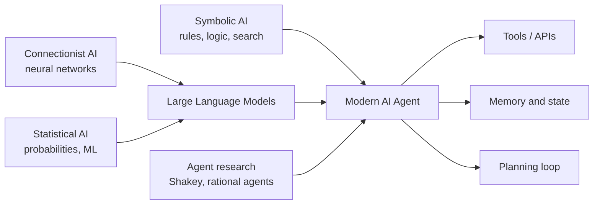
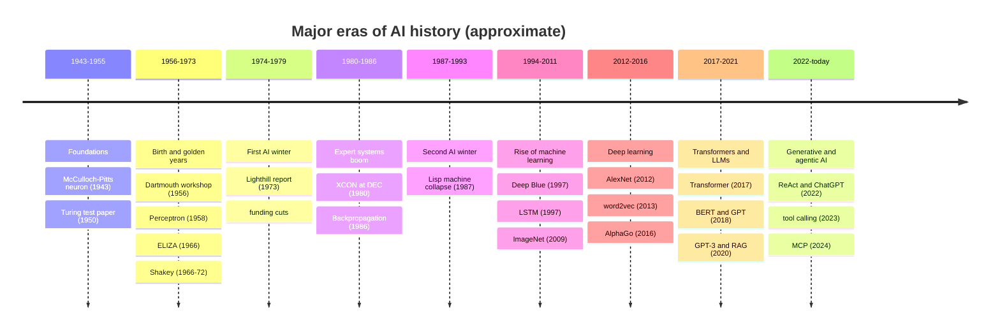
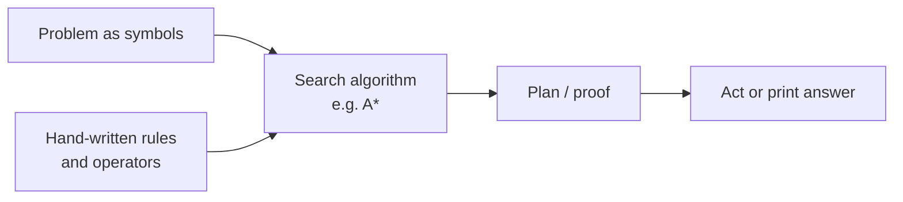
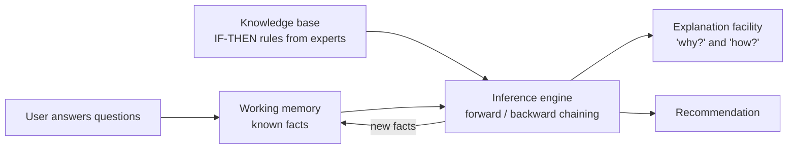
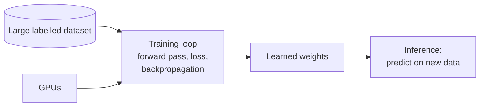
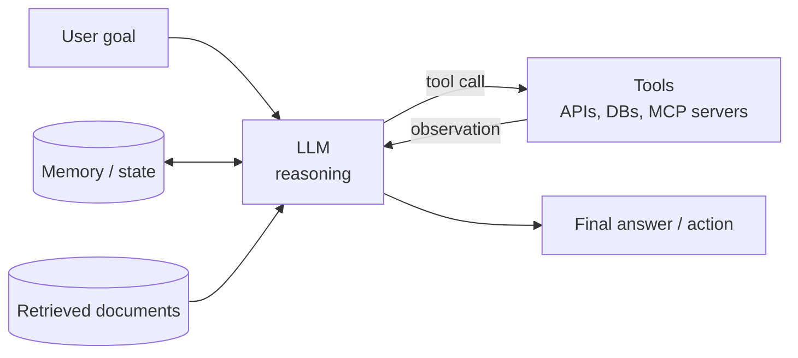
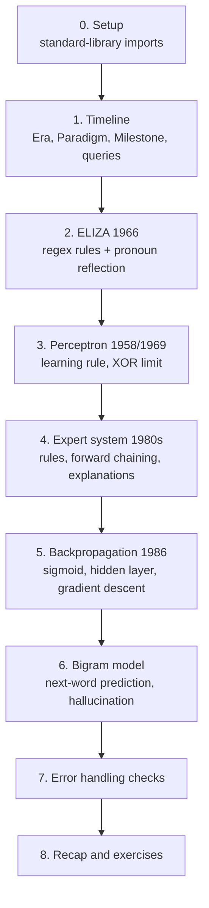
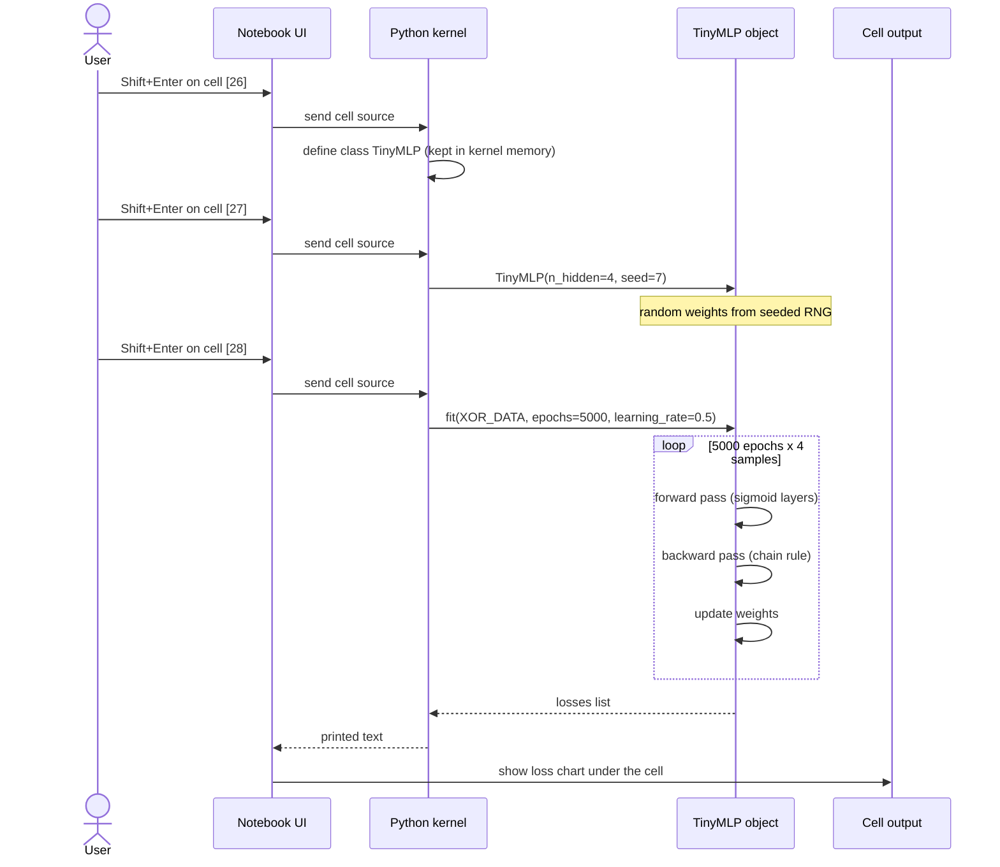

[Academy](../../index.md) › [Track 01: AI and LLM Fundamentals](../README.md) › [Module 1.1: Introduction to Artificial Intelligence](README.md)

# History of Artificial Intelligence: From Turing to AI Agents

## Description

Today's AI agents are built from ideas that are decades old. The "perceive, think, act" loop, rule-based reasoning, neural networks that learn from examples and models that predict the next word were each invented, oversold, abandoned and then revived. This lesson walks through that history era by era. You will also **rebuild five landmark systems in plain Python** so you can see why each one worked, why each one failed, and what modern AI agent engineering takes from it.

| Field | Value |
|---|---|
| **Track** | Track 01: AI and LLM Fundamentals |
| **Module** | Module 1.1: Introduction to Artificial Intelligence |
| **Difficulty** | Beginner |
| **Estimated reading time** | 60–75 minutes (plus 30 minutes for the hands-on project) |
| **Technologies** | Python standard library, Jupyter Notebook |
| **Framework versions** | Notebook code cells executed with Python 3.14.5. Python 3.10+ should work. |
| **Last verified date** | 2026-11-17 |

---

## 1. Introduction

### What is the history of AI?

The history of **artificial intelligence (AI)** is the story of people trying to make computers do things that, when humans do them, we call "intelligent": reasoning, conversing, recognising images, learning from experience, planning and acting.

It is **not** a straight line of progress. It is a cycle that has repeated several times:

1. A new idea produces an exciting demo.
2. Researchers and companies make big promises.
3. The idea hits a hard limit that nobody expected.
4. Funding and interest collapse (an **"AI winter"**).
5. A different idea, often an old one with more data and faster computers, brings AI back.

### Why does it matter for an engineer?

You might ask: "I want to build AI agents with LangChain and LangGraph. Why learn history?"

- **Every modern technique has an ancestor.** A LangGraph agent's loop of *observe → reason → call a tool → observe again* is a direct descendant of the Shakey robot from 1966–1972. Retrieval-augmented generation (RAG) is a new answer to an old problem: how do you give a system knowledge it was not built with?
- **The old failures are still possible today.** Expert systems failed because hand-written rules were brittle. If you write an agent whose behaviour depends on dozens of `if` statements in a prompt, you can rebuild that same failure.
- **Hype cycles repeat.** Knowing that AI has gone through two winters helps you separate real capability from marketing when you choose tools and promise results to a client or manager.
- **Interviews ask about it.** "What was the AI winter?", "Why couldn't the perceptron learn XOR?" and "What changed in 2012?" are common screening questions.

### Where does this knowledge show up in real work?

- Choosing between **rules, classic machine learning and LLMs** for a feature (Section 15 shows this as a decision table).
- Designing **explainable** systems for regulated industries, which echoes what expert systems did well.
- Understanding why LLMs **hallucinate**: they are next-word predictors, a line that runs straight back to statistical language models.
- Building **agents** that use tools, which is the "acting" half of AI that robotics researchers studied long before chatbots.

### How it fits into AI Agent Engineering



*How to read this diagram:* the three big schools of AI (symbolic, connectionist, statistical) plus decades of agent research all feed today's AI agent. The LLM provides language and reasoning; the agent framework adds tools, memory and a planning loop. Each of those parts has a history, and this lesson covers all of them.

---

## 2. Learning Objectives

After this lesson you will be able to:

1. **Describe the nine major eras** of AI history and name at least one landmark from each.
2. **Explain the three main paradigms** (symbolic, connectionist and statistical AI) and compare their strengths and weaknesses.
3. **Explain what caused the two AI winters** and what lessons they hold for today's projects.
4. **Run and modify an ELIZA-style chatbot** in a Jupyter notebook and explain why pattern matching is not understanding.
5. **Implement a perceptron** and show, with code, why it cannot learn XOR.
6. **Implement a forward-chaining expert system** that explains its own conclusions.
7. **Implement a small neural network trained with backpropagation** that solves XOR.
8. **Implement a bigram language model** and connect "next-word prediction" to how LLMs work.
9. **Trace the line from Shakey (1966–1972) to ReAct (2022) and tool-calling agents.**
10. **Use history to make engineering decisions**: when to use rules, classic ML or an LLM.

---

## 3. Prerequisites

| Requirement | Level needed | Why |
|---|---|---|
| Python basics | Variables, functions, loops, lists, dictionaries | All examples are in Python |
| Classes | Know what a class and method are | Each historical system is a class |
| Command line | Open a terminal, change folders, run a command | To run the project |
| Math | Multiplication and addition. The backpropagation section mentions slopes, but you can skip that maths. | Neural network examples |
| Previous lesson | [What is Artificial Intelligence?](01-what-is-artificial-intelligence.md) | Defines AI, agents and the difference between rules and learning |

**Tools:** Python 3.10 or newer, plus VS Code with the Jupyter extension or Jupyter Notebook. Basic notebook use (running a cell with `Shift + Enter`) is explained in Section 6.

**No API keys and no paid services are needed.** The notebook uses only the Python standard library and runs offline. You need a tool that can open notebooks (VS Code or Jupyter), or you can simply read it on GitHub.

**Frameworks:** none. This lesson builds history from scratch. LangChain, LangGraph and similar frameworks are introduced in later tracks.

---

## 4. Fundamental Concepts

Before the timeline, here are the ideas you will meet again and again. Each one is introduced the same way: definition, why it is needed, how it works, an analogy, a technical explanation and an example.

### 4.1 Artificial Intelligence (as a research field)

- **Definition:** the field of computer science that builds systems which perform tasks we associate with human intelligence.
- **Why it is needed:** many valuable tasks, such as translating text, diagnosing faults or answering questions, cannot be written as a simple fixed formula.
- **How it works:** either a human writes down the knowledge (rules), or the machine extracts the knowledge from data (learning), or both.
- **Analogy:** teaching someone to cook by giving them a recipe book (rules) versus letting them taste hundreds of dishes and work out what is good (learning).
- **Technical explanation:** the name was proposed by John McCarthy in the 1955 proposal for the **Dartmouth Summer Research Project on Artificial Intelligence**, held in 1956. The proposal assumed that "every aspect of learning or any other feature of intelligence can in principle be so precisely described that a machine can be made to simulate it."
- **Example:** a spam filter, a chess program and ChatGPT are all AI, built in very different ways.

### 4.2 The three paradigms

| Paradigm | Core idea | Classic example | Modern descendant |
|---|---|---|---|
| **Symbolic AI** (also called GOFAI, "Good Old-Fashioned AI") | Intelligence is manipulating symbols with explicit rules and logic | Logic Theorist, MYCIN, Deep Blue | Rule engines, knowledge graphs, guardrails, planners |
| **Connectionist AI** | Intelligence emerges from many simple connected units (neurons) that learn | Perceptron, backpropagation, AlexNet | Deep learning, Transformers, LLMs |
| **Statistical AI / Machine learning** | Learn patterns and probabilities from data | Bayesian spam filters, n-gram language models, SVMs | Classic ML in production, evaluation, ranking |

- **Why it matters:** the paradigms took turns being popular. Today's best agent systems **combine them**. An LLM (connectionist) is wrapped in code with explicit rules and tool schemas (symbolic), and is evaluated with metrics (statistical).
- **Analogy:** symbolic AI is a lawyer following statutes. Connectionist AI is an experienced chef who "just knows" by feel. Statistical AI is an actuary computing odds.

### 4.3 Agent

- **Definition:** anything that **perceives** its environment and **acts** on it to achieve a goal. This is the framing popularised by Russell and Norvig's textbook *Artificial Intelligence: A Modern Approach* (first edition, 1995).
- **Why it is needed:** answering a question is only half of intelligence. Booking a flight, fixing a bug or moving a box requires *doing*.
- **How it works:** a loop. Sense → decide → act → sense the result → decide again.
- **Analogy:** a thermostat is a very simple agent. It perceives the temperature and acts by switching the heater.
- **Technical explanation:** Shakey (SRI, 1966–1972) combined a camera, a planner (STRIPS) and a path-finding algorithm (A*) in exactly this loop. A modern LLM agent replaces the hand-built planner with a language model and replaces motors with API calls.
- **Example:** an AI coding assistant reads your files (perceive), decides on an edit (reason), runs tests (act) and reads the result (perceive again).

### 4.4 Knowledge representation and inference

- **Definition:** *knowledge representation* is how facts and rules are stored. *Inference* is how new facts are derived from them.
- **Why it is needed:** a system must store what it knows in a form it can reason with.
- **How it works:** in an expert system, knowledge is a list of `IF conditions THEN conclusion` rules. An **inference engine** repeatedly fires rules whose conditions are true. This is called **forward chaining**.
- **Analogy:** a detective writes clues on a board and keeps connecting them until a conclusion appears.
- **Example:** `IF no_power_light AND cable_connected THEN power_supply_suspect`. You will build exactly this in Step 4.

### 4.5 Learning, weights and training

- **Definition:** *learning* means improving performance from experience (data) instead of being explicitly programmed. Arthur Samuel's 1959 checkers paper is the commonly cited origin of the term "machine learning".
- **How it works:** a model has adjustable numbers called **weights** (or **parameters**). **Training** adjusts them to reduce errors on example data.
- **Analogy:** tuning a guitar. Play a note, hear it is flat, tighten the peg a bit, repeat.
- **Technical explanation:** a perceptron changes each weight by `learning_rate × error × input`. A modern LLM has billions of weights adjusted with the same basic idea, gradient descent, at enormous scale.

### 4.6 Linear separability and the XOR problem

- **Definition:** a dataset is **linearly separable** if one straight line (or flat plane, in more dimensions) can separate its classes.
- **Why it matters historically:** in 1969 Minsky and Papert's book *Perceptrons* showed rigorously that a single-layer perceptron cannot compute XOR, because XOR is not linearly separable. This helped cool interest in neural networks for over a decade.
- **Analogy:** put red and blue counters on a table: red at the bottom-left and top-right, blue at the other two corners. No single ruler placed on the table puts all red on one side and all blue on the other.

```
 x2
 1 | blue(0,1)=1   red(1,1)=0
 0 | red(0,0)=0    blue(1,0)=1
   +---------------------------- x1
       0             1
```

- **Fix:** add a **hidden layer** and train it with **backpropagation**. That makes the boundary bendable. You will see both outcomes in the project.

### 4.7 Backpropagation and gradient descent

- **Definition:** **gradient descent** improves a model by moving each weight a little in the direction that reduces the error. **Backpropagation** is the efficient way to compute that direction for every weight in a multi-layer network, using the chain rule from calculus.
- **Why it is needed:** with hidden layers we know the error at the output, but not how much each hidden weight caused it. Backprop distributes the blame backwards.
- **Analogy:** a restaurant gets a bad review. The manager asks the waiter, who asks the chef, who asks the supplier. Each person learns their share of the blame and adjusts.
- **History:** related ideas appeared earlier, but the 1986 *Nature* paper by Rumelhart, Hinton and Williams made backprop widely known and used.

### 4.8 Language model and next-token prediction

- **Definition:** a **language model** assigns probabilities to sequences of words. In practice: given the text so far, how likely is each possible next word (or **token**, a piece of a word)?
- **How it works (simple version):** count. If "agent" is followed by "reads" 2 times out of 5, then P(reads | agent) = 0.4. This is a **bigram** model.
- **How it works (modern version):** a **Transformer** neural network (2017) looks at the *whole* context, not just one previous word, and has billions of weights instead of a count table.
- **Analogy:** your phone keyboard's suggested next word.
- **Why it matters for agents:** an LLM agent "decides" to call a tool by generating the text of a tool call one token at a time. Understanding this explains both its power and its tendency to produce confident nonsense (**hallucination**).

### 4.9 AI winter

- **Definition:** a period when funding and interest in AI dropped sharply after expectations were not met.
- **First winter (about 1974–1980):** after early promises failed, critical reviews such as the 1966 ALPAC report on machine translation (US) and the 1973 Lighthill report (UK) led to funding cuts.
- **Second winter (about 1987–1993):** the market for specialised Lisp machines collapsed and expensive, brittle expert systems disappointed.
- **Lesson:** capability that impresses in a demo is not the same as capability that holds up in production. Evaluate your agents on real data before promising results.

> **Note on dates:** historians draw era boundaries differently. The year ranges in this lesson are approximate teaching aids, not official definitions.

---

## 5. Internal Architecture: How AI Systems Were Built in Each Era

For a history lesson, "internal architecture" means two things: (1) how a typical AI system of each era was put together, and (2) how the companion project in this lesson is organised.

### 5.1 The timeline



*Explanation:* each column is an era, and the items listed are its landmark events. Notice the gaps. The 1970s and late 1980s have few milestones because those were the winters.

### 5.2 Era by era

#### Era 1: Foundations (1943–1955)

- **1943: McCulloch and Pitts** publish a mathematical model of a neuron as a simple logic unit. This is the seed of every neural network.
- **1950: Alan Turing** publishes *Computing Machinery and Intelligence* in the journal *Mind*. He asks "Can machines think?" and replaces that hard-to-define question with a test, the **imitation game** (now called the Turing test): can a machine converse so that a judge cannot tell it from a human?
- **Architecture of the time:** room-sized computers with tiny memory. AI was mostly theory and paper.

#### Era 2: Birth and golden years (1956–1973)

- **1956: Dartmouth workshop.** McCarthy, Minsky, Shannon and Rochester gather researchers for a summer. The field gets its name.
- **1956: Logic Theorist** (Newell, Simon and Shaw) proves mathematical theorems by searching through logical steps.
- **1958: Perceptron.** Frank Rosenblatt's learning neuron model.
- **1958: LISP.** McCarthy's language becomes the main language of AI research for decades.
- **1966: ELIZA.** Joseph Weizenbaum's pattern-matching chatbot. Users became emotionally attached to it, which alarmed Weizenbaum. This is now called the **ELIZA effect**: people tend to attribute understanding to systems that only appear to understand.
- **1966–1972: Shakey** at SRI. The first mobile robot to perceive and reason about its surroundings. It led to the **A\*** search algorithm (1968) and the **STRIPS** planner (1971), both still taught today.
- **Typical architecture:** **symbolic search**. Represent the problem as states and rules, then search for a path to the goal.



#### Era 3: First AI winter (1974–1979)

- Early researchers predicted human-level AI within a generation. Problems turned out to be much harder: **combinatorial explosion** (the number of possibilities grows too fast to search), very little computing power, and no way to represent common-sense knowledge.
- The **1969 *Perceptrons*** book had already dampened neural-network research. The **1973 Lighthill report** in the UK and funding changes in the US cut support.
- **Engineering lesson:** a demo on a toy problem ("blocks world") does not prove the method scales.

#### Era 4: Expert systems boom (1980–1986)

- **Idea:** instead of general intelligence, capture **one expert's narrow knowledge** in rules.
- **MYCIN** (Stanford, 1970s) recommended treatments for blood infections and could explain its reasoning. **XCON / R1** at Digital Equipment Corporation configured computer orders in production and was widely reported to save the company millions per year.
- **1982:** Japan launched its ambitious **Fifth Generation Computer Systems** project, triggering investment races in other countries.
- **1986: backpropagation** was popularised, quietly restarting neural network research.



*Explanation:* the knowledge base holds rules written by human experts. The working memory holds the facts for the current case. The inference engine matches rules against facts and adds conclusions. The explanation facility can replay which rules fired. You will build every box in this diagram in Step 4.

#### Era 5: Second AI winter (1987–1993)

- Expert systems were **expensive to build and maintain**. Every new situation needed new rules, and rules started contradicting each other. This is the **knowledge acquisition bottleneck**.
- They were **brittle**: give them a case slightly outside their rules and they fail completely instead of degrading gracefully.
- Cheap desktop workstations made specialised **Lisp machines** obsolete around 1987, and that market collapsed.
- **Engineering lesson:** systems that cannot learn are costly to keep up to date. This is still true of long, rule-heavy system prompts.

#### Era 6: Rise of machine learning (1994–2011)

- AI researchers adopted **probability and statistics**: Bayesian networks, support vector machines, hidden Markov models for speech, and n-gram language models for translation.
- **1989:** Yann LeCun and colleagues used convolutional neural networks to read handwritten zip codes.
- **1995:** Russell and Norvig's textbook frames the whole field around **intelligent agents**.
- **1997: Deep Blue** (IBM) defeats world chess champion Garry Kasparov using massive search plus a hand-tuned evaluation function. That is symbolic AI at its peak.
- **1997: LSTM** networks (Hochreiter and Schmidhuber) can remember information across long sequences.
- **2006:** Hinton and colleagues show deep networks can be trained layer by layer, and the term **"deep learning"** spreads.
- **2009: ImageNet**, a dataset of millions of labelled images, is published.
- **2011: IBM Watson** wins the quiz show *Jeopardy!*, and Apple ships **Siri**.
- **Why it worked:** the web produced huge amounts of data, and computers became much faster.

#### Era 7: Deep learning revolution (2012–2016)

- **2012: AlexNet** (Krizhevsky, Sutskever and Hinton) wins the ImageNet image-recognition challenge by a large margin, using a deep convolutional network trained on **GPUs** (graphics processors).
- **2013: word2vec** represents words as vectors (**embeddings**), so similar words end up close together. Embeddings are the foundation of today's vector databases and RAG.
- **2014: GANs** (generative adversarial networks) generate realistic images. Sequence-to-sequence models and the **attention** mechanism improve machine translation.
- **2016: AlphaGo** (DeepMind) beats Go champion Lee Sedol by combining deep learning, reinforcement learning and tree search.
- **Recipe that won:** *big data + GPUs + deep networks + backpropagation*.



#### Era 8: Transformers and LLMs (2017–2021)

- **2017: "Attention Is All You Need"** (Vaswani et al.) introduces the **Transformer**. It processes all words in parallel and uses **self-attention** to let every word look at every other word. This made training on internet-scale text practical.
- **2018: BERT** (Google) and **GPT-1** (OpenAI) establish **pre-training**: train one large model on huge amounts of text, then adapt it to many tasks.
- **2020: GPT-3** (175 billion parameters) shows **few-shot learning**: give a few examples in the prompt and it performs a new task without retraining.
- **2020: Retrieval-augmented generation (RAG)** combines a language model with a document search step.
- **2020: AlphaFold 2** predicts protein structures with very high accuracy.

#### Era 9: Generative and agentic AI (2022–today)

- **2022:** **Chain-of-thought prompting** shows that asking for step-by-step reasoning improves results. **InstructGPT** uses reinforcement learning from human feedback (**RLHF**) to make models follow instructions. **ReAct** interleaves reasoning with actions (tool calls). **ChatGPT** (November 2022) brings conversational LLMs to the general public.
- **2023:** LLM APIs add **function calling / tool use**, so models can return structured requests for a program to run. Agent frameworks such as **LangChain** grow quickly.
- **2024:** Anthropic releases the **Model Context Protocol (MCP)**, an open standard for connecting AI applications to tools and data sources. The **Nobel Prize in Physics** goes to John Hopfield and Geoffrey Hinton for foundational work on neural networks, and the **Nobel Prize in Chemistry** is shared by Demis Hassabis and John Jumper (for AlphaFold) together with David Baker.
- **Since then:** reasoning-focused models, agents that operate software and computers, and agentic coding tools have moved from research into everyday developer workflows. Specific products change monthly, so check current vendor documentation instead of relying on any list.



*Explanation:* this is the modern agent loop. Compare it with Shakey: perception is now tool results and retrieved documents, the planner is now an LLM, and actions are API calls. The loop itself is more than 50 years old.

### 5.3 Architecture of the companion notebook

The hands-on part of this lesson is a single **Jupyter notebook**, [`history_of_ai.ipynb`](../../../examples/01-AI-FUNDAMENTALS/02-history-of-artificial-intelligence/history_of_ai.ipynb). It is set up like a **museum tour**: one section per historical system. In each section a Markdown cell explains the idea, a code cell defines it, and the next cells run it and show the result.



| Notebook section | Responsibility | Paradigm |
|---|---|---|
| 1. Timeline | Stores milestones and answers queries (by era, keyword, paradigm) | Data |
| 2. ELIZA | Responds to text with regex rules and pronoun reflection | Symbolic |
| 3. Perceptron | A single neuron with the perceptron learning rule | Connectionist |
| 4. Expert system | Rules plus an inference engine plus explanations | Symbolic |
| 5. Backpropagation | A two-layer network trained by gradient descent | Connectionist |
| 6. Bigram model | Counts word pairs and predicts or generates the next word | Statistical |
| 7. Error checks | Triggers every validation error on purpose so you can read it | Quality |

**How the notebook runs (state management):** a notebook has one **kernel**, a running Python process that remembers every variable, function and class defined so far. When you run the cell that defines `class Perceptron`, the class stays in the kernel's memory, and later cells can use it. That is why the notebook must be run **from top to bottom**. It also explains the most common beginner error, `NameError` (see Section 14).

**Data flow:** all data is written in the cells (no files, no network). All randomness is **seeded**, so every run prints exactly the same output as shown in this article.

---

## 6. Installation and Environment Setup

### 6.1 Required software

| Software | Version | Notes |
|---|---|---|
| Python | 3.10 or newer (the code cells were run on **3.14.5**) | Download from [python.org](https://www.python.org/downloads/) |
| A notebook tool | Jupyter Notebook / JupyterLab, or VS Code with the Jupyter extension | Any of these can open `.ipynb` files |
| Git | Any recent version | To clone the repository |

The notebook code uses **only the Python standard library**. No API keys, no environment variables, no internet access, and no extra packages are needed to *run the code*. You only need a tool that can *open* a notebook.

> **Just want to read it?** GitHub displays `.ipynb` files with their saved outputs. Open the notebook in your browser, and you can follow the whole lesson without installing anything.

### 6.2 Get the code

```bash
git clone <YOUR-REPOSITORY-URL>
cd AI_AGENT_ENGINEERING/examples/01-AI-FUNDAMENTALS/02-history-of-artificial-intelligence
```

### 6.3 Option A: VS Code (simplest if you already use it)

1. Install the **Python** and **Jupyter** extensions from the VS Code Extensions view.
2. Open `history_of_ai.ipynb`.
3. Click **Select Kernel** (top right) and choose your Python 3.10+ interpreter. If VS Code asks to install `ipykernel`, accept.
4. Click **Run All**, or press `Shift + Enter` to run one cell at a time.

### 6.4 Option B: Jupyter Notebook in a virtual environment

A **virtual environment** is a private folder of Python packages for one project, so projects do not interfere with each other.

```bash
python -m venv .venv
```

Activate it.

macOS / Linux:

```bash
source .venv/bin/activate
```

Windows PowerShell:

```powershell
.venv\Scripts\Activate.ps1
```

Windows Git Bash:

```bash
source .venv/Scripts/activate
```

Install Jupyter Notebook. `requirements.txt` contains a single line, `notebook`:

```bash
python -m pip install -r requirements.txt
```

Start it. Your browser opens the notebook:

```bash
python -m jupyter notebook history_of_ai.ipynb
```

> **Version note:** the notebook's code cells were executed with Python 3.14.5 on 2026-11-17. The Jupyter installation steps follow the standard Jupyter instructions but were not run on the authoring machine, so the Jupyter version is not pinned. If installation fails, see Section 14.

### 6.5 Check the setup

Run the first code cell. It should print your Python version:

```text
Python version: 3.14.5
```

---

## 7. Project Folder Structure

```text
02-history-of-artificial-intelligence/
├── history_of_ai.ipynb       # The whole lesson project: explanations, code and saved outputs
└── requirements.txt          # Only needed to install Jupyter (Option B)
```

**Why a single notebook?**

- **Explanation sits next to the code.** Every code cell has a Markdown cell above it that says what it does and why, which suits a beginner history lesson.
- **Experimenting is easy.** The **🧪 Try it yourself** cells invite you to change a value and re-run, for example to train the perceptron for 500 epochs or try 20 random seeds.
- **Outputs are saved.** Readers can see the results on GitHub without running anything.

**Trade-off:** a notebook is ideal for learning, but not for production code. Real projects put reusable logic in `.py` modules with automated tests (`pytest`) and keep notebooks for exploration. You will use that structure in later tracks. Section 13 explains the difference.

---

## 8. Step-by-Step Implementation

> **Demonstration code, not production code.** These are teaching re-creations written for clarity. They are deliberately small, use only the standard library, and avoid optimisation.

The code below is copied exactly from the notebook's code cells, and the outputs are the outputs saved in the notebook. Cell numbers such as **[12]** match the execution numbers in the notebook.

### Step 0: Imports (cell [1])

```python
from __future__ import annotations

import math
import random
import re
import sys
from collections import Counter, defaultdict
from dataclasses import dataclass, field
from enum import Enum

print("Python version:", sys.version.split()[0])
```

- `from __future__ import annotations` lets us use modern type hints such as `list[str] | None` in every cell.
- Everything else comes from the standard library: `dataclasses` and `enum` for data structures, `re` for text patterns, `math` and `random` for the neural network, and `collections` for counting.

### Step 1: The timeline (cells [2]–[9])

**What we are building:** a small, queryable database of milestones.

**Why:** history is easier to explore when you can ask questions such as "what happened in the 1980s?". It also shows good Python habits: immutable data, enums and input validation.

**Eras and paradigms**, cells [2] and [3]:

```python
class Era(Enum):
    # Broad periods of AI history: (label, start year, end year)
    FOUNDATIONS = ("Foundations", 1943, 1955)
    BIRTH_AND_GOLDEN_YEARS = ("Birth and golden years", 1956, 1973)
    FIRST_WINTER = ("First AI winter", 1974, 1979)
    EXPERT_SYSTEMS_BOOM = ("Expert systems boom", 1980, 1986)
    SECOND_WINTER = ("Second AI winter", 1987, 1993)
    MACHINE_LEARNING_RISE = ("Rise of machine learning", 1994, 2011)
    DEEP_LEARNING = ("Deep learning revolution", 2012, 2016)
    TRANSFORMERS = ("Transformers and LLMs", 2017, 2021)
    GENERATIVE_AND_AGENTIC = ("Generative and agentic AI", 2022, 9999)

    def __init__(self, label: str, start: int, end: int) -> None:
        # Python passes the tuple's three values in here, so each member gets attributes.
        self.label = label
        self.start = start
        self.end = end

    def contains(self, year: int) -> bool:
        return self.start <= year <= self.end


print(Era.DEEP_LEARNING.label, "starts in", Era.DEEP_LEARNING.start)
print("Is 1975 in the first winter?", Era.FIRST_WINTER.contains(1975))
```

```python
class Paradigm(str, Enum):
    SYMBOLIC = "symbolic"            # hand-written rules and logic
    CONNECTIONIST = "connectionist"  # neural networks
    STATISTICAL = "statistical"      # probability and classic ML
    AGENTIC = "agentic"              # perceive-reason-act systems
    INSTITUTIONAL = "institutional"  # funding, reports, events


print(Paradigm.CONNECTIONIST.value)
```

**The milestone record**, cell [4]:

```python
def era_for_year(year: int) -> Era:
    # Return the era containing `year`, or raise a clear error.
    for era in Era:
        if era.contains(year):
            return era
    raise ValueError(f"No era defined for year {year}; the timeline starts in 1943.")


@dataclass(frozen=True)
class Milestone:
    year: int
    title: str
    people: str
    paradigm: Paradigm
    why_it_matters: str

    @property
    def era(self) -> Era:
        return era_for_year(self.year)


example = Milestone(1950, "Turing's paper", "Alan Turing", Paradigm.SYMBOLIC, "Asked 'Can machines think?'")
print(example)
print("Era:", example.era.label)
```

| Code | What it does |
|---|---|
| `class Era(Enum)` with tuple values | Each era member stores a label, start year and end year. `__init__` unpacks the tuple into attributes, so `Era.DEEP_LEARNING.start == 2012`. |
| `9999` as the last end year | Means "still ongoing". It is printed as "today". |
| `class Paradigm(str, Enum)` | Inheriting from `str` makes each member behave like a string. |
| `@dataclass(frozen=True)` | Auto-generates `__init__` and `__repr__`. `frozen=True` makes milestones **immutable**. |
| `@property def era` | The era is **computed** from the year, so it can never disagree with it. |
| `era_for_year` | Returns the matching era, or raises `ValueError` for years before 1943 instead of silently returning `None`. |

Cell [5] defines the 35 milestones as a **tuple** (read-only). See the notebook for the full list. Cell [6] defines the query functions:

```python
def milestones_in_era(era: Era) -> list[Milestone]:
    return sorted((m for m in MILESTONES if m.era is era), key=lambda m: m.year)


def search(keyword: str) -> list[Milestone]:
    needle = keyword.strip().lower()
    if not needle:
        raise ValueError("keyword must not be empty")
    return [m for m in MILESTONES
            if needle in m.title.lower() or needle in m.people.lower() or needle in m.why_it_matters.lower()]


def count_by_paradigm() -> dict[Paradigm, int]:
    counts: dict[Paradigm, int] = defaultdict(int)  # missing keys start at 0
    for m in MILESTONES:
        counts[m.paradigm] += 1
    return dict(counts)
```

`search` lower-cases both sides for a case-insensitive match and rejects empty keywords. `count_by_paradigm` uses `defaultdict(int)`, so missing keys start at 0.

**Run it**, cell [7]:

```python
print("Milestones per era")
print("-" * 52)
for era in Era:
    end = "today" if era.end == 9999 else str(era.end)
    count = len(milestones_in_era(era))
    print(f"{era.start}-{end:<6} {era.label:<27} {'#' * count} {count}")
```

```text
Milestones per era
----------------------------------------------------
1943-1955   Foundations                 ## 2
1956-1973   Birth and golden years      ######### 9
1974-1979   First AI winter             # 1
1980-1986   Expert systems boom         ## 2
1987-1993   Second AI winter            ## 2
1994-2011   Rise of machine learning    ###### 6
2012-2016   Deep learning revolution    #### 4
2017-2021   Transformers and LLMs       #### 4
2022-today  Generative and agentic AI   ##### 5
```

The `#` bars form a mini bar chart. The two **winters** are nearly empty.

### Step 2: ELIZA, 1966 (cells [10]–[13])

**What we are building:** a chatbot in the style of ELIZA's famous "therapist" script.

**Why:** ELIZA is the ancestor of every chatbot, and it teaches a key lesson. **Fluent output is not understanding.**

```python
REFLECTIONS: dict[str, str] = {
    "i": "you", "me": "you", "my": "your", "am": "are", "i'm": "you are",
    "you": "I", "your": "my", "yours": "mine", "myself": "yourself",
}


def reflect(fragment: str) -> str:
    # Swap first and second person, word by word.
    return " ".join(REFLECTIONS.get(word, word) for word in fragment.lower().split())


print(reflect("I am worried about my exams"))
```

```python
@dataclass
class PatternRule:
    pattern: re.Pattern[str]
    responses: tuple[str, ...]
    _next: int = field(default=0, repr=False)

    def next_response(self) -> str:
        response = self.responses[self._next % len(self.responses)]
        self._next += 1
        return response


def _rule(regex: str, *responses: str) -> PatternRule:
    return PatternRule(re.compile(regex, re.IGNORECASE), responses)


def default_rules() -> list[PatternRule]:
    # Checked top to bottom. The last one matches anything.
    return [
        _rule(r"\bi need (.+)", "Why do you need {0}?", "Would getting {0} really help you?"),
        _rule(r"\bi am (.+)", "How long have you been {0}?", "Why do you say you are {0}?"),
        _rule(r"\bi feel (.+)", "Tell me more about feeling {0}.", "Do you often feel {0}?"),
        _rule(r"\bbecause (.+)", "Is that the real reason?", "What else could explain {0}?"),
        _rule(r"\b(?:mother|father|family)\b", "Tell me more about your family."),
        _rule(r"\bcomputer|machine|ai\b", "Do machines worry you?", "What do you think about machines?"),
        _rule(r"(.*)", "Please tell me more.", "I see. Go on.", "How does that make you feel?"),
    ]
```

```python
class Eliza:
    def __init__(self, rules: list[PatternRule] | None = None) -> None:
        self.rules = rules if rules is not None else default_rules()

    def respond(self, text: str) -> str:
        cleaned = text.strip().rstrip(".!?")
        if not cleaned:
            raise ValueError("text must not be empty")
        for rule in self.rules:
            match = rule.pattern.search(cleaned)
            if match:
                captured = [reflect(group) for group in match.groups()]
                return rule.next_response().format(*captured)
        return "Please go on."


bot = Eliza()
for line in ("I am worried about my exams", "I need a holiday", "Do you understand me?"):
    print(f"User : {line}")
    print(f"ELIZA: {bot.respond(line)}\n")
```

```text
User : I am worried about my exams
ELIZA: How long have you been worried about your exams?

User : I need a holiday
ELIZA: Why do you need a holiday?

User : Do you understand me?
ELIZA: Please tell me more.
```

**Key statements explained:**

- `REFLECTIONS` swaps first and second person, which is how "my exams" becomes "**your** exams".
- `PatternRule` pairs a compiled **regular expression** with reply templates. `{0}` is filled with the text captured by `(.+)`.
- `next_response()` **rotates** through replies instead of choosing randomly, so output is deterministic and testable.
- `default_rules()` returns **new** rule objects each time, because each rule keeps its own counter.
- Rules are tried **in order**, and the last rule `(.*)` matches anything. That catch-all is why "Do you understand me?" gets the vague "Please tell me more."
- `respond()` raises `ValueError` on empty input.

### Step 3: The perceptron, 1958, and its 1969 limit (cells [14]–[18])

**What we are building:** a single artificial neuron that learns AND and OR, but not XOR.

**Why:** it is the clearest demonstration in AI history of a model's **capacity** limit, and it explains the move to multi-layer networks.

```python
Sample = tuple[tuple[float, float], int]

AND_DATA: list[Sample] = [((0, 0), 0), ((0, 1), 0), ((1, 0), 0), ((1, 1), 1)]
OR_DATA: list[Sample] = [((0, 0), 0), ((0, 1), 1), ((1, 0), 1), ((1, 1), 1)]
XOR_DATA: list[Sample] = [((0, 0), 0), ((0, 1), 1), ((1, 0), 1), ((1, 1), 0)]
```

```python
class Perceptron:
    def __init__(self, n_inputs: int = 2, learning_rate: float = 0.1) -> None:
        if n_inputs < 1:
            raise ValueError("n_inputs must be at least 1")
        if learning_rate <= 0:
            raise ValueError("learning_rate must be positive")
        self.weights: list[float] = [0.0] * n_inputs
        self.bias: float = 0.0
        self.learning_rate = learning_rate

    def predict(self, inputs: tuple[float, ...]) -> int:
        if len(inputs) != len(self.weights):
            raise ValueError(f"expected {len(self.weights)} inputs, got {len(inputs)}")
        total = sum(w * x for w, x in zip(self.weights, inputs)) + self.bias
        return 1 if total > 0 else 0

    def fit(self, data: list[Sample], epochs: int = 20) -> list[int]:
        mistakes_per_epoch: list[int] = []
        for _ in range(epochs):
            mistakes = 0
            for inputs, target in data:
                error = target - self.predict(inputs)   # -1, 0 or +1
                if error != 0:
                    mistakes += 1
                    for i, x in enumerate(inputs):
                        self.weights[i] += self.learning_rate * error * x
                    self.bias += self.learning_rate * error
            mistakes_per_epoch.append(mistakes)
            if mistakes == 0:
                break
        return mistakes_per_epoch

    def accuracy(self, data: list[Sample]) -> float:
        return sum(1 for inputs, target in data if self.predict(inputs) == target) / len(data)
```

**Key statements explained:**

- **`predict`:** `total = w1*x1 + w2*x2 + bias`, then a **step function**. Geometrically, `w1*x1 + w2*x2 + bias = 0` is a straight line.
- **`fit`** (the perceptron learning rule): `error = target - prediction` is `+1`, `-1` or `0`, and each weight moves by `learning_rate * error * input`. Training stops early after an **epoch** (one full pass through the data) with zero mistakes.
- **Return value:** mistakes per epoch. Its length is the number of epochs used, and its last value shows whether training succeeded.
- **Validation:** bad constructor arguments and wrong input lengths raise `ValueError`.

**Watch it learn AND**, cell [16]:

```python
p = Perceptron()
history = p.fit(AND_DATA, epochs=20)
print("Mistakes per epoch:", history)
print("Learned weights:", [round(w, 2) for w in p.weights], " bias:", round(p.bias, 2))
for inputs, target in AND_DATA:
    print(f"  {inputs} -> predicted {p.predict(inputs)}  (target {target})")
```

```text
Mistakes per epoch: [1, 3, 3, 2, 1, 0]
Learned weights: [0.2, 0.1]  bias: -0.2
  (0, 0) -> predicted 0  (target 0)
  (0, 1) -> predicted 0  (target 0)
  (1, 0) -> predicted 0  (target 0)
  (1, 1) -> predicted 1  (target 1)
```

The learned weights `[0.2, 0.1]` and bias `-0.2` describe a line with `(1, 1)` on one side and the other three points on the other.

**AND vs OR vs XOR**, cell [17]:

```python
for name, data in (("AND", AND_DATA), ("OR", OR_DATA), ("XOR", XOR_DATA)):
    p = Perceptron()
    history = p.fit(data, epochs=20)
    print(f"{name:<3} accuracy {p.accuracy(data):>4.0%} after {len(history):>2} epochs "
          f"(mistakes in last epoch: {history[-1]})")
```

```text
AND accuracy 100% after  6 epochs (mistakes in last epoch: 0)
OR  accuracy 100% after  4 epochs (mistakes in last epoch: 0)
XOR accuracy  50% after 20 epochs (mistakes in last epoch: 4)
```

Even after 500 epochs (cell [18]), XOR stays at 50%. One straight line cannot separate XOR's diagonal pattern (see Section 4.6).

### Step 4: An expert system, 1980s (cells [19]–[24])

**What we are building:** a help-desk diagnosis system with a **knowledge base**, an **inference engine** and an **explanation facility**, the three parts in the Section 5.2 diagram.

**Why:** it shows both the strength (explainability) and the weakness (brittleness) of hand-written rules.

```python
@dataclass(frozen=True)
class Rule:
    name: str
    conditions: frozenset[str]
    conclusion: str


def rule(name: str, conditions: set[str], conclusion: str) -> Rule:
    return Rule(name, frozenset(conditions), conclusion)


HELPDESK_RULES: tuple[Rule, ...] = (
    rule("R1", {"no_power_light", "cable_connected"}, "power_supply_suspect"),
    rule("R2", {"power_supply_suspect", "under_warranty"}, "action:request_replacement"),
    rule("R3", {"power_supply_suspect", "out_of_warranty"}, "action:quote_repair"),
    rule("R4", {"wifi_icon_crossed", "other_devices_online"}, "laptop_network_fault"),
    rule("R5", {"laptop_network_fault"}, "action:restart_network_adapter"),
    rule("R6", {"slow_boot", "disk_over_90_percent"}, "storage_pressure"),
    rule("R7", {"storage_pressure"}, "action:clean_up_disk"),
)

for r in HELPDESK_RULES:
    print(f"{r.name}: IF {' AND '.join(sorted(r.conditions))} THEN {r.conclusion}")
```

```text
R1: IF cable_connected AND no_power_light THEN power_supply_suspect
R2: IF power_supply_suspect AND under_warranty THEN action:request_replacement
R3: IF out_of_warranty AND power_supply_suspect THEN action:quote_repair
R4: IF other_devices_online AND wifi_icon_crossed THEN laptop_network_fault
R5: IF laptop_network_fault THEN action:restart_network_adapter
R6: IF disk_over_90_percent AND slow_boot THEN storage_pressure
R7: IF storage_pressure THEN action:clean_up_disk
```

```python
@dataclass
class InferenceResult:
    facts: set[str]
    trace: list[str] = field(default_factory=list)
    explanations: dict[str, Rule] = field(default_factory=dict)

    def explain(self, fact: str, depth: int = 0) -> list[str]:
        indent = "  " * depth
        rule_used = self.explanations.get(fact)
        if rule_used is None:
            return [f"{indent}{fact} (given by the user)"]
        lines = [f"{indent}{fact} because rule {rule_used.name} needs {sorted(rule_used.conditions)}"]
        for condition in sorted(rule_used.conditions):
            lines.extend(self.explain(condition, depth + 1))
        return lines
```

```python
class ExpertSystem:
    def __init__(self, rules: tuple[Rule, ...] = HELPDESK_RULES) -> None:
        self.rules = rules

    def infer(self, initial_facts: set[str]) -> InferenceResult:
        if not initial_facts:
            raise ValueError("at least one fact is required")
        result = InferenceResult(facts=set(initial_facts))
        changed = True
        while changed:
            changed = False
            for r in self.rules:
                if r.conclusion not in result.facts and r.conditions <= result.facts:
                    result.facts.add(r.conclusion)
                    result.trace.append(r.name)
                    result.explanations[r.conclusion] = r
                    changed = True
        return result

    @staticmethod
    def actions(result: InferenceResult) -> list[str]:
        return sorted(f.removeprefix("action:") for f in result.facts if f.startswith("action:"))
```

**Key statements explained:**

- `Rule.conditions` is a `frozenset`, so `r.conditions <= result.facts` is a fast **subset test**: "are all conditions known?"
- **Chaining:** R1 concludes `power_supply_suspect`, which is a condition of R2 and R3.
- **`infer` (forward chaining):** fire every rule whose conditions are all known and whose conclusion is new, and repeat until a full pass adds nothing (a **fixed point**).
- `trace` records the firing order, and `explanations` maps each derived fact to its rule.
- **`explain`** is recursive. It walks back from a conclusion to the facts the user supplied. This is the "why?" feature that made MYCIN trusted by doctors.

**Run a diagnosis**, cell [22]:

```python
system = ExpertSystem()
facts = {"no_power_light", "cable_connected", "under_warranty"}
result = system.infer(facts)

print("Facts given :", sorted(facts))
print("Rules fired :", result.trace)
print("Recommended :", ExpertSystem.actions(result))
print("\nWhy?")
for line in result.explain("action:request_replacement"):
    print(" ", line)
```

```text
Facts given : ['cable_connected', 'no_power_light', 'under_warranty']
Rules fired : ['R1', 'R2']
Recommended : ['request_replacement']

Why?
  action:request_replacement because rule R2 needs ['power_supply_suspect', 'under_warranty']
    power_supply_suspect because rule R1 needs ['cable_connected', 'no_power_light']
      cable_connected (given by the user)
      no_power_light (given by the user)
    under_warranty (given by the user)
```

**Brittleness**, cell [23]:

```python
unknown = system.infer({"screen_flickers"})
print("Recommended:", ExpertSystem.actions(unknown) or "nothing: no rule applies")
```

```text
Recommended: nothing: no rule applies
```

No rule matches, so the system has no answer at all.

### Step 5: Backpropagation, 1986 (cells [25]–[30])

**What we are building:** a network with 2 inputs, 4 hidden neurons and 1 output, trained with backpropagation in pure Python.

**Why:** it fixes the perceptron's XOR failure, and the same training principle trains every modern deep network, including LLMs.

```python
def sigmoid(z: float) -> float:
    return 1.0 / (1.0 + math.exp(-z))


for z in (-6, -2, 0, 2, 6):
    print(f"sigmoid({z:>2}) = {sigmoid(z):.3f}")
```

```text
sigmoid(-6) = 0.002
sigmoid(-2) = 0.119
sigmoid( 0) = 0.500
sigmoid( 2) = 0.881
sigmoid( 6) = 0.998
```

```python
class TinyMLP:
    def __init__(self, n_hidden: int = 4, seed: int = 7) -> None:
        if n_hidden < 2:
            raise ValueError("XOR needs at least 2 hidden neurons")
        rng = random.Random(seed)
        self.w_hidden = [[rng.uniform(-1, 1) for _ in range(2)] for _ in range(n_hidden)]
        self.b_hidden = [rng.uniform(-1, 1) for _ in range(n_hidden)]
        self.w_out = [rng.uniform(-1, 1) for _ in range(n_hidden)]
        self.b_out = rng.uniform(-1, 1)

    def _forward(self, x: tuple[float, float]) -> tuple[list[float], float]:
        hidden = [sigmoid(w[0] * x[0] + w[1] * x[1] + b) for w, b in zip(self.w_hidden, self.b_hidden)]
        output = sigmoid(sum(w * h for w, h in zip(self.w_out, hidden)) + self.b_out)
        return hidden, output

    def predict_proba(self, x: tuple[float, float]) -> float:
        return self._forward(x)[1]

    def predict(self, x: tuple[float, float]) -> int:
        return 1 if self.predict_proba(x) >= 0.5 else 0

    def fit(self, data: list[Sample], epochs: int = 5000, learning_rate: float = 0.5) -> list[float]:
        if not data:
            raise ValueError("data must not be empty")
        losses: list[float] = []
        for _ in range(epochs):
            total = 0.0
            for x, target in data:
                hidden, out = self._forward(x)
                total += (out - target) ** 2

                # Backward pass: chain rule from the output back to the inputs.
                d_out = (out - target) * out * (1 - out)
                d_hidden = [d_out * self.w_out[j] * h * (1 - h) for j, h in enumerate(hidden)]

                for j, h in enumerate(hidden):
                    self.w_out[j] -= learning_rate * d_out * h
                self.b_out -= learning_rate * d_out
                for j, d in enumerate(d_hidden):
                    self.w_hidden[j][0] -= learning_rate * d * x[0]
                    self.w_hidden[j][1] -= learning_rate * d * x[1]
                    self.b_hidden[j] -= learning_rate * d
            losses.append(total / len(data))
        return losses

    def accuracy(self, data: list[Sample]) -> float:
        return sum(1 for x, t in data if self.predict(x) == t) / len(data)
```

**Key statements explained:**

- **`sigmoid`** replaces the step function. A step is flat almost everywhere, so it cannot say which direction to move a weight. The sigmoid has a usable slope (**gradient**) everywhere, and that is what makes backprop possible.
- **`random.Random(seed)`** gives random but **reproducible** starting weights. Randomness stops hidden neurons from all learning the same thing.
- **Backward pass:** `d_out = (out - target) * out * (1 - out)` is the output error times the sigmoid's slope. `d_hidden[j] = d_out * w_out[j] * h * (1 - h)` is each hidden neuron's share of the blame (the **chain rule**). Every weight then moves downhill: `weight -= learning_rate * delta * input` (**gradient descent**).
- **Return value:** mean squared error per epoch.

**Train and watch the loss fall**, cells [28] and [29]:

```python
losses = net.fit(XOR_DATA, epochs=5000, learning_rate=0.5)

for epoch in range(0, len(losses), 500):
    bar = "#" * int(losses[epoch] * 150)
    print(f"epoch {epoch + 1:>4}  loss {losses[epoch]:.4f}  {bar}")
print(f"epoch {len(losses):>4}  loss {losses[-1]:.4f}")
```

```text
epoch    1  loss 0.2625  #######################################
epoch  501  loss 0.1925  ############################
epoch 1001  loss 0.0274  ####
epoch 1501  loss 0.0064  
epoch 2001  loss 0.0032  
epoch 2501  loss 0.0021  
epoch 3001  loss 0.0015  
epoch 3501  loss 0.0012  
epoch 4001  loss 0.0010  
epoch 4501  loss 0.0008  
epoch 5000  loss 0.0007
```

```text
input=(0, 0)  target=0  output=0.014  -> 0
input=(0, 1)  target=1  output=0.968  -> 1
input=(1, 0)  target=1  output=0.976  -> 1
input=(1, 1)  target=0  output=0.034  -> 0
XOR accuracy after training: 100%
```

**Training depends on the seed**, cell [30]:

```python
for n_hidden in (2, 4, 8):
    solved = 0
    for seed in range(20):
        candidate = TinyMLP(n_hidden=n_hidden, seed=seed)
        candidate.fit(XOR_DATA, epochs=2000, learning_rate=0.5)
        solved += candidate.accuracy(XOR_DATA) == 1.0
    print(f"n_hidden={n_hidden}: solved XOR with {solved}/20 seeds (2000 epochs)")
```

```text
n_hidden=2: solved XOR with 12/20 seeds (2000 epochs)
n_hidden=4: solved XOR with 20/20 seeds (2000 epochs)
n_hidden=8: solved XOR with 20/20 seeds (2000 epochs)
```

With only 2 hidden neurons, training gets stuck for some starting weights. More hidden neurons make training more reliable. This is a real property of neural networks, not a bug.

### Step 6: A bigram language model (cells [31]–[35])

**What we are building:** a model that learns which word tends to follow which, then generates text.

**Why:** "predict the next token" is exactly the job of a modern LLM, and this exhibit shows how fluent nonsense (hallucination) can appear.

```python
START, END = "<s>", "</s>"

AGENT_CORPUS = '''
the agent reads the task .
the agent plans the next step .
the agent calls a tool .
the tool returns a result .
the agent reads the result .
the agent writes the answer .
'''


def tokenize(text: str) -> list[str]:
    return re.findall(r"[a-z']+|[.]", text.lower())


print(tokenize("The agent calls a tool."))
```

```python
class BigramModel:
    def __init__(self) -> None:
        self.counts: dict[str, Counter[str]] = defaultdict(Counter)

    def train(self, corpus: str) -> None:
        sentences = [line for line in corpus.strip().splitlines() if line.strip()]
        if not sentences:
            raise ValueError("corpus must contain at least one sentence")
        for sentence in sentences:
            tokens = [START, *tokenize(sentence), END]
            for current, nxt in zip(tokens, tokens[1:]):
                self.counts[current][nxt] += 1

    def next_word_probabilities(self, word: str) -> dict[str, float]:
        followers = self.counts.get(word.lower())
        if not followers:
            raise KeyError(f"'{word}' never appeared in the training corpus")
        total = sum(followers.values())
        return {w: c / total for w, c in followers.most_common()}

    def generate(self, max_words: int = 12, seed: int = 0) -> str:
        if not self.counts:
            raise RuntimeError("train the model before generating text")
        rng = random.Random(seed)
        word, output = START, []
        for _ in range(max_words):
            probs = self.next_word_probabilities(word)
            word = rng.choices(list(probs), weights=list(probs.values()))[0]
            if word == END:
                break
            output.append(word)
        return " ".join(output)


model = BigramModel()
model.train(AGENT_CORPUS)
print("Words the model knows:", len(model.counts))
```

**Key statements explained:**

- `<s>` and `</s>` mark sentence boundaries, so the model learns how sentences start and end. LLMs use similar special tokens.
- `tokenize` splits text into lower-case words and full stops. LLM tokenizers split text into sub-word pieces instead.
- `train` walks adjacent pairs with `zip(tokens, tokens[1:])` and counts them with `Counter`.
- `next_word_probabilities` computes `count(word, next) / count(word)` and raises `KeyError` for unknown words (the **out-of-vocabulary** problem).
- `generate` **samples** one word at a time, the same idea that `temperature` controls in LLM APIs.

**Predict and generate**, cells [33] and [34]:

```text
P(next word | 'agent'):
  reads    0.40  ########
  plans    0.20  ####
  calls    0.20  ####
  writes   0.20  ####

P(next word | 'the'):
  agent    0.50  ##########
  task     0.10  ##
  next     0.10  ##
  tool     0.10  ##
  result   0.10  ##
  answer   0.10  ##
```

```python
print(f"seed 7: '{model.generate(seed=7)}'")
```

```text
seed 7: 'the agent calls a result .'
```

### Step 7: Errors are part of the design (cell [36])

Every component validates its input and raises a clear, specific error. This cell triggers each one on purpose:

```python
checks = [
    ("search('')", lambda: search("")),
    ("era_for_year(1900)", lambda: era_for_year(1900)),
    ("Eliza().respond('   ')", lambda: Eliza().respond("   ")),
    ("Perceptron(learning_rate=0)", lambda: Perceptron(learning_rate=0)),
    ("ExpertSystem().infer(set())", lambda: ExpertSystem().infer(set())),
    ("model.next_word_probabilities('banana')", lambda: model.next_word_probabilities("banana")),
    ("BigramModel().generate()", lambda: BigramModel().generate()),
]
for label, call in checks:
    try:
        call()
        print(f"{label:<42} -> no error (unexpected!)")
    except (ValueError, KeyError, RuntimeError) as exc:
        print(f"{label:<42} -> {type(exc).__name__}: {exc}")
```

```text
search('')                                 -> ValueError: keyword must not be empty
era_for_year(1900)                         -> ValueError: No era defined for year 1900; the timeline starts in 1943.
Eliza().respond('   ')                     -> ValueError: text must not be empty
Perceptron(learning_rate=0)                -> ValueError: learning_rate must be positive
ExpertSystem().infer(set())                -> ValueError: at least one fact is required
model.next_word_probabilities('banana')    -> KeyError: "'banana' never appeared in the training corpus"
BigramModel().generate()                   -> RuntimeError: train the model before generating text
```

---

## 9. Execution and Expected Output

### 9.1 Run the notebook

- **VS Code:** open `history_of_ai.ipynb` → **Run All**.
- **Jupyter:** `python -m jupyter notebook history_of_ai.ipynb` → menu **Run → Run All Cells**.
- **One cell at a time:** click a cell and press `Shift + Enter`.

All outputs shown in Section 8 are the **actual outputs** saved in the notebook. They were produced on 2026-11-17 by running every code cell in order with Python 3.14.5 on Windows 11. Because all randomness is seeded, your output should match exactly.

### 9.2 How to read the output

| Exhibit | What to check | What it proves |
|---|---|---|
| 1. Timeline | Few milestones in the winter eras | Funding cycles shaped progress |
| 2. ELIZA | "my exams" becomes "your exams", but "Do you understand me?" gets a generic reply | Pattern matching without understanding |
| 3. Perceptron | AND and OR reach 100%. XOR stays at 50% with 4 mistakes per epoch, even after 500 epochs | A single-layer perceptron cannot represent XOR |
| 4. Expert system | R1 → R2 fire in a chain with a full "why" explanation, but an unknown symptom gets nothing | Explainable but brittle |
| 5. Backpropagation | Loss falls from 0.2625 to 0.0007, and XOR accuracy goes from 50% to 100% | A hidden layer plus backprop solves XOR |
| 6. Bigram | "the agent calls a result ." | Every word pair is valid, but the sentence is wrong: a tiny hallucination |

Exhibit 6 deserves a closer look. "agent calls", "calls a" and "a result" all appear in the training data. The model only looks one word back, so it chains valid pairs into a sentence that was never in the data and is not true. LLMs look at far more context, so this happens much less often, but the root cause of hallucination is the same: the model produces **likely** text, not **verified** text. That is why agents ground their answers with tools and retrieval.

### 9.3 Verifying it works

- Every code cell runs without a red error box, and the execution numbers go from **[1]** to **[36]**.
- Exhibit 3 shows **XOR 50%** and Exhibit 5 shows **XOR 100%**.
- The final error-check cell prints a `ValueError`, `KeyError` or `RuntimeError` on every line, and never "no error (unexpected!)".
- To start from a clean state, use **Restart Kernel and Run All**. This catches cells that only worked because of a leftover variable.

---

## 10. Internal Execution Flow

What happens inside the kernel when you run the backpropagation cells (Exhibit 5)?



**Step by step:**

1. **Input processing:** pressing `Shift + Enter` sends the cell's source code to the **kernel**, a separate Python process.
2. **Definition:** cell [26] defines the `TinyMLP` class and stores it in the kernel's memory. Nothing is computed yet.
3. **Model construction:** cell [27] creates the network: 4×2 hidden weights, 4 hidden biases, 4 output weights and 1 output bias, all from the seeded generator. The object is stored in the variable `net`.
4. **Model invocation (training):** cell [28] runs 5,000 epochs × 4 samples = 20,000 forward and backward passes. This takes well under a second in pure Python.
5. **Data transformation:** input `(0, 1)` → 4 hidden activations between 0 and 1 → an output probability → a class label via the 0.5 threshold.
6. **Response generation:** `print` output is captured by the notebook and displayed under the cell.
7. **State:** `net` stays in kernel memory after training. That is why cell [29] can show the trained predictions without retraining. If you re-run cell [27], `net` is replaced by a fresh, untrained network.
8. **Error handling:** an exception in a cell stops only that cell and shows a traceback under it. Earlier variables stay in memory, so you can fix the cell and re-run it.

**There is no tool execution, no network call and no LLM in this lesson.** In a modern agent, step 4 would be replaced by an API call to a pre-trained model, and a loop would decide whether to call tools. You will build that in later tracks.

---

## 11. Advanced Concepts

### 11.1 The "bitter lesson"

In a widely read 2019 essay, *The Bitter Lesson*, reinforcement learning pioneer Richard Sutton argued that, across 70 years of AI, **general methods that scale with computation** (search and learning) have consistently beaten approaches that build in human knowledge by hand. Deep Blue (search), AlexNet (learning) and LLMs (learning at scale) fit this pattern. Expert systems (hand-coded knowledge) do not.

**When it is useful:** when deciding whether to spend effort hand-crafting rules or collecting data and compute. **Caution:** in agent engineering, hand-written structure such as tool schemas, guardrails and workflows is still essential for reliability and safety. The lesson is about *where intelligence comes from*, not about removing all structure.

### 11.2 Scaling laws

Around 2020, researchers observed that LLM performance improves predictably as model size, data and compute increase. This is called a **scaling law**. It explains the race to build ever-larger models after GPT-3, and why training frontier models now costs very large sums. **Useful for:** understanding why model choice is a cost/quality trade-off.

### 11.3 Neuro-symbolic AI

**Neuro-symbolic AI** combines neural networks (good at perception and language) with symbolic systems (good at exact logic, rules and explanations). A modern agent that uses an LLM to understand a request, then calls a SQL database or a rules engine for an exact answer, is a practical neuro-symbolic system. **Useful when:** you need both flexibility and guarantees, for example in finance or healthcare.

### 11.4 Moravec's paradox

Hans Moravec and others observed in the 1980s that tasks that are hard for humans (chess, algebra) were relatively easy for computers, while tasks that are easy for a toddler (walking, recognising objects, picking things up) were very hard. This explains why chess fell in 1997, while household robots are still difficult. **Useful for:** setting expectations for agents that act in the physical world.

### 11.5 The ELIZA effect and anthropomorphism

People attribute understanding, intent and even feelings to systems that produce fluent language. Weizenbaum saw this in the 1960s with a few dozen rules. With LLMs the effect is much stronger. **Engineering implication:** design agent interfaces so users know they are talking to an AI, show sources, and avoid overclaiming.

### 11.6 Explainability: then and now

Expert systems could print exactly which rules fired. Deep networks cannot easily explain themselves. Modern **explainable AI** and **interpretability** research, along with agent **tracing** tools (such as LangSmith, covered later), try to recover some of that transparency. **Useful when:** regulations or users require you to justify decisions.

### 11.7 Benchmarks drive progress (and can mislead)

ImageNet drove the deep learning boom, and benchmarks such as GLUE and MMLU shaped LLM research. But models can overfit to benchmarks, and test data can leak into training data. **Engineering implication:** always evaluate agents on **your own** task-specific data, not only on public leaderboards.

---

## 12. Real-World Use Cases

Each use case below takes a lesson from history and applies it to a modern system.

### 12.1 Insurance claim triage: rules plus ML (lesson from the expert-system era)

- **Business problem:** thousands of claims a day. Some must follow strict regulations, while others just need fast routing.
- **Proposed architecture:** a **rules engine** for regulatory checks (auditable, like MYCIN's explanations) → an **ML classifier** or **LLM** to read free-text descriptions → a human review queue for low-confidence cases.
- **Technologies:** Python rules engine or decision tables, scikit-learn or an LLM API, a workflow orchestrator such as LangGraph.
- **Benefits:** compliance logic stays explainable, while flexible understanding handles messy text.
- **Limitations:** two systems to maintain, and the rules still go out of date when regulations change.

### 12.2 Customer support chatbot: beyond ELIZA (lesson from 1966)

- **Business problem:** the old FAQ chatbot uses keyword patterns and frustrates customers with "I didn't understand that."
- **Proposed architecture:** an LLM agent with **RAG** over the help-centre articles, tools for looking up orders, and handoff to a human when it is unsure.
- **Technologies:** LLM API, vector database, embeddings, LangChain or LangGraph, MCP servers for internal systems.
- **Benefits:** handles varied phrasing, and answers are grounded in real documents.
- **Limitations:** can still hallucinate, so it needs source citations, evaluation sets and guardrails. Customers may over-trust it (the ELIZA effect).

### 12.3 Manufacturing visual inspection (lesson from AlexNet and ImageNet)

- **Business problem:** manually inspecting parts for defects is slow and inconsistent.
- **Proposed architecture:** a camera on the line → a convolutional network or vision Transformer fine-tuned from a pre-trained model → a reject actuator, with images logged for retraining.
- **Technologies:** PyTorch, a pre-trained vision model, edge GPUs.
- **Benefits:** consistent, fast, and improves as more labelled images are collected.
- **Limitations:** needs labelled defect examples, which are rare by definition. Performance drops when lighting or the product changes (distribution shift).

### 12.4 IT help-desk agent (lesson from Shakey and ReAct)

- **Business problem:** many tickets ("my laptop can't connect", "reset my access") follow known diagnostic steps.
- **Proposed architecture:** a ReAct-style agent: read the ticket → reason → call diagnostic tools (check the device, check the account) → observe → act or escalate. Known high-risk actions require human approval.
- **Technologies:** LLM with tool calling, LangGraph for the control loop and state, MCP for tool access, LangSmith for tracing.
- **Benefits:** solves routine issues end-to-end. The trace of steps is an explanation, similar to an expert system's trace.
- **Limitations:** tool permissions must be tightly limited. Agents can loop or take wrong actions, so they need step limits and approvals.

### 12.5 Predictive text and search autocomplete (lesson from statistical NLP)

- **Business problem:** an internal search box should suggest completions quickly and cheaply.
- **Proposed architecture:** an n-gram or small neural model trained on past queries, with an LLM used only for rare, complex queries.
- **Technologies:** n-gram counts (like the notebook's `BigramModel`, at larger scale), a key-value store, an optional small LLM.
- **Benefits:** very low latency and cost. Not every problem needs a frontier model.
- **Limitations:** limited context, and needs retraining as vocabulary changes.

### 12.6 Drug and protein research (lesson from AlphaFold)

- **Business problem:** determining protein structures experimentally is slow and expensive.
- **Proposed architecture:** structure prediction models in a pipeline with laboratory validation, plus an LLM agent that searches the literature and summarises findings for scientists.
- **Technologies:** AlphaFold-style models, scientific databases, RAG over research papers.
- **Benefits:** much faster hypothesis generation.
- **Limitations:** predictions still need experimental confirmation, and agent summaries must cite their sources.

---

## 13. Best Practices

Lessons from 80 years of AI, turned into engineering practice.

### Code quality and maintainability

- **One responsibility per component**, as in the notebook's separate exhibits. When the next AI paradigm arrives, you replace one component, not the whole system.
- **Notebooks for learning and exploring, modules for production.** Move reusable code out of notebooks into `.py` modules with automated tests once it is used by other code.
- **Write known limitations down as checks** (like the notebook's brittleness cell, which shows the expert system has no answer for an unknown symptom). The expert-system era failed partly because limits were discovered by customers, not by engineers.
- **Prefer immutable data** (`frozen=True` dataclasses, tuples) for reference data such as configuration, rules and prompts.

### Performance

- **Match the tool to the task.** A bigram model or a regex can be thousands of times cheaper and faster than an LLM call. History shows simple methods often work well for narrow problems.
- Pure Python loops (as in the notebook's `TinyMLP`) are fine for learning but far too slow for real neural networks. Use NumPy or PyTorch, which run optimised native code and use GPUs.

### Security

- **Do not trust fluent output** (the ELIZA effect). Validate LLM outputs before acting on them, especially tool calls.
- **Least privilege for agents:** Shakey could only push boxes around one lab. Give your agents only the tools and permissions they need.
- Keep secrets in environment variables, never in code or prompts. This project needs none.

### Error handling

- **Fail loudly on invalid input** (`ValueError` for empty text, `KeyError` for unknown words), and handle expected errors at the boundary of your application (see the notebook's error-check cell).
- **Design graceful degradation.** Expert systems failed abruptly outside their rules. Give agents fallback paths: ask a clarifying question, escalate to a human, or say "I don't know."

### Scalability

- **Systems that learn scale better than systems that are hand-written.** If your agent's behaviour lives in an ever-growing list of prompt rules, you are rebuilding the knowledge acquisition bottleneck. Consider evaluation datasets, retrieval or fine-tuning instead.

### Cost optimisation

- **Avoid hype-driven architecture.** Both AI winters followed overpromising. Prototype with the cheapest approach that might work, measure, then upgrade.
- **Use deterministic seeds and caching** in experiments so you are not paying to re-run the same work.

### Demonstration vs production

| Aspect | This project (demo) | Production system |
|---|---|---|
| Data | Hard-coded examples | Versioned datasets, data validation |
| Models | Pure Python, tiny | Optimised libraries, pre-trained models |
| Randomness | Fixed seed | Seeded for experiments, monitored in production |
| Errors | Logged to console | Structured logging, alerts, retries |
| Evaluation | Printed results in a notebook | Evaluation suites, A/B tests, monitoring |
| Rules | 7 rules | Rule management, versioning, review workflows |

---

## 14. Common Errors and Troubleshooting

### Installation errors

| Error | Cause | Solution |
|---|---|---|
| `python: command not found` or the Microsoft Store opens | Python is not installed or not on `PATH` | Install from python.org and tick "Add python.exe to PATH" (Windows). Try `python3` on macOS/Linux, or `py` on Windows. |
| `Activate.ps1 cannot be loaded because running scripts is disabled` | PowerShell execution policy | Run `Set-ExecutionPolicy -Scope CurrentUser RemoteSigned` in PowerShell, or use Command Prompt with `.venv\Scripts\activate.bat`. |
| `No module named pip` | Minimal Python install | Run `python -m ensurepip --upgrade`. |
| `pip install` fails with SSL or proxy errors | Corporate network filtering | Ask IT for the proxy settings, or use `pip install --proxy http://proxy:port -r requirements.txt`. |

| `No module named jupyter` | Jupyter is not installed in the active environment | Activate `.venv` and run `python -m pip install -r requirements.txt`, or use VS Code (Option A). |

### Configuration errors

| Error | Cause | Solution |
|---|---|---|
| VS Code shows "Select Kernel" and nothing runs | No Python interpreter is chosen for the notebook | Click **Select Kernel** → **Python Environments** → choose Python 3.10+. Accept the prompt to install `ipykernel`. |
| The kernel is Python 3.9 or older | VS Code or Jupyter picked an old interpreter | Pick a 3.10+ interpreter in **Select Kernel**, or create the virtual environment with a newer Python. |
| The notebook opens as raw JSON text | The editor does not understand `.ipynb` | Install the Jupyter extension in VS Code, or open it with Jupyter Notebook / JupyterLab. |

### Runtime errors

| Error | Cause | Solution |
|---|---|---|
| `NameError: name 'Perceptron' is not defined` (or any other name) | You ran a cell before the cell that defines that name, or the kernel was restarted | Run the notebook from the top: **Run All**, or **Restart Kernel and Run All**. |
| Results differ from this article | Cells were run out of order, or a cell was run twice (for example, training an already trained network again) | **Restart Kernel and Run All**. Every exhibit is seeded, so a clean run reproduces the saved output exactly. |
| `TypeError: unsupported operand type(s) for \|` | Kernel is older than Python 3.10 | Switch the kernel to Python 3.10+. |
| `KeyError: "'banana' never appeared in the training corpus"` | Asking the bigram model about an unknown word | Expected behaviour. Train on a corpus that contains the word. |
| `RuntimeError: train the model before generating text` | Called `generate()` before `train()` | Call `train()` first. |
| XOR accuracy below 100% in Exhibit 5 | Changed seed, learning rate, epochs or hidden size | Restore `seed=7`, `learning_rate=0.5`, `epochs=5000`, `n_hidden=4`, or experiment with more epochs or hidden neurons. |
| A cell shows `[*]` for a long time | The cell is still running (the seed experiment in cell [30] trains 60 networks) | Wait a few seconds. Use **Interrupt Kernel** if it seems stuck. |

### API errors

This lesson calls no external APIs, so there are no API keys, rate limits or network errors to handle. You will meet those in the LLM lessons.

### Version compatibility

- `str.removeprefix` needs Python 3.9+, and `X | None` type hints need Python 3.10+ at runtime. Use a Python 3.10+ kernel.
- The notebook file uses the standard notebook format version 4, which current Jupyter and VS Code versions open.

### Debugging techniques

- **Run cells one by one** with `Shift + Enter` and read each output before moving on.
- **Inspect objects in a new cell:** for example `p = Perceptron(); print(p.fit(AND_DATA)); print(p.weights, p.bias)`.
- **Print the training curve:** `print(losses[::500])` after training in Exhibit 5.
- **Use the debugger:** add `breakpoint()` inside `ExpertSystem.infer` and step through rule firing (`n` = next line, `p result.facts` = print). VS Code also has a **Debug Cell** button.
- **Restart Kernel and Run All** whenever the notebook behaves strangely. Hidden leftover state is the most common notebook bug.

---

## 15. Comparison and Alternatives

### 15.1 The three paradigms compared

| | Symbolic (rules) | Statistical ML | Deep learning / LLMs |
|---|---|---|---|
| **Knowledge comes from** | Human experts | Data plus hand-designed features | Large amounts of data |
| **Explainability** | High (rule trace) | Medium | Low (needs special tools) |
| **Handles messy input** | Poorly (brittle) | Moderately | Well |
| **Data needed** | None | Moderate | Large (or a pre-trained model) |
| **Cost per decision** | Very low | Low | Medium to high |
| **Typical failure** | No rule applies | Distribution shift | Confident hallucination |
| **Historical peak** | 1956–1990 | 1990–2012 | 2012–today |

### 15.2 When to use each today

| Situation | Best fit | Why |
|---|---|---|
| Legal or regulatory rule with exact thresholds | Rules | Must be exact and auditable |
| Classifying thousands of similar records with labelled history | Classic ML | Cheap, fast, measurable |
| Understanding free-form language or images | LLM / deep learning | Handles variety |
| Multi-step tasks that need tools and decisions | LLM agent plus rules for guardrails | Combines flexibility and control |
| Very low latency, very high volume | Rules or small models | Cost and speed |

### 15.3 Different ways to "learn" AI history

| Approach | Advantage | Limitation |
|---|---|---|
| Reading a timeline | Fast overview | Facts without understanding |
| Reading original papers | Deep insight | Hard for beginners |
| **Re-implementing landmark systems in a notebook (this lesson)** | You *see* why ideas worked or failed | Simplified versions only |
| Textbooks (e.g. Russell and Norvig) | Complete and rigorous | Long |

---

## 16. Hands-on Exercises

### Beginner

**B1. Add a milestone.**
Add the 1997 Deep Blue match's predecessor, or any milestone you research (for example the 2011 launch of Siri), to `MILESTONES`.
- *Hint:* copy an existing `Milestone(...)` line, and choose the right `Paradigm`.
- *Outcome:* you understand dataclasses and how `era` is computed automatically. Re-run the timeline cells and see the count change.

**B2. Teach ELIZA a new pattern.**
Add a rule for "I want (.+)" that replies "What would it mean to you if you got {0}?".
- *Hint:* put it **before** the catch-all `(.*)` rule, or it will never match. Why?
- *Outcome:* you understand rule ordering, the main source of bugs in rule-based systems.

**B3. Train the perceptron on NAND.**
Create `NAND_DATA` (the output is 0 only when both inputs are 1) and train a perceptron on it.
- *Hint:* NAND is linearly separable.
- *Outcome:* you can predict whether a perceptron will succeed by drawing the four points.

### Intermediate

**I1. Add backward chaining to the expert system.**
Write `ExpertSystem.prove(goal, facts)`, which works **backwards** from a goal: to prove a conclusion, find a rule that concludes it and recursively prove its conditions. MYCIN worked this way.
- *Hint:* recursion. Guard against infinite loops with a `visited` set.
- *Outcome:* you understand the two classic inference strategies.

**I2. Build a trigram model.**
Extend `BigramModel` to condition on the **two** previous words. Compare the generated sentences with the bigram output.
- *Hint:* use tuple keys `(w1, w2)`, and start with `(START, START)`.
- *Outcome:* you see how more context reduces nonsense, which is the intuition behind larger LLM context windows.

**I3. Explore how training depends on the seed.**
Train `TinyMLP` on XOR with seeds 0–49 and count how many reach 100% accuracy. Then repeat with `n_hidden=2` and `n_hidden=8`.
- *Hint:* keep the epochs and learning rate fixed, and use a loop in a small script.
- *Outcome:* you learn that neural network training is stochastic, and that bigger networks are often easier to train.

### Advanced

**A1. ELIZA versus an LLM.**
Write a script that sends the same 10 messages to your ELIZA and to an LLM API of your choice (use an environment variable for the API key). Record the responses in a table and classify each response as relevant / generic / wrong.
- *Hint:* create the API key in the provider's dashboard and load it with `os.environ`. Never hard-code it.
- *Outcome:* a concrete feel for 60 years of progress, and for what is still the same (both can sound confident without checking facts).

**A2. A mini Shakey: perceive, plan, act.**
Build a grid world (for example 5×5 with walls). Write an agent class that perceives its position, plans a path with **A\*** search, and acts one step at a time, re-planning if a wall appears.
- *Hint:* use `heapq` for the priority queue and Manhattan distance as the heuristic.
- *Outcome:* you implement the original agent loop by hand. When you build LangGraph agents later, you will recognise the same structure.

---

## 17. Interview Preparation

### Beginner questions

**1. What is artificial intelligence, and when did the field begin?**
AI is the field of building systems that perform tasks associated with human intelligence, such as reasoning, language, perception and learning. It is usually dated to the **1956 Dartmouth workshop**, where the name "artificial intelligence" (from the 1955 proposal by McCarthy, Minsky, Rochester and Shannon) became the name of the field. Earlier foundations include the 1943 McCulloch-Pitts neuron and Turing's 1950 paper.

**2. What is the Turing test?**
Proposed by Alan Turing in 1950 as the "imitation game": a judge exchanges text messages with a human and a machine. If the judge cannot reliably tell which is which, the machine passes. It replaced the vague question "Can machines think?" with something observable. *Criticism:* it measures imitation of human conversation, not understanding. ELIZA showed that people can be fooled by very simple tricks.

**3. What was ELIZA?**
A 1966 program by Joseph Weizenbaum that simulated a therapist using pattern matching and pronoun reflection ("I am sad" → "Why do you say you are sad?"). It had no understanding, yet users confided in it. This gave rise to the term **ELIZA effect**.

**4. What is an AI winter?**
A period of reduced funding and interest after AI failed to meet expectations. There were two main ones: around **1974–1980** (after the Lighthill report and DARPA funding changes) and around **1987–1993** (after the expert-system and Lisp-machine collapse).

**5. What is an expert system?**
A program that encodes a human expert's knowledge as IF-THEN rules, plus an **inference engine** that applies the rules to a case's facts. Examples: MYCIN (medical) and XCON (computer configuration). Strength: explainable. Weakness: brittle and costly to maintain.

**6. What is a perceptron?**
A single artificial neuron (Rosenblatt, 1958). It computes a weighted sum of its inputs plus a bias and outputs 1 if the result is positive. It learns by adjusting the weights after each mistake. It can only learn linearly separable patterns.

**7. What was special about Deep Blue's 1997 win?**
IBM's Deep Blue defeated world chess champion Garry Kasparov in a match. It used massive parallel search plus a hand-tuned evaluation function, not learning. This makes it a peak achievement of **symbolic/search-based AI**.

**8. What happened in 2012 that matters so much?**
**AlexNet** won the ImageNet image-recognition challenge by a large margin, using a deep convolutional neural network trained on GPUs. It convinced the field that deep learning works, and began the current boom.

**9. What is the Transformer?**
A neural network architecture introduced in the 2017 paper *Attention Is All You Need*. It uses **self-attention** to relate every token to every other token and processes sequences in parallel. It is the architecture behind GPT, BERT, Claude and most modern LLMs.

**10. What is the difference between symbolic and connectionist AI?**
Symbolic AI represents knowledge explicitly with symbols and rules written by people (logic, expert systems). Connectionist AI learns knowledge implicitly in the weights of networks of simple units (neural networks). Symbolic AI is transparent but brittle. Connectionist AI is flexible but harder to explain.

### Intermediate questions

**11. Why can't a single-layer perceptron learn XOR, and how was it solved?**
A perceptron's decision boundary is a single straight line (`w1*x1 + w2*x2 + b = 0`). XOR's positive points (0,1) and (1,0) sit diagonally opposite each other, so no line separates them from (0,0) and (1,1). Minsky and Papert analysed this in 1969. The solution is a **hidden layer**: hidden neurons create intermediate features (for example "OR" and "NAND"), and the output combines them ("AND"). Training such networks became practical once **backpropagation** was popularised in 1986. *Example:* in this lesson's project, the perceptron stays at 50% on XOR, while the 4-hidden-neuron network reaches 100%.

**12. What is backpropagation, in plain terms?**
An algorithm for computing how much each weight in a network contributed to the output error, using the chain rule from calculus. The error is passed backwards layer by layer. Each weight is then adjusted slightly in the direction that reduces the error (gradient descent). It requires smooth activation functions (such as sigmoid or ReLU) instead of a hard step.

**13. Why did expert systems decline?**
(1) The **knowledge acquisition bottleneck**: extracting rules from experts was slow and expensive. (2) **Brittleness**: they failed completely on cases outside their rules. (3) **Maintenance**: thousands of interacting rules became hard to update without conflicts. (4) **No learning** from new data. (5) The hardware market (Lisp machines) collapsed around 1987.

**14. What three factors enabled the deep learning revolution?**
**Data** (the web, and labelled datasets such as ImageNet), **compute** (GPUs for parallel matrix maths) and **algorithmic improvements** (better activations such as ReLU, dropout regularisation, better initialisation, and later the Transformer). Backpropagation itself was decades old. Scale is what made it work.

**15. How does a bigram model relate to an LLM?**
Both predict the next token from previous text. A bigram model conditions on **one** previous word using a count table. An LLM conditions on **thousands** of previous tokens using a Transformer with billions of learned parameters. It also generalises to word combinations it has never seen, which a count table cannot do. Both generate text by sampling one token at a time.

**16. What is the "ELIZA effect", and why does it matter for LLM products?**
People's tendency to attribute understanding and intent to systems that produce human-like language. With LLMs, users may over-trust incorrect answers. Product implications: disclose that users are talking to AI, cite sources, show uncertainty, and keep humans in the loop for high-stakes decisions.

**17. What is the significance of word embeddings (word2vec, 2013)?**
They represent words as dense vectors, so semantic similarity becomes geometric closeness. The famous example is king − man + woman ≈ queen. Embeddings underpin semantic search, vector databases and RAG pipelines, which agents use to find relevant documents.

**18. Explain the difference between GPT-3's few-shot learning and traditional ML training.**
Traditional ML changes model weights by training on a labelled dataset for each task. Few-shot (or **in-context**) learning keeps the weights fixed and puts a few examples in the prompt. The model infers the pattern at inference time. That is why prompt engineering became a discipline.

**19. How did Shakey influence modern AI?**
Shakey (SRI, 1966–1972) was the first mobile robot to perceive, reason and act. Its project produced the **A\*** search algorithm and the **STRIPS** planning language, and it demonstrated the integrated **perceive → plan → act** loop. That loop is the core of today's LLM agents, with the LLM as planner and API calls as actions.

**20. What is ReAct, and why is it important for agents?**
ReAct (Yao et al., 2022) is a prompting pattern where an LLM alternates **Reasoning** traces ("I need the order status") with **Actions** (tool calls such as `lookup_order(123)`), then reads the **Observation** and continues. It grounds reasoning in real data, which reduces hallucination, and it is the basis of many agent frameworks' default agent loop.

### Advanced questions

**21. Compare the causes of the two AI winters with risks in today's generative AI market.**
Both winters followed (a) promises that outran capability, (b) systems that worked in demos but not in messy real environments (combinatorial explosion and brittleness), and (c) high costs (specialised hardware, expensive rule maintenance). Today's parallels include LLM hallucination in high-stakes settings, high inference and training costs, difficulty evaluating agents, and over-promising "autonomous" agents. Differences: generative AI already has broad, real usage and revenue, and the underlying methods improve with scale. A practical response for engineers is rigorous evaluation, human-in-the-loop design for risky actions, cost monitoring and honest communication about limitations.

**22. Explain Sutton's "bitter lesson" and argue where it does *not* apply in agent engineering.**
Sutton argued that general methods that leverage computation (search and learning) eventually beat hand-engineered domain knowledge. Examples: chess, Go, speech and vision. Where structure still matters in agent engineering: **safety and permissions** (hard rules on which tools an agent may call), **exactness** (calculations and database queries are better done by deterministic code), **compliance** (auditable decision rules), and **cost and latency** (a rule is cheaper than a model call). The modern view is to learn the fuzzy parts and specify the critical parts. This is neuro-symbolic design.

**23. Why did the Transformer displace recurrent networks (RNNs and LSTMs) for language?**
RNNs process tokens one at a time, so training cannot be parallelised across a sequence, and long-range information must pass through many steps (gradients vanish or explode, although LSTMs reduce this). Self-attention connects every pair of positions directly (path length 1) and processes all positions in parallel on GPUs, enabling training on far more data. The trade-off is that attention cost grows quadratically with sequence length, which motivates research into efficient attention and drives the cost of long context windows.

**24. Design an explainable loan-approval assistant using lessons from expert systems and modern ML.**
Architecture: (1) a **hard rules layer** for legal and eligibility constraints, with a rule trace as in this lesson's `explain()`; (2) an **ML risk model** (for example gradient-boosted trees) with feature-attribution explanations; (3) an **LLM** only to draft a plain-language explanation from the structured outputs, **not** to make the decision; (4) human review for borderline cases; (5) logging of every input, rule fired, score and explanation for audit; (6) fairness and drift monitoring. This takes explainability from expert systems, accuracy from ML and communication from LLMs, while avoiding letting an unexplainable model make regulated decisions.

**25. Trace the evolution of "knowledge" in AI systems from 1970 to today, and explain where RAG fits.**
- 1970s–80s: knowledge was **explicit rules** typed by engineers (MYCIN, XCON), which was precise but did not scale.
- 1990s–2000s: knowledge was **learned statistics** from labelled data.
- 2010s: knowledge was **implicit in network weights** learned from huge datasets. This is broad, but cannot be updated without retraining and cannot be cited.
- 2020 onwards: **RAG** adds an external, updatable knowledge store (documents plus embeddings) that the model retrieves from at query time. It combines the updatability and citability of a knowledge base with the language ability of an LLM.
- Agents extend this further with **tools** that fetch live knowledge (APIs, databases) and with MCP as a standard interface for those sources.

---

## 18. Summary

AI history is a sequence of ideas that rose, hit limits and were later combined:

- **Foundations (1943–1955):** artificial neurons and Turing's question about whether machines can think.
- **Golden years (1956–1973):** the field is named. Search, logic, the perceptron, ELIZA and Shakey's perceive-plan-act loop.
- **First winter:** combinatorial explosion, the limits of perceptrons, and funding cuts.
- **Expert systems:** commercial success with explainable rules, followed by failure from brittleness and maintenance cost.
- **Machine learning:** statistics and data replace hand-written rules.
- **Deep learning (2012):** big data + GPUs + backprop.
- **Transformers (2017) and LLMs:** next-token prediction at massive scale.
- **Agentic AI (2022 onwards):** LLMs that reason, call tools, retrieve knowledge and act in loops. This is the old agent idea with a new kind of brain.

### Checklist

- [ ] I can name the nine eras and one landmark from each.
- [ ] I can explain symbolic vs connectionist vs statistical AI.
- [ ] I can explain both AI winters and what caused them.
- [ ] I ran the notebook from top to bottom and understand each exhibit's output.
- [ ] I can explain why a perceptron fails on XOR and why a hidden layer fixes it.
- [ ] I can explain forward chaining and why expert systems were brittle.
- [ ] I can connect next-word prediction to how LLMs work and why they hallucinate.
- [ ] I can trace the agent loop from Shakey to ReAct to modern tool-calling agents.
- [ ] I completed at least one "🧪 Try it yourself" cell.

---

## 19. Next Learning Step

You have seen that AI is not one technique but **several families of techniques** that developed at different times. The next lesson, **[Types of AI](03-types-of-ai.md)**, organises them. It classifies AI by **capability** (narrow, general, super) and by **functionality** (reactive machines, limited memory, theory of mind, self-aware), and places today's LLMs and agents within those categories.

**Prerequisites for the next lesson:** this lesson's Sections 4 and 5 (paradigms and eras).

---

## 20. References

### Original papers and primary sources

- Turing, A. M. (1950). *Computing Machinery and Intelligence*. Mind, 59(236), 433–460. <https://doi.org/10.1093/mind/LIX.236.433>
- McCulloch, W. S., and Pitts, W. (1943). *A logical calculus of the ideas immanent in nervous activity*. Bulletin of Mathematical Biophysics, 5, 115–133. <https://doi.org/10.1007/BF02478259>
- McCarthy, J., Minsky, M., Rochester, N., and Shannon, C. (1955). *A Proposal for the Dartmouth Summer Research Project on Artificial Intelligence*. <http://jmc.stanford.edu/articles/dartmouth/dartmouth.pdf>
- Rosenblatt, F. (1958). *The perceptron: A probabilistic model for information storage and organization in the brain*. Psychological Review, 65(6), 386–408. <https://doi.org/10.1037/h0042519>
- Weizenbaum, J. (1966). *ELIZA: A computer program for the study of natural language communication between man and machine*. Communications of the ACM, 9(1), 36–45. <https://doi.org/10.1145/365153.365168>
- Rumelhart, D. E., Hinton, G. E., and Williams, R. J. (1986). *Learning representations by back-propagating errors*. Nature, 323, 533–536. <https://doi.org/10.1038/323533a0>
- Hochreiter, S., and Schmidhuber, J. (1997). *Long Short-Term Memory*. Neural Computation, 9(8), 1735–1780. <https://doi.org/10.1162/neco.1997.9.8.1735>
- Krizhevsky, A., Sutskever, I., and Hinton, G. E. (2012). *ImageNet Classification with Deep Convolutional Neural Networks*. NeurIPS. <https://papers.nips.cc/paper/2012/hash/c399862d3b9d6b76c8436e924a68c45b-Abstract.html>
- Mikolov, T., et al. (2013). *Efficient Estimation of Word Representations in Vector Space*. <https://arxiv.org/abs/1301.3781>
- Goodfellow, I., et al. (2014). *Generative Adversarial Networks*. <https://arxiv.org/abs/1406.2661>
- Silver, D., et al. (2016). *Mastering the game of Go with deep neural networks and tree search*. Nature, 529, 484–489. <https://doi.org/10.1038/nature16961>
- Vaswani, A., et al. (2017). *Attention Is All You Need*. <https://arxiv.org/abs/1706.03762>
- Devlin, J., et al. (2018). *BERT: Pre-training of Deep Bidirectional Transformers for Language Understanding*. <https://arxiv.org/abs/1810.04805>
- Brown, T., et al. (2020). *Language Models are Few-Shot Learners* (GPT-3). <https://arxiv.org/abs/2005.14165>
- Lewis, P., et al. (2020). *Retrieval-Augmented Generation for Knowledge-Intensive NLP Tasks*. <https://arxiv.org/abs/2005.11401>
- Wei, J., et al. (2022). *Chain-of-Thought Prompting Elicits Reasoning in Large Language Models*. <https://arxiv.org/abs/2201.11903>
- Ouyang, L., et al. (2022). *Training language models to follow instructions with human feedback* (InstructGPT). <https://arxiv.org/abs/2203.02155>
- Yao, S., et al. (2022). *ReAct: Synergizing Reasoning and Acting in Language Models*. <https://arxiv.org/abs/2210.03629>

### Institutions, awards and history resources

- SRI International: Shakey the Robot. <https://www.sri.com/hoi/shakey-the-robot/>
- IBM: Deep Blue. <https://www.ibm.com/history/deep-blue>
- Computer History Museum: AI and Robotics timeline. <https://www.computerhistory.org/timeline/ai-robotics/>
- The Nobel Prize in Physics 2024. <https://www.nobelprize.org/prizes/physics/2024/summary/>
- The Nobel Prize in Chemistry 2024. <https://www.nobelprize.org/prizes/chemistry/2024/summary/>
- ACM A.M. Turing Award 2018 (Bengio, Hinton, LeCun). <https://awards.acm.org/about/2018-turing>
- Stanford HAI: AI Index Report. <https://hai.stanford.edu/ai-index>
- Russell, S., and Norvig, P. *Artificial Intelligence: A Modern Approach*. <https://aima.cs.berkeley.edu/>
- Anthropic: Introducing the Model Context Protocol (2024). <https://www.anthropic.com/news/model-context-protocol>
- Model Context Protocol documentation. <https://modelcontextprotocol.io/>

### Tools used in this lesson

- Python downloads. <https://www.python.org/downloads/>
- Python `venv` documentation. <https://docs.python.org/3/library/venv.html>
- Python `dataclasses` documentation. <https://docs.python.org/3/library/dataclasses.html>
- Jupyter documentation. <https://docs.jupyter.org/>
- VS Code: Jupyter Notebooks. <https://code.visualstudio.com/docs/datascience/jupyter-notebooks>

> **Link verification note (2026-11-17):** the SRI, IBM, Computer History Museum, Stanford HAI, Anthropic, MCP, Python links were checked and returned HTTP 200. The arXiv, DOI, NeurIPS, Nobel, ACM, AIMA and Dartmouth links could not be checked from the authoring network because of a corporate web filter. They use canonical identifiers, but click-check them before publishing.

---

[⬅️ What is Artificial Intelligence?](01-what-is-artificial-intelligence.md) | [⬆️ Module overview](README.md) | [Types of AI ➡️](03-types-of-ai.md)
