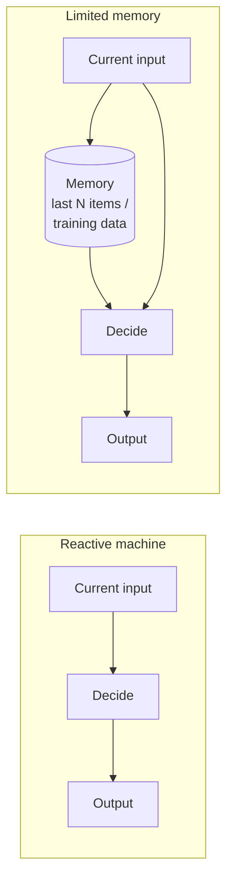
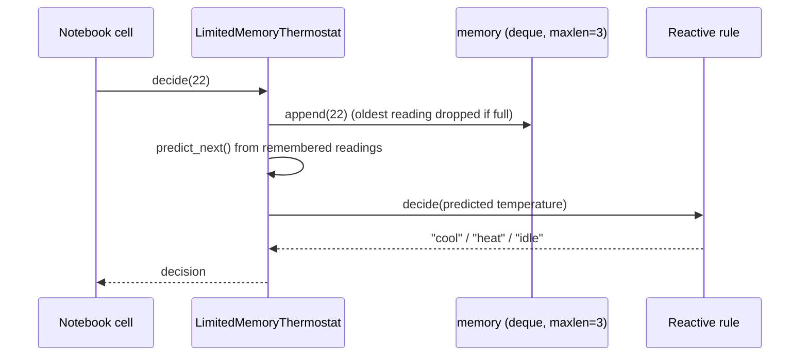

[Academy](../../index.md) › [Track 01: AI and LLM Fundamentals](../README.md) › [Module 1.1: Introduction to Artificial Intelligence](README.md)

# Types of AI: By Capability and by Functionality

| Field | Value |
|---|---|
| **Track** | Track 01: AI and LLM Fundamentals |
| **Module** | Module 1.1: Introduction to Artificial Intelligence |
| **Difficulty** | Beginner |
| **Estimated reading time** | 25–30 minutes (plus 15 minutes for the notebook) |
| **Prerequisites** | [What is Artificial Intelligence?](01-what-is-artificial-intelligence.md) and [History of Artificial Intelligence](02-history-of-artificial-intelligence.md). Python basics help for the notebook. |
| **Technologies** | Python standard library, Jupyter, pytest |
| **Framework versions** | Python 3.14.5, ipykernel 7.4.0, nbclient 0.11.0, nbformat 5.11.1, pytest 9.2.0 |
| **Last verified date** | 2026-11-17 |
| **Companion code** | [`examples/01-AI-FUNDAMENTALS/03-types-of-ai/`](../../../examples/01-AI-FUNDAMENTALS/03-types-of-ai/) |

> ✅ **Code status:** The companion notebook and its tests were run on Windows 11 with the versions above. Every output block in this article marked **"Actual output"** was copied from that run. Blocks marked **"Illustrative"** are examples written by hand.

---

## Table of Contents

1. [Introduction](#1-introduction)
2. [Learning Objectives](#2-learning-objectives)
3. [Prerequisites](#3-prerequisites)
4. [Fundamental Concepts](#4-fundamental-concepts)
5. [Internal Architecture](#5-internal-architecture)
6. [Installation and Environment Setup](#6-installation-and-environment-setup)
7. [Project Folder Structure](#7-project-folder-structure)
8. [Step-by-Step Implementation](#8-step-by-step-implementation)
9. [Execution and Expected Output](#9-execution-and-expected-output)
10. [Internal Execution Flow](#10-internal-execution-flow)
11. [Advanced Concepts](#11-advanced-concepts)
12. [Real-World Use Cases](#12-real-world-use-cases)
13. [Best Practices](#13-best-practices)
14. [Common Errors and Troubleshooting](#14-common-errors-and-troubleshooting)
15. [Comparison and Alternatives](#15-comparison-and-alternatives)
16. [Hands-on Exercises](#16-hands-on-exercises)
17. [Interview Preparation](#17-interview-preparation)
18. [Summary](#18-summary)
19. [Next Learning Step](#19-next-learning-step)
20. [References](#20-references)

---

## 1. Introduction

### What is this topic?

"AI" covers everything from a chess program in 1997 to today's chatbots, and also science-fiction ideas such as machines with feelings. To talk about all of that clearly, people sort AI into **types**. Two classifications are by far the most common:

| Classification | The question it asks | The types |
|---|---|---|
| **By capability** | *How broad* is the system's intelligence? | Narrow AI → General AI → Super AI |
| **By functionality** | *How does it work* with information over time? Does it remember? Does it understand minds? | Reactive machines → Limited memory → Theory of mind → Self-aware |

The single most important fact in this lesson:

> **Only three of these seven types exist today: Narrow AI, reactive machines and limited-memory machines.** Everything else is a research goal or a thought experiment.

### Why do these classifications exist?

Because "AI" is one word for very different things. Without shared labels, a news headline about "AI" could mean a spam filter or a hypothetical super-intelligence. The types give everyone (engineers, managers, regulators, the public) a common vocabulary.

### Why should developers learn it?

- **To judge claims.** When a vendor says their product "understands your customers' emotions", you can recognise that as a *theory of mind* claim, which no system today truly meets.
- **To design systems.** Knowing whether a component is reactive or uses memory tells you what state you must store and how its behaviour can change.
- **To talk to non-engineers.** These terms come up constantly in product meetings, policy discussions and interviews.

### How does it fit into AI Agent Engineering?

The AI agents you will build in this academy are **Narrow AI with limited memory**: a large language model (LLM) plus tools, plus a memory that *you* design (conversation history, a database, a vector store). This lesson gives you the words to describe exactly what you are building, and what you are not.

---

## 2. Learning Objectives

By the end of this lesson you will be able to:

- Name the three **capability** types and the four **functionality** types of AI.
- Say which types **exist today** and which are hypothetical.
- Explain the difference between a **reactive** machine and a **limited-memory** machine with a working example.
- Place a real system (for example a spam filter or a chatbot) on **both** scales.
- Spot marketing claims that describe a type of AI that does not exist yet.

---

## 3. Prerequisites

- **Knowledge:** the previous two lessons, [What is Artificial Intelligence?](01-what-is-artificial-intelligence.md) and [History of Artificial Intelligence](02-history-of-artificial-intelligence.md).
- **Python:** enough to read a small class and a `for` loop. The notebook explains every step.
- **Tools:** Python 3.10 or newer (tested on 3.14.5) and Jupyter Notebook or JupyterLab to open the notebook. No API keys.

---

## 4. Fundamental Concepts

### 4.1 Classification by capability

This scale measures **breadth**: how many kinds of task a system can handle, compared with a human.

#### Narrow AI (also called Weak AI or ANI) — exists today

- **Definition:** AI built for one task, or a small family of related tasks.
- **Analogy:** a calculator is brilliant at arithmetic and useless at cooking.
- **Examples:** spam filters, face unlock, product recommendations, chess engines, voice assistants, and LLM chatbots.
- **Note:** IBM's overview classes even ChatGPT as narrow AI. Some researchers argue that large language models are broad enough to blur the line; the next lesson covers that debate.

#### General AI (AGI, also called Strong AI) — does not exist yet

- **Definition:** AI that could learn and reason across *any* intellectual task a human can, and carry learning from one task to a brand-new one without being rebuilt.
- **Analogy:** a person who can learn to cook, then to code, then to speak Spanish.
- **Status:** a research goal. There is no agreed test for it, and experts disagree on whether and when it will arrive.

#### Super AI (ASI) — hypothetical

- **Definition:** AI that would exceed the best humans in almost every field, including science, creativity and social skills.
- **Status:** a thought experiment, discussed mainly in AI safety and philosophy (for example in Nick Bostrom's book *Superintelligence*).

This lesson keeps the capability scale short on purpose. **[Narrow AI vs General AI](04-narrow-ai-vs-general-ai.md)** goes deep on it.

### 4.2 Classification by functionality

This scale, popularised by researcher Arend Hintze in 2016, measures **how a system uses information over time**. Each level adds something to the one below it.

#### Type 1: Reactive machines — exist today

- **Definition:** the system responds only to the **current input**. It stores no memories and does not learn from past experience while it runs.
- **Key property:** **same input → same output**, every time.
- **Example:** IBM's **Deep Blue**, which beat world chess champion Garry Kasparov in 1997. It evaluated about 200 million positions per second, but it looked only at the board in front of it.
- **Analogy:** a light switch with a motion sensor. Movement now → light on. It has no idea whether someone walked past a minute ago.

#### Type 2: Limited memory — exist today

- **Definition:** the system uses **recent or stored past data** to make decisions. Its memory is limited: a short window of recent observations, or knowledge fixed at training time.
- **Key property:** the same current input can lead to **different outputs**, depending on what came before.
- **Examples:** a self-driving car estimating another car's speed from its last few positions; a recommender using your recent viewing; an LLM chatbot using the conversation so far (its *context window*) and what it learned during training.
- **Analogy:** a driver glancing in the mirror. You don't remember every car you passed today, just the last few seconds, and that is enough to change lanes safely.
- **Note:** almost all modern machine learning, including every AI agent in this academy, falls here.

#### Type 3: Theory of mind — does not exist yet

- **Definition:** AI that understands that **other beings have their own beliefs, intentions and emotions**, and adjusts its behaviour accordingly. The term comes from psychology, where it describes this ability in humans and animals.
- **Status:** a research goal. "Emotion AI" can detect signals such as facial expressions or sentiment in text, but detecting a smile is not the same as understanding what someone believes or wants.
- **Watch out:** a chatbot that *sounds* empathetic is generating likely text. Sounding understanding is not evidence of understanding.

#### Type 4: Self-aware — hypothetical

- **Definition:** AI with a sense of its **own existence and inner states**: something like consciousness.
- **Status:** purely hypothetical. We do not have an agreed scientific way to test consciousness even in animals, let alone in machines.

### 4.3 The two scales are independent

Every system gets **one label on each scale**. A spam filter is *Narrow AI* **and** *Limited memory*. Deep Blue is *Narrow AI* **and** *Reactive*. You need both labels to describe a system well.

---

## 5. Internal Architecture

There is no single "architecture" for a type of AI, but the **functionality** levels map onto a simple pattern: what the system is allowed to read before it decides.



*Diagram: A reactive machine decides from the current input alone. A limited-memory machine also reads from a bounded memory, which is updated with each new input. Theory-of-mind and self-aware machines would need extra components (a model of other minds, a model of the self) that nobody yet knows how to build.*

The two scales together form a grid. Only the two cells marked ✅ exist today:

| | Reactive | Limited memory | Theory of mind | Self-aware |
|---|---|---|---|---|
| **Narrow AI** | ✅ exists (Deep Blue) | ✅ exists (chatbots, self-driving perception) | ❌ | ❌ |
| **General AI** | ❌ | ❌ | ❌ | ❌ |
| **Super AI** | ❌ | ❌ | ❌ | ❌ |

---

## 6. Installation and Environment Setup

From the repository root:

```bash
cd examples/01-AI-FUNDAMENTALS/03-types-of-ai
python -m venv .venv
# Windows (PowerShell): .venv\Scripts\Activate.ps1
# macOS / Linux:        source .venv/bin/activate
pip install -r requirements.txt
pip install notebook            # Jupyter itself, if you don't already have it
```

`requirements.txt` pins the packages the notebook and tests need:

```text
ipykernel==7.4.0
nbclient==0.11.0
nbformat==5.11.1
pytest==9.2.0
```

The notebook itself uses only the Python standard library. No environment variables or API keys are needed.

---

## 7. Project Folder Structure

```text
examples/01-AI-FUNDAMENTALS/03-types-of-ai/
├── types_of_ai.ipynb            # the step-by-step notebook: all the code, saved with outputs
├── requirements.txt             # pinned packages for running the notebook and the test
├── pytest.ini                   # tells pytest where the test is
├── README.md                    # how to run it
└── tests/
    └── test_notebook.py         # runs the whole notebook, fails on any error
```

Everything lives in one self-contained notebook: the explanations, the code, and a few `assert` quick checks. The test simply runs it from top to bottom.

---

## 8. Step-by-Step Implementation

The full walkthrough lives in the notebook: **[`types_of_ai.ipynb`](../../../examples/01-AI-FUNDAMENTALS/03-types-of-ai/types_of_ai.ipynb)**. Each step is a Markdown explanation, a short code cell, its output, and a note on what the output means. Here are the key pieces of code from the notebook.

### Step 1: A catalogue of the types

Each type is a small, immutable record that includes whether it exists today:

```python
@dataclass(frozen=True)
class AIType:
    name: str
    axis: str          # "capability" or "functionality"
    level: int         # 1 = simplest
    description: str
    exists_today: bool
    example: str
```

`CAPABILITY_TYPES` and `FUNCTIONALITY_TYPES` are lists of these records. Putting `exists_today` in the data makes the key fact of the lesson something the code can check: a quick-check cell in the notebook asserts that only Narrow AI, reactive machines and limited-memory machines exist today.

### Step 2: A reactive machine

```python
class ReactiveThermostat:
    def __init__(self, target=21.0, tolerance=1.0):
        self.target = target
        self.tolerance = tolerance

    def decide(self, temperature):
        if temperature > self.target + self.tolerance:
            return "cool"
        if temperature < self.target - self.tolerance:
            return "heat"
        return "idle"
```

`decide()` reads only its argument. Nothing is stored between calls, so the same temperature always gives the same answer. That is a reactive machine.

### Step 3: A limited-memory machine

```python
class LimitedMemoryThermostat(ReactiveThermostat):
    def __init__(self, target=21.0, tolerance=1.0, memory_size=3):
        super().__init__(target, tolerance)
        if memory_size < 2:
            raise ValueError("memory_size must be at least 2 to see a trend")
        self.memory = deque(maxlen=memory_size)

    def predict_next(self):
        readings = list(self.memory)
        if len(readings) < 2:
            return readings[-1]
        average_change = (readings[-1] - readings[0]) / (len(readings) - 1)
        return readings[-1] + average_change

    def decide(self, temperature):
        self.memory.append(temperature)
        return super().decide(self.predict_next())
```

Three things to notice:

- `deque(maxlen=memory_size)` is a list with a fixed size. When it is full, adding a new reading drops the oldest one. That is the "limited" in limited memory.
- `predict_next()` uses the remembered readings to estimate where the temperature is heading.
- `decide()` reuses the reactive rule, but feeds it the *prediction* instead of the raw reading. Memory changes the input to the decision, not the rule itself.

### Step 4: Placing a system on both scales

```python
@dataclass(frozen=True)
class SystemProfile:
    name: str
    uses_past_data: bool = False
    models_other_minds: bool = False
    is_self_aware: bool = False
    general_across_domains: bool = False
    beats_humans_at_everything: bool = False


def classify_functionality(profile):
    if profile.is_self_aware:
        return "Self-aware"
    if profile.models_other_minds:
        return "Theory of mind"
    if profile.uses_past_data:
        return "Limited memory"
    return "Reactive machine"
```

`classify_capability()` works the same way on the breadth questions. `classify(profile)` returns `(name, capability, functionality)`, and `exists_today(type_name)` looks the answer up in the catalogue. The checks run from the highest level down, because each level includes the ones below it.

---

## 9. Execution and Expected Output

Open the notebook and run all cells (**Kernel → Restart & Run All**):

```bash
jupyter notebook types_of_ai.ipynb
```

**Actual output** of the functionality catalogue cell (Windows 11, Python 3.14.5, run on 2026-11-17):

```text
Functionality type  Exists today?  Example
------------------  -------------  -----------------------------------------------
Reactive machine    yes            IBM Deep Blue, a simple thermostat rule
Limited memory      yes            Self-driving perception, recommenders, chatbots
Theory of mind      no             None yet (research goal)
Self-aware          no             None (hypothetical)
```

**Actual output** of the thermostat comparison. Both rooms end at 22 °C:

```text
Warming room
  18 °C   reactive: heat   limited memory: heat   (predicted next: 18.0 °C)
  19 °C   reactive: heat   limited memory: idle   (predicted next: 20.0 °C)
  20 °C   reactive: idle   limited memory: idle   (predicted next: 21.0 °C)
  21 °C   reactive: idle   limited memory: idle   (predicted next: 22.0 °C)
  22 °C   reactive: idle   limited memory: cool   (predicted next: 23.0 °C)

Cooling room
  26 °C   reactive: cool   limited memory: cool   (predicted next: 26.0 °C)
  25 °C   reactive: cool   limited memory: cool   (predicted next: 24.0 °C)
  24 °C   reactive: cool   limited memory: cool   (predicted next: 23.0 °C)
  23 °C   reactive: cool   limited memory: idle   (predicted next: 22.0 °C)
  22 °C   reactive: idle   limited memory: idle   (predicted next: 21.0 °C)
```

At the last reading the reactive thermostat says `idle` in both rooms. The limited-memory one says `cool` in the warming room and `idle` in the cooling room. Same current input, different decision, because of memory.

**Actual output** of classifying real systems:

```text
System                       Capability  Functionality
---------------------------  ----------  ----------------
IBM Deep Blue (1997 chess)   Narrow AI   Reactive machine
Email spam filter            Narrow AI   Limited memory
Self-driving car perception  Narrow AI   Limited memory
LLM chatbot (e.g. ChatGPT)   Narrow AI   Limited memory
```

**Actual output** of checking a hypothetical "empathic robot" claim:

```text
Empathic care robot (claimed): Narrow AI + Theory of mind
Does 'Theory of mind' AI exist today? False
```

### Verify it works

```bash
pytest
```

**Actual output** (last line):

```text
1 passed in 2.33s
```

`tests/test_notebook.py` runs the whole notebook from top to bottom and fails if any cell raises an error, including the `assert` quick checks inside the notebook. `pytest.ini` hides a harmless Windows notice from the Jupyter messaging library about the asyncio event loop.

---

## 10. Internal Execution Flow

What happens when the limited-memory thermostat receives one reading:



For the reactive thermostat the diagram collapses to a single step: `decide(22)` goes straight to the rule. The only error path is constructing the limited-memory thermostat with `memory_size < 2`, which raises `ValueError`, because one reading cannot show a trend.

---

## 11. Advanced Concepts

- **"Limited" has several meanings.** It can mean a short window of recent inputs (our thermostat), a context window (an LLM can only "see" a certain number of tokens), or knowledge frozen at training time (a model knows nothing after its training cut-off unless you give it tools or retrieval).
- **Learning vs remembering.** A model can be trained on past data and then act reactively at run time. Many classifiers are like this: training used memory, but each prediction looks only at the current input. Sources classify these systems differently, so explain what you mean when you use the labels.
- **Agents add memory on purpose.** In later tracks you will give agents short-term memory (conversation state) and long-term memory (databases, vector stores). That is engineering *within* the limited-memory type, not a step to theory of mind.
- **Other classifications exist.** AI is also grouped by *technique* (rule-based, machine learning, deep learning), by *learning style* (supervised, unsupervised, reinforcement), and by *output* (predictive vs generative). Later lessons in this module cover those.

---

## 12. Real-World Use Cases

| Use case | Type (capability + functionality) | Why that type fits | Limitation |
|---|---|---|---|
| Industrial safety cut-off (stop the machine if a sensor reads over a limit) | Narrow + Reactive | Must be predictable and instant; history would add risk | Cannot anticipate a problem that is building slowly |
| Email spam filtering | Narrow + Limited memory | Learns from labelled past emails | Needs retraining as spammers change tactics |
| Driver assistance and self-driving perception | Narrow + Limited memory | Tracks nearby objects over the last moments to predict their paths | Struggles with rare situations not seen in training |
| Product and video recommendations | Narrow + Limited memory | Uses your recent behaviour to rank items | Can trap users in a "filter bubble" of past interests |
| Customer-support AI agent | Narrow + Limited memory | LLM plus conversation history plus tools | Does not truly understand the customer's feelings; must escalate sensitive cases to humans |
| Sentiment analysis in a call centre | Narrow + Limited memory (often marketed as "emotion AI") | Detects signals such as tone or wording | Detecting a signal is not theory of mind; misreads sarcasm and cultural differences |

---

## 13. Best Practices

- **Use precise labels.** Say "a narrow, limited-memory system" rather than just "AI". It sets correct expectations.
- **Prefer reactive designs where predictability matters.** Safety checks, permission checks and validation rules in an agent should usually be reactive, deterministic code, not a model with memory.
- **Bound your memory.** Real memory has costs (storage, privacy, latency, LLM token cost). Keep only what the decision needs, as `deque(maxlen=...)` does in our demo.
- **Treat memory as sensitive data.** Anything an agent remembers about a user may be personal data; store and expire it deliberately.
- **Be honest in product copy.** Don't claim empathy, understanding or awareness. Describe what the system actually detects or predicts.

---

## 14. Common Errors and Troubleshooting

| Problem | Cause | Fix |
|---|---|---|
| `NameError: name 'AIType' is not defined` (or another name) in the notebook | A cell was run before the cells above it that define the name | Run the cells from top to bottom, or **Kernel → Restart & Run All** |
| `jupyter: command not found` | Jupyter is not installed in the active environment | Activate the venv, then `pip install notebook` |
| `No such kernel named python3` when running tests | `ipykernel` is missing from the environment | `pip install -r requirements.txt` |
| `ValueError: memory_size must be at least 2` | You created a limited-memory thermostat with a window of 1 | Use 2 or more; one reading cannot show a trend |
| Notebook outputs look different after editing a cell | Cells were run out of order | **Kernel → Restart & Run All** |
| `RuntimeWarning: Proactor event loop ...` when executing the notebook on Windows | A known notice from the Jupyter messaging library | Safe to ignore; `pytest.ini` hides it during tests |

**Conceptual mistakes** are more common than code errors:

- *"ChatGPT is general AI."* Mainstream sources (including IBM) still class it as narrow, although the question is debated.
- *"A chatbot that remembers my name has theory of mind."* Remembering facts is limited memory. Theory of mind means modelling someone's beliefs and intentions.
- *"Reactive means simple."* Deep Blue was reactive and beat the world chess champion.

---

## 15. Comparison and Alternatives

| | By capability | By functionality |
|---|---|---|
| **Question** | How broad? | How does it use information over time? |
| **Levels** | Narrow, General, Super | Reactive, Limited memory, Theory of mind, Self-aware |
| **Exist today** | Narrow only | Reactive and limited memory only |
| **Best for** | Discussing the future of AI, policy and safety | Describing how a real system behaves and what state it keeps |

Alternatives you will meet later: classification by **technique** (rules vs machine learning vs deep learning, see [Machine Learning vs Deep Learning](05-machine-learning-vs-deep-learning.md)), by **learning style** (supervised, unsupervised, reinforcement) and by **output** ([Generative AI](09-generative-ai.md)).

---

## 16. Hands-on Exercises

**Beginner**

1. Change `memory_size` to 2 and then 5 in the notebook and re-run. *Outcome:* see how a longer memory reacts more slowly to change. *Hint:* compare the "predicted next" column.
2. Add a new `SystemProfile` for a voice assistant and classify it. *Outcome:* practice using both labels.
3. Find a product description online that uses the word "understands". Decide which functionality type the claim implies. *Outcome:* spot theory-of-mind claims.

**Intermediate**

4. Write a `ReactiveSecurityLight` class that turns on when motion is detected, and a test that proves the same input always gives the same output. *Hint:* copy the shape of `ReactiveThermostat`.
5. Give the limited-memory thermostat a `reset()` method that clears its memory, and add a test. *Outcome:* see that memory is state you must manage.
6. Add a `ChatMemory` class that keeps only the last N chat messages using `deque(maxlen=N)`. *Outcome:* a tiny model of an LLM context window.

**Advanced**

7. Replace the trend formula in `predict_next()` with a least-squares line fit (with `numpy.polyfit`; run `pip install numpy` first), and check that the decisions in the notebook stay sensible. *Outcome:* swap the "brain" without changing the type.
8. Extend `SystemProfile` with a `learns_after_deployment` flag and write a short note on whether it should change the functionality label. *Outcome:* engage with the "learning vs remembering" ambiguity from Section 11.

---

## 17. Interview Preparation

### Beginner questions

**1. What are the two most common ways to classify AI?**
By capability (Narrow, General, Super) and by functionality (Reactive, Limited memory, Theory of mind, Self-aware).

**2. Which types of AI exist today?**
Narrow AI on the capability scale; reactive and limited-memory machines on the functionality scale.

**3. What is Narrow AI? Give an example.**
AI built for a specific task, such as a spam filter or face recognition on a phone.

**4. What is General AI?**
Hypothetical AI that could learn and perform any intellectual task a human can, transferring learning to new tasks. It does not exist yet.

**5. What is Super AI?**
Hypothetical AI that would surpass the best humans in nearly every field.

**6. What is a reactive machine?**
A system that responds only to its current input, with no memory of past inputs. The same input always gives the same output.

**7. Give a famous example of a reactive machine.**
IBM Deep Blue, which beat Garry Kasparov at chess in 1997.

**8. What is limited-memory AI?**
AI that uses recent or stored past data to decide, such as a self-driving car tracking nearby vehicles or a chatbot using the conversation so far.

**9. What is theory-of-mind AI?**
Hypothetical AI that understands others have beliefs, intentions and emotions. It does not exist yet.

**10. What is self-aware AI?**
Hypothetical AI with consciousness and a sense of its own inner states.

### Intermediate questions

**11. Can one system belong to both classifications?**
Yes, always. The scales are independent: a spam filter is Narrow + Limited memory.

**12. Why is ChatGPT usually called Narrow AI?**
Because it is built for one kind of task (generating text from a prompt) and does not reliably learn and transfer across any domain like a human. Some researchers argue that LLMs are broad enough to challenge this label.

**13. Is a chatbot that remembers your name an example of theory of mind?**
No. Storing facts is limited memory. Theory of mind would mean modelling your beliefs and intentions.

**14. What does "limited" mean in limited memory?**
The memory is bounded: a short window of recent data, a fixed context window, or knowledge frozen at training time.

**15. Why might you deliberately choose a reactive design?**
For predictability, testability and speed, for example in safety cut-offs or permission checks.

**16. How would you show the difference between reactive and limited memory in code?**
Feed both systems different histories that end in the same input. The reactive one gives the same output; the limited-memory one may not. This lesson's thermostat demo does exactly that.

**17. Where do AI agents sit on these scales?**
Narrow AI with limited memory: an LLM plus tools plus designed memory.

**18. What is "emotion AI", and is it theory of mind?**
Systems that detect emotional signals (facial expressions, tone, wording). Detecting signals is not the same as understanding minds, so it is not theory of mind.

**19. Is "reactive" the same as "simple"?**
No. Deep Blue was reactive but searched about 200 million positions per second.

**20. Who popularised the four functionality types?**
Researcher Arend Hintze, in a widely shared 2016 article.

### Advanced questions

**21. A model was trained on years of data but each prediction looks only at the current input. Reactive or limited memory?**
It depends on the definition. Training used past data, so many sources call it limited memory; at run time it behaves reactively. A good answer explains both views and states which one you mean.

**22. How would you evaluate a vendor's claim that their AI "understands customer emotions"?**
Ask what it actually measures (for example sentiment scores), how accurate it is on your data, how it fails (sarcasm, cultural differences), and whether humans review sensitive cases. Treat "understands" as marketing for signal detection.

**23. What engineering risks come with adding memory to an agent?**
Privacy (stored personal data), stale or wrong memories affecting later decisions, prompt-injection content persisting in memory, and higher cost and latency. Mitigate with bounded memory, expiry, validation and access control.

**24. Why do policy discussions often use the capability scale?**
Because questions of long-term risk and regulation depend on breadth of capability (narrow vs general vs super), not on how state is stored.

**25. Are these classifications scientifically precise?**
No. They are useful teaching and communication tools. The boundaries, especially between narrow and general, are debated, and there is no agreed test for AGI, theory of mind or consciousness.

---

## 18. Summary

- AI is commonly classified **by capability** (Narrow, General, Super) and **by functionality** (Reactive, Limited memory, Theory of mind, Self-aware).
- **Only Narrow AI, reactive machines and limited-memory machines exist today.**
- A **reactive** machine gives the same output for the same input; a **limited-memory** machine uses recent history, so its output can change.
- Memory is **limited** by design: fixed windows, context windows and training cut-offs.
- Every system gets **one label on each scale**. AI agents are Narrow AI with limited memory.

### Checklist

- [ ] I can name all seven types and say which exist today.
- [ ] I can explain reactive vs limited memory using the thermostat example.
- [ ] I can classify a real system on both scales.
- [ ] I can recognise a theory-of-mind claim in marketing copy.
- [ ] I ran the notebook and the tests.

---

## 19. Next Learning Step

You have seen that every real AI system today is **Narrow AI**. The next lesson, **[Narrow AI vs General AI](04-narrow-ai-vs-general-ai.md)**, zooms in on that boundary: what would make a system "general", why large language models have reopened the debate, and what that means for engineers building agents today.

**Prerequisites for the next lesson:** this lesson.

---

## 20. References

Sources checked on 2026-11-17:

| Resource | Link |
|---|---|
| IBM, *Types of Artificial Intelligence* (both classifications and which exist today) | <https://www.ibm.com/think/topics/artificial-intelligence-types> |
| IBM, *What is Artificial General Intelligence (AGI)?* | <https://www.ibm.com/think/topics/artificial-general-intelligence> |
| IBM, *Deep Blue* (1997 match facts) | <https://www.ibm.com/history/deep-blue> |
| Stanford HAI, *AI Index* (data on the state of AI) | <https://hai.stanford.edu/ai-index> |
| Python `collections.deque` documentation | <https://docs.python.org/3/library/collections.html> |
| nbclient, *Executing notebooks* | <https://nbclient.readthedocs.io/en/latest/client.html> |
| Project Jupyter, *Installing Jupyter* | <https://jupyter.org/install> |

Further reading (named without a link because the page could not be opened for verification):

- Arend Hintze, "Understanding the four types of AI, from reactive robots to self-aware beings", *The Conversation*, 2016.
- Encyclopaedia Britannica, "Artificial intelligence" (entry covering strong vs weak AI).
- Nick Bostrom, *Superintelligence: Paths, Dangers, Strategies*, Oxford University Press, 2014.

See also: [Academy references](../../references.md)

---

[⬅️ History of Artificial Intelligence](02-history-of-artificial-intelligence.md) | [⬆️ Module overview](README.md) | [Narrow AI vs General AI ➡️](04-narrow-ai-vs-general-ai.md)
