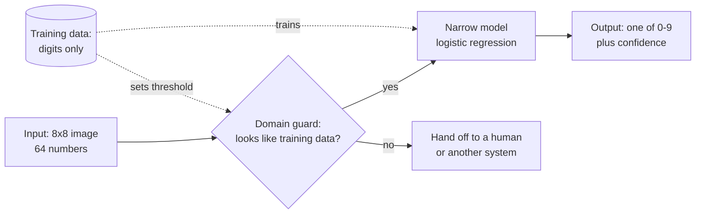
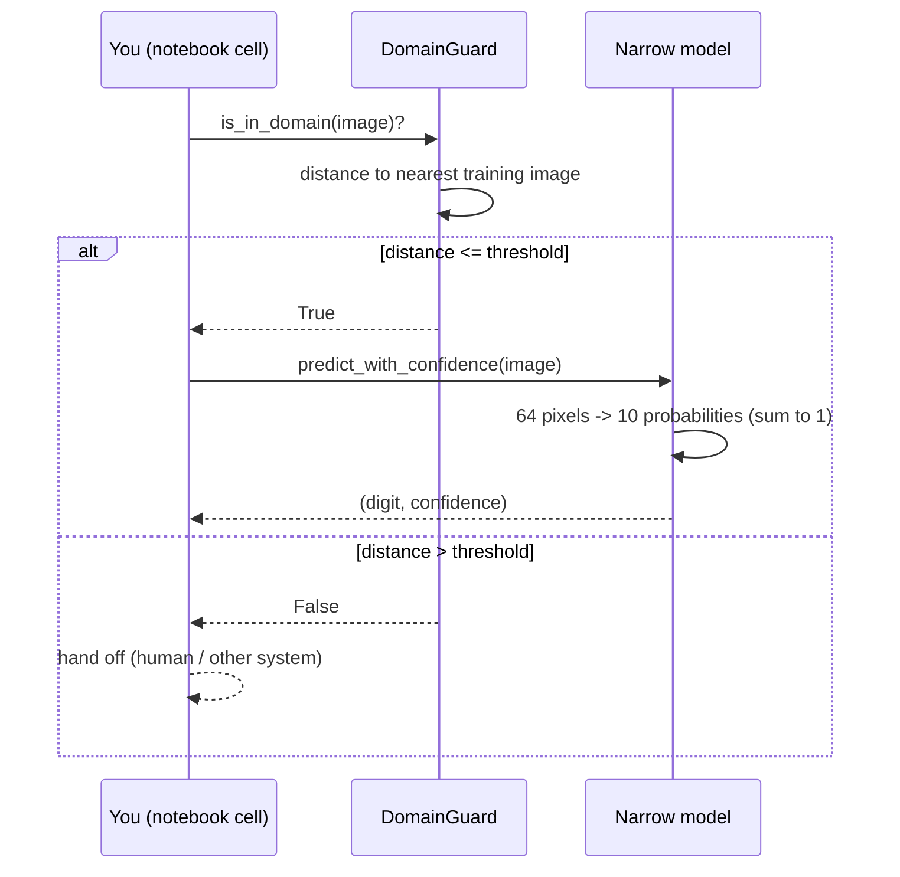

[Academy](../../index.md) › [Track 01: AI and LLM Fundamentals](../README.md) › [Module 1.1: Introduction to Artificial Intelligence](README.md)

# Narrow AI vs General AI: What Today's AI Can and Cannot Do

| Field | Value |
|---|---|
| **Track** | Track 01: AI and LLM Fundamentals |
| **Module** | Module 1.1: Introduction to Artificial Intelligence |
| **Difficulty** | Beginner |
| **Estimated reading time** | 20–25 minutes (plus 15 minutes for the notebook) |
| **Prerequisites** | [What is Artificial Intelligence?](01-what-is-artificial-intelligence.md) and [Types of AI](03-types-of-ai.md). Python basics help for the notebook. |
| **Technologies** | Python, Jupyter, numpy, scikit-learn, pytest |
| **Framework versions** | Python 3.14.5, numpy 2.5.5, scikit-learn 1.9.1, nbclient 0.11.0, nbformat 5.11.1, ipykernel 7.4.0, pytest 9.2.0 |
| **Last verified date** | 2026-11-17 |
| **Companion code** | [`examples/01-AI-FUNDAMENTALS/04-narrow-ai-vs-general-ai/`](../../../examples/01-AI-FUNDAMENTALS/04-narrow-ai-vs-general-ai/) |

> ✅ **Code status:** The companion notebook and its tests were run on Windows 11 with the versions above. Every output block marked **"Actual output"** was copied from that run. Blocks marked **"Illustrative"** are written by hand.

---

## Table of Contents

1. [Introduction](#1-introduction)
2. [Learning Objectives](#2-learning-objectives)
3. [Prerequisites](#3-prerequisites)
4. [Fundamental Concepts](#4-fundamental-concepts)
5. [How a Narrow System Works Inside](#5-how-a-narrow-system-works-inside)
6. [Installation and Environment Setup](#6-installation-and-environment-setup)
7. [Project Folder Structure](#7-project-folder-structure)
8. [Step-by-Step Walkthrough of the Notebook](#8-step-by-step-walkthrough-of-the-notebook)
9. [Execution and Output](#9-execution-and-output)
10. [Internal Execution Flow](#10-internal-execution-flow)
11. [Advanced Concepts](#11-advanced-concepts)
12. [Real-World Use Cases](#12-real-world-use-cases)
13. [Best Practices](#13-best-practices)
14. [Common Errors and Troubleshooting](#14-common-errors-and-troubleshooting)
15. [Comparison: Narrow AI, Today's LLM Agents and AGI](#15-comparison-narrow-ai-todays-llm-agents-and-agi)
16. [Hands-on Exercises](#16-hands-on-exercises)
17. [Interview Preparation](#17-interview-preparation)
18. [Summary](#18-summary)
19. [Next Learning Step](#19-next-learning-step)
20. [References](#20-references)

---

## 1. Introduction

### What is the topic?

People talk about "AI" as if it were one thing. In practice there is a big difference between:

- **Narrow AI** (also called *weak AI* or *artificial narrow intelligence, ANI*): a system built and trained for **one task or a small set of related tasks**. A spam filter, a chess engine, a face-unlock feature and a product recommender are all narrow AI.
- **General AI** (also called *artificial general intelligence, AGI*, or *strong AI*): a **hypothetical** system that could handle essentially **any** intellectual task a person can, and learn new tasks without being rebuilt for each one.

Every AI system you can use today is narrow in this sense. AGI is a research goal and a subject of active debate, not a product. IBM's overview of AI types, for example, describes narrow AI as the only kind that exists today and AGI as theoretical.

### Why does the distinction exist?

Because it explains **what you can safely expect from an AI system**. A narrow model can be superhuman at its job (AlphaFold predicts protein structures better than any person) and still be useless, or confidently wrong, one step outside it.

### What problem does knowing it solve?

It protects you from two opposite mistakes:

1. **Over-trusting** a system: assuming that because a model is brilliant at one thing, it "understands" related things too.
2. **Under-using** a system: dismissing a narrow tool because it is "not really intelligent", when it is excellent at the job it was built for.

### Why should developers care?

When you build AI agents you are always deciding **what the system is allowed to do** and **what it should hand back to a human**. That decision depends on knowing where your system's competence ends. This lesson gives you the vocabulary and a small experiment to make that concrete.

### Where does it fit in AI agent engineering?

Large language models (LLMs) and the agents built on them are much **broader** than a classic one-task model: the same model can write code, summarise documents and answer questions. But they are still **not general** in the AGI sense. They make confident mistakes, have gaps, and need tools, guardrails and human oversight. A useful working phrase for this course is:

> **Today's LLM agents are broad, but not general.**

---

## 2. Learning Objectives

After this lesson you will be able to:

- Define **narrow AI** and **AGI** in plain language and give examples of each.
- Explain why a model that is excellent at one task can fail badly outside it.
- Describe the difference between **performance** (how well) and **generality** (how many kinds of tasks).
- Explain why today's LLMs and agents are usually described as **broad but not general**.
- Run a notebook that trains a narrow model, tests it on out-of-domain inputs, and adds a simple **domain guard**.
- Discuss AGI timelines and claims in a balanced, evidence-based way.

---

## 3. Prerequisites

- **Previous lessons:** [What is Artificial Intelligence?](01-what-is-artificial-intelligence.md) and [Types of AI](03-types-of-ai.md).
- **Programming:** basic Python (variables, functions, loops). You do not need any maths beyond "a probability is a number between 0 and 1".
- **Tools:** Python 3.10 or newer (tested on 3.14.5) and a terminal. To open the notebook in a browser you also need JupyterLab (`pip install jupyterlab`), or you can use VS Code.
- **API keys:** none. Everything runs locally.

---

## 4. Fundamental Concepts

### 4.1 Narrow AI

- **Definition:** an AI system designed and trained for a specific, well-defined task.
- **Why it exists:** a focused problem with good data is something we can actually build, test and trust. Almost all commercial AI is narrow for this reason.
- **How it works:** you collect examples of *one* task (photos labelled "cat"/"dog", emails labelled "spam"/"not spam"), train a model on them, and measure it on held-out examples of the *same* task.
- **Analogy:** a pocket calculator is astonishing at arithmetic and useless at spelling. Nobody calls that a flaw; it is what the device is for.
- **Technical view:** a narrow model learns a mapping from a fixed input format to a fixed set of outputs. A digit classifier maps 64 pixel values to one of the labels 0–9. It has **no output for "none of the above"** unless someone adds one.
- **Example:** in the notebook, a model that reads 8x8 digits scores about 96% on unseen digits, then calls the letter X an "8" with almost 100% confidence.

### 4.2 Artificial General Intelligence (AGI)

- **Definition:** a hypothetical AI that can match (or exceed) human ability across essentially all cognitive tasks, including learning new ones.
- **Why people want it:** one system that could tackle any problem, rather than one model per problem.
- **How it would work:** nobody knows yet. There is no agreed design, and no agreed test that would prove a system is AGI.
- **Analogy:** a capable new colleague. You can explain an unfamiliar task, they ask sensible questions, learn it, and tell you when they are out of their depth.
- **Technical view:** researchers disagree on the definition itself. Some focus on passing broad sets of human-level tests, others on economic usefulness, others on flexible learning. IBM's AGI explainer notes there is no consensus on what qualifies as AGI.
- **Example:** none exists. Anything sold as "AGI" today deserves careful scrutiny.

### 4.3 Performance vs generality

A helpful way to think about this comes from a Google DeepMind paper, *Levels of AGI for Operationalizing Progress on the Path to AGI* (Morris et al., ICML 2024). It separates two questions:

- **Performance (depth):** how *well* does the system do a task, compared with skilled people?
- **Generality (breadth):** how *many kinds* of tasks can it do?

Their framework places systems on a grid of performance levels (from "Emerging" up to "Superhuman") against two columns, **Narrow** and **General**. In their table (written in 2023–2024):

- **AlphaFold** is placed at **Superhuman Narrow AI**: better than any human, but at one task.
- **Deep Blue** and **AlphaGo** are **Virtuoso Narrow AI**.
- Chatbots such as **ChatGPT**, **Bard**, **Llama 2** and **Gemini** are placed at **Emerging AGI**: very broad, but at roughly the level of an unskilled human on many tasks.
- Every level above that in the General column ("Competent AGI" and higher) is marked **not yet achieved**.

The key lesson: **high performance and high generality are different things**. A system can be superhuman and narrow, or broad and only moderately good.

### 4.4 "Broad but not general": where LLMs and agents sit

LLMs are trained on huge amounts of text (and often images and code), which makes them usable for many tasks without retraining. That breadth is real and new. But they still:

- make **confident mistakes** (often called hallucinations),
- can struggle with **reliable** multi-step reasoning, long-horizon planning and learning genuinely new skills on the fly,
- have **no built-in awareness** of when they are outside their competence.

An **AI agent** wraps a model with tools (search, code execution, APIs), memory and a loop that plans and acts. That makes the *system* more capable, but it is engineered capability, with guardrails and human checkpoints, not general intelligence. The same DeepMind paper treats **autonomy** as a separate dial from capability, ranging from "AI as a Tool" to "AI as an Agent", and stresses that how much autonomy to give a system is a design choice.

### 4.5 Out-of-domain inputs

- **Definition:** inputs that are unlike anything the model saw during training (also called *out-of-distribution*).
- **Why it matters:** this is exactly where narrow AI breaks, and often **silently**.
- **Example:** a photo of a cat given to a digit reader, or a sentence given to an image model.

### 4.6 Super AI (briefly)

**Artificial superintelligence (ASI)** describes a hypothetical system far beyond human ability across the board. It sits beyond AGI in most taxonomies and is even more speculative. This course mentions it only so you recognise the term.

---

## 5. How a Narrow System Works Inside

A narrow AI has a fixed input format, a learned model and a fixed set of possible outputs. Our notebook adds one extra component, a **domain guard**, so the system can notice inputs it was never built for.



**Components and responsibilities**

| Component | Responsibility |
|---|---|
| Training data | Defines the *only* world the model knows: 8x8 handwritten digits |
| Narrow model | Maps 64 pixel values to a probability for each digit 0–9 |
| Output | Always one of ten digits, plus a confidence score |
| Domain guard | Measures how far an input is from the nearest training example; rejects inputs that are too far |
| Hand-off | What a real system does with rejected inputs (ask a human, route elsewhere) |

The important point in the diagram: **without the guard, every input goes to the model and always comes out as a digit**. The guard does not make the model smarter; it just stops it being used where it has no business.

---

## 6. Installation and Environment Setup

You need Python 3.10+ (tested with 3.14.5). From the repository root:

```bash
cd examples/01-AI-FUNDAMENTALS/04-narrow-ai-vs-general-ai
python -m venv .venv
# Windows (PowerShell): .venv\Scripts\Activate.ps1
# macOS / Linux:        source .venv/bin/activate
pip install -r requirements.txt
```

`requirements.txt` pins: numpy 2.5.5, scikit-learn 1.9.1, nbformat 5.11.1, nbclient 0.11.0, ipykernel 7.4.0 and pytest 9.2.0. To open the notebook in a browser, also run `pip install jupyterlab` (or open it in VS Code). No environment variables or API keys are needed; the digits dataset ships inside scikit-learn.

---

## 7. Project Folder Structure

```text
examples/01-AI-FUNDAMENTALS/04-narrow-ai-vs-general-ai/
├── narrow_vs_general_ai.ipynb   # the step-by-step notebook: all the code (saved with outputs)
├── requirements.txt             # pinned package versions
├── pytest.ini                   # tells pytest where the tests are
├── README.md                    # how to run it
└── tests/
    └── test_notebook.py         # runs the whole notebook, fails on any error
```

All the code lives in the notebook, one small function per cell, right after the explanation it belongs to. A few "quick check" cells use `assert` to confirm the key results as you go.

---

## 8. Step-by-Step Walkthrough of the Notebook

Open the full notebook here: [narrow_vs_general_ai.ipynb](../../../examples/01-AI-FUNDAMENTALS/04-narrow-ai-vs-general-ai/narrow_vs_general_ai.ipynb). Below are the key snippets.

### Step 1: Load the data and train a narrow model

```python
# narrow_vs_general_ai.ipynb (Steps 2 and 3)
def load_data(seed: int = SEED):
    digits = load_digits()
    return train_test_split(
        digits.data, digits.target, test_size=0.25, random_state=seed, stratify=digits.target
    )

def train_digit_model(X_train, y_train) -> LogisticRegression:
    model = LogisticRegression(max_iter=2000)
    model.fit(X_train, y_train)
    return model
```

- `load_digits()` returns 1,797 images, each flattened to 64 numbers between 0 and 16.
- `train_test_split(..., random_state=seed)` keeps 25% of images aside for testing, the same way every run.
- `LogisticRegression` is a simple, fast classifier. The model is not the point here; *any* classifier trained only on digits behaves the same way.

### Step 2: Predict with a confidence score

```python
def predict_with_confidence(model, image) -> tuple[int, float]:
    row = np.asarray(image, dtype=float).reshape(1, -1)   # one row of 64 numbers
    probabilities = model.predict_proba(row)[0]            # 10 probabilities that sum to 1
    best = int(np.argmax(probabilities))
    return int(model.classes_[best]), float(probabilities[best])
```

`predict_proba` returns one probability per known label. Notice there is **no slot for "not a digit"**: the ten probabilities always add up to 1, so the model must spread its belief across digits.

### Step 3: Build inputs that are not digits

```python
def make_out_of_domain_inputs(seed: int = SEED) -> dict[str, np.ndarray]:
    rng = np.random.default_rng(seed)
    ...
    return {
        "random noise": rng.uniform(0, MAX_INK, size=IMAGE_SHAPE),
        "blank page": np.zeros(IMAGE_SHAPE),
        "letter X": letter_x,
        "checkerboard": checkerboard,
    }
```

Four 8x8 grids that are valid input for the model (64 numbers in the right range) but clearly not handwritten digits.

### Step 4: Try a completely different task

```python
sentence = "Is this restaurant review positive or negative?"
try:
    model.predict([[sentence]])
except ValueError as error:
    print("ValueError:", str(error).splitlines()[0])
```

A general intelligence could switch to reading text. Our model cannot even accept the input.

### Step 5: Add a domain guard

```python
class DomainGuard:
    def fit(self, X_train):
        self._nn = NearestNeighbors(n_neighbors=2).fit(X_train)
        distances, _ = self._nn.kneighbors(X_train)
        # distance from each training image to its closest *other* training image
        self.threshold = float(np.percentile(distances[:, 1], self.percentile))
        return self

    def is_in_domain(self, image) -> bool:
        return self.distance(image) <= self.threshold
```

- `kneighbors` returns distances to the nearest training images. We use the 2nd neighbour during fitting because the 1st is the image itself (distance 0).
- The threshold is the 99th percentile of "normal" distances. Anything further away than that is treated as unfamiliar.
- This is deliberately simple. Real systems use more robust out-of-distribution detection, but the idea is the same.

---

## 9. Execution and Output

### 9.1 Run the notebook

```bash
pip install jupyterlab
jupyter lab narrow_vs_general_ai.ipynb
```

Then run the cells from top to bottom (or **Run → Run All Cells**). You can also open it in VS Code and pick your `.venv` as the kernel. The notebook is saved with outputs, so you can also just read it on GitHub.

### 9.2 Accuracy on its one task

**Actual output** (Windows 11, Python 3.14.5, scikit-learn 1.9.1, run on 2026-11-17):

```text
Accuracy on unseen digits: 96.2%
```

```text
true=1  predicted=8  confidence=0.84
true=0  predicted=0  confidence=1.00
true=9  predicted=9  confidence=0.99
true=1  predicted=1  confidence=1.00
true=5  predicted=5  confidence=1.00
```

Strong at its job, but not perfect: the first test image (a 1) was read as an 8 with 0.84 confidence. Even *inside* its domain, confidence does not guarantee correctness.

### 9.3 Outside its job

**Actual output** (images shown as text; `#` is full ink, `:` and `.` are lighter):

```text
--- random noise: predicted digit 1 with confidence 0.69
--- blank page: predicted digit 4 with confidence 0.11
--- letter X: predicted digit 8 with confidence 1.00
##            ##
  ##        ##  
    ##    ##    
      ####      
      ####      
    ##    ##    
  ##        ##  
##            ##
--- checkerboard: predicted digit 7 with confidence 0.76
```

(The notebook prints the picture for every input; three are trimmed here.)

How to read it:

- The **letter X** becomes an **8** with confidence that rounds to 1.00. Confidently wrong.
- **Noise** and the **checkerboard** get digits with 0.69 and 0.76 confidence.
- The **blank page** gets a low 0.11, but the model *still* has to name a digit.

### 9.4 A different task entirely

**Actual output:**

```text
This model expects exactly 64 numbers (pixels) per input.
Given a sentence instead, it fails:
ValueError: dtype='numeric' is not compatible with arrays of bytes/strings.Convert your data to numeric values explicitly instead.
```

### 9.5 The domain guard

**Actual output:**

```text
Distance threshold: 27.6
Real test digits accepted by the guard: 99.8%

random noise  distance= 58.4  REJECT -> hand to a human
blank page    distance= 50.3  REJECT -> hand to a human
letter X      distance= 59.9  REJECT -> hand to a human
checkerboard  distance= 78.4  REJECT -> hand to a human
```

The guard accepts 99.8% of real test digits and rejects all four odd inputs. The system is still narrow, but now it is **honest about being narrow**.

### 9.6 Run the tests

```bash
python -m pytest
```

**Actual output** (last line):

```text
1 passed in 7.57s
```

The single test executes the entire notebook with `nbclient` and fails if any cell raises an error. That includes the notebook's "quick check" cells, which `assert` the key results (for example, that the letter X is misread with confidence above 0.9 and that the guard rejects every odd input).

---

## 10. Internal Execution Flow



1. **Input processing:** the 8x8 grid is flattened into one row of 64 numbers.
2. **Guard check:** the guard finds the nearest training image and compares the distance with its threshold.
3. **Model invocation:** only in-domain inputs reach the model, which multiplies the pixels by learned weights and turns the scores into 10 probabilities.
4. **Response:** the highest probability becomes the answer and its value becomes the confidence.
5. **Error handling:** input in the wrong format (such as text) is rejected by scikit-learn with a `ValueError` before the model runs.

---

## 11. Advanced Concepts

Short pointers for later; each gets more depth in future lessons.

- **Transfer learning and foundation models.** Instead of training from scratch for every task, you start from a large pre-trained model and adapt it. This is how LLMs became *broad*. It reduces the "one model per task" cost of narrow AI, but does not by itself produce AGI.
- **In-context learning.** LLMs can often pick up a new task from a few examples in the prompt, with no retraining. This is a real step toward generality, but it is not reliable enough to count as general learning.
- **Calibration.** A model is *calibrated* when "0.8 confidence" really means right about 80% of the time. Our model is badly calibrated on out-of-domain inputs (1.00 for the letter X).
- **Out-of-distribution (OOD) detection.** Our nearest-neighbour guard is the simplest version. Production systems use methods based on model embeddings, ensembles or dedicated detectors.
- **Measuring generality.** The DeepMind "Levels of AGI" paper argues that judging AGI needs broad benchmarks of cognitive and *metacognitive* tasks (including knowing your own limits), tested in realistic settings, not one impressive demo.
- **Capability vs autonomy.** How capable a system is and how much freedom you give it are separate decisions. A capable model can be deployed as a cautious assistant.

---

## 12. Real-World Use Cases

| # | Business problem | Narrow AI design | Benefit | Key limitation |
|---|---|---|---|---|
| 1 | Detect fraudulent card payments | Classifier trained on past transactions | Catches fraud in milliseconds | New fraud patterns look out-of-domain; needs monitoring and human review |
| 2 | Read cheque or postcode digits | Image classifier (like our notebook, but larger) | Fast, cheap processing | Fails on damaged or unusual images; route low-confidence items to people |
| 3 | Triage support tickets | Text classifier into fixed queues | Faster routing | Cannot handle a brand-new product's tickets until retrained |
| 4 | Medical image screening | Model trained for one finding on one scanner type | Prioritises urgent cases | May degrade on a different hospital's scanners; must stay a decision *aid* |
| 5 | Customer-service agent | LLM + tools (order lookup, refunds) + escalation rules | Handles many question types (broad) | Can be confidently wrong; scope limits and human hand-off are essential |
| 6 | Coding assistant | LLM with repository and test tools | Speeds up routine coding | Output must be reviewed and tested; not a general software engineer |

Pattern across all six: the system works well **inside a defined scope**, and good engineering is about **detecting and handling what falls outside it**.

---

## 13. Best Practices

- **Write down the scope.** State exactly which inputs and tasks your model or agent is for. Anything else is out of scope by default.
- **Test outside the comfort zone.** Evaluate on odd, empty, adversarial and off-topic inputs, not only on a clean test set.
- **Never treat confidence as truth.** Combine it with domain checks, validation rules and human review.
- **Add a way to say "I don't know".** A reject option, an escalation path, or a "none of the above" class.
- **Monitor in production.** Real-world inputs drift. Track how often the guard rejects inputs and investigate spikes.
- **Prefer a narrow, well-tested component** when the task is narrow. A simple classifier is cheaper, faster and easier to audit than a large general-purpose model.
- **Be precise in claims.** In documentation and conversations, avoid calling systems "general" or "AGI". Describe what they were tested to do.
- **Security:** treat out-of-scope requests to an agent (for example, instructions hidden in a document) as a risk, not a feature. Limit tools and permissions to the task.

---

## 14. Common Errors and Troubleshooting

| Problem | Cause | Solution |
|---|---|---|
| `AssertionError` in a "quick check" cell | A result changed (usually different library versions) | Install the pinned versions from `requirements.txt` and rerun all cells from the top |
| `NameError: name 'model' is not defined` (or similar) | Cells run out of order, or the kernel was restarted | Run all cells from the top (**Run → Run All Cells**) |
| `jupyter: command not found` | Virtual environment not activated, or JupyterLab not installed | Activate `.venv` and run `pip install jupyterlab` (or open the notebook in VS Code) |
| Kernel won't start / `No such kernel named python3` | `ipykernel` missing in the active environment | `pip install ipykernel==7.4.0` inside the venv |
| `ValueError: Expected 2D array, got 1D array` | Passing one image to scikit-learn without reshaping | Use `.reshape(1, -1)` (as `predict_with_confidence` does) |
| Notebook test times out | Slow machine or first-run imports | Increase `timeout` in `tests/test_notebook.py` |
| Your numbers differ slightly from the article | Different library versions | Install the pinned versions; seeds are fixed so pinned runs are reproducible |
| `RuntimeWarning: Proactor event loop...` on Windows | Message from the Jupyter messaging library | Harmless; it does not affect results |

**Debugging tip:** when a model gives a surprising answer, print the input (the notebook's `ascii_image` helper does this) and its confidence before assuming the model is broken. Often the input is simply outside the model's domain.

---

## 15. Comparison: Narrow AI, Today's LLM Agents and AGI

| Question | Classic narrow AI | Today's LLM-based agents | AGI |
|---|---|---|---|
| Exists today? | Yes | Yes | No (hypothetical) |
| Range of tasks | One task or a small related set | Many language, code and image tasks | Essentially all cognitive tasks |
| New task needs... | New data and retraining | Often just a new prompt or tool, with uneven reliability | Would learn it like a person |
| Knows its limits? | No, unless you add a guard | Partly; can still be confidently wrong | Would, by most definitions |
| Typical examples | Spam filter, AlphaFold, chess engine | Chat assistants, coding agents | None |
| How to use it well | Strict scope, OOD checks | Tools, guardrails, evaluation, human oversight | Not applicable yet |

**On AGI timelines.** Predictions range from "within a few years" to "decades away" to "not with current approaches", and experts disagree about both the definition and the evidence. There is no agreed test that would settle the question. For this course, the practical stance is: **build and evaluate systems for what they demonstrably do today**, and treat confident AGI claims, in either direction, as opinions to be checked against evidence. Sources such as Stanford HAI's annual AI Index are a good way to follow measured progress rather than headlines.

**When to use what:**

- Clear, stable task with data → a **narrow model**.
- Varied language-heavy tasks, or tasks that change often → an **LLM**, possibly in an **agent** with tools, still with a defined scope and escalation.
- "We need AGI" → re-scope the problem; it is not a buildable requirement today.

---

## 16. Hands-on Exercises

### Beginner

1. **Change the guard's strictness.** Set `percentile` to 90 and to 99.9. *Outcome:* see the trade-off between rejecting odd inputs and wrongly rejecting real digits. *Hint:* look at the "Real test digits accepted" line.
2. **Draw your own non-digit.** Make an 8x8 array (for example a horizontal bar) and pass it to the model and the guard. *Hint:* copy how `letter_x` is built.
3. **Find the mistakes.** Print all test images where the model is wrong. *Hint:* compare `model.predict(X_test)` with `y_test`.

### Intermediate

1. **Add a reject option to the model itself.** Return "not sure" when confidence is below 0.6. Does it catch the letter X? *Outcome:* see why confidence alone is not a good guard.
2. **Train on fewer digits.** Train only on digits 0–4 and test on 5–9. *Outcome:* watch a narrow model force unseen digits into the classes it knows.
3. **Swap the model.** Replace `LogisticRegression` with `sklearn.ensemble.RandomForestClassifier(random_state=42)`. *Outcome:* the out-of-domain problem stays; it is not about one algorithm.

### Advanced

1. **Score the guard properly.** Generate 200 random-noise images and measure the guard's rejection rate together with its false-rejection rate on real digits. Plot both against `percentile`.
2. **Compare with an LLM (optional, needs an API key).** Ask any LLM to classify a text description of the letter-X grid as a digit 0–9 or "not a digit". *Outcome:* see how a broad model can sometimes say "not a digit", and discuss whether that makes it general.

---

## 17. Interview Preparation

This beginner lesson keeps the list short; deeper questions come with later modules.

### Beginner

1. **What is narrow AI?** A system built for a specific task or small set of tasks, such as a spam filter or a face-unlock feature. It can be excellent at that task and fail outside it.
2. **What is AGI?** A hypothetical AI that could perform essentially any intellectual task a human can and learn new tasks flexibly. It does not exist today.
3. **Is ChatGPT (or any current LLM) AGI?** Not by mainstream definitions. It is broad, but it makes confident mistakes and cannot reliably learn and perform any task. The DeepMind "Levels of AGI" paper places such chatbots at "Emerging AGI", the lowest general level, and marks higher general levels as not achieved.
4. **Give three examples of narrow AI.** Recommendation engines, fraud detectors, chess engines, AlphaFold, speech-to-text.
5. **Weak AI vs strong AI?** Roughly synonyms for narrow AI vs AGI (strong AI sometimes also implies a human-like mind).
6. **What is superintelligence?** A hypothetical system far beyond human ability in almost every domain. More speculative than AGI.

### Intermediate

1. **Why does a narrow model fail on out-of-domain inputs?** It only learned patterns from its training data and has a fixed set of outputs. With no "none of the above" option, it maps strange inputs onto the closest pattern it knows, often confidently.
2. **Performance vs generality?** Performance is how well a system does a task; generality is how many kinds of tasks it can do. AlphaFold is high performance, low generality; chatbots are high generality, moderate performance.
3. **How would you stop a narrow model being misused on unfamiliar inputs?** Define its scope, add input validation and an out-of-distribution check, add a reject/escalate path, and monitor rejection rates in production.
4. **Are AI agents more general than plain models?** They are more *capable* as systems because they add tools, memory and planning, but their underlying intelligence is still limited. They need scoped permissions and human oversight.

### Advanced

1. **How would you evaluate a claim that a system is AGI?** Ask for the definition being used, then for evidence across a wide, realistic set of cognitive and metacognitive tasks (including learning new skills and knowing its own limits), compared against skilled humans, rather than a few impressive demos.
2. **Why separate capability from autonomy when deploying AI?** A capable system can still be risky if given too much freedom. Choosing the autonomy level (tool, assistant, collaborator, agent) per task lets you get value while keeping a human in control where mistakes are costly.

---

## 18. Summary

- **Narrow AI** does one job (or a few related ones). It can be superhuman at that job and still fail, confidently, outside it.
- **AGI** is a hypothetical system that could handle essentially any cognitive task. There is no agreed definition or test, and no system meets it today.
- **Performance and generality are different axes.** A system can be excellent and narrow, or broad and only moderately good.
- **Today's LLMs and agents are broad but not general:** useful for many tasks, but they still need scope, tools, guardrails and human oversight.
- In the notebook, a 96%-accurate digit model called the letter X an 8 with ~100% confidence, and could not accept text at all. A simple **domain guard** let the system notice and hand off unfamiliar inputs.

### Checklist

- [ ] I can define narrow AI and AGI and give examples.
- [ ] I can explain why high confidence does not mean a correct answer.
- [ ] I can explain the difference between performance and generality.
- [ ] I can explain why LLM agents are "broad but not general".
- [ ] I ran the notebook and understood each step.
- [ ] I know why a domain guard and human hand-off are good engineering practice.
- [ ] I can talk about AGI timelines without hype in either direction.

---

## 19. Next Learning Step

You have seen that all practical AI today is narrow (or broad but not general), and that the models behind it learn from data. The next lesson, **[Machine Learning vs Deep Learning](05-machine-learning-vs-deep-learning.md)**, looks at *how* those models learn: the difference between classic machine learning (like the logistic regression in this notebook) and deep neural networks (the technology behind LLMs), and when to use each.

---

## 20. References

Checked on 2026-11-17:

| Resource | Link |
|---|---|
| IBM, *Types of Artificial Intelligence* | <https://www.ibm.com/think/topics/artificial-intelligence-types> |
| IBM, *What is Artificial General Intelligence (AGI)?* | <https://www.ibm.com/think/topics/artificial-general-intelligence> |
| Morris et al., *Position: Levels of AGI for Operationalizing Progress on the Path to AGI*, ICML 2024 (PMLR 235) | <https://proceedings.mlr.press/v235/morris24b.html> |
| Stanford HAI, *AI Index* | <https://hai.stanford.edu/ai-index> |
| scikit-learn `load_digits` | <https://scikit-learn.org/stable/modules/generated/sklearn.datasets.load_digits.html> |
| scikit-learn `LogisticRegression` | <https://scikit-learn.org/stable/modules/generated/sklearn.linear_model.LogisticRegression.html> |
| scikit-learn `NearestNeighbors` | <https://scikit-learn.org/stable/modules/generated/sklearn.neighbors.NearestNeighbors.html> |
| Jupyter installation guide | <https://jupyter.org/install> |
| nbclient documentation | <https://nbclient.readthedocs.io/en/latest/> |

Further reading (look up from the official publishers):

- The arXiv preprint of the Levels of AGI paper (arXiv:2311.02462).
- Encyclopaedia Britannica, entries on *artificial intelligence* and *artificial general intelligence*.
- Stuart Russell and Peter Norvig, *Artificial Intelligence: A Modern Approach*.

See also: [Academy references](../../references.md)

---

[⬅️ Types of AI](03-types-of-ai.md) | [⬆️ Module overview](README.md) | [Machine Learning vs Deep Learning ➡️](05-machine-learning-vs-deep-learning.md)
