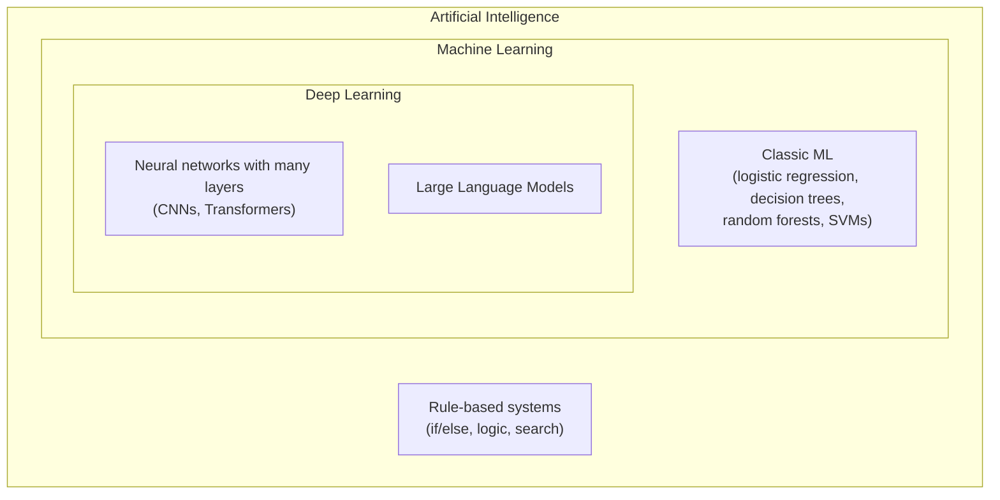
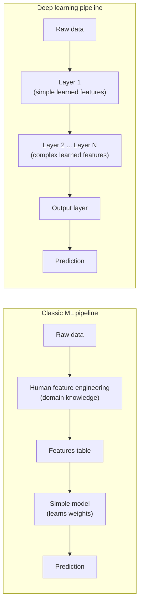
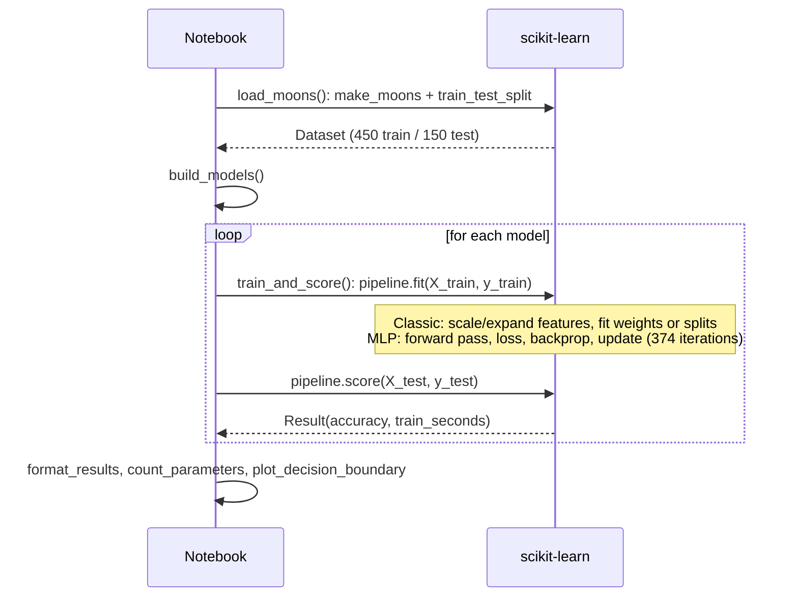
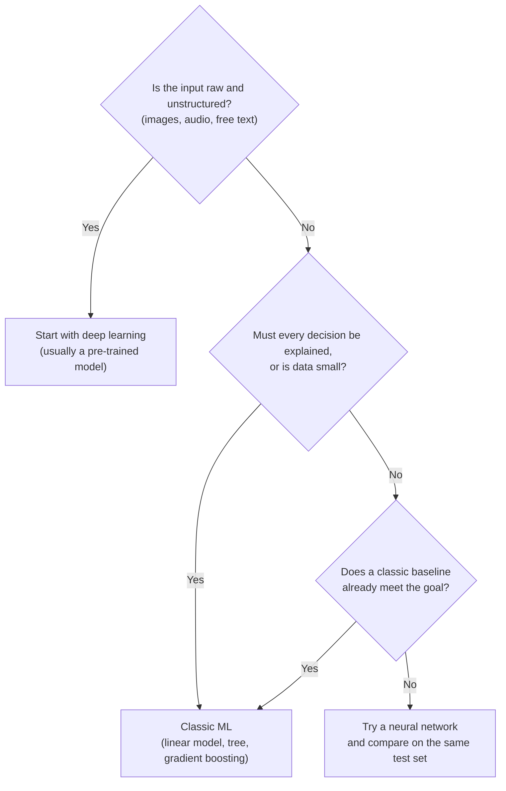

[Academy](../../index.md) › [Track 01: AI and LLM Fundamentals](../README.md) › [Module 1.1: Introduction to Artificial Intelligence](README.md)

# Machine Learning vs Deep Learning

| Field | Value |
|---|---|
| **Track** | Track 01: AI and LLM Fundamentals |
| **Module** | Module 1.1: Introduction to Artificial Intelligence |
| **Difficulty** | Beginner |
| **Estimated reading time** | 25–30 minutes (plus 15 minutes for the notebook) |
| **Prerequisites** | [What is Artificial Intelligence?](01-what-is-artificial-intelligence.md); Python basics help for the notebook |
| **Technologies** | Python, scikit-learn, numpy, matplotlib, Jupyter, pytest |
| **Framework versions** | Python 3.14.5, numpy 2.5.5, scikit-learn 1.9.1, matplotlib 3.11.2, nbclient 0.11.0, nbformat 5.11.1, ipykernel 7.4.0, pytest 9.2.0 |
| **Last verified date** | 2026-11-17 |
| **Companion code** | [`examples/01-AI-FUNDAMENTALS/05-machine-learning-vs-deep-learning/`](../../../examples/01-AI-FUNDAMENTALS/05-machine-learning-vs-deep-learning/) |

> ✅ **Code status:** The companion notebook and tests were run on Windows 11 with the versions above. Every output block marked **"Actual output"** was copied from that run. Blocks marked **"Illustrative"** were written by hand. Accuracies are reproducible (fixed random seed 42); **training times change on every run and every machine**.

---

## Table of Contents

1. [Introduction](#1-introduction)
2. [Learning Objectives](#2-learning-objectives)
3. [Prerequisites](#3-prerequisites)
4. [Fundamental Concepts](#4-fundamental-concepts)
5. [Internal Architecture](#5-internal-architecture)
6. [Installation and Environment Setup](#6-installation-and-environment-setup)
7. [Project Folder Structure](#7-project-folder-structure)
8. [Step-by-Step Implementation](#8-step-by-step-implementation)
9. [Execution and Expected Output](#9-execution-and-expected-output)
10. [Internal Execution Flow](#10-internal-execution-flow)
11. [Advanced Concepts](#11-advanced-concepts)
12. [Real-World Use Cases](#12-real-world-use-cases)
13. [Best Practices](#13-best-practices)
14. [Common Errors and Troubleshooting](#14-common-errors-and-troubleshooting)
15. [Comparison and Alternatives](#15-comparison-and-alternatives)
16. [Hands-on Exercises](#16-hands-on-exercises)
17. [Interview Preparation](#17-interview-preparation)
18. [Summary](#18-summary)
19. [Next Learning Step](#19-next-learning-step)
20. [References](#20-references)

---

## 1. Introduction

### What is the topic?

People often use "AI", "machine learning" and "deep learning" as if they meant the same thing. They don't. They are **nested**:

- **Artificial intelligence (AI)** is the whole field: any software that produces smart-looking predictions, decisions or content. It includes hand-written rule systems.
- **Machine learning (ML)** is the part of AI where the computer **learns patterns from example data** instead of following rules a person wrote.
- **Deep learning (DL)** is the part of ML that uses **neural networks with many layers**. Those layers learn their own internal features from raw data.



*Diagram: every deep-learning model is a machine-learning model, and every machine-learning model is a kind of AI. The reverse is not true.*

In this lesson, "classic ML" (sometimes called "traditional" or "shallow" ML) means machine learning **without** deep neural networks.

### Why does the difference matter?

Because the two approaches have very different costs. A classic model may train in milliseconds on a laptop and be explained in one sentence. A deep model may need a GPU cluster, millions of examples, and still be hard to explain. Picking the wrong one wastes money or gives poor results.

### What problem does each solve?

- **Classic ML** solves "learn a pattern from **well-described** data": tables of numbers or categories where a person already knows which columns (features) matter.
- **Deep learning** solves "learn a pattern from **raw, messy** data": pixels, sound waves, text. Nobody can easily write down the right features for "is this a cat?", so the network learns them.

### Why should AI agent engineers learn it?

The "brain" of a modern AI agent is a **large language model (LLM)**, and an LLM is a deep-learning model. But the tools around an agent (spam filters, fraud scores, routers, rankers) are often classic ML because it is cheaper and easier to explain. Good engineers know which to reach for.

### Where is each used?

| Classic ML | Deep learning |
|---|---|
| Credit scoring, churn prediction, demand forecasting on spreadsheets | Image recognition, speech-to-text, translation |
| Fraud rules learned from transaction tables | Chatbots and LLM agents |
| Simple recommendation and ranking features | Image and text generation |

---

## 2. Learning Objectives

After this lesson you will be able to:

- Place AI, ML, deep learning and LLMs correctly in the "nested circles" picture.
- Explain the difference between **hand-crafted features** and **learned features**.
- Compare classic ML and deep learning on accuracy, data needs, compute, and interpretability.
- Choose a sensible starting approach for a new problem.
- Run a notebook that shows a straight-line model failing on curved data, feature engineering fixing it, and a small neural network learning the curve by itself.
- Explain why LLMs are deep learning.

---

## 3. Prerequisites

- **Lessons:** [What is Artificial Intelligence?](01-what-is-artificial-intelligence.md) (features, labels, training, test sets). The previous lesson, [Narrow AI vs General AI](04-narrow-ai-vs-general-ai.md), is useful context.
- **Programming:** basic Python (variables, functions, `for` loops). You do not need to write code to follow the article.
- **Tools:** Python 3.10 or newer (tested on 3.14.5), a terminal, and a browser for Jupyter.
- **Math:** none required. We explain the few ideas we need in plain words.

---

## 4. Fundamental Concepts

### 4.1 Features

- **Definition:** A **feature** is one measurable input to a model, such as "house size in m²" or "number of failed logins".
- **Why it matters:** A model can only learn from what you give it. Good features make learning easy; bad features make it impossible.
- **Analogy:** Features are the questions a doctor asks. Ask the right ones and diagnosis is easy.
- **Example:** In our notebook each point has two features: its `x` and `y` position.

### 4.2 Hand-crafted features (classic ML)

- **Definition:** Features that a **person** designs from domain knowledge before training. This is called **feature engineering**.
- **How it works:** You look at the problem, guess what signals help, and compute them: ratios, counts, squares, date parts, keyword flags.
- **Analogy:** A chef chops and measures the ingredients before cooking. The oven (the model) just bakes.
- **Example:** In the notebook, we turn `x, y` into 9 columns (`x²`, `x·y`, `y³`, ...). A straight-line model can then draw a curve.
- **Trade-off:** Works well when experts know what matters. Slow and hard when they don't (what are the "features" of a face?).

### 4.3 Learned features (deep learning)

- **Definition:** Features that the **model discovers by itself** during training, inside its hidden layers.
- **How it works:** A neural network is a stack of layers. Each layer takes numbers in, multiplies them by learned weights, adds them up, applies a simple non-linear function (such as ReLU, which turns negative values into zero), and passes new numbers on. Early layers learn simple patterns (in images: edges); later layers combine them into complex ones (eyes, faces). This idea is called **representation learning**.
- **Analogy:** Instead of a chef preparing ingredients, you have a team of apprentices; each learns, from thousands of meals, which preparation helps the next person in the line.
- **Example:** Our `MLPClassifier` gets only raw `x` and `y`. Its two hidden layers of 16 units learn the curve without any `x²` from us.

### 4.4 "Deep"

- **Definition:** "Deep" just means **many layers** between input and output. There is no exact cut-off. Our 2-hidden-layer network is a *tiny* neural network that shows the idea; real deep models have dozens to hundreds of layers.

### 4.5 Parameters

- **Definition:** **Parameters** (or weights) are the numbers a model adjusts during training.
- **Why it matters:** More parameters means more flexibility, but also more data and compute to set them well, and more difficulty explaining them.
- **Example (Actual, from the notebook):** plain logistic regression learns **3** numbers; our small neural network learns **337**. GPT-class LLMs learn billions.

### 4.6 Interpretability

- **Definition:** How easily a person can understand **why** a model gave an answer.
- **Classic ML:** a logistic regression has one weight per feature; a small decision tree prints as if/else rules. Easy to audit.
- **Deep learning:** each hidden unit mixes all its inputs, so individual weights mean little. You need special tools (feature attributions, probing) and even those give partial answers.

### 4.7 Data and compute needs

- **Classic ML** often works with hundreds to thousands of rows and trains on a laptop CPU in seconds.
- **Deep learning** usually shines with large datasets (often tens of thousands of examples or far more) and benefits greatly from GPUs. Its accuracy tends to keep improving as data grows, where classic models level off sooner.
- This is a **rule of thumb**, not a law. Our notebook shows that a *very small* network on a *very simple* problem does fine with little data (see [Section 9](#93-reading-the-results)).

---

## 5. Internal Architecture

The real difference is **who does the feature work**.



*Diagram: in classic ML a human turns raw data into features and the model only learns the final weighting. In deep learning the model learns every step from raw data to prediction ("end-to-end").*

**Components and responsibilities**

| Component | Classic ML | Deep learning |
|---|---|---|
| Feature extraction | A person (code, SQL, domain rules) | Hidden layers, learned |
| Model | Few parameters (linear, tree, ensemble) | Thousands to billions of parameters |
| Training | Often a closed-form or fast optimiser, CPU | Gradient descent with backpropagation, often GPU |
| Explanation | Weights, rules, feature importances | Post-hoc tools, approximate |

**How a neural network trains (in one paragraph).** Start with random weights. Push a batch of examples forward through the layers to get predictions. Measure how wrong they are with a **loss** function. **Backpropagation** works out how much each weight contributed to the error, and **gradient descent** nudges every weight a little in the direction that reduces the error. Repeat thousands of times. You met backpropagation in the [History of AI](02-history-of-artificial-intelligence.md) lesson.

---

## 6. Installation and Environment Setup

No API keys, no GPU. From the repository root:

```bash
cd examples/01-AI-FUNDAMENTALS/05-machine-learning-vs-deep-learning
python -m venv .venv
# Windows (PowerShell): .venv\Scripts\Activate.ps1
# macOS / Linux:        source .venv/bin/activate
pip install -r requirements.txt
```

`requirements.txt` pins the versions we tested (numpy, scikit-learn, matplotlib, nbformat, nbclient, ipykernel, pytest). It also lists `notebook` (the browser UI for `jupyter notebook`) without a pin, because the tests do not use it.

---

## 7. Project Folder Structure

```text
05-machine-learning-vs-deep-learning/
├── ml_vs_dl.ipynb        # The step-by-step notebook: all the code, saved with outputs
├── README.md             # How to run
├── requirements.txt      # Pinned versions
├── pytest.ini            # pytest settings
└── tests/
    └── test_notebook.py  # Runs the whole notebook and fails on any error
```

Everything lives in one self-contained notebook: each Markdown explanation is followed by a small code cell, its output, and a short interpretation. Each helper function is defined in the cell where it is first explained, and a few "quick check" cells use `assert` to confirm key results.

---

## 8. Step-by-Step Implementation

The full code is in the notebook: **[ml_vs_dl.ipynb](../../../examples/01-AI-FUNDAMENTALS/05-machine-learning-vs-deep-learning/ml_vs_dl.ipynb)**. Here are the key pieces.

### Step 1: A curved dataset

`make_moons` creates two interleaving half circles. No straight line can separate them, which makes it a tiny test of non-linear learning.

```python
# ml_vs_dl.ipynb, section 2
def load_moons(n_samples: int = 600, noise: float = 0.25, seed: int = SEED) -> Dataset:
    """Make the two-moons dataset and split it 75 % train / 25 % test."""
    X, y = make_moons(n_samples=n_samples, noise=noise, random_state=seed)
    X_train, X_test, y_train, y_test = train_test_split(
        X, y, test_size=0.25, random_state=seed, stratify=y
    )
    return Dataset(X_train, X_test, y_train, y_test)
```

`random_state=seed` makes the data and split identical on every run. `stratify=y` keeps the two classes balanced in both splits.

### Step 2: The four models

```python
# ml_vs_dl.ipynb, section 3
def build_models(seed: int = SEED) -> dict[str, Pipeline]:
    return {
        "logistic regression (raw x, y)": make_pipeline(
            StandardScaler(), LogisticRegression()
        ),
        "logistic regression + engineered features": make_pipeline(
            PolynomialFeatures(degree=3, include_bias=False),  # hand-crafted features
            StandardScaler(),
            LogisticRegression(max_iter=1000),
        ),
        "decision tree": make_pipeline(
            DecisionTreeClassifier(max_depth=5, random_state=seed)
        ),
        "neural network (MLP)": make_pipeline(
            StandardScaler(),
            MLPClassifier(hidden_layer_sizes=(16, 16), max_iter=2000, random_state=seed),
        ),
    }
```

- The first two models are **the same algorithm**. Only the input features differ, so any accuracy change comes from feature engineering.
- `PolynomialFeatures(degree=3)` is our "human expert": it adds `x²`, `x·y`, `y²`, `x³`, ... columns.
- `MLPClassifier(hidden_layer_sizes=(16, 16))` is a neural network with two hidden layers of 16 units. It only gets scaled `x` and `y`.
- `StandardScaler` rescales inputs to mean 0 and standard deviation 1. Neural networks are sensitive to feature scale, and scikit-learn's docs recommend scaling for them.

### Step 3: Train, time and score

```python
# ml_vs_dl.ipynb, section 3
def train_and_score(name: str, model: Pipeline, data: Dataset) -> Result:
    start = time.perf_counter()
    model.fit(data.X_train, data.y_train)
    seconds = time.perf_counter() - start
    accuracy = float(model.score(data.X_test, data.y_test))
    return Result(name=name, accuracy=accuracy, train_seconds=seconds)
```

Training uses only the training split. Accuracy is measured on the **test** split, which the model never saw.

### Step 4: Explain the models

The notebook prints logistic regression's weights and the top of the decision tree with `sklearn.tree.export_text`, and counts each model's learned numbers with a small `count_parameters` helper. It also draws each model's **decision boundary** (Step 7 of the notebook).

### Step 5: Tests

The notebook checks itself with a few short `assert` lines in "quick check" cells: the split sizes, that the fixed seed gives the same data twice, that engineered features and the network both beat the raw linear model, and the 337-parameter count. `tests/test_notebook.py` runs every notebook cell with `nbclient` and fails on any error, including a failed `assert`:

```python
# tests/test_notebook.py
nb = nbformat.read(NOTEBOOK, as_version=4)
client = NotebookClient(nb, timeout=300, kernel_name="python3",
                        resources={"metadata": {"path": str(FOLDER)}})
client.execute()  # raises CellExecutionError if any cell fails
```

No test depends on exact timings.

---

## 9. Execution and Expected Output

### 9.1 Run the notebook

```bash
jupyter notebook ml_vs_dl.ipynb
```

Then choose **Run → Run All Cells**. The notebook is saved with its outputs, so you can also just read it on GitHub.

### 9.2 Key outputs

**Actual output** (notebook section 4, the engineered features):

```text
2 raw features become 9 engineered features:
['x', 'y', 'x^2', 'x y', 'y^2', 'x^3', 'x^2 y', 'x y^2', 'y^3']
```

**Actual output** (notebook section 6, the comparison; Windows 11, Python 3.14.5, scikit-learn 1.9.1, 2026-11-17):

```text
model                                      accuracy  train time
logistic regression (raw x, y)               86.0%      3.1 ms
logistic regression + engineered features    92.0%      4.7 ms
decision tree                                92.7%      1.1 ms
neural network (MLP)                         94.7%    225.4 ms

logistic regression (raw x, y)             learned numbers: 3
logistic regression + engineered features  learned numbers: 10
decision tree                              learned numbers: 27
neural network (MLP)                       learned numbers: 337
(for the tree, the count is the number of nodes)
```

> Your training times **will differ**: they change on every run and depend on your CPU. Accuracies and parameter counts should match exactly with the pinned versions.

The notebook also draws each model's decision boundary. In the run above: plain logistic regression draws a straight line; with engineered features the line bends into a curve; the decision tree makes a staircase of rectangles; the neural network bends its boundary around the moons from raw inputs alone.

**Actual output** (notebook section 8, interpretability):

```text
logistic regression weights (x, y): [[ 1.13 -2.16]]  bias: [-0.03]

decision tree, top two levels of rules:
|--- y <= 0.25
|   |--- x <= -0.56
|   |   |--- class: 0
|   |--- x >  -0.56
|   |   |--- truncated branch of depth 4
|--- y >  0.25
|   |--- x <= 1.31
|   |   |--- truncated branch of depth 4
|   |--- x >  1.31
|   |   |--- class: 1
```

(The logistic regression weights apply to the *scaled* `x` and `y`, because the pipeline scales first.)

**Actual output** (notebook section 9, less training data):

```text
 20 training points:  engineered LR 84.7%   neural net 86.0%
 50 training points:  engineered LR 88.7%   neural net 89.3%
450 training points:  engineered LR 92.0%   neural net 94.7%
```

### 9.3 Reading the results

- **Feature engineering works.** The same logistic regression went from 86.0 % to 92.0 % just because a human added better features.
- **Learned features work too.** The network reached 94.7 % from raw `x, y` with no feature engineering.
- **But they cost more.** The network trained roughly 50–200 times slower than the classic models here and has about 100 times more parameters than plain logistic regression.
- **Classic models are easier to explain.** "Weight on `y` is −2.16" or "if `y <= 0.25` and `x <= -0.56` then class 0" are readable. 337 network weights are not.
- **Data:** on this toy problem, both models stay close with little data, and the network's lead grows with more data. The well-known "deep learning needs huge data" rule is about *large* networks on *hard* problems; our 337-parameter network on 2-D points is small enough to cope.

### 9.4 Run the tests

```bash
python -m pytest
```

**Actual output:**

```text
tests	est_notebook.py .                                                 [100%]

============================== 1 passed in 5.60s ==============================
```

(The time varies by machine; most of it is starting a Jupyter kernel to run the notebook.)

### 9.5 How to verify it works

- [ ] Every notebook cell runs without a red error.
- [ ] Engineered logistic regression beats plain logistic regression.
- [ ] The neural network beats plain logistic regression without engineered features.
- [ ] The neural network has the longest training time.
- [ ] `python -m pytest` reports `1 passed`.

---

## 10. Internal Execution Flow



1. **Input:** each point is a row `[x, y]`.
2. **Transformation:** each pipeline transforms the inputs first (scaling, or polynomial expansion + scaling).
3. **Training:** logistic regression and the tree fit quickly. The MLP repeats forward pass → loss → backpropagation → weight update until the loss stops improving (374 passes over the data in our run).
4. **Inference:** `predict` runs the same transforms, then the model. For the MLP that is two hidden layers of 16 ReLU units and one output unit giving the class probability.
5. **Errors:** if any cell fails (including a quick-check `assert`), `nbclient` raises `CellExecutionError` and the notebook test fails.

---

## 11. Advanced Concepts

- **Why the network beat plain logistic regression.** Without hidden layers and non-linear activations, stacking layers would still produce only a straight line. The non-linearity (ReLU) lets each layer bend the space, so later layers see a problem that *is* nearly straight. That is what "learning features" means mathematically.
- **Transfer learning.** Deep models trained on huge datasets can be reused: you keep their learned features and retrain only the last layers on your small dataset. This is why you can build a good image classifier with a few hundred photos, and why LLMs can be adapted to new tasks.
- **Tabular data is still classic-ML territory.** On spreadsheet-style data with meaningful columns, gradient-boosted trees (e.g. scikit-learn's `HistGradientBoostingClassifier`) are a very strong baseline and often match or beat neural networks with far less tuning.
- **LLMs are deep learning.** A large language model is a deep neural network (a Transformer) with billions of parameters, trained on huge text collections to predict the next token. Everything in this lesson applies at a much larger scale: learned features (here called embeddings and hidden states), massive data and compute, and limited interpretability. You will study them in later tracks.
- **Hybrid systems.** Real agents mix both: an LLM to understand a request, plus a small classic model for a cheap, explainable score, plus rules as guardrails.

---

## 12. Real-World Use Cases

| Use case | Typical choice | Why | Limitation |
|---|---|---|---|
| **Loan default risk** from application data | Classic ML (logistic regression, gradient-boosted trees) | Tabular features, regulators require explanations | Needs good feature engineering and fairness checks |
| **Customer churn prediction** | Classic ML | Structured CRM data, fast retraining, clear drivers ("no login in 30 days") | Misses signals hidden in free-text support tickets |
| **Medical image triage** (X-ray, skin photos) | Deep learning (CNNs or vision Transformers), often via transfer learning | Raw pixels; nobody can hand-write features for every finding | Needs large labelled datasets, clinical validation and human review |
| **Speech-to-text in a support centre** | Deep learning | Raw audio; deep models are far ahead | Compute cost; accents and noise can still fail |
| **AI agent for an IT help desk** | Deep learning (LLM) for understanding + classic ML/rules for routing and guardrails | LLM handles language; small models are cheap and auditable | LLM can be wrong confidently; needs evaluation and escalation |

---

## 13. Best Practices

- **Start simple.** Train a classic baseline first. If a deep model can't clearly beat it, ship the simple one.
- **Use pipelines.** Keep scaling and feature steps inside a scikit-learn `Pipeline` so training and prediction always apply the same transforms.
- **Scale inputs for neural networks.** `StandardScaler` before `MLPClassifier`.
- **Fix random seeds** when comparing models, and compare on the same held-out test set.
- **Measure cost, not just accuracy.** Training time, inference latency, hardware and maintenance matter in production.
- **Keep explainability requirements in mind** early (finance, healthcare, hiring).
- **Test your notebooks.** Add a few `assert` checks for the results that matter and run the whole notebook automatically (here with `nbclient` and pytest), as this project does.

---

## 14. Common Errors and Troubleshooting

| Problem | Cause | Fix |
|---|---|---|
| `ConvergenceWarning: Stochastic Optimizer: Maximum iterations reached` | The MLP did not finish learning within `max_iter` | Increase `max_iter`, scale the inputs, or try `solver="lbfgs"` for small datasets |
| `NameError: name 'load_moons' is not defined` (or another helper) | A cell was run before the cell that defines it, e.g. after restarting the kernel | Use **Run → Run All Cells**, or run the cells from the top in order |
| `AssertionError` in a quick-check cell | You changed the data or models, so a check written for the default settings no longer holds | Expected after experiments; restore the defaults or update the check |
| `No such kernel named python3` when running tests | `ipykernel` missing in the active environment | Activate the venv and `pip install -r requirements.txt` |
| Accuracy differs from the article | Different library versions or seed | Use the pinned `requirements.txt`; keep `random_state=42` |
| Training times differ from the article | Normal: timing depends on CPU and load | Compare relative sizes, not exact values |
| Neural network accuracy is poor | Unscaled inputs or too few hidden units | Keep `StandardScaler`; try larger `hidden_layer_sizes` |

**Debugging tip:** when a model underperforms, plot its decision boundary (the notebook's `plot_decision_boundary`). A straight line on curved data tells you the model is too simple; a jagged boundary wrapping individual points suggests overfitting.

---

## 15. Comparison and Alternatives

| | Classic machine learning | Deep learning |
|---|---|---|
| **Features** | Hand-crafted by people | Learned by the network from raw data |
| **Best data type** | Structured tables | Images, audio, text, video |
| **Data needed** | Hundreds to thousands of rows can be enough | Usually much more; transfer learning reduces this |
| **Compute** | CPU, seconds to minutes | Often GPUs, minutes to weeks |
| **Interpretability** | Usually high (weights, rules) | Low; needs special tools |
| **Tuning effort** | Low to moderate | Higher (architecture, learning rate, layers) |
| **Examples** | Logistic regression, decision trees, random forests, gradient boosting, SVMs | CNNs, RNNs, Transformers, LLMs |

**When to pick which**



*Diagram: a rough guide, not a rule. Always compare against a simple baseline.*

---

## 16. Hands-on Exercises

### Beginner

1. **More noise.** Change `noise` in `load_moons` to `0.4`. Which model's accuracy drops most? *Hint:* edit the call in notebook section 2. *Outcome:* see how noisy data limits every model.
2. **Fewer features.** Change `PolynomialFeatures(degree=3)` to `degree=2`. Does engineered logistic regression still beat the raw one? *Outcome:* feel how feature choice drives classic-ML accuracy.
3. **Read the tree.** Change `max_depth=1` in the `export_text` call to `max_depth=2`. Can you trace one test point through the rules by hand?

### Intermediate

1. **Network size.** Try `hidden_layer_sizes=(4,)`, `(16, 16)` and `(64, 64, 64)`. Record accuracy, training time and parameter count. *Hint:* use `count_parameters`.
2. **Real images.** Replace the moons with `sklearn.datasets.load_digits` (8×8 handwritten digits, 64 pixel features). Compare plain logistic regression and the MLP. *Hint:* skip `plot_decision_boundary`, which only works for 2-D data.
3. **Stronger classic baseline.** Add `HistGradientBoostingClassifier` to `build_models` and compare.

### Advanced

1. **Learning curve.** Repeat the data-size experiment with 5 different seeds and plot mean accuracy vs training size for both models. Does the "network gains more from data" pattern hold on average? *Hint:* use `random_state` in `load_moons`.
2. **Look inside the network.** Compute the first hidden layer's outputs for a grid of points (`max(0, X @ coefs_[0] + intercepts_[0])` on scaled inputs) and plot one unit at a time. Each unit is a learned feature: what shapes do you see?

---

## 17. Interview Preparation

### Beginner

1. **What is the relationship between AI, ML and deep learning?**
   Nested sets: deep learning is a kind of machine learning, which is a kind of AI. Rule-based expert systems are AI but not ML; logistic regression is ML but not deep learning.
2. **What is a feature?**
   One measurable input to a model, such as transaction amount or pixel brightness.
3. **What is feature engineering?**
   A person creating better input features from raw data using domain knowledge, e.g. "days since last purchase" or polynomial terms like `x²`.
4. **What does "deep" mean in deep learning?**
   The model is a neural network with many layers between input and output; each layer learns features built on the previous layer's.
5. **Name two classic ML algorithms and two deep-learning architectures.**
   Logistic regression, decision trees; convolutional neural networks (CNNs), Transformers.
6. **Is an LLM machine learning or deep learning?**
   Both: it is a deep-learning model (a large Transformer), and all deep learning is machine learning.

### Intermediate

1. **Why does deep learning usually need more data?**
   It has many more parameters to set. With little data it can memorise the training set (overfit) instead of learning general patterns. Transfer learning reduces this need.
2. **Why might you choose logistic regression over a neural network?**
   Small or tabular data, need for explanations (lending, healthcare), low latency or cost, or when it already meets the accuracy goal. In our notebook, engineered logistic regression reached 92.0 % vs the network's 94.7 %, trained much faster and has 10 readable weights.
3. **Why do neural networks need non-linear activation functions?**
   Without them, stacked layers collapse to a single linear function and can only draw straight boundaries, no better than logistic regression.
4. **What is backpropagation?**
   The algorithm that computes how much each weight contributed to the loss, so gradient descent can adjust all weights to reduce error.

### Advanced

1. **On tabular data, which typically wins: deep learning or gradient-boosted trees?**
   Gradient-boosted trees are often as good or better and much easier to tune, so they are the usual first choice. Neural networks become attractive when tables are huge or combined with text/images.
2. **How would you explain a deep model's decision to a regulator?**
   Use post-hoc tools (feature attributions such as SHAP or integrated gradients, example-based explanations), document training data and evaluation, and consider an interpretable model if the regulation requires decision-level explanations. Admit that post-hoc explanations are approximations.

---

## 18. Summary

- **AI ⊃ ML ⊃ deep learning ⊃ LLMs.**
- **Classic ML** learns weights over **features chosen by people**. It is fast, works with modest data and is easy to explain.
- **Deep learning** stacks layers that **learn their own features** from raw data. It leads on images, audio and text but needs more data, compute and effort to explain.
- In our notebook, feature engineering lifted logistic regression from 86.0 % to 92.0 %; a small network reached 94.7 % from raw inputs, but trained far slower and has 337 parameters vs 3.
- Start with a simple baseline; reach for deep learning when the data is raw and complex or the baseline is not good enough.
- LLMs, the brains of AI agents, are very large deep-learning models.

### Checklist

- [ ] I can draw the nested AI / ML / DL / LLM diagram.
- [ ] I can explain hand-crafted vs learned features with an example.
- [ ] I can list three trade-offs between classic ML and deep learning.
- [ ] I ran the notebook and can explain why plain logistic regression scored lowest.
- [ ] I can say when I would pick each approach.

---

## 19. Next Learning Step

Every model in this lesson learned from **labelled** examples: each point came with the right answer (class 0 or 1). That style of learning, whether classic or deep, is called **supervised learning**, and it is the subject of the next lesson, **[Supervised Learning](06-supervised-learning.md)**. You will look more closely at labels, classification vs regression, training/validation/test splits, and how to measure a model properly.

---

## 20. References

Documentation and articles (checked on 2026-11-17):

| Resource | Link |
|---|---|
| scikit-learn: Neural network models (supervised) | <https://scikit-learn.org/stable/modules/neural_networks_supervised.html> |
| scikit-learn: `MLPClassifier` API reference | <https://scikit-learn.org/stable/modules/generated/sklearn.neural_network.MLPClassifier.html> |
| scikit-learn: `LogisticRegression` API reference | <https://scikit-learn.org/stable/modules/generated/sklearn.linear_model.LogisticRegression.html> |
| scikit-learn: `PolynomialFeatures` API reference | <https://scikit-learn.org/stable/modules/generated/sklearn.preprocessing.PolynomialFeatures.html> |
| scikit-learn: `make_moons` API reference | <https://scikit-learn.org/stable/modules/generated/sklearn.datasets.make_moons.html> |
| scikit-learn: `export_text` API reference | <https://scikit-learn.org/stable/modules/generated/sklearn.tree.export_text.html> |
| Google Machine Learning Crash Course: Neural networks | <https://developers.google.com/machine-learning/crash-course/neural-networks> |
| Google Machine Learning Crash Course: Feature crosses | <https://developers.google.com/machine-learning/crash-course/categorical-data/feature-crosses> |
| IBM: What is machine learning? | <https://www.ibm.com/think/topics/machine-learning> |
| IBM: What is deep learning? | <https://www.ibm.com/think/topics/deep-learning> |
| nbclient documentation | <https://nbclient.readthedocs.io/en/latest/> |

Further reading (look these up from their publishers):

- Yann LeCun, Yoshua Bengio and Geoffrey Hinton, "Deep learning", *Nature* 521, 2015 (review of representation learning and deep networks).
- Ian Goodfellow, Yoshua Bengio and Aaron Courville, *Deep Learning*, MIT Press, 2016 (free online edition on the authors' book website).

See also: [Academy references](../../references.md)

---

[⬅️ Narrow AI vs General AI](04-narrow-ai-vs-general-ai.md) | [⬆️ Module overview](README.md) | [Supervised Learning ➡️](06-supervised-learning.md)
