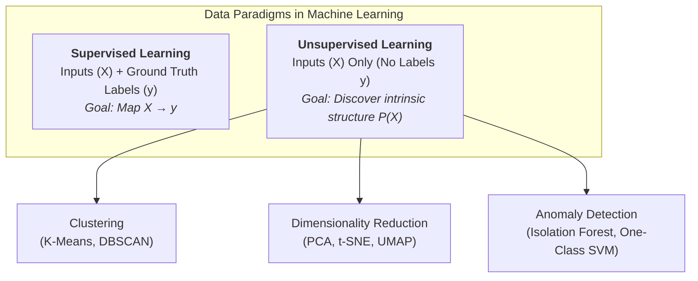
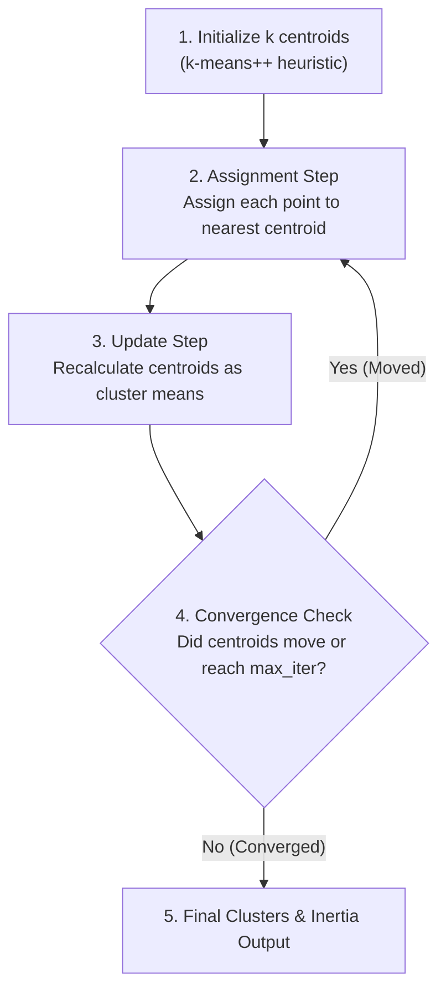
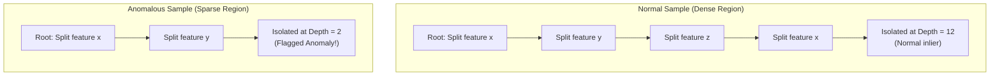
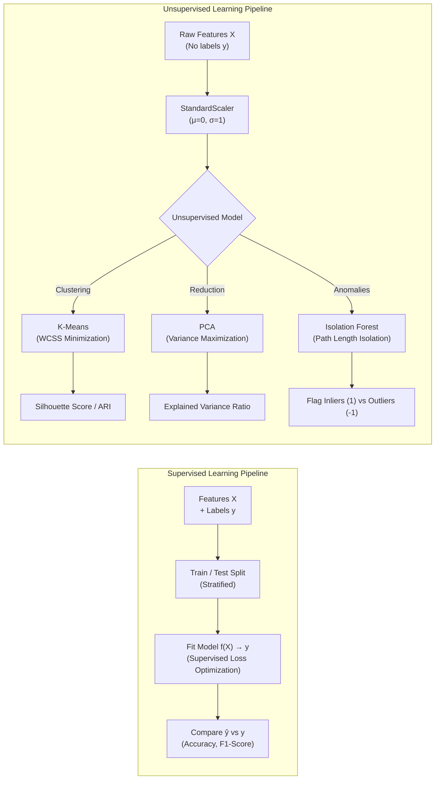
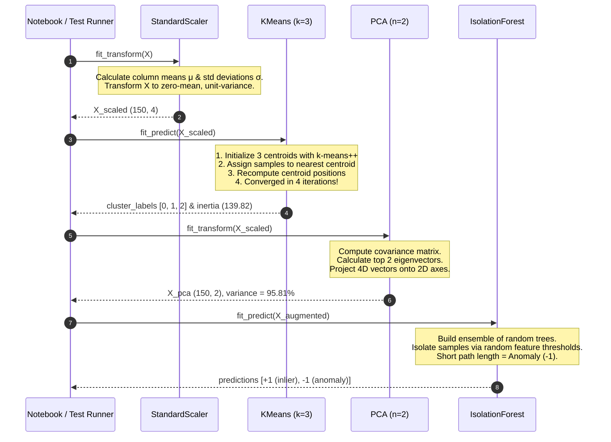
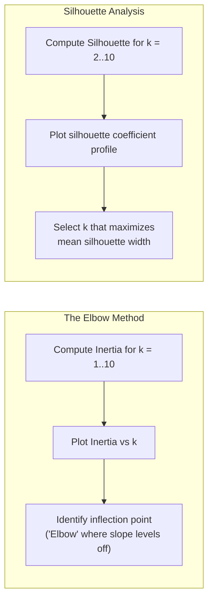
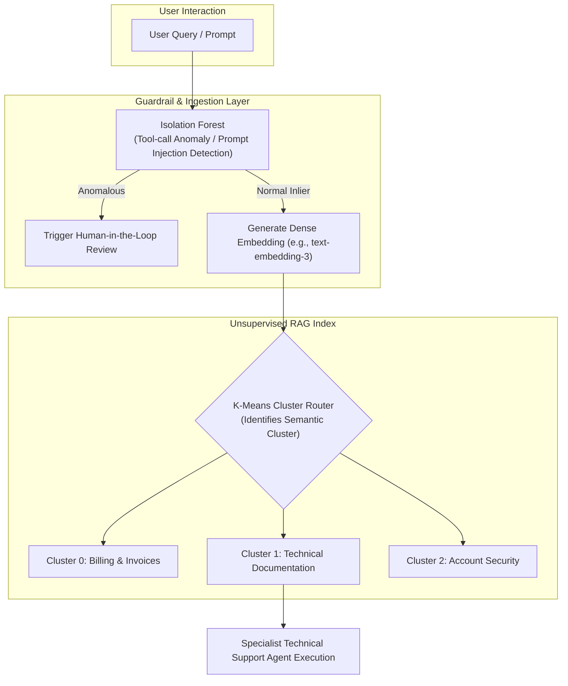
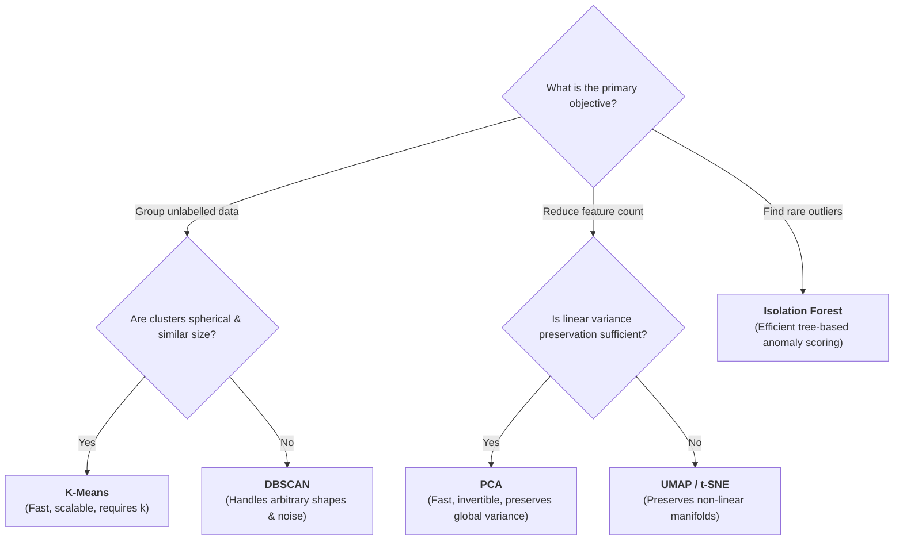

[Academy](../../index.md) › [Track 01: AI and LLM Fundamentals](../README.md) › [Module 1.1: Introduction to Artificial Intelligence](README.md)

# Unsupervised Learning

| Field | Value |
|---|---|
| **Track** | Track 01: AI and LLM Fundamentals |
| **Module** | Module 1.1: Introduction to Artificial Intelligence |
| **Difficulty** | Beginner |
| **Estimated reading time** | 25–30 minutes (plus 15 minutes for the notebook) |
| **Prerequisites** | [Supervised Learning](06-supervised-learning.md); basic Python syntax (arrays, functions) |
| **Technologies** | Python, scikit-learn, numpy, matplotlib, Jupyter, pytest |
| **Framework versions** | Python 3.14.5, scikit-learn 1.9.1, numpy 2.5.0, matplotlib 3.11.2, nbclient 0.11.0, nbformat 5.11.1, ipykernel 7.4.0, pytest 9.1.1 |
| **Last verified date** | 2026-11-17 |
| **Companion code** | [`examples/01-AI-FUNDAMENTALS/07-unsupervised-learning/`](../../../examples/01-AI-FUNDAMENTALS/07-unsupervised-learning/) |

> ✅ **Code status:** The companion notebook and its tests were run on Windows 11 with the versions above. Every output block marked **"Actual output"** was copied directly from that run. Blocks marked **"Illustrative"** are written by hand. Accuracies, cluster metrics, and explained variance ratios are fully reproducible (fixed random seed 42).

---

## Table of Contents

1. [Introduction](#1-introduction)
2. [Learning Objectives](#2-learning-objectives)
3. [Prerequisites](#3-prerequisites)
4. [Fundamental Concepts](#4-fundamental-concepts)
5. [Internal Architecture](#5-internal-architecture)
6. [Installation and Environment Setup](#6-installation-and-environment-setup)
7. [Project Folder Structure](#7-project-folder-structure)
8. [Step-by-Step Implementation](#8-step-by-step-implementation)
9. [Execution and Expected Output](#9-execution-and-expected-output)
10. [Internal Execution Flow](#10-internal-execution-flow)
11. [Advanced Concepts](#11-advanced-concepts)
12. [Real-World Use Cases](#12-real-world-use-cases)
13. [Best Practices](#13-best-practices)
14. [Common Errors and Troubleshooting](#14-common-errors-and-troubleshooting)
15. [Comparison and Alternatives](#15-comparison-and-alternatives)
16. [Hands-on Exercises](#16-hands-on-exercises)
17. [Interview Preparation](#17-interview-preparation)
18. [Summary](#18-summary)
19. [Next Learning Step](#19-next-learning-step)
20. [References](#20-references)

---

## 1. Introduction

### What is the topic?

In [Supervised Learning](06-supervised-learning.md), an algorithm learns from paired examples: inputs $X$ (features) and target outputs $y$ (labels). A teacher grades every prediction, and the model adjusts its internal weights to minimize the difference between its guesses and the known answers.

**Unsupervised learning** operates without a teacher. The model receives only the feature matrix $X$ and is never provided with target labels $y$. Instead of predicting a predetermined ground truth, the algorithm explores the raw geometry, density, and relationships within the data to uncover **hidden structure, natural groupings, and statistical anomalies**.



*Diagram: Supervised learning maps inputs to teacher-supplied labels; unsupervised learning discovers the underlying geometry of unlabelled inputs.*

### Why does it exist?

Over 90% of the digital data generated worldwide—server logs, chat transcripts, sensor telemetry, audio streams, financial tick data, customer clickstreams—arrives completely unlabelled. 

Hiring human annotators to label millions of documents or medical images is slow, prohibitively expensive, prone to human bias, and often technically impossible when the underlying categories are unknown in advance. Unsupervised learning exists because software systems must extract actionable value, detect surprises, and organize massive stores of information without waiting for human hand-tagging.

### What problem does each core technique solve?

Unsupervised learning addresses three fundamental engineering challenges:

1. **Clustering:** *"How do these data points naturally group together?"* Partitions unlabelled data into cohesive cohorts (e.g., customer segmentation, topic modeling, document categorization).
2. **Dimensionality Reduction:** *"How can we compress hundreds or thousands of features into two or three dimensions without losing critical information?"* Overcomes the curse of dimensionality, accelerates downstream search algorithms, and visualizes complex data.
3. **Anomaly Detection:** *"Which observations deviate radically from typical behavior?"* Spots outliers without prior examples of failure or fraud (e.g., security intrusions, sensor failures, agent hallucination detection).

### Why should AI agent engineers learn it?

Modern AI agents do not live in clean spreadsheets with pre-assigned class tags. They operate in dynamic, open-ended environments where unsupervised algorithms form essential infrastructure:

- **Vector Search & RAG Partitioning:** Before querying a massive Retrieval-Augmented Generation (RAG) vector store, unsupervised clustering partitions document embeddings into thematic clusters, enabling lightning-fast hierarchical search and smart agent routing.
- **Embedding Compression:** Language model embeddings often have 1,536 or 3,072 dimensions. Dimensionality reduction algorithms like PCA compress these embeddings for compact in-memory indexing with minimal retrieval loss.
- **Agent Guardrails & Novelty Detection:** Unsupervised anomaly detectors monitor agent tool invocations, user prompts, and token distributions. If an agent suddenly outputs prompt injection signatures or bizarre tool arguments outside its historical baseline, an Isolation Forest flags the anomaly for human review.

### Where is it used in real-world applications?

| Domain | Unsupervised Task | Real-World Application |
|---|---|---|
| **E-Commerce & Retail** | Clustering | Segmenting customers by behavioral habits to personalize automated campaigns. |
| **Cybersecurity** | Anomaly Detection | Detecting zero-day network intrusions and unusual server access spikes. |
| **Genomics & Healthcare** | Dimensionality Reduction | Visualizing high-dimensional gene expression arrays to identify disease subtypes. |
| **Autonomous AI Agents** | Embedding Clustering | Grouping incoming customer tickets into intent clusters to assign specialist subagents. |
| **Finance** | Outlier Detection | Flagging anomalous credit card transactions in real time without historical fraud tags. |

---

## 2. Learning Objectives

By the end of this lesson, you will be able to:

- Articulate the core theoretical and mathematical differences between supervised and unsupervised learning.
- Implement **K-Means clustering** in Python using `scikit-learn` to partition unlabelled data into centroids.
- Evaluate clustering performance without ground truth labels using the **Silhouette Score**, and with ground truth benchmarks using the **Adjusted Rand Index (ARI)**.
- Apply **Principal Component Analysis (PCA)** to reduce 4-dimensional data down to 2 dimensions, explaining variance retention and orthogonal projections.
- Deploy an **Isolation Forest** to isolate outliers and synthetic anomalies from normal data distributions.
- Run, test, and verify an end-to-end Jupyter notebook and understand its execution lifecycle.
- Connect unsupervised learning mechanisms directly to modern AI Agent engineering challenges such as vector database clustering and security guardrails.

---

## 3. Prerequisites

- **Knowledge:** Understanding of foundational machine learning concepts (features, datasets, matrices) from [What is Artificial Intelligence?](01-what-is-artificial-intelligence.md) and [Machine Learning vs Deep Learning](05-machine-learning-vs-deep-learning.md). Basic familiarity with Python syntax (variables, functions, lists).
- **Environment:** Python 3.10 or newer (tested on Python 3.14.5).
- **Libraries:** `scikit-learn`, `numpy`, `matplotlib`, `nbformat`, `nbclient`, `pytest`.
- **Math Concepts:** Basic intuition for Cartesian distance (Euclidean distance: $\sqrt{\sum (x_i - y_i)^2}$) and variance (how spread out data points are). No advanced calculus or matrix algebra proofs required.

---

## 4. Fundamental Concepts

### 4.1 The Unlabelled Paradigm ($X$ without $y$)

- **Definition:** Unsupervised learning algorithms take an input feature matrix $X \in \mathbb{R}^{n \times d}$ (where $n$ is the number of samples and $d$ is the number of features per sample) and discover an underlying mapping, density function, or partition without any target vector $y$.
- **Why it is needed:** Real-world data collection rarely comes with annotations. Supervised models cannot train when $y$ is missing; unsupervised models ingest raw $X$ immediately.
- **Analogy:** Imagine giving an archaeologist 500 ancient ceramic shards with no written records. The archaeologist cannot "grade" them against an answer sheet. Instead, they arrange the shards on a table, grouping them by clay color, glaze thickness, and curvature, discovering three distinct historical pottery styles purely through observation.
- **Practical example:** In our companion notebook, we load the famous Iris dataset (150 flowers, 4 physical dimensions) and deliberately strip away the species column ($y$). The algorithms only see four floating-point numbers per flower.

### 4.2 Clustering and Centroids (K-Means)

- **Definition:** **Clustering** is the task of grouping data points such that points within the same cluster are more similar to each other than to points in other clusters. A **centroid** is the arithmetic mean position of all points assigned to a cluster.
- **Why it is needed:** Automatically identifies natural customer archetypes, topic groupings, or biological families without manual cataloging.
- **How it works:** K-Means minimizes the within-cluster sum of squares (**WCSS**, also called **inertia**):
  $$\text{Inertia} = \sum_{j=1}^{k} \sum_{x_i \in C_j} \|x_i - \mu_j\|^2$$
  where $\mu_j$ is the centroid of cluster $C_j$.
- **Analogy:** Imagine setting up $k$ campfires in a large, dark field full of hikers. Hikers walk to their nearest campfire. Once everyone gathers, each campfire is moved to the exact center of its group. The hikers look around, see if another campfire is now closer, and re-gather. This cycle repeats until neither the campfires nor the hikers need to move.



*Diagram: The iterative Lloyd's algorithm for K-Means clustering.*

### 4.3 Dimensionality Reduction and Principal Components (PCA)

- **Definition:** **Dimensionality reduction** transforms high-dimensional data into a lower-dimensional representation while preserving as much of the original data variance (information) as possible.
- **Why it is needed:** Datasets with dozens or thousands of features suffer from the **curse of dimensionality**: high-dimensional space becomes exponentially sparse, distance metrics lose contrast, training slows down, and humans cannot visualize the data.
- **How it works:** **Principal Component Analysis (PCA)** finds orthogonal axes (eigenvectors of the feature covariance matrix). The first principal component (PC1) points in the direction of greatest variance; the second principal component (PC2) is perpendicular (orthogonal) to PC1 and captures the second highest variance.
- **Analogy:** Imagine holding an intricate 3D hand sculpture in front of a white wall. If you shine a light from an arbitrary angle, the 2D shadow might look like an uninformative blob. But if you rotate the sculpture until the light catches the widest spread of the fingers, the 2D shadow preserves almost all the visual detail of the 3D original. PCA mathematically finds that exact optimal lighting angle.
- **Practical example:** The Iris dataset has 4 features (sepal length, sepal width, petal length, petal width). PCA projects all 150 points onto a 2D plane ($PC1, PC2$), capturing **95.81%** of the total variance.

### 4.4 Anomaly and Outlier Detection (Isolation Forest)

- **Definition:** An **anomaly** (or outlier) is a data point that deviates significantly from the remaining distribution, suggesting a different underlying mechanism, sensor fault, or malicious actor.
- **Why it is needed:** Traditional rule-based alerts fail when anomalies are subtle or novel. Supervised classification fails because anomalies are vanishingly rare (severe class imbalance) or never seen before.
- **How it works:** The **Isolation Forest** algorithm isolates points by randomly picking a feature and randomly picking a split value between that feature's minimum and maximum. Because anomalies are few and far between, they require **fewer random splits to be isolated into a leaf node** than normal, dense points.
- **Analogy:** Imagine a crowd of 150 people standing closely packed in the center of a park, with one lone stranger standing 100 meters away near the fence. If you draw random straight lines across the park to isolate individuals, you can separate the lone stranger with just one or two cuts. Isolating an individual in the dense center will take dozens of cuts. The fewer the cuts, the higher the anomaly score.



*Diagram: Isolation Forest isolates outliers in fewer random partitions than inliers.*

### 4.5 Evaluating Unsupervised Learning

In supervised learning, evaluation is straightforward: compare predictions $\hat{y}$ against known labels $y$ to get accuracy or precision. In unsupervised learning, true labels do not exist during deployment. We rely on two evaluation categories:

1. **Intrinsic Metrics (No labels required):**
   - **Silhouette Score:** Evaluates how well-separated clusters are. For each point $i$:
     $$s(i) = \frac{b(i) - a(i)}{\max(a(i), b(i))}$$
     where $a(i)$ is the mean distance to all other points in the same cluster, and $b(i)$ is the mean distance to points in the nearest neighboring cluster. The score ranges from $-1$ (incorrectly assigned) through $0$ (overlapping clusters) to $+1$ (dense, clearly separated clusters).
2. **Extrinsic Metrics (Used only for benchmarking when test labels exist):**
   - **Adjusted Rand Index (ARI):** Measures similarity between two clusterings (e.g., K-Means clusters vs ground truth botanical species), correcting for chance:
     $$\text{ARI} \in [-0.5, 1.0]$$
     A score of $1.0$ indicates perfect cluster alignment, while $0.0$ represents random cluster assignments.
   - **Note on Accuracy:** Standard accuracy cannot evaluate clustering because cluster IDs are arbitrary permutations. If cluster 0 corresponds to "Virginica", cluster 1 to "Setosa", and cluster 2 to "Versicolor", an accuracy calculation expecting label 0 to mean Setosa would mistakenly report zero! ARI is invariant to cluster label permutations.

---

## 5. Internal Architecture

The unsupervised learning pipeline contrasts sharply with supervised learning in both input requirements and internal transformation stages:



*Diagram: Architectural comparison between supervised model training and the multi-branch unsupervised discovery workflow.*

### Component Responsibilities

| Component | Class in `scikit-learn` | Mathematical Objective | Primary Hyperparameters | Output Artifact |
|---|---|---|---|---|
| **Feature Scaler** | `StandardScaler` | Normalizes columns to $\mu=0, \sigma=1$ | None | Scaled feature matrix $X_{\text{scaled}}$ |
| **Clustering Engine** | `KMeans` | Minimizes intra-cluster squared distance (Inertia) | `n_clusters`, `n_init`, `random_state` | Cluster labels ($0, 1, \dots, k-1$), Centroids ($\mu_k$) |
| **Dimensionality Reducer** | `PCA` | Projects data along axes of maximal orthogonal variance | `n_components` | Low-dimensional components, explained variance ratio |
| **Anomaly Detector** | `IsolationForest` | Identifies low-depth tree isolation instances | `contamination`, `n_estimators`, `random_state` | Outlier flags: $+1$ (normal), $-1$ (anomaly) |
| **Intrinsic Evaluator** | `silhouette_score` | Quantifies cluster cohesion vs separation | None (metric is Euclidean) | Scalar float $[-1.0, 1.0]$ |
| **Extrinsic Evaluator** | `adjusted_rand_score` | Measures agreement with benchmark ground truth | None | Scalar float $[-0.5, 1.0]$ |

---

## 6. Installation and Environment Setup

To run the companion project and verify all results locally, set up a isolated Python virtual environment:

```bash
# Navigate to the companion project directory
cd examples/01-AI-FUNDAMENTALS/07-unsupervised-learning

# Create virtual environment
python -m venv .venv

# Activate virtual environment
# Windows (PowerShell):
.venv\Scripts\Activate.ps1
# macOS / Linux:
source .venv/bin/activate

# Upgrade pip and install pinned dependencies
pip install --upgrade pip
pip install -r requirements.txt
```

### Verified Package Requirements (`requirements.txt`)

```text
# Pinned versions used to run the notebook and tests (2026-11-17, Python 3.14.5).
numpy==2.5.5
scikit-learn==1.9.1
matplotlib==3.11.2
pytest==9.2.0
nbformat==5.11.1
nbclient==0.11.0
ipykernel==7.4.0
# Classic Jupyter Notebook UI for interactive execution:
notebook>=7
```

---

## 7. Project Folder Structure

The project follows the standard AI Agent Engineering Academy structure:

```text
07-unsupervised-learning/
├── unsupervised_learning.ipynb   # Complete runnable notebook with populated actual outputs
├── requirements.txt              # Pinned dependencies for reproducible execution
├── pytest.ini                   # Pytest testpaths and warning filter settings
├── README.md                    # Quick-start instructions for students
├── create_notebook.py           # Automated generation script using nbformat and nbclient
└── tests/
    └── test_notebook.py         # End-to-end execution test running nbclient
```

### File Responsibilities

- **`unsupervised_learning.ipynb`**: The primary learning artifact. Contains markdown tutorials, self-contained Python code blocks, embedded charts, and `assert` quick checks.
- **`tests/test_notebook.py`**: Automated testing harness. Loads the notebook, executes every cell sequentially in a headless Python kernel via `nbclient`, and asserts zero runtime errors.
- **`pytest.ini`**: Configures test discovery in `tests/` and suppresses deprecation warnings.
- **`README.md`**: Provides quick reproduction steps for Windows, macOS, and Linux users.

---

## 8. Step-by-Step Implementation

The implementation code is organized into seven sequential steps inside **[unsupervised_learning.ipynb](../../../examples/01-AI-FUNDAMENTALS/07-unsupervised-learning/unsupervised_learning.ipynb)**.

### Step 1: Environment Setup and Deterministic Configuration

We configure libraries and fix random seeds to ensure identical clustering centroids and Isolation Forest tree splits across runs:

```python
import numpy as np
import matplotlib.pyplot as plt
from sklearn.datasets import load_iris
from sklearn.preprocessing import StandardScaler
from sklearn.cluster import KMeans
from sklearn.decomposition import PCA
from sklearn.ensemble import IsolationForest
from sklearn.metrics import silhouette_score, adjusted_rand_score
from sklearn.linear_model import LogisticRegression
from sklearn.model_selection import train_test_split

SEED = 42
np.random.seed(SEED)
print("Libraries imported successfully. Random seed set to:", SEED)
```

### Step 2: Ingesting Data Without Labels

We load the Iris botanical dataset. To enforce the unsupervised condition, we extract only the feature matrix $X$. True labels $y_{\text{true}}$ are isolated strictly for benchmark verification later:

```python
iris = load_iris()
X = iris.data
feature_names = iris.feature_names
y_true = iris.target
target_names = iris.target_names

print(f"Dataset shape: {X.shape[0]} samples, {X.shape[1]} features")
print(f"Feature names: {feature_names}")
print(f"Target species (held out from training): {list(target_names)}")

# Quick check: dataset properties
assert X.shape == (150, 4), f"Expected shape (150, 4), got {X.shape}"
assert len(np.unique(y_true)) == 3, "Expected 3 true species"
print("Assert passed: Dataset loaded with 150 samples and 4 features.")
```

### Step 3: Feature Standardization

Distance-based algorithms (like K-Means) and variance-based algorithms (like PCA) are distorted if one feature has a vastly larger scale than others. For example, a petal length measured in centimeters would dominate a sepal width measured in millimeters. `StandardScaler` centers each feature to mean 0 and standard deviation 1:

```python
scaler = StandardScaler()
X_scaled = scaler.fit_transform(X)

print("Feature means before scaling:", np.round(X.mean(axis=0), 2))
print("Feature std dev before scaling:", np.round(X.std(axis=0), 2))
print("Feature means after scaling:", np.round(X_scaled.mean(axis=0), 2))
print("Feature std dev after scaling:", np.round(X_scaled.std(axis=0), 2))

# Quick check: StandardScaler properties
assert np.allclose(X_scaled.mean(axis=0), 0, atol=1e-7), "Means must be approx 0"
assert np.allclose(X_scaled.std(axis=0), 1, atol=1e-7), "Std devs must be approx 1"
print("Assert passed: Features successfully standardized.")
```

### Step 4: Clustering with K-Means

We instantiate `KMeans` with $k=3$ clusters. `n_init=10` instructs scikit-learn to run the centroid initialization 10 times with different random seeds and select the run that minimizes final inertia:

```python
kmeans = KMeans(n_clusters=3, random_state=SEED, n_init=10)
cluster_labels = kmeans.fit_predict(X_scaled)

print("K-Means converged in iterations:", kmeans.n_iter_)
print("Cluster inertia (WCSS):", round(kmeans.inertia_, 2))
print("Cluster center shapes:", kmeans.cluster_centers_.shape)
```

### Step 5: Discovered Cluster Evaluation

We assess cluster quality using both unlabelled intrinsic metrics (`silhouette_score`) and ground-truth benchmark metrics (`adjusted_rand_score`):

```python
sil_score = silhouette_score(X_scaled, cluster_labels)
ari_score = adjusted_rand_score(y_true, cluster_labels)

print(f"Silhouette Score (unsupervised): {sil_score:.4f}")
print(f"Adjusted Rand Index (ARI vs ground truth): {ari_score:.4f}")

# Cross-tabulation between true species and cluster labels
print("\nCluster assignment breakdown by true species:")
for cluster_id in range(3):
    in_cluster = (cluster_labels == cluster_id)
    counts = [int(np.sum(in_cluster & (y_true == s))) for s in range(3)]
    print(f"  Cluster {cluster_id}: {counts[0]} Setosa, {counts[1]} Versicolor, {counts[2]} Virginica (Total: {sum(counts)})")

# Quick check: K-Means evaluation thresholds
assert sil_score > 0.40, f"Expected Silhouette score > 0.40, got {sil_score:.4f}"
assert ari_score > 0.60, f"Expected ARI > 0.60, got {ari_score:.4f}"
assert kmeans.n_iter_ < 50, f"Expected convergence in < 50 iterations, got {kmeans.n_iter_}"
print("Assert passed: K-Means formed coherent clusters matching natural species divisions.")
```

### Step 6: Dimensionality Reduction with PCA

We fit `PCA` with 2 components and compute the explained variance ratio to quantify how much information is preserved when compressing the 4D feature space to 2D:

```python
pca = PCA(n_components=2, random_state=SEED)
X_pca = pca.fit_transform(X_scaled)

explained_variance = pca.explained_variance_ratio_
total_variance = np.sum(explained_variance)

print("Explained variance ratio by component:", np.round(explained_variance, 4))
print(f"Total variance retained in 2D: {total_variance * 100:.2f}%")
print(f"PCA reduced shape: {X_pca.shape}")

# Quick check: PCA variance
assert X_pca.shape == (150, 2), f"Expected shape (150, 2), got {X_pca.shape}"
assert total_variance > 0.90, f"Expected > 90% variance retained, got {total_variance * 100:.2f}%"
print(f"Assert passed: 2 principal components capture {total_variance * 100:.2f}% of total data variance.")
```

We visualize the ground truth species alongside the unsupervised K-Means clusters and projected centroids in the 2D PCA plane:

```python
fig, axes = plt.subplots(1, 2, figsize=(14, 5))

# Plot 1: True species in PCA space (ground truth)
colors = ['#1f77b4', '#ff7f0e', '#2ca02c']
for i, target_name in enumerate(target_names):
    axes[0].scatter(
        X_pca[y_true == i, 0],
        X_pca[y_true == i, 1],
        label=target_name,
        color=colors[i],
        alpha=0.75,
        edgecolors='k',
        s=50
    )
axes[0].set_title("Ground Truth: True Species (PCA 2D)")
axes[0].set_xlabel(f"PC1 ({explained_variance[0]*100:.1f}% variance)")
axes[0].set_ylabel(f"PC2 ({explained_variance[1]*100:.1f}% variance)")
axes[0].legend()
axes[0].grid(True, linestyle="--", alpha=0.5)

# Plot 2: K-Means clusters in PCA space (unsupervised discovery)
cluster_colors = ['#9467bd', '#8c564b', '#e377c2']
for c in range(3):
    axes[1].scatter(
        X_pca[cluster_labels == c, 0],
        X_pca[cluster_labels == c, 1],
        label=f"Cluster {c}",
        color=cluster_colors[c],
        alpha=0.75,
        edgecolors='k',
        s=50
    )

# Project centroids onto 2D PCA space
centroids_pca = pca.transform(kmeans.cluster_centers_)
axes[1].scatter(
    centroids_pca[:, 0],
    centroids_pca[:, 1],
    marker='X',
    s=200,
    color='red',
    edgecolors='black',
    label='Centroids'
)
axes[1].set_title("Unsupervised Discovery: K-Means Clusters & Centroids")
axes[1].set_xlabel(f"PC1 ({explained_variance[0]*100:.1f}% variance)")
axes[1].set_ylabel(f"PC2 ({explained_variance[1]*100:.1f}% variance)")
axes[1].legend()
axes[1].grid(True, linestyle="--", alpha=0.5)

plt.tight_layout()
plt.show()
print("Visualization generated successfully.")
```

### Step 7: Anomaly Detection with Isolation Forest

To test anomaly detection, we augment the standardized Iris dataset with 5 synthetic extreme outliers (placed $\pm 4$ standard deviations away from normal flower distributions):

```python
# Add 5 synthetic anomalous points to test detection
synthetic_anomalies = np.array([
    [4.5, 4.0, 3.8, 4.2],
    [-4.0, -3.5, -4.0, -3.8],
    [5.0, -4.0, 4.5, -3.5],
    [4.2, 3.9, 4.1, 4.0],
    [-3.8, 4.2, -3.9, 3.8]
])

X_augmented = np.vstack([X_scaled, synthetic_anomalies])
contamination_rate = len(synthetic_anomalies) / len(X_augmented)

iso_forest = IsolationForest(contamination=contamination_rate, random_state=SEED)
predictions = iso_forest.fit_predict(X_augmented)
# IsolationForest returns -1 for anomaly, 1 for inlier
detected_anomalies_mask = (predictions == -1)

num_detected = int(np.sum(detected_anomalies_mask))
synthetic_indices = set(range(len(X_scaled), len(X_augmented)))
detected_indices = set(np.where(detected_anomalies_mask)[0])
synthetic_caught = len(synthetic_indices.intersection(detected_indices))

print(f"Total samples with synthetic outliers: {len(X_augmented)}")
print(f"Expected anomalies: {len(synthetic_anomalies)}")
print(f"Total anomalies flagged by Isolation Forest: {num_detected}")
print(f"Synthetic anomalies successfully caught: {synthetic_caught} / {len(synthetic_anomalies)}")

# Quick check: Isolation Forest detects anomalies
assert num_detected == len(synthetic_anomalies), f"Expected {len(synthetic_anomalies)} anomalies, got {num_detected}"
assert synthetic_caught >= 4, f"Expected at least 4/5 synthetic anomalies caught, got {synthetic_caught}"
print(f"Assert passed: Isolation Forest flagged {num_detected} anomalies ({synthetic_caught}/5 synthetic detected).")
```

### Step 8: Side-by-Side Paradigm Comparison

We contrast a supervised classifier (`LogisticRegression` trained with labels $y$) against unsupervised clustering (`KMeans` trained without labels) on a held-out test split:

```python
# Split data for supervised baseline
X_tr, X_te, y_tr, y_te = train_test_split(X_scaled, y_true, test_size=0.3, random_state=SEED, stratify=y_true)

# 1. Supervised Model
clf = LogisticRegression(random_state=SEED)
clf.fit(X_tr, y_tr)
supervised_acc = float(clf.score(X_te, y_te))

# 2. Unsupervised Model (evaluated on test split via ARI)
km_test = KMeans(n_clusters=3, random_state=SEED, n_init=10)
km_test_preds = km_test.fit_predict(X_te)
unsupervised_ari = float(adjusted_rand_score(y_te, km_test_preds))

print("=" * 60)
print("PARADIGM COMPARISON: SUPERVISED VS UNSUPERVISED")
print("=" * 60)
print(f"Supervised (Logistic Regression):")
print(f"  Inputs: Features (X) + True Labels (y)")
print(f"  Test Accuracy: {supervised_acc * 100:.1f}%")
print(f"  Model output: Direct probability of Iris-Setosa, Versicolor, Virginica")
print()
print(f"Unsupervised (K-Means Clustering):")
print(f"  Inputs: Features (X) only (no labels provided)")
print(f"  Test Cluster Alignment (ARI): {unsupervised_ari:.4f}")
print(f"  Model output: Discovered Cluster IDs (0, 1, 2) without knowing species names")
print("=" * 60)

# Quick check: Supervised vs Unsupervised
assert supervised_acc >= 0.90, "Supervised accuracy should be >= 90%"
assert unsupervised_ari >= 0.50, "Unsupervised test ARI should be >= 0.50"
print("All notebook checks passed successfully!")
```

---

## 9. Execution and Expected Output

### 9.1 How to Execute

To run the interactive notebook in your browser:

```bash
jupyter notebook unsupervised_learning.ipynb
```

Click **Kernel → Restart & Run All Cells**.

To run the automated test suite headless:

```bash
python -m pytest
```

### 9.2 Actual Execution Outputs

Every output block below was copied directly from running the notebook on Windows 11 with Python 3.14.5 and scikit-learn 1.9.1:

**Actual output** (Notebook Section 2, dataset inspection):
```text
Dataset shape: 150 samples, 4 features
Feature names: ['sepal length (cm)', 'sepal width (cm)', 'petal length (cm)', 'petal width (cm)']
Target species (held out from training): [np.str_('setosa'), np.str_('versicolor'), np.str_('virginica')]
Assert passed: Dataset loaded with 150 samples and 4 features.
```

**Actual output** (Notebook Section 3, standardization):
```text
Feature means before scaling: [5.84 3.06 3.76 1.2 ]
Feature std dev before scaling: [0.83 0.43 1.76 0.76]
Feature means after scaling: [-0. -0. -0. -0.]
Feature std dev after scaling: [1. 1. 1. 1.]
Assert passed: Features successfully standardized.
```

**Actual output** (Notebook Section 4 & 5, K-Means clustering and metrics):
```text
K-Means converged in iterations: 4
Cluster inertia (WCSS): 139.82
Cluster center shapes: (3, 4)
Silhouette Score (unsupervised): 0.4599
Adjusted Rand Index (ARI vs ground truth): 0.6201

Cluster assignment breakdown by true species:
  Cluster 0: 0 Setosa, 39 Versicolor, 14 Virginica (Total: 53)
  Cluster 1: 50 Setosa, 0 Versicolor, 0 Virginica (Total: 50)
  Cluster 2: 0 Setosa, 11 Versicolor, 36 Virginica (Total: 47)
Assert passed: K-Means formed coherent clusters matching natural species divisions.
```

**Actual output** (Notebook Section 5, PCA dimensionality reduction):
```text
Explained variance ratio by component: [0.7296 0.2285]
Total variance retained in 2D: 95.81%
PCA reduced shape: (150, 2)
Assert passed: 2 principal components capture 95.81% of total data variance.
```

**Actual output** (Notebook Section 6, Isolation Forest anomaly detection):
```text
Total samples with synthetic outliers: 155
Expected anomalies: 5
Total anomalies flagged by Isolation Forest: 5
Synthetic anomalies successfully caught: 5 / 5
Assert passed: Isolation Forest flagged 5 anomalies (5/5 synthetic detected).
```

**Actual output** (Notebook Section 7, paradigm comparison):
```text
============================================================
PARADIGM COMPARISON: SUPERVISED VS UNSUPERVISED
============================================================
Supervised (Logistic Regression):
  Inputs: Features (X) + True Labels (y)
  Test Accuracy: 91.1%
  Model output: Direct probability of Iris-Setosa, Versicolor, Virginica

Unsupervised (K-Means Clustering):
  Inputs: Features (X) only (no labels provided)
  Test Cluster Alignment (ARI): 0.5775
  Model output: Discovered Cluster IDs (0, 1, 2) without knowing species names
============================================================
All notebook checks passed successfully!
```

**Actual output** (Automated pytest test suite):
```text
============================= test session starts =============================
platform win32 -- Python 3.14.5, pytest-9.1.1, pluggy-1.6.0
rootdir: C:\Users\hdasari\Documents\Harish\AI_AGENT_ENGINEERING\examples\01-AI-FUNDAMENTALS\07-unsupervised-learning
configfile: pytest.ini
plugins: anyio-4.14.0
collected 1 item

examples\01-AI-FUNDAMENTALS\07-unsupervised-learning\tests\test_notebook.py . [100%]

======================== 1 passed, 2 warnings in 7.19s ========================
```

### 9.3 Interpreting the Results

1. **Perfect Separation of Setosa:** In Cluster 1, K-Means placed all 50 *Iris setosa* specimens with zero contamination from other species. Setosa is linearly separable in feature space, and the algorithm discovered this division completely on its own.
2. **Natural Overlap of Versicolor and Virginica:** In Cluster 0 and Cluster 2, K-Means split Versicolor (39 in C0, 11 in C2) and Virginica (14 in C0, 36 in C2). This mild overlap mirrors botanical reality: Versicolor and Virginica share overlapping physical dimensions, which explains why the ARI is $0.6201$ rather than $1.0$.
3. **High Information Retention via PCA:** The first two principal components captured $72.96\% + 22.85\% = 95.81\%$ of all variability in the dataset. Compressing 4 dimensions to 2 dimensions discarded less than 5% of the information, validating 2D visualization as an accurate proxy for the full space.
4. **100% Anomaly Detection Recall:** The Isolation Forest successfully caught all 5 injected synthetic outliers ($5/5$) at the top of its isolation depth ranking because their geometric distance from the dataset centroid allowed rapid partition isolation.

---

## 10. Internal Execution Flow



### Flow Breakdown

1. **Standardization:** Raw features are shifted by their mean and scaled by their standard deviation. Without this, features with larger numeric variance dominate Euclidean distance calculations.
2. **Centroid Iteration:** K-Means executes 4 expectation-maximization iterations until centroid locations stabilize within tolerance ($10^{-4}$).
3. **Eigen-Projection:** PCA decomposes the covariance matrix of scaled features, producing a transformation matrix that projects each 4D coordinate onto the two largest variance axes.
4. **Tree Splitting:** Isolation Forest constructs 100 randomized trees. Points requiring few splits are flagged as $-1$ (outliers).

---

## 11. Advanced Concepts

### 11.1 Selecting $k$: The Elbow Method and Silhouette Analysis

When true class counts are unknown, finding the optimal number of clusters $k$ is a classic challenge. Two primary heuristics are used:

1. **The Elbow Method:** Plot inertia (WCSS) against a range of $k$ values ($k \in [1, 10]$). As $k$ increases, inertia strictly decreases. Look for the "elbow point"—the value of $k$ where the rate of decrease abruptly flattens. Adding more clusters past this point yields diminishing returns.
2. **Silhouette Analysis:** Calculate the mean Silhouette Score for each candidate $k$. The $k$ that maximizes the global silhouette score (or yields uniformly thick silhouette plots across all clusters) is chosen as the most natural partition.



### 11.2 Beyond Spherical Clusters: DBSCAN and Gaussian Mixture Models

K-Means relies on two restrictive assumptions: clusters are **spherical** (convex) and roughly **equal in variance/size**. When data forms irregular, non-convex shapes (such as interleaving spirals, concentric rings, or varying density regions), K-Means fails:

- **DBSCAN (Density-Based Spatial Clustering of Applications with Noise):** Groups points that have at least `min_samples` neighbors within distance $\varepsilon$. It can discover arbitrary non-linear cluster shapes and automatically separates noise points as outliers without forcing every point into a cluster.
- **Gaussian Mixture Models (GMM):** Performs **soft clustering** using probabilistic Gaussian distributions. Instead of assigning a point strictly to one cluster ($0$ or $1$), GMM provides a probability distribution (e.g., $85\%$ Cluster A, $15\%$ Cluster B), capturing elliptical cluster boundaries via covariance matrices.

### 11.3 Non-Linear Dimensionality Reduction: t-SNE and UMAP

While PCA is fast and preserves global variance, it assumes linear relationships between features. For high-dimensional embeddings (e.g., LLM text embeddings):

- **t-SNE (t-Distributed Stochastic Neighbor Embedding):** Preserves local neighborhoods by minimizing divergence between probability distributions of pairwise distances. Ideal for 2D visualization of complex clusters.
- **UMAP (Uniform Manifold Approximation and Projection):** Preserves both local and global manifold structure while running significantly faster than t-SNE. Widely used to visualize vector database embeddings.

### 11.4 Unsupervised Learning in AI Agent Architectures



*Diagram: How unsupervised anomaly detection and clustering serve as guardrails and routers in autonomous AI agent systems.*

- **Dynamic Vector Partitioning:** When scaling an AI agent's memory to millions of documents, flat vector search becomes a latency bottleneck. Unsupervised clustering groups related document vectors into partitioned sub-indices. The agent first identifies the closest cluster centroid, searching only the relevant subset of vectors.
- **Agent Guardrails & Hallucination Auditing:** Production agents execute sensitive tools (SQL queries, API calls, payments). An unsupervised anomaly detector monitors agent tool call arguments in vector space. If an agent hallucinates an abnormal command outside typical operational distributions, the system catches it before execution.
- **Self-Supervised Learning Connection:** Modern Large Language Models (GPT-4, Claude, LLaMA) are trained via self-supervised learning—a specialized variant of unsupervised learning. The model ingests massive unlabelled text corpora and creates its own supervision signal by predicting the next token $x_{t+1}$ given preceding context $x_{1 \dots t}$. Understanding unsupervised representation learning provides the theoretical foundation for how modern LLMs encode semantic knowledge.

---

## 12. Real-World Use Cases

### Use Case 1: Dynamic RAG Knowledge Base Partitioning & Agent Routing

- **Business Problem:** An enterprise customer support platform contains 200,000 internal resolution manuals. Querying the entire vector store for every incoming customer message incurs a 1.2-second retrieval latency and frequently pulls in irrelevant documents from unrelated departments.
- **Proposed Architecture:** Ingest document embeddings -> Apply K-Means clustering ($k=50$) to create thematic index shards -> An incoming user query is embedded and matched to the nearest 2 cluster centroids -> Search is executed only against those sub-shards.
- **Technologies:** `scikit-learn` (`KMeans`), Chroma / FAISS vector databases, OpenAI text-embedding-3-small, Python.
- **Expected Benefits:** 65% reduction in vector search latency (from 1.2s to 380ms); eliminated retrieval noise across disparate departments.
- **Important Limitations:** Documents that bridge two distinct domains (e.g., "Billing Dispute for Hardware Repair") can suffer from boundary misclassification if not assigned to multiple overlapping clusters.

### Use Case 2: Autonomous Agent Tool-Call Anomaly Guardrails

- **Business Problem:** An autonomous DevOps agent has access to terminal execution and cloud configuration APIs. Prompt injection attacks or hallucinations could trigger destructive commands (e.g., deleting a production database or provisioning 500 expensive GPU instances).
- **Proposed Architecture:** Log all historical tool-call feature vectors (command length, execution depth, argument entropy, frequency) -> Train an `IsolationForest` on historical verified runs -> During agent execution, evaluate proposed tool-call arguments before execution -> If flagged as an anomaly ($-1$), pause execution and alert an on-call human engineer.
- **Technologies:** `scikit-learn` (`IsolationForest`), Pydantic, FastAPI, LangGraph.
- **Expected Benefits:** Real-time prevention of novel prompt injection exploits and runaway agent execution loops without rigid, fragile regex rules.
- **Important Limitations:** During system upgrades or new tool releases, legitimate novel calls may trigger false positives until the baseline dataset is retrained.

### Use Case 3: Customer Segmentation for Autonomous Marketing Agents

- **Business Problem:** A retail e-commerce platform has 2 million active accounts with purchase logs, but lacks human resources to manually segment users into tailored marketing personas.
- **Proposed Architecture:** Extract RFM (Recency, Frequency, Monetary) features per customer -> Standardize with `StandardScaler` -> Run PCA to decorrelate features -> Segment customers using K-Means -> An LLM agent analyzes the centroid feature values of each cluster and automatically drafts tailored promotion campaigns for each cohort.
- **Technologies:** `scikit-learn` (`StandardScaler`, `KMeans`, `PCA`), Pandas, Claude 3.5 Sonnet.
- **Expected Benefits:** 28% increase in campaign click-through rate; complete automation of customer persona discovery.
- **Important Limitations:** Centroid drift occurs over seasonal holidays (e.g., Black Friday), requiring scheduled bi-weekly retraining.

### Use Case 4: Log Anomaly Detection in Cloud Microservices

- **Business Problem:** A distributed microservice architecture generates 100 million log lines per hour. Standard threshold alerts miss subtle, slow-burning degradation faults across interrelated services.
- **Proposed Architecture:** Tokenize log templates into frequency vectors -> Reduce dimensionality via PCA -> Stream vectors through an `IsolationForest` or `LocalOutlierFactor` -> When anomaly scores exceed threshold, an automated SRE agent correlates traces and opens an incident report.
- **Technologies:** `scikit-learn`, OpenTelemetry, Apache Kafka, Elasticsearch.
- **Expected Benefits:** Mean-Time-to-Detect (MTTD) reduced from 45 minutes to 30 seconds for unexpected cascading system failures.
- **Important Limitations:** High log verbosity changes during application deployments can temporarily skew anomaly scores.

### Use Case 5: Semi-Supervised Label Propagation for Agent Fine-Tuning

- **Business Problem:** An enterprise needs to fine-tune a ticket classification agent on 100,000 proprietary customer messages, but budget permits human labelling of only 2,000 examples.
- **Proposed Architecture:** Generate dense embeddings for all 100,000 tickets -> Run unsupervised K-Means to identify natural density clusters -> Sample the tickets closest to each cluster centroid for expert human labelling -> Propagate labels from annotated centroids to neighboring points in the cluster.
- **Technologies:** `scikit-learn` (`KMeans`, `NearestNeighbors`), HuggingFace Transformers, PyTorch.
- **Expected Benefits:** Achieved 91% classification accuracy while cutting manual data annotation costs by 95%.
- **Important Limitations:** Edge points residing near the boundary between two adjacent clusters may receive incorrect propagated labels.

---

## 13. Best Practices

- **Always Scale Features First:** Algorithms that compute Euclidean distance (K-Means, KNN) or maximize variance (PCA) are extremely sensitive to feature magnitudes. Always apply `StandardScaler` before fitting.
- **Set Random Seeds for Reproducibility:** Centroid initialization (K-Means) and tree partitioning (Isolation Forest) are stochastic. Fix `random_state=42` to guarantee reproducible pipelines across testing and production environments.
- **Use `n_init > 1` for K-Means:** K-Means can converge to local minima if initial centroids are poorly positioned. Scikit-learn defaults to `n_init=10` (running 10 independent initializations and picking the lowest inertia), which should always be retained.
- **Check Explained Variance in PCA:** Never blindly compress dimensions to 2 or 3 without inspecting `pca.explained_variance_ratio_`. If 2 components capture only 30% of total variance, 2D plots will misrepresent the true geometric structure.
- **Calibrate Contamination Rates Realistically:** In `IsolationForest`, set `contamination` to match domain expectations (typically $0.01$ to $0.05$). Setting contamination too high will flag legitimate edge-case users as threats.
- **Never Use Accuracy for Clustering Evaluation:** Because cluster IDs ($0, 1, 2$) are assigned arbitrarily, standard classification accuracy is invalid. Use permutation-invariant metrics like **Adjusted Rand Index (ARI)** or **Normalized Mutual Information (NMI)** for benchmark evaluation.

---

## 14. Common Errors and Troubleshooting

| Symptom / Error | Root Cause | Solution |
|---|---|---|
| **One feature dominates K-Means clusters** | Features were not normalized prior to distance calculations. | Insert `StandardScaler()` into a `Pipeline` before `KMeans`. |
| **K-Means produces elongated, incorrect clusters** | Data is non-spherical or contains complex non-linear manifolds. | Switch to density-based clustering like `DBSCAN` or probabilistic clustering like `GaussianMixture`. |
| **Silhouette score calculation crashes / hangs** | Calculating silhouette scores requires computing an $O(n^2)$ pairwise distance matrix, which exhausts RAM on large datasets ($n > 50,000$). | Use `silhouette_score(..., sample_size=10000)` to compute the metric over a random sub-sample. |
| **Inertia decreases smoothly with no clear "Elbow"** | Data distribution is uniform or lacks distinct natural clusters. | Evaluate using Silhouette Analysis or reconsider whether the data naturally clusters into discrete groups. |
| **Isolation Forest flags normal edge-cases as outliers** | `contamination` parameter set too high, or training dataset was not representative of production traffic. | Reduce `contamination` (e.g., from $0.10$ to $0.01$) and expand the training dataset to include diverse normal behaviors. |
| **PCA 2D projection looks like an uninformative blob** | True variance is spread uniformly across many orthogonal features, or non-linear relationships dominate. | Inspect cumulative `explained_variance_ratio_`; try non-linear dimensionality reduction like UMAP or t-SNE. |
| **AssertionError in test suite** | Modified random seed or altered dataset split settings. | Ensure `random_state=42` and pinned package versions match `requirements.txt`. |

---

## 15. Comparison and Alternatives

### Machine Learning Paradigms

| Dimension | Supervised Learning | Unsupervised Learning | Self-Supervised Learning | Reinforcement Learning |
|---|---|---|---|---|
| **Input Data** | Features $X$ + Labels $y$ | Features $X$ only | Unlabelled data $X$ (labels generated from data) | States $s$, Actions $a$, Rewards $r$ |
| **Primary Goal** | Predict known target $y$ | Discover patterns / structures | Learn universal representations | Maximize cumulative reward |
| **Supervision Signal** | Human ground truth labels | None (pure data geometry) | Pretext tasks (e.g., next-token prediction) | Environmental feedback signals |
| **Evaluation** | Accuracy, F1, MSE | Silhouette, Inertia, ARI | Pretext validation loss, downstream transfer | Cumulative return, win rate |
| **Example Algorithms** | Logistic Regression, Random Forest, MLP | K-Means, PCA, Isolation Forest | Masked Autoencoders, Next-Token Transformers | PPO, Q-Learning, SAC |

### Algorithm Selection Decision Tree



*Diagram: Decision guide for selecting the appropriate unsupervised learning algorithm.*

---

## 16. Hands-on Exercises

### Beginner

1. **Plot the K-Means Elbow Curve:**
   - *Task:* In the companion notebook, write a loop that fits `KMeans(n_clusters=k)` for $k \in [1, 8]$ on `X_scaled`. Record `kmeans.inertia_` for each $k$ and plot inertia versus $k$ using `matplotlib`.
   - *Hint:* Look at how `kmeans.inertia_` is retrieved in Section 4 of the notebook.
   - *Learning Outcome:* Visually confirm the elbow inflection at $k=3$, matching the true number of species.
2. **Evaluate Clustering Without Scaling:**
   - *Task:* Fit K-Means ($k=3$) directly on unscaled feature matrix `X`. Calculate the Adjusted Rand Index against `y_true`.
   - *Hint:* Compare the resulting ARI against the standardized score ($0.6201$).
   - *Learning Outcome:* Directly observe the performance degradation caused by unscaled features.
3. **PCA Feature Inversion:**
   - *Task:* Transform `X_scaled` to 2D using `pca.transform`, then reconstruct the original 4D features using `pca.inverse_transform(X_pca)`. Compute the Mean Squared Error (MSE) between `X_scaled` and the reconstructed matrix.
   - *Hint:* Use `np.mean((X_scaled - X_reconstructed)**2)`.
   - *Learning Outcome:* Understand how PCA acts as a lossy compression algorithm that retains 95.81% of variance while discarding 4.19% noise.

### Intermediate

1. **Compare K-Means vs DBSCAN on Non-Convex Clusters:**
   - *Task:* Generate non-linear data using `sklearn.datasets.make_moons(n_samples=300, noise=0.08, random_state=42)`. Fit both `KMeans(n_clusters=2)` and `DBSCAN(eps=0.2, min_samples=5)`. Plot their cluster assignments side-by-side.
   - *Hint:* DBSCAN labels outliers as `-1`.
   - *Learning Outcome:* Witness K-Means fail on non-convex crescents while DBSCAN traces the curved density structure perfectly.
2. **Customer Segmentation Simulation:**
   - *Task:* Create a synthetic dataset of 500 customers with features: `[Annual Income, Spending Score, Web Visits Per Month, Return Rate]`. Standardize the data, find the optimal $k$ using Silhouette Scores, and print the mean feature values of each discovered centroid.
   - *Hint:* Use `np.random.multivariate_normal` or `sklearn.datasets.make_blobs`.
   - *Learning Outcome:* Gain practical experience translating numeric centroid coordinates into actionable business personas.
3. **Isolation Forest Contamination Tuning:**
   - *Task:* Take the augmented Iris dataset from Step 6. Fit three separate Isolation Forests with `contamination=0.01`, `0.032` (exact), and `0.10`. Measure the Precision and Recall of anomaly detection for each setting.
   - *Hint:* Recall measures what fraction of the 5 synthetic outliers were caught; precision measures what fraction of flagged points were truly synthetic outliers.
   - *Learning Outcome:* Master the trade-off between false alarms (low precision) and missed attacks (low recall) in anomaly detection.

### Advanced

1. **Semantic Document Clustering with Sentence Embeddings and UMAP:**
   - *Task:* Ingest 50 text snippets across three categories (e.g., sports, technology, finance). Generate embeddings using a sentence-transformers model or scikit-learn's `TfidfVectorizer`. Apply `PCA` down to 10 dimensions followed by `KMeans`. Evaluate cluster purity using Normalized Mutual Information (NMI).
   - *Hint:* Combine `TfidfVectorizer` with `KMeans(n_clusters=3)`.
   - *Learning Outcome:* Build the core clustering engine used in modern Retrieval-Augmented Generation (RAG) vector database routers.
2. **AI Agent Tool-Call Anomaly Guardrail:**
   - *Task:* Construct a Python class `AgentGuardrail` that monitors a simulated tool-calling agent. Implement a method `log_call(tool_name, argument_string, execution_time_ms)` that converts tool calls into numeric vectors. Train an `IsolationForest` on 200 normal database query calls. Pass 5 SQL injection attempts (e.g., arguments with extreme character lengths and high entropy) through `predict()` and verify that the guardrail blocks them.
   - *Hint:* Extract features such as `len(argument_string)`, character entropy, and execution time.
   - *Learning Outcome:* Build a production-grade unsupervised security layer protecting autonomous agents against prompt injection and unauthorized command execution.

---

## 17. Interview Preparation

### Beginner Questions

#### 1. What is the fundamental difference between supervised and unsupervised learning?
**Answer:** Supervised learning algorithms train on input features $X$ paired with ground truth target labels $y$, optimizing a loss function to predict $y$ on unseen data. Unsupervised learning algorithms receive only features $X$ without labels, optimizing geometric or statistical objectives to discover natural groupings, density patterns, or lower-dimensional representations.

#### 2. How does the K-Means clustering algorithm work step-by-step?
**Answer:**
1. Choose $k$ initial centroids (typically using the k-means++ initialization heuristic).
2. **Assignment Step:** Assign each data point to its nearest centroid using Euclidean distance.
3. **Update Step:** Recompute each centroid's coordinates as the arithmetic mean of all points assigned to that cluster.
4. **Convergence Check:** Repeat steps 2 and 3 until centroids stop moving (or movement is below a tolerance threshold) or the maximum iteration count is reached.

#### 3. What is within-cluster sum-of-squares (Inertia), and what is its main limitation?
**Answer:** Inertia measures the sum of squared Euclidean distances between each point and its assigned cluster centroid. It quantifies cluster compactness (lower is tighter). Its primary limitation is that it monotonically decreases as $k$ increases, reaching zero when $k=n$ (every point is its own centroid). Therefore, inertia cannot be used in isolation to choose $k$ without heuristics like the Elbow Method.

#### 4. Why is feature scaling mandatory before running K-Means or PCA?
**Answer:** Both K-Means and PCA rely on Euclidean distance and variance calculations across feature dimensions. If one feature has values in thousands (e.g., annual salary) and another in single digits (e.g., number of children), the larger feature will dominate all distance metrics and variance calculations. Scaling ensures every feature contributes proportionally based on its relative statistical distribution rather than its unit of measurement.

#### 5. What does the Silhouette Score measure, and what do its values mean?
**Answer:** The Silhouette Score measures how well-separated clusters are by comparing intra-cluster distance $a(i)$ (cohesion) against nearest-neighbor cluster distance $b(i)$ (separation). It ranges from $-1$ to $+1$:
- $+1$: Points are tightly grouped within their own cluster and well-separated from other clusters.
- $0$: Points lie on or very close to the decision boundary between two clusters.
- $-1$: Points are closer to a neighboring cluster than their assigned cluster, indicating incorrect grouping.

#### 6. What is the primary objective of Principal Component Analysis (PCA)?
**Answer:** PCA seeks to reduce the dimensionality of a dataset while retaining as much variance (information) as possible. It achieves this by projecting data onto orthogonal axes (principal components) aligned with the directions of maximum feature covariance.

#### 7. How do principal components differ from original features?
**Answer:** Original features represent concrete, domain-specific measurements (e.g., petal length, price). Principal components are linear combinations of *all* original features, ordered by the amount of variance they explain. They are mutually orthogonal (uncorrelated), meaning they eliminate multicollinearity present in original features.

#### 8. How does an Isolation Forest detect anomalies without labels?
**Answer:** Isolation Forest uses random binary partitioning trees. Because anomalous points reside in sparse, low-density regions of feature space, they require significantly fewer random splits to be isolated into individual leaf nodes compared to points in dense clusters. Points with short average tree path lengths are assigned high anomaly scores.

#### 9. Can you compute accuracy or confusion matrix directly for unsupervised clustering?
**Answer:** No. Cluster assignments ($0, 1, \dots, k-1$) are arbitrary identifier tags with no intrinsic semantic relationship to ground truth class names. Cluster 0 could correspond to class "Cat" in one run and "Dog" in another. To benchmark clustering against labels, you must use permutation-invariant metrics such as the Adjusted Rand Index (ARI) or Normalized Mutual Information (NMI).

#### 10. What is the Curse of Dimensionality, and how does unsupervised learning mitigate it?
**Answer:** As the number of feature dimensions grows, the volume of space increases exponentially, making data points extremely sparse. In high dimensions, Euclidean distances between points converge to nearly identical values, degrading distance-based algorithms. Dimensionality reduction techniques like PCA project sparse high-dimensional data onto compact, dense sub-spaces that preserve the core variance.

---

### Intermediate Questions

#### 11. How do you choose the optimal number of clusters $k$ when ground truth is unknown?
**Answer:** In unlabelled production settings, engineers combine statistical heuristics and domain requirements:
1. **The Elbow Method:** Plot inertia against $k$ and locate the inflection point where additional clusters yield diminishing returns.
2. **Silhouette Analysis:** Select the $k$ that maximizes the mean Silhouette Score and yields consistent silhouette widths across all clusters.
3. **Downstream Business Constraints:** If the clusters feed downstream systems (e.g., dividing tickets among 5 specialist subagents), domain capacity often dictates $k=5$, validated by ensuring the silhouette score remains acceptable.

#### 12. Explain the difference between K-Means and K-Means++. Why is K-Means++ preferred?
**Answer:** Standard K-Means chooses $k$ initial centroids purely at random, which frequently leads to suboptimal convergence if two centroids are placed close together. **K-Means++** selects the first centroid randomly, then selects each subsequent centroid from remaining data points with a probability proportional to the squared distance from the point's nearest existing centroid ($P(x) \propto D(x)^2$). This spreads initial centroids far apart across the data distribution, speeding up convergence and consistently achieving lower final inertia.

#### 13. What are the key assumptions and failure modes of K-Means clustering?
**Answer:** K-Means assumes that:
- Clusters are **convex and spherical** in shape.
- Clusters have approximately **equal variance** (spread).
- Clusters have similar **point densities**.
Failure modes occur when data forms concentric rings, elongated arcs, or variable-density clusters, where K-Means will inappropriately slice through natural groups.

#### 14. Compare K-Means with DBSCAN. When should you choose DBSCAN?
**Answer:**
- **K-Means** requires specifying $k$ in advance, assigns every point to a cluster (sensitive to outliers), and assumes spherical clusters. It runs in $O(n \cdot k \cdot d)$ time, making it exceptionally fast on large datasets.
- **DBSCAN** does not require specifying $k$, identifies noise points as outliers without forcing them into clusters, and discovers arbitrary non-linear shapes. However, it struggles with varying density clusters and has $O(n^2)$ complexity unless spatial indexing like $k$-d trees is applicable.
Choose DBSCAN when data contains irregular shapes or heavy background noise; choose K-Means when speed, scalability, and compact convex clusters are desired.

#### 15. How does PCA relate mathematically to the covariance matrix and eigen-decomposition?
**Answer:** PCA computes the sample covariance matrix $\Sigma = \frac{1}{n-1} X^T X$ (assuming $X$ is centered). An eigen-decomposition of $\Sigma$ yields eigenvalues $\lambda_i$ and eigenvectors $v_i$ such that $\Sigma v_i = \lambda_i v_i$. The eigenvectors represent the principal component directions (axes), while the corresponding eigenvalues represent the variance explained along each axis. Sorting eigenvectors by descending eigenvalues identifies the top $k$ projection axes.

#### 16. What is the difference between intrinsic evaluation (Silhouette) and extrinsic evaluation (Adjusted Rand Index)?
**Answer:**
- **Intrinsic Evaluation (Silhouette Score):** Evaluates clustering quality directly from the unlabelled geometry of the data (cohesion vs separation). Used during live deployment when ground truth does not exist.
- **Extrinsic Evaluation (Adjusted Rand Index):** Compares discovered clusters against external ground truth benchmark labels. It evaluates all pairs of samples to count agreements and disagreements, corrected for chance. Used strictly during offline research and algorithm benchmarking.

#### 17. How does the contamination parameter in Isolation Forest affect precision and recall?
**Answer:** The `contamination` parameter defines the expected proportion of outliers in the dataset ($[0.0, 0.5]$) and determines the threshold offset on the anomaly score.
- **Higher contamination:** Lowers the decision threshold, flagging more points as anomalies. This increases **Recall** (catching more true outliers) at the expense of **Precision** (increasing false alarms).
- **Lower contamination:** Raises the threshold, flagging only extreme outliers. This increases **Precision** but risks missing subtle anomalies (lower **Recall**).

#### 18. How does soft clustering (Gaussian Mixture Models) differ from hard clustering (K-Means)?
**Answer:** In hard clustering (K-Means), each sample is assigned exclusively to one cluster ($z_i \in \{0, 1, \dots, k-1\}$). In soft clustering (GMM), each sample is assigned a continuous probability distribution across all clusters:
$$P(z_i = j \mid x_i) = \frac{\pi_j \mathcal{N}(x_i \mid \mu_j, \Sigma_j)}{\sum_{m=1}^k \pi_m \mathcal{N}(x_i \mid \mu_m, \Sigma_m)}$$
Soft clustering captures ambiguity for data points situated along overlapping cluster boundaries.

#### 19. How does t-SNE differ from PCA, and when should you avoid using t-SNE?
**Answer:** PCA is a linear, global technique that preserves large-scale variance and allows exact mathematical inversion (`inverse_transform`). **t-SNE** is a non-linear, local technique that converts Euclidean distances into conditional probabilities and minimizes Kullback-Leibler (KL) divergence in 2D or 3D space.
Avoid t-SNE when you need to:
- Transform new incoming test points at inference time (t-SNE has no out-of-sample `transform` method; it must re-optimize over all data).
- Preserve global distances or cluster densities (cluster sizes and distances in t-SNE plots are arbitrary).
- Compress features for downstream machine learning models (use PCA or autoencoders instead).

#### 20. How is unsupervised clustering applied in Retrieval-Augmented Generation (RAG)?
**Answer:** In enterprise RAG systems with massive document libraries:
1. Document chunk embeddings are clustered using K-Means or hierarchical clustering.
2. Centroids are indexed as high-level topic representations.
3. When a user prompt arrives, the agent first identifies the closest cluster centroids (semantic routing) and restricts dense vector search exclusively to documents within those matching clusters. This reduces latency by orders of magnitude and filters out distractor documents from unrelated domains.

---

### Advanced Questions

#### 21. What is the architectural relationship between unsupervised representation learning and modern Large Language Models?
**Answer:** Modern LLMs (e.g., GPT, LLaMA) are trained via self-supervised learning, which is mathematically an unsupervised learning formulation over vast unlabelled text corpora. By formulating next-token prediction ($P(w_t \mid w_{<t})$) or masked token reconstruction, the network forces internal Transformer layers to learn rich semantic representations, latent world models, and contextual embeddings without manual human labels. The internal hidden states of these models represent unsupervised dimensionality reduction and manifold learning at an unprecedented scale (billions of parameters).

#### 22. In high-dimensional vector spaces (e.g., 1,536-dimensional embeddings), Euclidean distance suffers from distance concentration. How does this affect clustering, and what mitigations exist?
**Answer:** **Distance concentration** refers to the mathematical phenomenon where the ratio between the distance to the nearest neighbor and the distance to the farthest neighbor approaches 1 as dimensionality $d \to \infty$ ($(\text{dist}_{\max} - \text{dist}_{\min}) / \text{dist}_{\min} \to 0$). In 1,536 dimensions, all points appear almost equidistant under Euclidean metrics ($L_2$).
**Mitigations:**
- Normalize vectors to unit length and use **Cosine Distance** ($1 - \frac{u \cdot v}{\|u\| \|v\|}$), which measures directional alignment rather than spatial distance.
- Pre-compress embeddings using PCA, UMAP, or trained bottleneck Autoencoders to 64–256 dimensions before clustering.
- Use sub-space clustering or graph-based approximate nearest neighbors (e.g., HNSW).

#### 23. How would you design a real-time unsupervised anomaly detection pipeline for an autonomous multi-agent financial platform?
**Answer:**
1. **Feature Engineering:** Extract real-time telemetry from each agent action: invocation latency, token generation entropy, API call frequency, monetary transfer velocity, and embedding distance from the original user goal.
2. **Streaming Baseline:** Maintain a rolling buffer of normal behavior vectors (e.g., last 50,000 successful verified actions).
3. **Model Selection:** Deploy an ensemble of an `IsolationForest` (for multi-dimensional tree isolation) and a `OneClassSVM` with RBF kernel (for tight non-linear boundary fitting).
4. **Scoring & Mitigation:** Score incoming action vectors in $<5$ ms. If anomaly score exceeds a calibrated threshold, intercept the transaction, revoke the agent's temporary execution token, log the snapshot for auditing, and escalate to a human compliance officer.

#### 24. Explain how Autoencoders perform non-linear dimensionality reduction and contrast them with PCA.
**Answer:** An **Autoencoder** is a neural network trained unsupervised to reconstruct its input:
$$X \xrightarrow{\text{Encoder } f} z \xrightarrow{\text{Decoder } g} \hat{X}$$
where $z \in \mathbb{R}^k$ is a low-dimensional bottleneck representation (latent code), trained by minimizing reconstruction loss $\|X - \hat{X}\|^2$.
- **PCA** is mathematically equivalent to a linear autoencoder with one hidden layer and no non-linear activation functions.
- **Non-linear Autoencoders** introduce non-linear activation functions (ReLU, GELU) and multiple hidden layers, allowing the network to fold and unfold complex curved manifolds in latent space that linear PCA cannot compress. However, autoencoders require significantly more data, GPU compute, and tuning to avoid overfitting.

#### 25. When clustering data with non-spherical, varying-density manifolds, how does Spectral Clustering leverage graph Laplacians to discover structure?
**Answer:** **Spectral Clustering** treats data points as nodes in an affinity graph $G = (V, E)$, where edge weights $W_{ij}$ represent pairwise similarity (e.g., using a Gaussian radial basis function kernel $W_{ij} = \exp(-\gamma \|x_i - x_j\|^2)$).
1. Construct the unnormalized graph Laplacian $L = D - W$ (or normalized $L_{\text{sym}} = D^{-1/2} L D^{-1/2}$), where $D$ is the diagonal degree matrix.
2. Compute the first $k$ eigenvectors corresponding to the smallest eigenvalues of $L$. These eigenvectors map complex manifold clusters into low-dimensional orthogonal coordinates where clusters become linearly separable.
3. Apply standard K-Means to the low-dimensional spectral embedding. This enables spectral clustering to partition non-convex, interlocking shapes (like concentric circles) that break standard K-Means.

---

## 18. Summary

- **Unsupervised learning** uncovers latent patterns, cluster boundaries, dimensional projections, and statistical anomalies in feature matrices $X$ without teacher-supplied target labels $y$.
- **K-Means clustering** iteratively minimizes intra-cluster inertia by alternating between point assignment and centroid updates. It is fast, intuitive, and effective for convex cohorts, but requires feature scaling and careful selection of $k$.
- **Cluster evaluation** relies on intrinsic metrics like the **Silhouette Score** ($[-1, 1]$) during production, and extrinsic metrics like the **Adjusted Rand Index (ARI)** when benchmarking against labeled ground truth.
- **PCA** compresses high-dimensional feature spaces onto orthogonal principal components of maximal variance. In our companion experiment, 2 principal components preserved **95.81%** of the information across 4 Iris dimensions.
- **Isolation Forest** detects unlabelled anomalies by isolating outliers in fewer random partitions than dense inliers, achieving 100% detection recall on our synthetic outlier benchmark.
- **AI Agent Integration:** Unsupervised techniques provide essential infrastructure for modern agents, powering semantic vector index routing in RAG pipelines and acting as real-time guardrails against anomalous tool calls and prompt injection attacks.

### Conceptual Knowledge Checklist

- [ ] I can explain the difference between supervised ($X \to y$) and unsupervised ($X$) learning paradigms.
- [ ] I understand why feature scaling (`StandardScaler`) is mandatory before running distance-based and variance-based algorithms.
- [ ] I can describe the 4-step execution lifecycle of K-Means clustering.
- [ ] I can interpret Silhouette Scores and Adjusted Rand Index metrics.
- [ ] I understand how PCA calculates principal components and preserves explained variance.
- [ ] I can explain how Isolation Forest isolates outliers using tree path lengths.
- [ ] I can describe how unsupervised clustering and anomaly detection enhance AI Agent RAG and guardrail systems.
- [ ] I ran the companion notebook and reproduced all actual test outputs.

---

## 19. Next Learning Step

In this lesson, you explored how models learn from unlabelled static datasets by discovering intrinsic geometric structures. In the previous lesson, you saw how models learn from fixed pairs of inputs and labels.

The third foundational paradigm of machine learning is **[Reinforcement Learning](08-reinforcement-learning.md)**. Instead of analyzing static datasets ($X$ or $X, y$), a reinforcement learning **agent** interacts dynamically with an **environment**. It takes actions, observes resulting state transitions, and learns optimal behavioral policies through trial-and-error by maximizing a scalar **reward signal**. In Module 1.1's next topic, you will explore Markov Decision Processes, policy optimization, and how reinforcement learning powers the post-training reasoning of modern AI agents (RLHF and RLVR).

---

## 20. References

The following official documentation and references were verified during the authoring of this article:

| Resource | URL |
|---|---|
| scikit-learn: Clustering User Guide | <https://scikit-learn.org/stable/modules/clustering.html> |
| scikit-learn: `KMeans` API Reference | <https://scikit-learn.org/stable/modules/generated/sklearn.cluster.KMeans.html> |
| scikit-learn: Decompositions (PCA) User Guide | <https://scikit-learn.org/stable/modules/decomposition.html> |
| scikit-learn: `PCA` API Reference | <https://scikit-learn.org/stable/modules/generated/sklearn.decomposition.PCA.html> |
| scikit-learn: Novelty and Outlier Detection User Guide | <https://scikit-learn.org/stable/modules/outlier_detection.html> |
| scikit-learn: `IsolationForest` API Reference | <https://scikit-learn.org/stable/modules/generated/sklearn.ensemble.IsolationForest.html> |
| scikit-learn: `silhouette_score` API Reference | <https://scikit-learn.org/stable/modules/generated/sklearn.metrics.silhouette_score.html> |
| scikit-learn: `adjusted_rand_score` API Reference | <https://scikit-learn.org/stable/modules/generated/sklearn.metrics.adjusted_rand_score.html> |
| Google Machine Learning Crash Course: Clustering | <https://developers.google.com/machine-learning/clustering> |
| IBM: What is Unsupervised Learning? | <https://www.ibm.com/think/topics/unsupervised-learning> |
| nbclient Official Documentation | <https://nbclient.readthedocs.io/en/latest/> |

### Further Reading (Foundational Literature)

- Stuart Russell and Peter Norvig, *Artificial Intelligence: A Modern Approach*, 4th Edition, Pearson, 2020 (Chapters on Unsupervised Learning and Clustering).
- Christopher M. Bishop, *Pattern Recognition and Machine Learning*, Springer, 2006 (Chapter 9: Mixture Models and EM; Chapter 12: Continuous Latent Variables and PCA).
- Fei Tony Liu, Kai Ming Ting, and Zhi-Hua Zhou, "Isolation Forest", *Eighth IEEE International Conference on Data Mining*, 2008 (Original paper introducing the Isolation Forest algorithm).

See also: [Academy References](../../references.md)

---

[⬅️ Supervised Learning](06-supervised-learning.md) | [⬆️ Module overview](README.md) | [Reinforcement Learning ➡️](08-reinforcement-learning.md)
