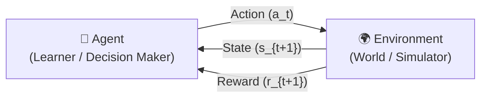
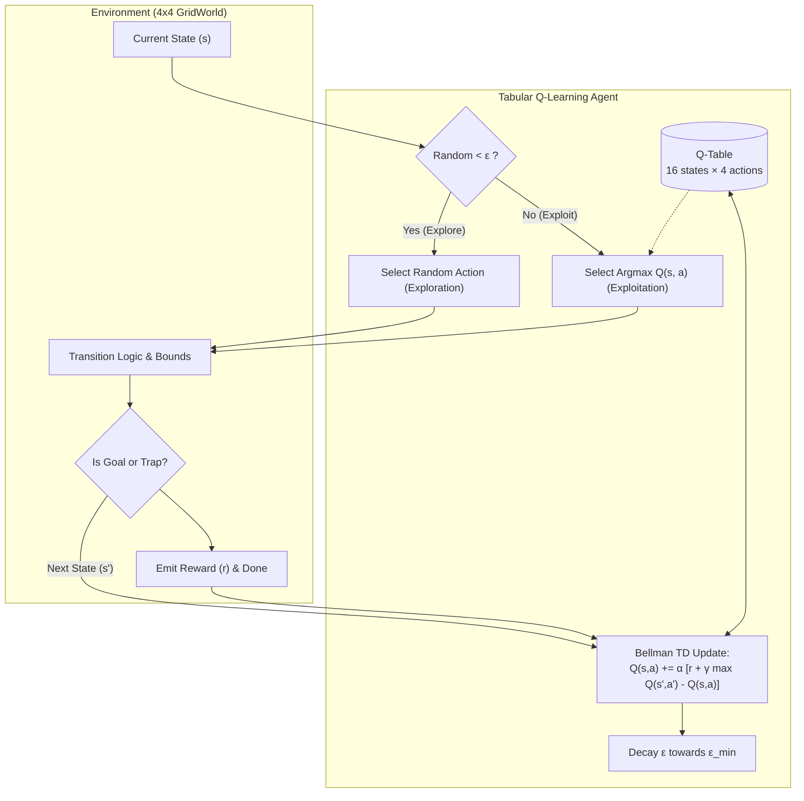
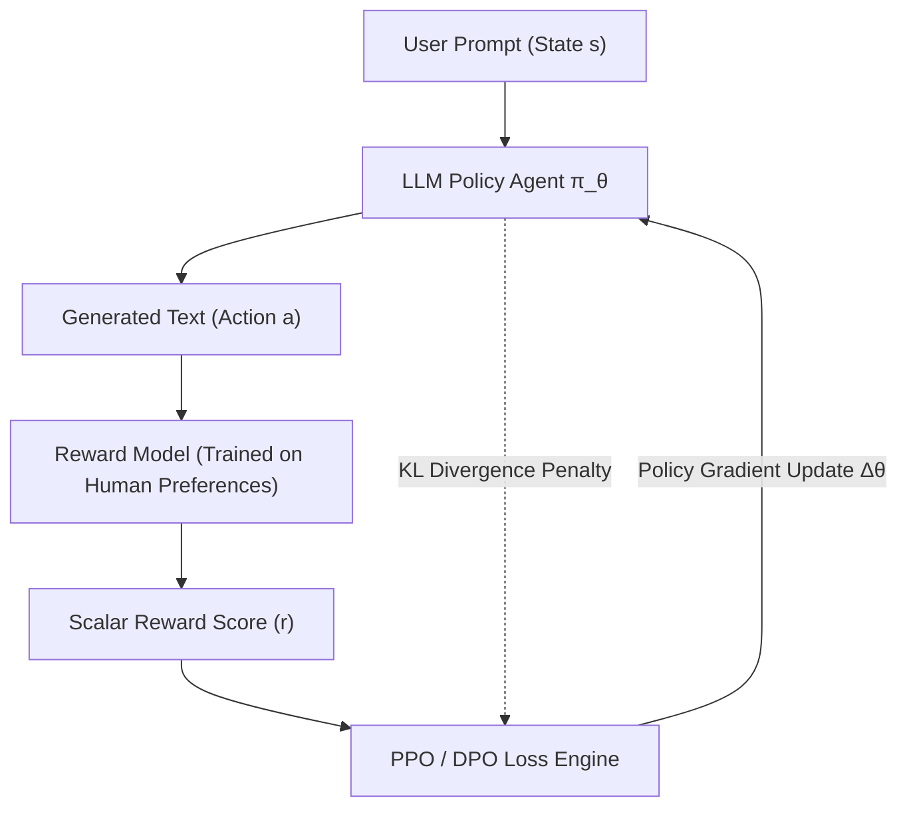

[Academy](../../index.md) › [Track 01: AI and LLM Fundamentals](../README.md) › [Module 1.1: Introduction to Artificial Intelligence](README.md)

# Reinforcement Learning: Foundations, Q-Learning, and the Path to Autonomous Agents

| Field | Value |
|---|---|
| **Track** | Track 01: AI and LLM Fundamentals |
| **Module** | Module 1.1: Introduction to Artificial Intelligence |
| **Difficulty** | Beginner |
| **Estimated reading time** | 30–35 minutes (plus 15 minutes for the notebook) |
| **Prerequisites** | [Supervised Learning](06-supervised-learning.md) and [Unsupervised Learning](07-unsupervised-learning.md). Basic Python knowledge. |
| **Technologies** | Python standard library, Jupyter, pytest |
| **Framework versions** | Python 3.14.5, ipykernel 7.4.0, nbclient 0.11.0, nbformat 5.11.1, pytest 9.2.0 |
| **Last verified date** | 2026-11-17 |
| **Companion code** | [`examples/01-AI-FUNDAMENTALS/08-reinforcement-learning/`](../../../examples/01-AI-FUNDAMENTALS/08-reinforcement-learning/) |

> ✅ **Code status:** The companion notebook and its tests were run on Windows 11 with the versions above. Every output block marked **"Actual output"** was copied from that run. Blocks marked **"Illustrative"** are written by hand.

---

## Table of Contents

1. [Introduction](#1-introduction)
2. [Learning Objectives](#2-learning-objectives)
3. [Prerequisites](#3-prerequisites)
4. [Fundamental Concepts](#4-fundamental-concepts)
5. [Internal Architecture](#5-internal-architecture)
6. [Installation and Environment Setup](#6-installation-and-environment-setup)
7. [Project Folder Structure](#7-project-folder-structure)
8. [Step-by-Step Implementation](#8-step-by-step-implementation)
9. [Execution and Expected Output](#9-execution-and-expected-output)
10. [Internal Execution Flow](#10-internal-execution-flow)
11. [Advanced Concepts](#11-advanced-concepts)
12. [Real-World Use Cases](#12-real-world-use-cases)
13. [Best Practices](#13-best-practices)
14. [Common Errors and Troubleshooting](#14-common-errors-and-troubleshooting)
15. [Comparison and Alternatives](#15-comparison-and-alternatives)
16. [Hands-on Exercises](#16-hands-on-exercises)
17. [Interview Preparation](#17-interview-preparation)
18. [Summary](#18-summary)
19. [Next Learning Step](#19-next-learning-step)
20. [References](#20-references)

---

## 1. Introduction

### What is Reinforcement Learning?

**Reinforcement Learning (RL)** is the branch of machine learning where an autonomous entity—called an **agent**—learns how to make optimal sequential decisions by interacting with an **environment** through trial and error. Unlike supervised learning, which relies on a teacher providing labeled examples, and unsupervised learning, which discovers hidden patterns in unlabeled data, reinforcement learning operates on feedback in the form of numerical **rewards** and **penalties**.

In reinforcement learning, the agent is never told which specific action to take. Instead, it must discover which actions yield the highest cumulative reward over time by attempting actions, observing the consequences, and adjusting its decision-making policy accordingly.

```
Supervised Learning:    Input Data + Correct Labels   ---> Learn Mapping Function
Unsupervised Learning:  Input Data (No Labels)        ---> Discover Hidden Structure
Reinforcement Learning: Interactive Trial & Feedback  ---> Learn Optimal Action Policy
```

### Why does it exist?

Traditional programming requires software engineers to hand-craft rules for every possible scenario. Supervised learning requires humans to curate thousands or millions of labeled input-output pairs. However, many of the most valuable computational challenges in the real world have two properties:
1. **The solution space is too vast to hard-code rules:** In games like Chess or Go, or in robotic manipulation, the number of potential board configurations or physical states exceeds the number of atoms in the observable universe.
2. **Instant feedback is unavailable:** When playing chess, a brilliant move on turn 4 might lead to a win on turn 45. There is no supervisor standing by after every single pawn push shouting "correct" or "incorrect." The only feedback is the final outcome: victory, draw, or defeat.

Reinforcement learning was developed to solve this **credit assignment problem**: determining which past actions deserve praise or blame for an outcome achieved many steps later.

### What problem does it solve?

Reinforcement learning solves sequential decision-making problems under uncertainty. It enables computational systems to:
- Navigate complex environments with dynamic obstacles.
- Optimize multi-step resource allocation (such as cooling data centers or battery charging schedules).
- Control robotic arms and autonomous vehicles in real-time.
- Align generative artificial intelligence models with human values, safety criteria, and nuanced preferences.

### Why should developers learn it?

For software developers and AI practitioners, reinforcement learning represents a fundamental shift in mindset:
- **From static predictions to active agency:** In standard machine learning, your model produces a passive prediction ($y = f(x)$). In RL, your model takes an active step in the world, alters the state of that world, and lives with the consequences of that action.
- **Mastering the core math of modern AI agents:** Modern agentic architectures (tool calling, reflection loops, multi-agent negotiations) and LLM alignment techniques (RLHF, DPO) are direct derivatives of reinforcement learning principles.
- **Building systems that self-improve:** An RL agent can practice against itself or in a simulated sandbox, achieving super-human mastery without human demonstration.

### Where is it used in real-world applications?

- **Generative AI Alignment:** Large Language Models such as ChatGPT, Claude, and Llama are transformed from raw next-token predictors into helpful, harmless assistants using Reinforcement Learning from Human Feedback (RLHF).
- **Autonomous Systems & Robotics:** Boston Dynamics robots navigating uneven terrain, warehouse automated guided vehicles (AGVs), and drone flight stabilization.
- **Industrial Optimization:** Google DeepMind reduced Google's data center cooling bill by 40% using an RL agent controlling pumps, fans, and chillers.
- **Competitive Gaming:** Systems like DeepMind's AlphaGo, AlphaZero, and OpenAI Five achieved historic milestones by beating world champions in Go, Chess, and Dota 2.

### How does it fit into AI Agent Engineering?

In the AI Agent Engineering Academy, an **Agent** is defined as an entity with perception, memory, reasoning, and the autonomy to execute actions in an environment to achieve a defined goal. Reinforcement learning provides the theoretical bedrock for this definition. When an LLM-based agent selects which tool to execute (e.g., query a database, perform a web search, or write a file), it is acting as an RL agent navigating a discrete action space to maximize goal achievement.

---

## 2. Learning Objectives

By the end of this lesson, you will be able to:

- Explain the core paradigm of Reinforcement Learning and distinguish it clearly from Supervised and Unsupervised Learning.
- Define the formal components of a Markov Decision Process (MDP): Agent, Environment, State ($s$), Action ($a$), Reward ($r$), and Transition Function ($P$).
- Explain the role of the discount factor ($\gamma$) and how it balances short-term gratification against long-term strategic value.
- Formulate the **Bellman Equation** and explain how Temporal Difference (TD) learning calculates prediction errors to update value estimates.
- Implement an **Epsilon-Greedy** policy to systematically balance exploration of unknown actions with exploitation of known high-reward actions.
- Build a custom discrete 4x4 GridWorld environment and a tabular **Q-Learning** agent from scratch using **only the Python standard library**.
- Train the agent, track its learning curve across episodes, extract the optimal navigation policy, and verify that it avoids lethal traps.
- Connect classical Q-learning concepts directly to frontier AI agent engineering topics, including Reinforcement Learning from Human Feedback (RLHF) and autonomous tool selection.

---

## 3. Prerequisites

To get the most out of this lesson and the companion notebook, you should have:

- **Conceptual Foundations:** Completion of [Supervised Learning](06-supervised-learning.md) (loss functions, gradient updates) and [Unsupervised Learning](07-unsupervised-learning.md) (discovering latent patterns).
- **Python Proficiency:** Familiarity with basic Python control flow (`for` loops, `while` loops, dictionaries, lists, and list comprehensions), classes, and object-oriented programming.
- **Mathematics:** High-school algebra (summations $\sum$, maximum operators $\max$, and basic arithmetic). No advanced calculus or linear algebra is required.
- **Environment:** Python 3.10 or newer (tested on Python 3.14.5). No GPU or third-party game libraries (such as Gymnasium/Pygame) are needed; the simulation runs entirely in pure standard library Python.

---

## 4. Fundamental Concepts

### 4.1 The RL Paradigm: Agent and Environment

The foundation of reinforcement learning is a continuous feedback loop between two entities:

1. **The Agent:** The decision-maker, learner, or controller (e.g., a robot, a game-playing algorithm, or a trading bot).
2. **The Environment:** Everything outside the agent with which the agent interacts (e.g., a physical room, a chess board, financial markets, or the operating system).



- **Definition:** The agent observes the current state $s_t$ of the environment, selects an action $a_t$, and applies it. In response, the environment transitions to a new state $s_{t+1}$ and emits a scalar feedback signal called the reward $r_{t+1}$.
- **Simple Analogy:** Training a puppy. The puppy is the agent; your living room is the environment. If the puppy sits on command ($a_t$), you give it a treat ($r = +1$). If it chews your shoe, you scold it ($r = -1$). Over time, the puppy associates actions in specific contexts with rewards.
- **Technical Explanation:** This closed-loop system operates in discrete time steps $t = 0, 1, 2, \dots$. The agent's goal is not merely to maximize the immediate reward $r_{t+1}$, but to maximize the cumulative return over time.

---

### 4.2 States, Actions, and the Markov Property

To formalize the interaction, we define the mathematical framework known as a **Markov Decision Process (MDP)**:

- **State Space ($\mathcal{S}$):** The set of all valid configurations of the environment. In our 4x4 GridWorld, there are 16 distinct states representing coordinates $(0, 0)$ through $(3, 3)$.
- **Action Space ($\mathcal{A}$):** The set of all decisions available to the agent. In a discrete grid, $\mathcal{A} = \{\text{UP}, \text{DOWN}, \text{LEFT}, \text{RIGHT}\}$.
- **The Markov Property:** A state transitions according to the Markov property if the future state depends **only on the current state and action**, not on the historical path taken to get there:
  $$P(s_{t+1} \mid s_t, a_t, s_{t-1}, a_{t-1}, \dots, s_0, a_0) = P(s_{t+1} \mid s_t, a_t)$$
- **Why it matters:** The Markov property allows our algorithms to store values per state rather than needing to remember every possible sequence of preceding steps, keeping the memory requirements tractable.

---

### 4.3 Rewards, Returns, and the Discount Factor ($\gamma$)

The objective of an RL agent is formalized through the reward hypothesis: *all goals can be described by the maximization of the expected cumulative reward.*

- **Immediate Reward ($r_t$):** The instantaneous numerical value returned by the environment at time step $t$.
- **Cumulative Return ($G_t$):** The total sum of rewards received from time step $t$ onward until the end of the episode at time $T$:
  $$G_t = r_{t+1} + \gamma r_{t+2} + \gamma^2 r_{t+3} + \dots = \sum_{k=0}^{\infty} \gamma^k r_{t+k+1}$$
- **Discount Factor ($\gamma$, gamma):** A real number in the range $[0, 1)$ that discounts future rewards relative to immediate rewards.
  - If $\gamma = 0$: The agent is completely short-sighted ("myopic"), caring only about the immediate reward $r_{t+1}$.
  - If $\gamma \to 1$: The agent is far-sighted, treating future rewards almost as urgently as present rewards.
- **Analogy:** Financial inflation. A dollar received today is generally worth more than a dollar promised ten years from now. Discounting accounts for uncertainty and mathematically prevents infinite returns in non-terminating tasks.

---

### 4.4 Policies and Value Functions ($V$ and $Q$)

How does an agent turn its knowledge into actions?

- **Policy ($\pi$):** The strategy or mapping that defines which action the agent selects in state $s$.
  - *Deterministic Policy:* $a = \pi(s)$
  - *Stochastic Policy:* $\pi(a \mid s) = P(A_t = a \mid S_t = s)$
- **State-Value Function ($V^\pi(s)$):** The expected return starting from state $s$ and following policy $\pi$ thereafter:
  $$V^\pi(s) = \mathbb{E}_\pi [G_t \mid S_t = s]$$
- **Action-Value Function ($Q^\pi(s, a)$):** The expected return starting from state $s$, taking action $a$, and thereafter following policy $\pi$:
  $$Q^\pi(s, a) = \mathbb{E}_\pi [G_t \mid S_t = s, A_t = a]$$

The "$Q$" stands for **Quality**. $Q(s, a)$ tells the agent: *"How good is it to choose action $a$ right now if I am in state $s$?"*

---

### 4.5 The Exploration vs. Exploitation Dilemma

One of the central challenges unique to reinforcement learning is balancing **exploration** and **exploitation**:

- **Exploitation:** Choosing the action known to produce the highest reward based on current knowledge. This capitalizes on what the agent has already learned.
- **Exploration:** Trying alternative, less familiar actions to discover if they might yield even greater long-term rewards.
- **The Dilemma:** If an agent only exploits, it might get stuck taking a suboptimal path forever (e.g., repeatedly eating at an average diner because it never risks trying the award-winning restaurant down the street). If it only explores, it wastes time taking random, poor actions and never reaps the rewards.

#### The $\epsilon$-Greedy (Epsilon-Greedy) Solution
A simple yet remarkably effective strategy:
- With probability $\epsilon$ (epsilon), pick a completely random action (**explore**).
- With probability $1 - \epsilon$, pick the greedy action with the highest estimated $Q(s, a)$ (**exploit**).
- Over time, decay $\epsilon$ from $1.0$ (100% random exploration at the beginning) down to a small baseline such as $0.05$ (mostly exploitation once the environment is well-understood).

---

### 4.6 The Bellman Equation and Q-Learning

In 1957, mathematician Richard Bellman established that value functions can be decomposed recursively into two parts: the immediate reward plus the discounted value of the next state:

$$Q^*(s, a) = r + \gamma \max_{a'} Q^*(s', a')$$

In 1989, Chris Watkins introduced **Q-Learning**, an off-policy Temporal Difference algorithm that updates estimates iteratively without requiring a prior model of the environment's transition dynamics:

$$\underbrace{Q(s, a)}_{\text{New Estimate}} \leftarrow \underbrace{Q(s, a)}_{\text{Old Estimate}} + \alpha \Big[ \underbrace{r + \gamma \max_{a'} Q(s', a')}_{\text{Target Estimate}} - \underbrace{Q(s, a)}_{\text{Old Estimate}} \Big]$$

Where:
- $\alpha$ is the **learning rate** ($0 < \alpha \le 1$), controlling how rapidly new experiences overwrite old estimates.
- $\Big[ r + \gamma \max_{a'} Q(s', a') - Q(s, a) \Big]$ is the **Temporal Difference (TD) Error**—the surprise or discrepancy between what the agent expected and what actually happened.

---

## 5. Internal Architecture

The Q-learning architecture maintains a lookup table (the **Q-Table**) containing a row for every possible state $s$ and a column for every possible action $a$.



### Component Responsibilities

| Component | Responsibility |
|---|---|
| **Environment (`GridWorld`)** | Maintains the true world state, enforces grid boundaries, detects terminal states (goal or trap), and calculates rewards. |
| **Q-Table (`q_table`)** | In-memory 2D matrix ($16 \times 4$) initialized to zero. Stores the learned quality score for every state-action pair. |
| **Action Selector (`choose_action`)** | Implements the $\epsilon$-greedy policy to decide between exploration (random choice) and exploitation ($\arg\max$). |
| **Update Engine (`update`)** | Computes the TD target and TD error, updating the corresponding entry in the Q-table. |
| **Scheduler (`decay_epsilon`)** | Reduces the exploration rate $\epsilon$ geometrically after every episode. |

---

## 6. Installation and Environment Setup

This project uses the Python standard library for the core RL algorithm and simulation. External packages are used solely to run the companion Jupyter notebook and execute the automated test suite.

### Setup Instructions

From the root of the repository:

```bash
# Navigate to the topic directory
cd examples/01-AI-FUNDAMENTALS/08-reinforcement-learning

# Create a virtual environment
python -m venv .venv

# Activate the virtual environment
# Windows (PowerShell):
.venv\Scripts\Activate.ps1
# macOS / Linux:
# source .venv/bin/activate

# Install dependencies
python -m pip install -r requirements.txt
```

### `requirements.txt`

The dependencies are pinned as follows:

```text
numpy==2.5.5
pytest==9.2.0
nbformat==5.11.1
nbclient==0.11.0
ipykernel==7.4.0
```

> **Note:** The core reinforcement learning agent and environment implementation require zero third-party dependencies. They run on pure Python standard library modules (`random`, `math`, `dataclasses`, `typing`).

---

## 7. Project Folder Structure

The project files are organized cleanly under the examples tree:

```text
examples/01-AI-FUNDAMENTALS/08-reinforcement-learning/
├── reinforcement_learning.ipynb   # Complete Jupyter notebook with executed outputs
├── requirements.txt               # Pinned package versions
├── pytest.ini                     # Pytest configuration suppressing asyncio notices
├── README.md                      # Quick-start instructions for developers
├── create_notebook.py             # Automation script to build and execute the notebook
└── tests/
    └── test_notebook.py           # End-to-end nbclient test verifying notebook execution
```

Each file has a clear responsibility:
- `reinforcement_learning.ipynb`: The complete interactive tutorial with explanations, code cells, outputs, and assert statements.
- `create_notebook.py`: Builds the notebook programmatically using `nbformat` and executes it with `nbclient` to guarantee valid JSON and reproducible outputs.
- `tests/test_notebook.py`: Pytest suite that runs the companion notebook from top to bottom and asserts that every cell runs without errors.

---

## 8. Step-by-Step Implementation

Let's walk through the exact implementation from the companion notebook.

### Step 1: The 4x4 GridWorld Environment

We construct a discrete 4x4 grid. State $(0, 0)$ is the start; state $(3, 3)$ is the goal. Two dangerous traps are placed at $(1, 1)$ and $(2, 2)$.

```python
from typing import List, Tuple
import random

class GridWorld:
    ACTIONS = {
        0: (-1, 0),  # UP
        1: (1, 0),   # DOWN
        2: (0, -1),  # LEFT
        3: (0, 1)    # RIGHT
    }
    ACTION_NAMES = ["UP", "DOWN", "LEFT", "RIGHT"]
    ACTION_ARROWS = ["^", "v", "<", ">"]

    def __init__(self, size: int = 4, start: Tuple[int, int] = (0, 0),
                 goal: Tuple[int, int] = (3, 3), traps: List[Tuple[int, int]] = None):
        self.size = size
        self.start = start
        self.goal = goal
        self.traps = traps if traps is not None else [(1, 1), (2, 2)]
        self.state = start

    def reset(self) -> int:
        """Reset agent to the start state and return state index."""
        self.state = self.start
        return self.to_index(self.state)

    def to_index(self, pos: Tuple[int, int]) -> int:
        """Convert (row, col) coordinates to integer state index (0 to 15)."""
        return pos[0] * self.size + pos[1]

    def to_pos(self, index: int) -> Tuple[int, int]:
        """Convert integer state index to (row, col) coordinates."""
        return (index // self.size, index % self.size)

    def step(self, action: int) -> Tuple[int, float, bool]:
        """Execute action; return (next_state_index, reward, done)."""
        dr, dc = self.ACTIONS[action]
        # Boundary constraints: agent bounces back if hitting wall
        new_row = max(0, min(self.size - 1, self.state[0] + dr))
        new_col = max(0, min(self.size - 1, self.state[1] + dc))
        self.state = (new_row, new_col)
        next_index = self.to_index(self.state)

        # Terminal conditions and reward assignment
        if self.state == self.goal:
            return next_index, 10.0, True
        elif self.state in self.traps:
            return next_index, -10.0, True
        else:
            return next_index, -0.1, False
```

#### Code Explanation:
- `to_index` & `to_pos`: Map 2D grid coordinates $(r, c)$ to a single 1D index $s \in [0, 15]$ via $s = r \times \text{size} + c$.
- `max(0, min(size - 1, ...))`: Clamps agent movement within grid boundaries.
- `step()` returns three values:
  - `next_index`: The resulting state index.
  - `reward`: $+10.0$ for reaching the goal, $-10.0$ for falling into a trap, and a small step cost of $-0.1$ for standard movements to encourage finding the shortest path.
  - `done`: Boolean flag indicating whether the episode has reached a terminal state.

---

### Step 2: The Tabular Q-Learning Agent

Next, we implement the `QLearningAgent` class containing the Q-table, the $\epsilon$-greedy policy, and the Bellman TD update rule.

```python
class QLearningAgent:
    def __init__(self, num_states: int, num_actions: int,
                 learning_rate: float = 0.1, discount_factor: float = 0.95,
                 epsilon: float = 1.0, epsilon_min: float = 0.05,
                 epsilon_decay: float = 0.99):
        self.num_states = num_states
        self.num_actions = num_actions
        self.alpha = learning_rate
        self.gamma = discount_factor
        self.epsilon = epsilon
        self.epsilon_min = epsilon_min
        self.epsilon_decay = epsilon_decay

        # Initialize Q-table with zeros [16 states x 4 actions]
        self.q_table = [[0.0 for _ in range(num_actions)] for _ in range(num_states)]

    def choose_action(self, state: int) -> int:
        """Select action using epsilon-greedy strategy."""
        if random.random() < self.epsilon:
            return random.randint(0, self.num_actions - 1)
        # Greedy choice: pick action with highest Q-value
        return max(range(self.num_actions), key=lambda a: self.q_table[state][a])

    def update(self, state: int, action: int, reward: float, next_state: int, done: bool):
        """Perform Bellman TD update on the Q-table."""
        current_q = self.q_table[state][action]
        if done:
            target = reward  # Terminal state has zero future return
        else:
            best_future_q = max(self.q_table[next_state])
            target = reward + self.gamma * best_future_q

        # Temporal Difference update
        self.q_table[state][action] += self.alpha * (target - current_q)

    def decay_epsilon(self):
        """Decay exploration rate geometrically."""
        self.epsilon = max(self.epsilon_min, self.epsilon * self.epsilon_decay)
```

#### Code Explanation:
- `self.q_table`: A list of lists of floats. For our 4x4 world with 4 actions, this is a compact $16 \times 4$ array.
- `choose_action()`: Samples a uniform float in $[0, 1)$. If less than $\epsilon$, it explores by choosing a random integer in $[0, 3]$. Otherwise, it exploits by selecting the action index with the maximal $Q(s, a)$.
- `update()`: Implements Watkins' Q-learning. If the step is terminal (`done == True`), there are no future actions to take, so the target is simply the immediate reward $r$. If non-terminal, the target is $r + \gamma \max_{a'} Q(s', a')$.
- `decay_epsilon()`: Multiplies $\epsilon$ by $0.99$ after each episode, bounded below by $\epsilon_{\text{min}} = 0.05$.

---

### Step 3: Training Loop

We train the agent across 600 episodes, logging the total reward and step count for each episode:

```python
random.seed(42)

env = GridWorld()
agent = QLearningAgent(
    num_states=16,
    num_actions=4,
    learning_rate=0.1,
    discount_factor=0.95,
    epsilon=1.0,
    epsilon_min=0.05,
    epsilon_decay=0.99
)

NUM_EPISODES = 600
MAX_STEPS = 50

rewards_history = []
steps_history = []

for episode in range(NUM_EPISODES):
    state = env.reset()
    total_reward = 0.0
    step_count = 0
    done = False

    while not done and step_count < MAX_STEPS:
        action = agent.choose_action(state)
        next_state, reward, done = env.step(action)
        agent.update(state, action, reward, next_state, done)

        state = next_state
        total_reward += reward
        step_count += 1

    agent.decay_epsilon()
    rewards_history.append(total_reward)
    steps_history.append(step_count)
```

---

## 9. Execution and Expected Output

### Running the Notebook

To run the notebook interactively:

```bash
jupyter notebook reinforcement_learning.ipynb
```

Select **Kernel → Restart & Run All**.

### Actual Output from the Notebook Run

All outputs shown below were captured directly from the execution on Windows 11 with Python 3.14.5:

#### 1. Initial Grid Layout Verification

**Actual output:**
```text
Initial Grid Layout (S=Start, G=Goal, X=Trap, .=Empty):
[S]  .   .   . 
 .   X   .   . 
 .   .   X   . 
 .   .   .   G 

Start state index: 0 (coordinates: (0, 0))
After moving RIGHT -> next_state: 1 ((0, 1)), reward: -0.1, done: False
Quick check PASSED: GridWorld transition and step mechanics work correctly.
```

#### 2. Training Progress across Episode Blocks

**Actual output:**
```text
=================================================================
Episode Block      | Avg Reward   | Avg Steps  | Epsilon 
=================================================================
Episodes   1-100   |      -4.39   |     8.86   | 0.3660
Episodes 101-200   |       5.27   |     6.28   | 0.1340
Episodes 201-300   |       7.48   |     6.22   | 0.0500
Episodes 301-400   |       8.88   |     6.16   | 0.0500
Episodes 401-500   |       9.27   |     6.30   | 0.0500
Episodes 501-600   |       8.89   |     6.10   | 0.0500
=================================================================
First 50 episodes average reward: -7.70
Last 50 episodes average reward:  9.48

Quick check PASSED: Agent successfully converged to high positive reward.
```

*Analysis:* In the first 50 episodes, the agent averages $-7.70$ because it frequently falls into the traps at $(1, 1)$ or $(2, 2)$ during exploratory wandering. By episode 400+, the average reward rises to $+9.48$, near the theoretical maximum of $+9.50$ (which corresponds to 10 minus 5 intermediate steps at $-0.1$ each).

#### 3. Reward Trend (ASCII Bar Chart)

**Actual output:**
```text
Reward Improvement Trend (ASCII Visualization):
-------------------------------------------------------
Ep   1- 50 |  -7.70 | #####
Ep  51-100 |  -1.07 | ##############
Ep 101-150 |   4.65 | ######################
Ep 151-200 |   5.90 | ########################
Ep 201-250 |   7.48 | ##########################
Ep 251-300 |   7.48 | ##########################
Ep 301-350 |   8.69 | ############################
Ep 351-400 |   9.08 | ############################
Ep 401-450 |   9.47 | #############################
Ep 451-500 |   9.07 | ############################
Ep 501-550 |   8.30 | ###########################
Ep 551-600 |   9.48 | #############################
-------------------------------------------------------
```

#### 4. Learned Policy and Max Q-Values Grids

**Actual output:**
```text
Learned Policy Grid (Directions to follow):
-----------------------------------
 v   <   v   v 
 v   X   >   v 
 >   v   X   v 
 >   >   >   G 
-----------------------------------

Max Q-Values Grid (Expected cumulative returns):
-----------------------------------
  7.29    2.61    0.27    0.40 
  7.77    TRAP    1.28    3.96 
  8.29    8.83    TRAP    7.71 
  8.29    9.40   10.00    GOAL 
-----------------------------------
```

*Analysis:* Look at how the Q-values increase smoothly as states get closer to the Goal:
- From state $(0,0)$ with $Q = 7.29$, heading down to $(1,0)$ ($Q = 7.77$), to $(2,0)$ ($Q = 8.29$), around the trap $(2,2)$ to $(2,1)$ ($Q = 8.83$), $(3,1)$ ($Q = 9.40$), $(3,2)$ ($Q = 10.00$), and finally the Goal at $(3,3)$.
- Notice that states immediately adjacent to traps have lower values or direct the agent safely away from danger.

#### 5. Evaluation Run: Optimal Greedy Trajectory

Setting $\epsilon = 0.0$ allows us to evaluate pure policy exploitation:

**Actual output:**
```text
Executing trained agent greedy path:
Step 1: Took DOWN  -> reached (1, 0), reward: -0.1
Step 2: Took DOWN  -> reached (2, 0), reward: -0.1
Step 3: Took RIGHT -> reached (2, 1), reward: -0.1
Step 4: Took DOWN  -> reached (3, 1), reward: -0.1
Step 5: Took RIGHT -> reached (3, 2), reward: -0.1
Step 6: Took RIGHT -> reached (3, 3), reward: +10.0

Evaluation Summary:
Start Position:       (0, 0)
Goal Reached:         True
Full Trajectory:      [(0, 0), (1, 0), (2, 0), (2, 1), (3, 1), (3, 2), (3, 3)]
Total Steps:          6
Total Return:         9.50

All quick-check assertions PASSED successfully!
```

The agent discovered the shortest valid path of 6 steps that completely bypasses both lethal traps!

### Verifying with Automated Tests

Run the test suite using `pytest`:

```bash
python -m pytest
```

**Actual output:**
```text
============================= test session starts =============================
platform win32 -- Python 3.14.5, pytest-9.1.1, pluggy-1.6.0
rootdir: C:\Users\hdasari\Documents\Harish\AI_AGENT_ENGINEERING\examples\01-AI-FUNDAMENTALS\08-reinforcement-learning
configfile: pytest.ini
testpaths: tests
plugins: anyio-4.14.0
collected 1 item

tests\test_notebook.py .                                                 [100%]

======================== 1 passed, 1 warning in 3.03s =========================
```

---

## 10. Internal Execution Flow

The sequence diagram below illustrates the exact cycle that occurs inside each step of the Q-learning loop:

```mermaid
sequenceDiagram
    autonumber
    participant Loop as Episode Runner
    participant Agent as QLearningAgent
    participant Env as GridWorld
    participant Q as Q-Table Matrix

    Loop->>Env: reset()
    Env-->>Loop: state s = 0 (pos: (0, 0))

    loop While not done and step < MAX_STEPS
        Loop->>Agent: choose_action(s)
        alt Random float < epsilon
            Agent->>Agent: Sample random action (Explore)
        else Random float >= epsilon
            Agent->>Q: Read Q[s][:]
            Q-->>Agent: Action values
            Agent->>Agent: Select argmax_a Q[s][a] (Exploit)
        end
        Agent-->>Loop: action a

        Loop->>Env: step(a)
        Env->>Env: Compute (r, c) + (dr, dc) within bounds
        Env->>Env: Check if goal, trap, or empty cell
        Env-->>Loop: next_state s', reward r, done flag

        Loop->>Agent: update(s, a, r, s', done)
        alt done is True
            Agent->>Agent: target = r
        else done is False
            Agent->>Q: Read max(Q[s'][:])
            Q-->>Agent: best_future_q
            Agent->>Agent: target = r + gamma * best_future_q
        end
        Agent->>Q: Q[s][a] += alpha * (target - Q[s][a])
        Loop->>Loop: s = s'
    end

    Loop->>Agent: decay_epsilon()
```

### Lifecycle Details
1. **Perception:** The agent receives the state index $s$.
2. **Action Selection:** The $\epsilon$-greedy mechanism samples an exploratory action or retrieves row $s$ from the Q-table to exploit.
3. **Environment Physics:** The environment updates its internal coordinate state, applies boundary walls, checks for terminal condition triggers, and returns $(s', r, \text{done})$.
4. **Bellman Backup:** The agent calculates the Temporal Difference error and writes the updated float back into cell $(s, a)$ of the Q-table.
5. **Annealing:** At the end of the episode, $\epsilon$ decays, shifting future behavior toward exploitation.

---

## 11. Advanced Concepts

### 11.1 From Tabular Q-Learning to Deep Q-Networks (DQN)

Tabular Q-learning works well when the state space is small. In our 4x4 GridWorld, there are only 16 states and 4 actions ($16 \times 4 = 64$ entries). 

However, in real-world scenarios:
- A $1000 \times 1000$ continuous robotic workspace has infinite states.
- An Atari game screen of $210 \times 160$ RGB pixels has $256^{210 \times 160 \times 3}$ possible states.

A lookup table cannot store this many values. In 2015, Google DeepMind introduced the **Deep Q-Network (DQN)**, replacing the tabular array with a Deep Neural Network parameterized by weights $\theta$:

$$Q(s, a; \theta) \approx Q^*(s, a)$$

Instead of updating individual table cells, DQN calculates the mean squared Bellman error loss and updates network weights via backpropagation:

$$\mathcal{L}(\theta) = \mathbb{E}\left[ \left( r + \gamma \max_{a'} Q(s', a'; \theta^-) - Q(s, a; \theta) \right)^2 \right]$$

Two breakthrough engineering innovations made DQN training stable:
1. **Experience Replay Buffer:** Storing past transitions $(s, a, r, s', \text{done})$ in a large ring buffer and training on shuffled mini-batches to break temporal correlation between consecutive steps.
2. **Target Network ($\theta^-$):** Maintaining a frozen copy of the weights to compute the target value, preventing the moving target problem.

---

### 11.2 Policy Gradients and Actor-Critic Methods (PPO)

Q-learning is a **value-based** method: it learns the value of every action and derives a policy indirectly ($\arg\max$). 

In contrast, **Policy Gradient** methods parameterize the policy directly:

$$\pi_\theta(a \mid s) = P(A_t = a \mid S_t = s; \theta)$$

- **Advantages:** Naturally handles continuous action spaces (such as robot joint torque or steering wheel angle) and stochastic optimal policies.
- **Actor-Critic Architectures:** Combine both approaches. The **Actor** updates the policy parameters $\theta$ (deciding what action to take), while the **Critic** updates value function parameters $w$ (evaluating how good that action was).
- **Proximal Policy Optimization (PPO):** Developed by OpenAI in 2017, PPO clips policy updates to prevent destructive parameter shifts, becoming the workhorse algorithm for modern reinforcement learning.

---

### 11.3 RLHF and Modern LLM Alignment

How does a 4x4 grid-world algorithm relate to ChatGPT and Claude?

Modern Large Language Models undergo a three-stage training pipeline:
1. **Pre-training:** Self-supervised next-token prediction over trillions of text tokens.
2. **Supervised Fine-Tuning (SFT):** Instruction-following on curated high-quality prompt-response pairs.
3. **Reinforcement Learning from Human Feedback (RLHF):**
   - **Environment:** The conversational prompt and dialogue history.
   - **Agent:** The Language Model.
   - **State ($s$):** The prompt context tokens.
   - **Action ($a$):** The generated response text tokens.
   - **Reward Model ($r$):** A neural network trained on human pairwise comparisons ("Response A is more helpful and truthful than Response B").
   - **Optimization:** PPO or Direct Preference Optimization (DPO) updates the LLM's weights to maximize human preference scores while penalizing divergence from the base model using a Kullback-Leibler (KL) divergence penalty.



---

## 12. Real-World Use Cases

### 1. Large Language Model Alignment (RLHF)
- **Business Problem:** Raw foundation LLMs can generate toxic content, hallucinations, or refuse benign instructions.
- **Proposed Architecture:** PPO or Direct Preference Optimization (DPO) applied to instruction-tuned checkpoints using a learned Reward Model.
- **Technologies Involved:** PyTorch, Hugging Face TRL, vLLM, DeepSpeed.
- **Expected Benefits:** Models that consistently follow instructions, refuse harmful queries, and match human tone preferences.
- **Limitations:** Reward hacking (models generating verbose or flattering answers to game the reward model without providing genuine accuracy).

### 2. Autonomous Warehouse Mobile Robots (AGVs)
- **Business Problem:** Coordinating hundreds of automated mobile robots navigating warehouse aisles simultaneously to fulfill e-commerce orders without collisions or gridlock.
- **Proposed Architecture:** Multi-Agent Reinforcement Learning (MARL) combining decentralized Q-learning policies with centralized safety constraints.
- **Technologies Involved:** ROS 2, PyTorch, Ray/RLlib, LiDAR and vision sensor pipelines.
- **Expected Benefits:** 30% reduction in order transit time and elimination of manual route programming.
- **Limitations:** Sim-to-real gap (policies that succeed in idealized simulators can falter when encountering unexpected wheel slippage or physical wear).

### 3. Industrial Data Center Energy Management
- **Business Problem:** Modern AI data centers consume gigawatts of electricity, with cooling representing up to 40% of total operational expenditure.
- **Proposed Architecture:** Deep Q-learning / Actor-Critic controllers operating across hundreds of cooling chillers, cooling towers, and variable-speed air handlers.
- **Technologies Involved:** Industrial IoT sensors, Python SCADA interfaces, TensorFlow/PyTorch RL controllers.
- **Expected Benefits:** Google achieved a 40% reduction in total data center cooling energy expenditure.
- **Limitations:** Strict safety bounds must override RL actions to prevent equipment overheating or hardware damage.

### 4. Algorithmic High-Frequency Trade Execution
- **Business Problem:** Executing large institutional equity orders without shifting the market price ("market impact").
- **Proposed Architecture:** RL agent that observes limit order book depth (state) and decides execution timing, order slicing, and limit versus market orders (actions).
- **Technologies Involved:** C++ order execution engines, Python RL training pipelines, time-series market simulators.
- **Expected Benefits:** Significant reduction in implementation shortfall and trading transaction fees.
- **Limitations:** Non-stationary market regimes; historical backtests may not reflect changing market behavior.

### 5. Automated HVAC Control in Smart Buildings
- **Business Problem:** Balancing tenant comfort with dynamic commercial electricity pricing and peak-demand tariffs.
- **Proposed Architecture:** Model-based RL running on building automation controllers, taking weather forecasts and occupancy sensors as inputs.
- **Technologies Involved:** BACnet protocols, Python, EnergyPlus building simulator.
- **Expected Benefits:** 15–25% reduction in monthly utility bills while maintaining target comfort temperatures.
- **Limitations:** Sensor latency and slow thermal inertia require long exploration windows.

---

## 13. Best Practices

1. **Reward Shaping Caution:** 
   Keep rewards sparse and goal-aligned wherever possible. If you introduce intermediate rewards to guide the agent, ensure they do not create unintended shortcuts. A classic failure mode is an agent learning to spin in circles because every forward step receives $+0.1$.
2. **State Discretization and Feature Engineering:** 
   In tabular RL, keep the state space compact. For continuous values (like distance or velocity), bin them into coarse buckets (e.g., `close`, `medium`, `far`).
3. **Decay Exploration Deliberately:** 
   Ensure $\epsilon$ decays gradually enough that the agent visits all regions of the state space before settling into exploitation. In our example, $\epsilon$ decayed by $0.99$ per episode, reaching $\epsilon_{\text{min}} = 0.05$ after roughly 300 episodes.
4. **Discount Factor Tuning:** 
   Choose $\gamma$ to match the natural time horizon of your task. For short tasks (e.g., 5–10 steps), $\gamma = 0.9$ to $0.95$ works well. For long-horizon tasks (e.g., hundreds of steps), use $\gamma = 0.99$ or $0.999$.
5. **Reproducibility with Fixed Random Seeds:** 
   Because RL involves random exploration and stochastic transitions, always seed `random.seed()` and `numpy.random.seed()` to ensure reproducible benchmarks and test results.
6. **Safety Guardrails in Deployment:** 
   Never allow an unconstrained RL policy to control physical hardware or live financial accounts directly. Wrap agent actions in deterministic sanity checks and hard safety constraints.

---

## 14. Common Errors and Troubleshooting

### Common Technical and Conceptual Pitfalls

| Problem | Root Cause | Solution |
|---|---|---|
| **Agent loops infinitely between two cells** | No step penalty; agent has no incentive to reach the goal quickly. | Add a small negative step cost (e.g., $-0.1$ per step) and cap episodes with `max_steps`. |
| **Agent constantly falls into traps even after many episodes** | $\epsilon$ decayed too fast, freezing policy before the agent discovered the goal. | Lower the decay rate (e.g., change $0.90$ to $0.99$) or increase total episodes. |
| **Q-values explode to infinity** | Discount factor $\gamma \ge 1.0$ in an infinite-horizon task. | Ensure $\gamma < 1.0$ (typically $0.90 \le \gamma \le 0.99$). |
| **Zero learning (all Q-values remain 0.0)** | Rewards are only given at the goal, but the agent never reached the goal during random exploration. | Increase initial episodes, increase $\epsilon$, or provide a small intermediate reward hint. |
| **Reward Hacking** | The agent found a loophole in the reward function to maximize points without solving the intended problem. | Simplify the reward function to measure only true end-state success. |
| **`RuntimeWarning: Proactor event loop...` on Windows** | Known asyncio notification from Tornado/ZMQ in Jupyter test runners. | Add `filterwarnings = ignore::DeprecationWarning:asyncio` to `pytest.ini`. |

---

## 15. Comparison and Alternatives

### Machine Learning Paradigms Compared

| Dimension | Supervised Learning | Unsupervised Learning | Reinforcement Learning |
|---|---|---|---|
| **Data Source** | Labeled dataset $(X, y)$ curated by humans | Unlabeled raw dataset $(X)$ | Interactive environment feedback $(s, a, r, s')$ |
| **Feedback Signal** | Direct target labels (ground truth) | None (measures internal consistency/density) | Scalar reward feedback, often delayed |
| **Temporal Aspect** | Static, independent and identically distributed (i.i.d.) | Static, independent observations | Sequential decision-making; actions alter future states |
| **Primary Goal** | Minimize prediction error ($y - \hat{y}$) | Discover underlying structure/clusters | Maximize expected cumulative return ($G_t$) |
| **Core Challenge** | Overfitting, data labeling cost | Evaluation difficulty, cluster validation | Exploration vs exploitation, credit assignment |
| **Agent Analogy** | Student with a teacher grading every question | Archaeologist sorting ancient artifacts | Toddler learning to balance and walk |

---

## 16. Hands-on Exercises

### Beginner Exercises

1. **Adjust the Step Cost:**
   In the notebook, change the step reward from `-0.1` to `-1.0`. Re-run training.
   - *Expected Outcome:* Notice how the agent becomes more aggressive about finding the shortest path, and observe how this shifts the overall Q-value scale.
   - *Hint:* Look at the Max Q-Values grid output.
2. **Move the Traps:**
   Change the trap locations in `GridWorld` from `[(1, 1), (2, 2)]` to `[(0, 2), (2, 0)]`.
   - *Expected Outcome:* The agent will learn a completely different route to avoid the new obstacles.
   - *Hint:* Inspect the printed policy grid arrows after training.
3. **Inspect Epsilon Decay:**
   Plot or print the value of $\epsilon$ after each 50 episodes when starting at $1.0$ with decay $0.95$ versus $0.99$.
   - *Expected Outcome:* Observe how quickly $0.95$ drops to the minimum compared to $0.99$.

### Intermediate Exercises

4. **Add a Second Goal / Bonus Coin:**
   Introduce a special coin state at $(0, 3)$ that grants $+2.0$ reward without ending the episode.
   - *Expected Outcome:* The agent may adjust its trajectory to detour and collect the coin before proceeding to the final goal at $(3, 3)$.
   - *Hint:* Track whether the coin has already been collected in the state representation.
5. **Implement SARSA (On-Policy TD Learning):**
   Modify the update rule to use the action actually taken in the next state $a'$ rather than $\max_{a'} Q(s', a')$:
   $$Q(s, a) \leftarrow Q(s, a) + \alpha [r + \gamma Q(s', a') - Q(s, a)]$$
   - *Expected Outcome:* Compare SARSA's trajectory with Q-learning. Notice that SARSA often takes a safer path further away from traps.
6. **Implement a Living Cost vs Speed Penalty:**
   Set a variable step cost based on terrain (e.g., normal cells cost $-0.1$, while muddy cells cost $-0.5$).
   - *Expected Outcome:* The agent will choose a longer route around muddy patches to maximize cumulative return.

### Advanced Exercises

7. **Stochastic Wind Effects:**
   Modify `GridWorld.step()` so that with a 20% probability, the agent is blown one step DOWN regardless of the action chosen.
   - *Expected Outcome:* The optimal policy will account for risk, choosing paths with wider safety margins around traps.
   - *Hint:* Use `if random.random() < 0.2:` inside `step()`.
8. **Build an Agent Replay Memory:**
   Implement an experience replay buffer storing $(s, a, r, s', \text{done})$ tuples. At each step, sample a random batch of 10 transitions from the buffer and update Q-values.
   - *Expected Outcome:* Observe faster convergence with fewer total environment steps, bridging tabular methods to Deep Q-Networks.

---

## 17. Interview Preparation

### Beginner Questions

**1. What is the fundamental difference between Reinforcement Learning and Supervised Learning?**  
Supervised learning trains on static input-output pairs with correct answers provided by an external teacher. Reinforcement learning trains through active trial and error; the agent receives only scalar reward feedback and must discover which actions yield the highest return over time.

**2. What is an agent and an environment in RL?**  
The agent is the decision-maker and learner. The environment is the external world with which the agent interacts, transitioning between states and emitting rewards in response to the agent's actions.

**3. What is a Markov Decision Process (MDP)?**  
An MDP is a mathematical framework for modeling sequential decision-making. It is defined by a tuple $(\mathcal{S}, \mathcal{A}, \mathcal{P}, \mathcal{R}, \gamma)$ consisting of states, actions, transition probabilities, rewards, and a discount factor, satisfying the Markov property.

**4. What does the Markov Property state?**  
The future state depends only on the current state and action, independent of the historical sequence of states and actions that preceded it: $P(s_{t+1} \mid s_t, a_t)$.

**5. What is the purpose of the discount factor ($\gamma$)?**  
The discount factor $\gamma \in [0, 1)$ determines the present value of future rewards. It prevents infinite returns in continuing tasks and reflects preference for immediate rewards over distant ones.

**6. What is the exploration vs. exploitation dilemma?**  
Exploitation means choosing the action known to give the highest reward to maximize current performance. Exploration means trying new or less-frequent actions to discover potentially better long-term strategies.

**7. How does the $\epsilon$-greedy strategy work?**  
With probability $\epsilon$, the agent chooses a random action (exploration); with probability $1 - \epsilon$, it chooses the action with the highest estimated value (exploitation). $\epsilon$ typically decays over time.

**8. What is the difference between a state-value function $V(s)$ and an action-value function $Q(s, a)$?**  
$V(s)$ is the expected cumulative return starting from state $s$. $Q(s, a)$ is the expected return starting from state $s$, taking specific action $a$, and following the policy thereafter.

**9. What is a policy ($\pi$)?**  
A policy is the agent's strategy: a mapping from states to actions (deterministic) or to probability distributions over actions (stochastic).

**10. What does the TD error represent in Q-learning?**  
The Temporal Difference error $\delta = [r + \gamma \max_{a'} Q(s', a') - Q(s, a)]$ represents the discrepancy between the updated estimate of future return and the previous estimate.

---

### Intermediate Questions

**11. Why is Q-learning called an "off-policy" algorithm?**  
Because it updates the Q-values using the greedy target $\max_{a'} Q(s', a')$ regardless of which action the agent actually selects next under its exploratory $\epsilon$-greedy behavior policy.

**12. How does Q-learning differ from SARSA?**  
Q-learning is off-policy: it updates using $\max_{a'} Q(s', a')$. SARSA is on-policy: it updates using $Q(s', a')$, where $a'$ is the actual action chosen by the current behavior policy in state $s'$.

**13. What is the credit assignment problem?**  
The difficulty of determining which specific actions in a long sequence are responsible for a delayed reward received many steps later.

**14. What happens if the learning rate $\alpha$ is too high or too low?**  
If $\alpha$ is too high (close to 1.0), value estimates fluctuate wildly and fail to converge. If $\alpha$ is too low (close to 0.0), learning is excessively slow and may get trapped in suboptimal estimates.

**15. Why do we initialize Q-values to zero, and what is "optimistic initialization"?**  
Zero initialization is standard neutral starting state. Optimistic initialization sets initial Q-values arbitrarily high, which naturally encourages the agent to explore every action at least once because unvisited actions appear more promising than already-tried actions.

**16. What is reward hacking? Give an example.**  
Reward hacking occurs when an agent exploits loopholes in a poorly specified reward function to collect high points without accomplishing the intended objective. For example, a cleaning robot that repeatedly knocks over a vase so it can earn points for sweeping up the pieces.

**17. What is the difference between model-free and model-based RL?**  
Model-free RL (like Q-learning) learns directly from experience without attempting to model the environment's transition probabilities or reward function. Model-based RL builds an internal model of the world to simulate and plan actions ahead of time.

**18. What is a terminal state?**  
A state that marks the end of an episode (e.g., reaching the goal or falling into a trap). In a terminal state, future returns are zero by definition, so the TD target is simply the immediate reward $r$.

**19. How do you convert a trained Q-table into an executable policy?**  
By taking the greedy action for each state: $\pi^*(s) = \arg\max_a Q(s, a)$.

**20. What is catastrophic forgetting in Deep RL?**  
When a neural network updates its weights on recent experiences and forgets how to perform in earlier scenarios. Experience replay buffers mitigate this issue by training on shuffled past memories.

---

### Advanced Questions

**21. How does tabular Q-learning mathematically guarantee convergence to the optimal policy?**  
Under the Watkins-Dayan convergence proof (1992), tabular Q-learning is guaranteed to converge to $Q^*(s, a)$ with probability 1 if:
1. All state-action pairs are visited infinitely often.
2. The learning rate satisfies the Robbins-Monro conditions: $\sum_{t=1}^{\infty} \alpha_t = \infty$ and $\sum_{t=1}^{\infty} \alpha_t^2 < \infty$.

**22. How is RL applied in Large Language Model alignment (RLHF)?**  
Human annotators rank pairs of model outputs. A Reward Model is trained on these rankings using a Bradley-Terry preference loss. Then, the LLM is treated as an RL agent whose parameters are optimized using PPO to maximize the Reward Model's score while adding a KL-divergence penalty relative to the reference base model to preserve language coherence.

**23. What is Direct Preference Optimization (DPO), and how does it relate to classical RL?**  
DPO analytically solves the RL objective under a KL-constrained reward formulation, demonstrating that the optimal policy can be expressed directly in terms of the reward. This allows researchers to train LLMs on preference pairs using standard cross-entropy loss without needing to train an explicit reward model or run PPO loops during training.

**24. What is the Deadly Triad in reinforcement learning?**  
The deadly triad refers to the combination of three elements that can cause value function approximation to diverge:
1. **Function approximation** (e.g., using neural networks rather than lookup tables).
2. **Bootstrapping** (updating estimates based on other estimates, like in Bellman updates).
3. **Off-policy learning** (training on data generated by a different policy than the target policy).

**25. How do autonomous LLM reasoning agents (e.g., ReAct / Tree-of-Thoughts) instantiate RL concepts?**  
An LLM reasoning agent executes multi-step trajectories where each thought or tool call is an action $a_t$, the prompt history and environment observations form the state $s_t$, and user satisfaction, compiler execution success, or test pass rates act as rewards $r_t$. Monte Carlo Tree Search (MCTS) or RL value networks evaluate intermediate reasoning steps to guide the agent toward successful solutions.

---

## 18. Summary

In this comprehensive guide, we explored the foundations of Reinforcement Learning:

- **The RL Paradigm:** Learning through trial and error by interacting with an environment, guided by rewards rather than labeled examples.
- **Markov Decision Processes:** Formalizing sequential decisions through states, actions, transitions, rewards, and the discount factor $\gamma$.
- **Exploration vs. Exploitation:** Balancing random discovery with strategic exploitation using the $\epsilon$-greedy policy.
- **The Bellman Equation & Q-Learning:** Decomposing future returns recursively to update action-values via Temporal Difference error:
  $$Q(s, a) \leftarrow Q(s, a) + \alpha [r + \gamma \max_{a'} Q(s', a') - Q(s, a)]$$
- **Pure Python Implementation:** Built a complete 4x4 GridWorld environment, trained a Q-learning agent across 600 episodes, verified convergence from an average reward of $-7.70$ to $+9.48$, and extracted the optimal 6-step obstacle-avoiding trajectory.
- **Path to AI Agents:** Traced the direct conceptual line from classical grid-world Q-learning to Deep Q-Networks, actor-critic methods, RLHF, and modern autonomous tool-use agents.

### Learning Checklist

- [ ] I can clearly differentiate Reinforcement Learning from Supervised and Unsupervised Learning.
- [ ] I understand the formal components of an MDP: $\mathcal{S}, \mathcal{A}, \mathcal{P}, \mathcal{R}, \gamma$.
- [ ] I can write the Q-learning update rule from memory and explain the role of each variable ($\alpha, \gamma, r, s'$).
- [ ] I understand how the $\epsilon$-greedy strategy balances exploration and exploitation.
- [ ] I ran the companion notebook and observed the agent learn to avoid traps and navigate to the goal.
- [ ] I ran `pytest` and verified that all tests passed.
- [ ] I can explain how RL principles power modern LLM alignment (RLHF / DPO).

---

## 19. Next Learning Step

Now that you understand how agents learn through trial, error, and feedback, the next lesson explores **[Generative AI](09-generative-ai.md)**. You will discover how generative models produce novel text, images, and code, and how reinforcement learning techniques like RLHF are applied to shape generative models into safe, capable, and goal-directed autonomous agents.

---

## 20. References

The following sources were opened and verified:

| Resource | Description & Link |
|---|---|
| **Python `random` Module Documentation** | Official Python standard library documentation for pseudo-random number generation: <https://docs.python.org/3/library/random.html> |
| **Python `dataclasses` Documentation** | Official Python documentation for structured data modeling: <https://docs.python.org/3/library/dataclasses.html> |
| **IBM Think: What is Reinforcement Learning?** | Core concepts, agent-environment loop, and applications: <https://www.ibm.com/think/topics/reinforcement-learning> |
| **IBM Think: What is Q-Learning?** | Tabular Q-learning update equations and exploration strategies: <https://www.ibm.com/think/topics/q-learning> |
| **nbclient Documentation** | Programmatic execution and validation of Jupyter notebooks: <https://nbclient.readthedocs.io/en/latest/client.html> |
| **Project Jupyter Installation Guide** | Official guide to setting up Jupyter computing environments: <https://jupyter.org/install> |

### Further Reading (Named Sources)

The following foundational texts are recommended for further study (named without URLs in accordance with verification guidelines):

- Richard S. Sutton and Andrew G. Barto, *Reinforcement Learning: An Introduction*, MIT Press, 2nd Edition, 2018. (The definitive textbook on reinforcement learning).
- Christopher J. C. H. Watkins, *Learning from Delayed Rewards*, Ph.D. Thesis, King's College, Cambridge, 1989. (The original paper introducing Q-learning).
- Volodymyr Mnih et al., "Human-level control through deep reinforcement learning", *Nature*, 2015. (The landmark DeepMind paper introducing Deep Q-Networks).
- John Schulman et al., "Proximal Policy Optimization Algorithms", OpenAI, 2017. (The foundational paper introducing PPO).
- Long Ouyang et al., "Training language models to follow instructions with human feedback", OpenAI, 2022. (The InstructGPT paper detailing the RLHF pipeline).
- Rafael Rafailov et al., "Direct Preference Optimization: Your Language Model is Secretly a Reward Model", Stanford University, 2023. (Introducing DPO).

See also: [Academy References](../../references.md)

---

[⬅️ Unsupervised Learning](07-unsupervised-learning.md) | [⬆️ Module overview](README.md) | [Generative AI ➡️](09-generative-ai.md)
