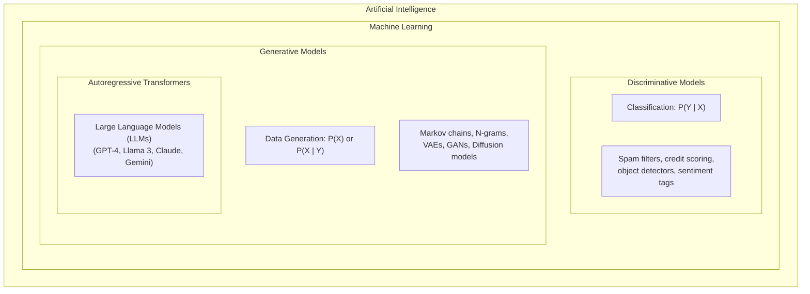
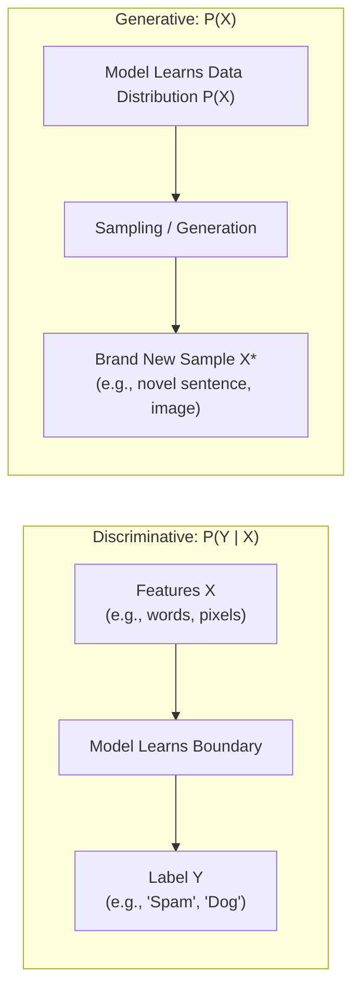
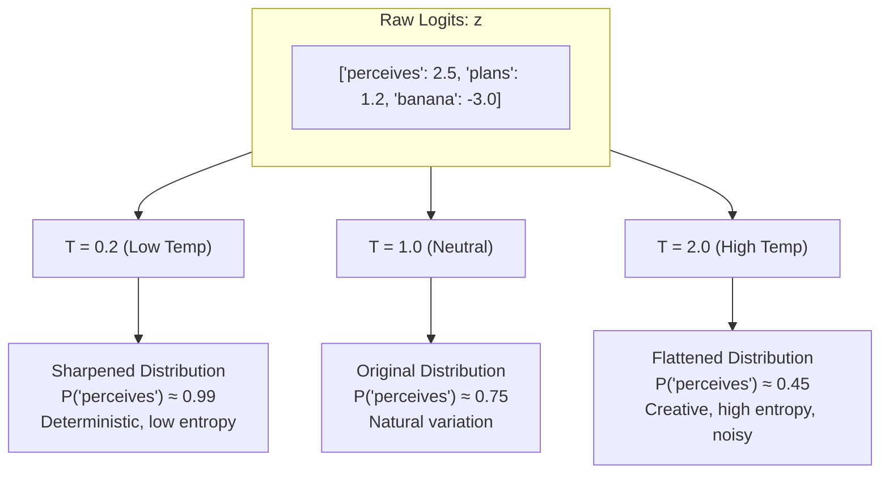
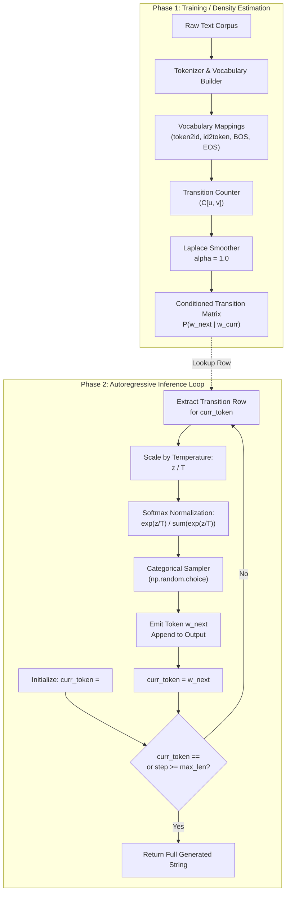
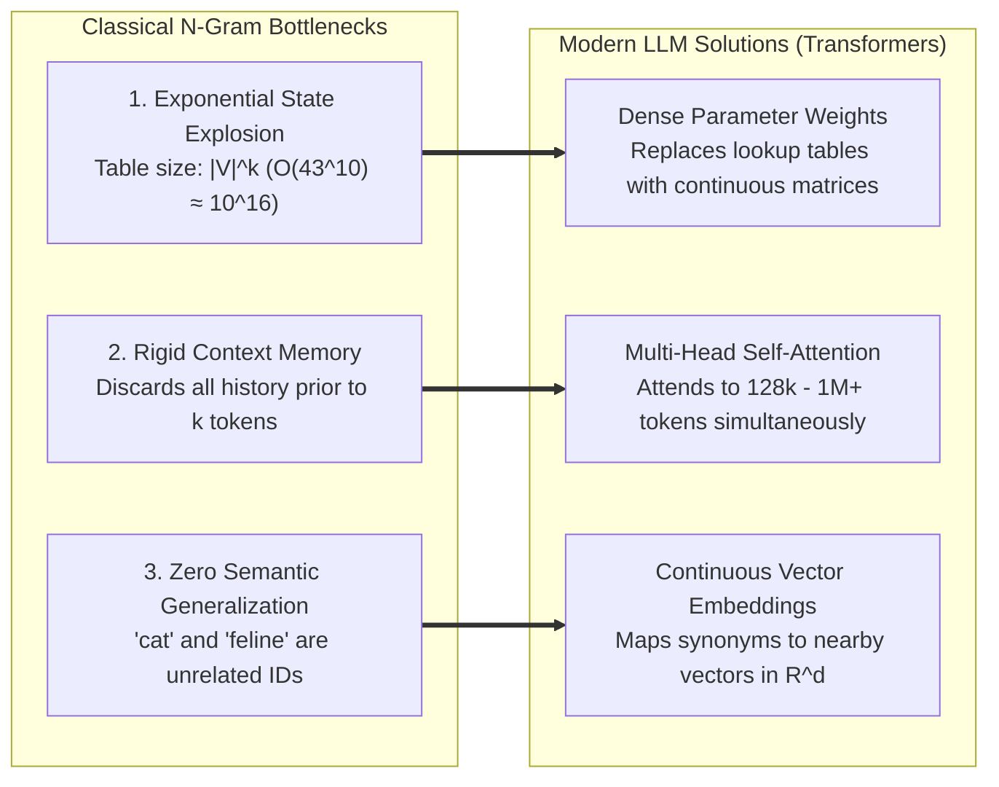
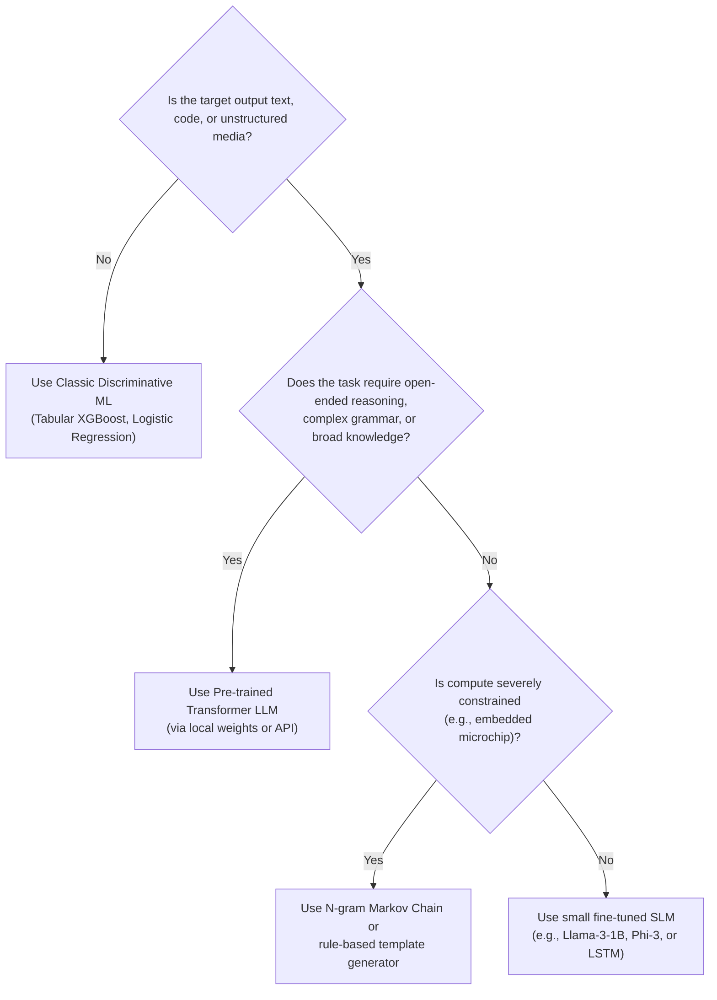

[Academy](../../index.md) › [Track 01: AI and LLM Fundamentals](../README.md) › [Module 1.1: Introduction to Artificial Intelligence](README.md)

# Generative AI

| Field | Value |
|---|---|
| **Track** | Track 01: AI and LLM Fundamentals |
| **Module** | Module 1.1: Introduction to Artificial Intelligence |
| **Difficulty** | Beginner |
| **Estimated reading time** | 25–30 minutes (plus 15 minutes for the notebook) |
| **Prerequisites** | [Reinforcement Learning](08-reinforcement-learning.md); basic Python (loops, functions, dictionaries) |
| **Technologies** | Python, NumPy, Jupyter, nbclient, pytest |
| **Framework versions** | Python 3.14.5, numpy 2.5.0, nbformat 5.11.1, nbclient 0.11.0, ipykernel 7.4.0, pytest 9.1.1 |
| **Last verified date** | 2026-11-17 |
| **Companion code** | [`examples/01-AI-FUNDAMENTALS/09-generative-ai/`](../../../examples/01-AI-FUNDAMENTALS/09-generative-ai/) |

> ✅ **Code status:** The companion notebook and its tests were run on Windows 11 with the versions above. Every output block marked **"Actual output"** was copied from that run. Blocks marked **"Illustrative"** are written by hand. Random operations use fixed seeds (`SEED = 42`) for reproducibility.

---

## Table of Contents

1. [Introduction](#1-introduction)
2. [Learning Objectives](#2-learning-objectives)
3. [Prerequisites](#3-prerequisites)
4. [Fundamental Concepts](#4-fundamental-concepts)
5. [Internal Architecture](#5-internal-architecture)
6. [Installation and Environment Setup](#6-installation-and-environment-setup)
7. [Project Folder Structure](#7-project-folder-structure)
8. [Step-by-Step Implementation](#8-step-by-step-implementation)
9. [Execution and Expected Output](#9-execution-and-expected-output)
10. [Internal Execution Flow](#10-internal-execution-flow)
11. [Advanced Concepts](#11-advanced-concepts)
12. [Real-World Use Cases](#12-real-world-use-cases)
13. [Best Practices](#13-best-practices)
14. [Common Errors and Troubleshooting](#14-common-errors-and-troubleshooting)
15. [Comparison and Alternatives](#15-comparison-and-alternatives)
16. [Hands-on Exercises](#16-hands-on-exercises)
17. [Interview Preparation](#17-interview-preparation)
18. [Summary](#18-summary)
19. [Next Learning Step](#19-next-learning-step)
20. [References](#20-references)

---

## 1. Introduction

### What is the topic?

**Generative Artificial Intelligence (Generative AI)** is a family of machine learning methods designed to **create new, original data artifacts**—such as text, software code, images, audio, video, or synthetic tables—that match the underlying statistical patterns of the data they were trained on.

In previous lessons, you examined systems that classify images, predict loan defaults, cluster customer profiles, or learn game policies by trial and error. Most of those models are **discriminative**: they map inputs to labels ($X \to Y$).

Generative AI operates under a different mathematical objective: it learns the **probability distribution of the data itself** ($P(X)$ or $P(X \mid Y)$). Once an algorithm understands how words, pixels, or audio frequencies naturally co-occur, it can **sample** from that distribution to generate novel, coherent instances that never existed in the training dataset.



*Diagram: Generative AI is a branch of machine learning that models the data distribution itself. Large Language Models (LLMs) are deep autoregressive generative models.*

### Why does it exist?

Traditional software requires human programmers to anticipate every scenario and write explicit rules. Traditional predictive machine learning automates decisions, but only answers bounded questions: *"Is this email spam?"*, *"What will the temperature be tomorrow?"*, or *"Which category does this photo belong to?"*

However, most human intellectual work is **synthetic and compositional**:
- Writing an explanatory technical report.
- Translating thought into runnable Python code.
- Formulating a multi-step plan to resolve a customer incident.
- Designing a new user interface layout or molecular compound.

Generative AI exists because modeling high-dimensional data distributions allows computers to assist with and automate open-ended, creative, and communicative tasks that cannot be reduced to a fixed set of classification labels.

### What problem does it solve?

Generative AI solves the **synthesis problem** across unstructured modalities:
1. **Unstructured Communication:** It bridges the gap between human language and structured computer operations.
2. **Cognitive Automation:** It automates repetitive writing, summarizing, coding, and data transformation workflows.
3. **Data Scarcity & Privacy:** It generates high-fidelity synthetic data for training other models without leaking real user records.

### Why should AI agent engineers learn it?

For an AI Agent Engineer, Generative AI is not merely one tool among many—**it is the cognitive engine of modern agents**.

An autonomous agent perceives an environment, reasons about goals, decides which tools to execute, and generates responses. Every step of that reasoning loop (whether using ReAct, Plan-and-Solve, or Tool-Use protocols) is fundamentally an **autoregressive next-token generation process**.

When an agent:
- Decides to invoke an API tool, it generates a JSON payload token-by-token.
- Reflects on an error message, it generates explanatory reasoning tokens.
- Selects between creative exploration and deterministic execution, it is configured by sampling **temperature** and decoding parameters.

Engineers who do not understand the probabilistic nature of generative models treat LLMs as black-box "magic." Engineers who master probability distributions, tokenization, context windows, and sampling build reliable, deterministic, production-grade agent systems.

### Where is it used in real-world applications?

| Domain | Generative AI Application | Core Mechanism |
|---|---|---|
| **Autonomous AI Agents** | Tool calling, reasoning traces, API orchestration | Autoregressive token generation with JSON schemas |
| **Software Development** | Code completion, unit test synthesis, documentation | Sequence-to-sequence code models trained on ASTs |
| **Customer Support** | Contextual ticket resolution and intelligent escalation | Retrieval-Augmented Generation (RAG) |
| **Media & Design** | Photorealistic images, 3D assets, video synthesis | Latent Diffusion and Flow Matching |
| **Healthcare & Pharma** | De novo protein design, automated clinical notes | Conditional generative models on amino acid sequences |

---

## 2. Learning Objectives

After completing this lesson, you will be able to:

- Articulate the mathematical and practical difference between **discriminative** models ($P(Y \mid X)$) and **generative** models ($P(X)$).
- Explain how text generation decomposes into a sequence of conditional next-token probabilities via the **chain rule of probability**.
- Describe the role of **tokens**, vocabulary indexing, and special sequence boundaries (`<BOS>`, `<EOS>`).
- Build and train a **Bigram Language Model** and an **N-gram Markov Chain generator** from scratch using standard Python and NumPy.
- Explain **Laplace (add-1) smoothing** and why it is necessary to prevent zero-probability crashes.
- Define **logits**, the **softmax function**, and explain how the **temperature ($T$)** hyperparameter controls randomness, entropy, and creativity.
- Evaluate generative quality using **Cross-Entropy Loss** and **Perplexity (PPL)**.
- Connect classical Markov chain language models to modern **Transformer-based Large Language Models (LLMs)**, identifying the three key architectural bottlenecks deep learning resolved.

---

## 3. Prerequisites

- **Required Lessons:**
  - [What is Artificial Intelligence?](01-what-is-artificial-intelligence.md) (features, labels, models, training).
  - [Machine Learning vs Deep Learning](05-machine-learning-vs-deep-learning.md) (parameters, layers, representation learning).
  - [Supervised Learning](06-supervised-learning.md) (loss functions, training splits).
  - [Reinforcement Learning](08-reinforcement-learning.md) (state transitions, policies).
- **Programming:** Basic Python (lists, dictionaries, string manipulation, `defaultdict`, `Counter`).
- **Mathematics:** High-school probability intuition (probabilities are between 0 and 1 and sum to 1; logarithms). No calculus required.
- **Environment:** Python 3.10 or newer (tested on Python 3.14.5), NumPy, pytest, and Jupyter. Zero API keys or cloud accounts needed.

---

## 4. Fundamental Concepts

### 4.1 Discriminative vs Generative Modeling

To understand Generative AI, you must contrast it with the standard predictive models studied in earlier chapters:

- **Discriminative Models ($P(Y \mid X)$):**
  - **Goal:** Predict a target label $Y$ given observed input features $X$.
  - **What they learn:** The **boundary** between categories.
  - **Question answered:** *"Given this email text ($X$), is it spam ($Y=1$) or not ($Y=0$)?"*
  - **Analogy:** A judge in a courtroom. The judge does not paint paintings or write novels; they examine evidence ($X$) and render a verdict ($Y$).
  - **Algorithms:** Logistic Regression, Support Vector Machines, Random Forests, standard classification neural nets.

- **Generative Models ($P(X)$ or $P(X \mid Y)P(Y)$):**
  - **Goal:** Model how the data $X$ was generated in the first place.
  - **What they learn:** The underlying **probability density and feature relationships** of the data.
  - **Question answered:** *"What does a realistic email look like? Generate a brand-new one."*
  - **Analogy:** An artist or author. Having studied thousands of paintings or books, they understand how colors or words combine, and create a new work that fits the style.
  - **Algorithms:** Markov Chains, Naive Bayes, Variational Autoencoders (VAEs), Generative Adversarial Networks (GANs), Diffusion Models, and Autoregressive Transformers (LLMs).



*Diagram: Discriminative models map input features to a target label. Generative models capture the probability landscape of the data space and sample new data points from it.*

### 4.2 Sequence Generation and the Chain Rule of Probability

How does generating a coherent paragraph or code file work?
A text document is a sequence of discrete symbols: $W = (w_1, w_2, w_3, \dots, w_T)$.

The fundamental task of a language model is to assign a probability to the entire sequence $P(W)$. By the **chain rule of probability**, any joint probability can be factored into a chain of conditional probabilities:

$$P(w_1, w_2, \dots, w_T) = P(w_1) \cdot P(w_2 \mid w_1) \cdot P(w_3 \mid w_1, w_2) \cdots P(w_T \mid w_1, \dots, w_{T-1})$$

In compact mathematical notation:

$$P(w_1, \dots, w_T) = \prod_{t=1}^T P(w_t \mid w_1, \dots, w_{t-1})$$

This formulation gives rise to **autoregressive generation**:
1. You provide an initial prompt (or start marker).
2. The model evaluates the conditional distribution over all possible words for the next position: $P(w_t \mid \text{context})$.
3. You select (sample) a word from this distribution.
4. You append the selected word to the context.
5. You repeat the process until the model emits a designated stopping symbol or reaches a maximum length limit.

### 4.3 Tokens, Vocabularies, and Special Boundary Markers

Computers cannot process raw characters or words directly; they operate on integers:
- **Token:** The atomic unit of text processed by a language model. In simple systems, a token is a whole word (e.g., `"agent"`). In production LLMs, tokens are subword chunks derived via algorithms like Byte-Pair Encoding (BPE), allowing arbitrary text to be represented efficiently.
- **Vocabulary ($V$):** The fixed, finite set of all recognized tokens. The size of the vocabulary is denoted $|V|$.
- **Token IDs:** Each unique token is assigned a unique integer index: $0, 1, 2, \dots, |V|-1$.

To give a generative sequence model control over structure, we introduce **special delimiter tokens**:
- `<BOS>` (*Beginning of Sequence*): Signifies the start of a document or thought. It seeds the autoregressive generation loop.
- `<EOS>` (*End of Sequence*): Informs the generation loop that the thought, sentence, or tool call is complete. Without `<EOS>`, a generator would ramble indefinitely until hitting an arbitrary buffer limit.
- `<UNK>` (*Unknown Token*): Represents words absent from the model's vocabulary.

### 4.4 The Markov Property and N-gram Language Models

Calculating $P(w_t \mid w_1, \dots, w_{t-1})$ conditioned on hundreds or thousands of prior words is computationally difficult without deep neural networks.

In 1913, mathematician Andrey Markov introduced a simplifying assumption: **the future depends only on the immediate present, not the entire past**.

- **First-Order Markov Assumption (Bigram Model):**
  The probability of word $w_t$ depends **only** on the immediately preceding word $w_{t-1}$:
  $$P(w_t \mid w_1, \dots, w_{t-1}) \approx P(w_t \mid w_{t-1})$$
- **Second-Order Markov Assumption (Trigram Model):**
  The probability depends on the preceding **two** words:
  $$P(w_t \mid w_1, \dots, w_{t-1}) \approx P(w_t \mid w_{t-2}, w_{t-1})$$
- **General N-gram Model ($k$-th order):**
  Conditioned on a context window of length $k = N - 1$:
  $$P(w_t \mid w_{t-k}, \dots, w_{t-1})$$

In a Bigram model, the parameters of the model can be stored as a 2D matrix of shape $|V| \times |V|$, where each cell $(u, v)$ stores the probability that token $u$ is followed by token $v$.

### 4.5 The Zero-Frequency Problem and Laplace Smoothing

Suppose your training corpus contains the phrases:
- `"intelligent agent"`
- `"autonomous system"`

What is the probability of the phrase `"intelligent system"`?
If the pair `("intelligent", "system")` never appeared adjacent in the training corpus, its empirical count $C(\text{"intelligent"}, \text{"system"})$ is **0**.

Under maximum likelihood estimation:
$$P(\text{"system"} \mid \text{"intelligent"}) = \frac{0}{\sum_v C(\text{"intelligent"}, v)} = 0$$

A probability of zero is dangerous:
1. If the model evaluates a new sentence containing that pair, the entire product $\prod P(w_t \mid w_{t-1})$ becomes zero.
2. In log-probability space ($\log P$), $\log(0) = -\infty$, causing mathematical overflow and crashes.

The simplest remedy is **Laplace Smoothing (add-1 smoothing)**: pretend you observed every possible transition at least $\alpha$ times (typically $\alpha = 1$):

$$P(v \mid u) = \frac{C[u, v] + \alpha}{\sum_{v'} (C[u, v'] + \alpha)} = \frac{C[u, v] + 1}{\sum_{v'} C[u, v'] + |V|}$$

Every transition receives a valid, non-zero probability, preserving numerical stability.

### 4.6 Logits and the Softmax Function

In modern neural networks and probabilistic classifiers, the raw unnormalized numerical outputs produced by the model are called **logits** (often denoted $z$).

Logits can be any real number: negative, zero, or positive ($z_i \in (-\infty, +\infty)$). To turn logits into a valid probability distribution where every value is positive and all values sum to $1.0$, we apply the **Softmax function**:

$$\text{Softmax}(z)_i = \frac{\exp(z_i)}{\sum_{j=1}^{|V|} \exp(z_j)}$$

### 4.7 Sampling Strategies and Temperature ($T$)

Once you have a probability distribution over the vocabulary for the next token, how do you pick which word to output?

1. **Greedy Decoding (Argmax):**
   Always pick the token with the single highest probability:
   $$w_t = \arg\max_i P_i$$
   *Problem:* While deterministic, greedy search often gets stuck in repetitive loops (e.g., *"the agent of the agent of the agent"*), lacks creativity, and misses high-quality global sequences.

2. **Categorical / Stochastic Sampling:**
   Roll a weighted multi-sided die where each face corresponds to a token with probability $P_i$. Words with higher probabilities are chosen more often, but less common words still have a chance.

3. **Temperature Scaling ($T$):**
   Temperature is a positive scalar hyperparameter ($T > 0$) applied to the logits before computing the softmax:

   $$P_i(T) = \frac{\exp(z_i / T)}{\sum_j \exp(z_j / T)}$$



*Diagram: Temperature alters the sharpness of the probability distribution. Low temperature concentrates probability on the top candidates; high temperature flattens the distribution.*

- **$T \to 0$ (Approaching zero):** The distribution collapses into a one-hot spike. Equivalent to greedy argmax decoding.
- **$T < 1.0$ (Low temperature, e.g. $0.2 - 0.7$):** Dampens low-probability tail tokens. Responses are focused, concise, and predictable. Ideal for structured JSON output, factual extraction, and agent tool execution.
- **$T = 1.0$ (Neutral):** Standard sampling according to the model's learned distribution.
- **$T > 1.0$ (High temperature, e.g. $1.2 - 1.8$):** Flattens the distribution towards a uniform spread. Rare tokens are chosen frequently. Increases diversity and creative novelty, but dramatically elevates the risk of incoherent "hallucinations" or grammatical breakdown.

### 4.8 Evaluating Generative Models: Cross-Entropy and Perplexity

How do you measure whether a language model is performing well without asking humans to read thousands of outputs?

We compute **Cross-Entropy Loss (Negative Log-Likelihood)** on a held-out test sentence $W = (w_1, \dots, w_N)$:

$$\text{NLL}(W) = -\frac{1}{N} \sum_{i=1}^N \log_2 P(w_i \mid w_{i-1})$$

From NLL, we compute **Perplexity (PPL)**:

$$\text{PPL}(W) = 2^{\text{NLL}(W)}$$

- **Intuition:** Perplexity measures the model's **uncertainty** (or average branching factor).
- If a model has a perplexity of **15.0** on a sentence, it means that at each token position, the model was as uncertain as if it had to choose uniformly among **15 equally likely words**.
- **Lower perplexity = superior model**. If a sentence is natural and follows the training corpus patterns, perplexity is low. If a sentence is nonsensical, grammatically corrupt, or out-of-domain, perplexity is high (the model is "perplexed").

---

## 5. Internal Architecture

The end-to-end generative text generation pipeline consists of seven interacting components.



*Diagram: The end-to-end architecture of an autoregressive generator. In Phase 1, transition counts are smoothed into conditional probabilities. In Phase 2, the model runs a while-loop sampling tokens until emitting `<EOS>`.*

### Component Responsibilities

| Component | Responsibility | Mathematical Formulation |
|---|---|---|
| **Tokenizer** | Converts raw strings into sequences of integer indices and inserts sequence boundary markers. | `"the agent"` $\to `[\text{BOS}, 38, 3, \text{EOS}]`$ |
| **Vocabulary Store** | Maintains bijective mapping between strings and integer IDs. | $\text{token2id}(w) \leftrightarrow \text{id2token}(i)$ |
| **Transition Model** | Stores statistical dependencies between context prefixes and continuation tokens. | $C[u, v] \to P(v \mid u)$ |
| **Laplace Smoother** | Regularizes probabilities so no valid transition evaluates to 0. | $(C + \alpha) / (\sum C + \alpha |V|)$ |
| **Temperature Scaler** | Modulates the entropy of the output distribution prior to sampling. | $z_i' = z_i / T$ |
| **Stochastic Sampler** | Selects the next token according to the tempered categorical distribution. | $i \sim \text{Categorical}(p_1, \dots, p_{|V|})$ |
| **Autoregressive Controller** | Manages the generation state, appends tokens, and evaluates termination criteria (`<EOS>`). | `while curr != EOS and len < max_len` |

---

## 6. Installation and Environment Setup

This project uses the Python standard library and NumPy. No GPU, no external cloud credentials, and no API keys are required.

### 1. Virtual Environment Setup

From the repository root:

```bash
# Navigate to the topic directory
cd examples/01-AI-FUNDAMENTALS/09-generative-ai

# Create an isolated virtual environment
python -m venv .venv

# Activate the environment:
# On Windows (PowerShell):
.venv\Scripts\Activate.ps1
# On macOS / Linux:
# source .venv/bin/activate

# Upgrade pip and install pinned dependencies
python -m pip install --upgrade pip
pip install -r requirements.txt
```

### 2. Pinned Dependencies (`requirements.txt`)

```text
# Pinned versions used to run the companion notebook and tests (2026-11-17, Python 3.14.5).
numpy==2.5.5
pytest==9.2.0
nbformat==5.11.1
nbclient==0.11.0
ipykernel==7.4.0
notebook>=7
```

---

## 7. Project Folder Structure

The project is structured according to the academy's test-driven standards:

```text
examples/01-AI-FUNDAMENTALS/09-generative-ai/
├── generative_ai.ipynb       # Complete Jupyter notebook with all code and saved outputs
├── requirements.txt          # Strictly pinned production package versions
├── pytest.ini               # Pytest test discovery and warning filters
├── README.md                # Quick-start documentation and run commands
└── tests/
    └── test_notebook.py     # Automated test running the entire notebook via nbclient
```

- `generative_ai.ipynb`: The self-contained notebook organized into 8 educational sections, complete with `assert` validation checks.
- `tests/test_notebook.py`: Automated CI test that executes the entire notebook head-to-tail using `nbclient`, ensuring zero regressions.

---

## 8. Step-by-Step Implementation

Below are the complete, runnable Python implementations extracted from the companion notebook.

### Step 1: Environment and Reproducibility Setup

```python
# generative_ai.ipynb, Section 1
import sys
import math
import random
from collections import defaultdict, Counter
import numpy as np

SEED = 42
random.seed(SEED)
np.random.seed(SEED)

print(f"Python version : {sys.version.split()[0]}")
print(f"NumPy version  : {np.__version__}")
print(f"Random seed    : {SEED}")
```

Setting `SEED = 42` guarantees that all pseudorandom numbers (from Gaussian generation to multinomial token sampling) yield identical outputs across operating systems.

### Step 2: Demonstrating Discriminative vs Generative Models

We create a synthetic 1D dataset with two distinct classes:
- Class 0: $\mathcal{N}(\mu = -2.0, \sigma = 0.8)$
- Class 1: $\mathcal{N}(\mu = +2.5, \sigma = 0.9)$

We train a **discriminative** logistic model to find the decision boundary $P(Y=1 \mid X)$, and fit a **generative** model to capture $P(X \mid Y)$ and generate synthetic data from scratch.

```python
# generative_ai.ipynb, Section 2
n_samples = 200
x0 = np.random.normal(loc=-2.0, scale=0.8, size=n_samples)
x1 = np.random.normal(loc=2.5, scale=0.9, size=n_samples)

X = np.concatenate([x0, x1])
y = np.concatenate([np.zeros(n_samples), np.ones(n_samples)])

# A. Discriminative Model: Find decision boundary P(Y=1 | X) via Logistic Regression
w = 0.0
b = 0.0
lr = 0.05
for _ in range(500):
    logits = w * X + b
    preds = 1.0 / (1.0 + np.exp(-np.clip(logits, -20, 20)))
    grad_w = np.mean((preds - y) * X)
    grad_b = np.mean(preds - y)
    w -= lr * grad_w
    b -= lr * grad_b

decision_boundary = -b / w

# B. Generative Model: Learn class-conditional data distributions P(X | Y=k)
mean_0, std_0 = float(np.mean(x0)), float(np.std(x0))
mean_1, std_1 = float(np.mean(x1)), float(np.std(x1))
prior_0 = len(x0) / len(X)
prior_1 = len(x1) / len(X)

# Generate brand new synthetic data points from scratch
new_synthetic_c0 = np.random.normal(loc=mean_0, scale=std_0, size=5)
new_synthetic_c1 = np.random.normal(loc=mean_1, scale=std_1, size=5)
```

The discriminative model discards how the data was shaped—it only retains the single dividing line ($x \approx 0.099$). The generative model captures the full probability density ($\mu, \sigma$), enabling it to create brand-new realistic samples on demand.

### Step 3: Preparing the Domain Corpus and Tokenizer

We use a domain corpus focused on autonomous AI agents:

```python
# generative_ai.ipynb, Section 3
CORPUS = [
    "the intelligent agent perceives its environment and takes action",
    "the agent learns from experience to maximize cumulative reward",
    "an intelligent agent communicates with tools and other agents",
    "the system perceives incoming data and takes action",
    "an autonomous agent plans each action and executes tools",
    "the neural network learns representations from raw data",
    "an intelligent system takes action to solve complex tasks",
    "the agent observes the environment and plans its next step",
    "the autonomous agent executes tools to solve complex tasks",
    "an agent learns from data to improve cumulative performance",
]

BOS = "<BOS>"
EOS = "<EOS>"

# Tokenize sentences into word sequences wrapped in sequence markers
tokenized_sentences = []
all_words = [BOS, EOS]

for sent in CORPUS:
    words = sent.strip().lower().split()
    tokenized_sentences.append([BOS] + words + [EOS])
    all_words.extend(words)

# Build bijective vocabulary mappings
unique_tokens = sorted(list(set(all_words)))
vocab_size = len(unique_tokens)
token2id = {tok: idx for idx, tok in enumerate(unique_tokens)}
id2token = {idx: tok for idx, tok in enumerate(unique_tokens)}
```

### Step 4: Bigram Matrix with Laplace Smoothing

We build a transition count matrix and normalize it with Laplace smoothing ($\alpha = 1.0$):

```python
# generative_ai.ipynb, Section 4
count_matrix = np.zeros((vocab_size, vocab_size), dtype=np.int32)

for sent in tokenized_sentences:
    for u, v in zip(sent[:-1], sent[1:]):
        idx_u = token2id[u]
        idx_v = token2id[v]
        count_matrix[idx_u, idx_v] += 1

# Convert counts to Laplace-smoothed transition probabilities
alpha = 1.0
smoothed_counts = count_matrix + alpha
transition_probs = smoothed_counts / smoothed_counts.sum(axis=1, keepdims=True)
```

### Step 5: Temperature-Controlled Sampling and Text Generation

```python
# generative_ai.ipynb, Section 5
def sample_next_token(probs: np.ndarray, temperature: float = 1.0) -> int:
    """Sample next token index from probability distribution with temperature scaling."""
    if temperature <= 1e-4:
        # Greedy decoding: argmax
        return int(np.argmax(probs))
    
    # Convert probabilities to log-scale logits: z = log(p)
    logits = np.log(np.clip(probs, 1e-12, 1.0))
    scaled_logits = logits / temperature
    # Shift for numerical stability before exponentiation
    shifted = scaled_logits - np.max(scaled_logits)
    exp_logits = np.exp(shifted)
    tempered_probs = exp_logits / np.sum(exp_logits)
    
    # Sample token index from tempered categorical distribution
    return int(np.random.choice(len(tempered_probs), p=tempered_probs))

def generate_sentence(trans_matrix: np.ndarray, temperature: float = 1.0, max_len: int = 20) -> str:
    """Autoregressively generate a sentence starting from <BOS> until <EOS> or max_len."""
    curr_idx = token2id[BOS]
    generated_tokens = []
    
    for _ in range(max_len):
        next_probs = trans_matrix[curr_idx]
        next_idx = sample_next_token(next_probs, temperature=temperature)
        next_tok = id2token[next_idx]
        
        if next_tok == EOS:
            break
        generated_tokens.append(next_tok)
        curr_idx = next_idx
        
    return " ".join(generated_tokens)
```

### Step 6: Negative Log-Likelihood and Perplexity Computation

```python
# generative_ai.ipynb, Section 6
def calculate_perplexity(sentence: str, trans_matrix: np.ndarray) -> tuple[float, float]:
    """Calculate Cross-Entropy (bits/token) and Perplexity for a test sentence."""
    words = [BOS] + sentence.strip().lower().split() + [EOS]
    total_nll = 0.0
    valid_transitions = 0
    
    for u, v in zip(words[:-1], words[1:]):
        if u in token2id and v in token2id:
            u_idx = token2id[u]
            v_idx = token2id[v]
            p = trans_matrix[u_idx, v_idx]
        else:
            # Fallback uniform probability for unseen out-of-vocabulary tokens
            p = 1.0 / vocab_size
            
        total_nll += -math.log2(p)
        valid_transitions += 1
        
    avg_nll = total_nll / max(1, valid_transitions)
    ppl = 2.0 ** avg_nll
    return avg_nll, ppl
```

### Step 7: Context Windows with Higher-Order Markov Chains

```python
# generative_ai.ipynb, Section 7
class NGramMarkovGenerator:
    """N-gram Markov Chain text generator with variable context window k."""
    def __init__(self, order_k: int = 2):
        self.k = order_k
        self.transitions = defaultdict(Counter)
        
    def fit(self, sentences: list[str]):
        """Train Markov chain by counting transitions from k-token prefix contexts."""
        for sent in sentences:
            tokens = [BOS] * self.k + sent.strip().lower().split() + [EOS]
            for i in range(len(tokens) - self.k):
                prefix = tuple(tokens[i : i + self.k])
                next_tok = tokens[i + self.k]
                self.transitions[prefix][next_tok] += 1
                
    def generate(self, max_length: int = 25, seed: int = None) -> str:
        """Autoregressively generate text conditioned on the previous k tokens."""
        if seed is not None:
            random.seed(seed)
            
        context = [BOS] * self.k
        output = []
        
        for _ in range(max_length):
            prefix = tuple(context[-self.k :])
            next_counts = self.transitions.get(prefix)
            
            if not next_counts:
                break
                
            candidates = list(next_counts.keys())
            weights = list(next_counts.values())
            total = sum(weights)
            probs = [w / total for w in weights]
            
            next_word = random.choices(candidates, weights=probs, k=1)[0]
            if next_word == EOS:
                break
                
            output.append(next_word)
            context.append(next_word)
            
        return " ".join(output)
```

---

## 9. Execution and Expected Output

### 9.1 Running the Companion Notebook

Launch Jupyter from the project directory:

```bash
cd examples/01-AI-FUNDAMENTALS/09-generative-ai
jupyter notebook generative_ai.ipynb
```

Click **Run → Run All Cells**. Every cell executes locally in under 3 seconds.

### 9.2 Key Actual Outputs

**Actual output** (Section 2: Discriminative boundary vs Generative distributions):

```text
Discriminative Model (P(Y|X)):
  Learned boundary: x = 0.099
  Decision rule   : If x > 0.099 predict Class 1, else Class 0.

Generative Model (P(X|Y) and P(Y)):
  Class 0 distribution: Normal(mean=-2.033, std=0.743), Prior=0.50
  Class 1 distribution: Normal(mean=2.577, std=0.886), Prior=0.50

Generated Synthetic Samples from Generative Model:
  Synthetic Class 0: [-3.217, -2.478, -2.029, -1.998, -2.367]
  Synthetic Class 1: [3.129, 1.631, 2.451, 2.684, 3.033]
```

**Actual output** (Section 3 & 4: Vocabulary and Bigram Transitions):

```text
Corpus sentences   : 10
Total token count  : 109
Vocabulary size (V): 43 unique tokens (including <BOS>, <EOS>)
Vocabulary sample  : ['<BOS>', '<EOS>', 'action', 'agent', 'agents', 'an', 'and', 'autonomous'] ...

Top 3 transitions following '<BOS>':
  P(the          | <BOS>) = 0.1321
  P(an           | <BOS>) = 0.0943
  P(tools        | <BOS>) = 0.0189

Top 3 transitions following 'agent':
  P(learns       | agent) = 0.0600
  P(plans        | agent) = 0.0400
  P(observes     | agent) = 0.0400
```

Notice that `<BOS>` is most frequently followed by `"the"` (0.1321) and `"an"` (0.0943), mirroring the natural sentence starters in our corpus.

**Actual output** (Section 5: Autoregressive Generation Across Temperatures):

```text
--- Text Generation Across Temperatures ---

Greedy (T -> 0):
  [1] the agent learns from data
  [2] the agent learns from data to solve complex tasks
  [3] the agent learns from experience to solve complex tasks

Temperature T = 0.7:
  [1] from to reward next and communicates action takes network performance <BOS> to solve complex communicates communicates environment its incoming data
  [2] representations and executes improve incoming reward autonomous its next action neural autonomous agent to tools step data agent perceives incoming
  [3] an intelligent

Temperature T = 1.5:
  [1] experience to raw next and autonomous action takes next plans <BOS> tools system complex communicates autonomous each maximize incoming each
  [2] other an each experience intelligent reward communicates maximize next action next autonomous action to tools step each agent perceives incoming
  [3] an its
```

**Actual output** (Section 6: Cross-Entropy Loss and Perplexity):

```text
In-domain sentence    : 'the agent learns from experience to solve complex tasks'
  Cross-Entropy Loss  : 3.965 bits/token | Perplexity: 15.62

Out-of-domain sentence: 'quantum bananas orbit supersonic umbrellas in space'
  Cross-Entropy Loss  : 5.426 bits/token | Perplexity: 43.00
```

**Actual output** (Section 7: Higher-Order N-gram Markov Generation):

```text
--- N-gram Markov Generation by Context Window (Order k) ---

Order k=1 (Context size = 1 token):
  Sample 1: an intelligent agent learns representations from data and other agents
  Sample 2: an intelligent system perceives incoming data to maximize cumulative reward

Order k=2 (Context size = 2 tokens):
  Sample 1: an intelligent agent perceives its environment and takes action
  Sample 2: an intelligent system takes action

Order k=3 (Context size = 3 tokens):
  Sample 1: an intelligent agent communicates with tools and other agents
  Sample 2: an intelligent system takes action to solve complex tasks
```

### 9.3 Reading and Interpreting the Results

1. **Greedy decoding converges on high-probability paths:** At $T \to 0$, the model outputs clean, grammatical phrases like `"the agent learns from experience to solve complex tasks"`. Because there is zero randomness, it can only traverse the single highest-probability branches.
2. **High temperature flattens probabilities into disorder:** At $T = 1.5$, low-probability transitions receive significant weight, causing words like `"incoming"`, `"each"`, and `"experience"` to collide haphazardly. This is the exact mechanism behind **hallucination and incoherence** in LLMs when temperature is set too high.
3. **Perplexity validates semantic coherence:** The in-domain sentence achieved a perplexity of **15.62** (3.965 bits/token), while the out-of-domain nonsense sentence scored **43.00** (5.426 bits/token). Because the vocabulary has 43 tokens, a perplexity of 43.00 indicates the model was choosing almost completely at random across the entire vocabulary.
4. **Context window controls syntactic memory:** At $k=1$ (Bigram), sentences drift grammatically because the model forgets anything older than one word. At $k=2$ (Trigram) and $k=3$ (4-gram), the sentences become locally cohesive and mirror complete human thoughts.

### 9.4 Running the Test Suite

```bash
python -m pytest
```

**Actual output:**

```text
============================= test session starts =============================
platform win32 -- Python 3.14.5, pytest-9.1.1, pluggy-1.6.0
rootdir: C:\Users\hdasari\Documents\Harish\AI_AGENT_ENGINEERING\examples\01-AI-FUNDAMENTALS\09-generative-ai
configfile: pytest.ini
plugins: anyio-4.14.0
collected 1 item

examples\01-AI-FUNDAMENTALS\09-generative-ai\tests\test_notebook.py .    [100%]

======================== 1 passed, 1 warning in 2.61s =========================
```

---

## 10. Internal Execution Flow

The sequence diagram below traces how an autoregressive generation loop operates step-by-step:

```mermaid
sequenceDiagram
    autonumber
    actor User as Engineer / Agent Runner
    participant Loop as Generation Controller
    participant M as Transition Matrix P(w|u)
    participant S as Softmax & Temperature Scaler
    participant Sampler as Categorical Sampler

    User->>Loop: generate_sentence(temp=0.7)
    Loop->>Loop: curr_token = "<BOS>"
    loop Until curr_token == "<EOS>" or step == max_len
        Loop->>M: Query row for curr_token
        M-->>Loop: Raw transition probabilities / logits
        Loop->>S: Scale logits (z / 0.7)
        S->>S: Compute exp(z / T) / sum
        S-->>Loop: Tempered probability distribution
        Loop->>Sampler: Sample token from tempered distribution
        Sampler-->>Loop: Selected token ID (e.g. "agent")
        Loop->>Loop: Append "agent" to output string
        Loop->>Loop: curr_token = "agent"
    end
    Loop-->>User: Return complete generated sentence
```

1. **Initialization:** The runner triggers generation with a specified temperature ($T = 0.7$). The internal buffer is seeded with `<BOS>`.
2. **Conditional Lookup:** The model accesses the conditional probability row for the current active token.
3. **Temperature Rescaling:** Logits are scaled by $1 / T$.
4. **Probability Normalization:** The softmax ensures all elements sum to $1.0$.
5. **Stochastic Draw:** A pseudo-random float selects the next token index proportionally to its probability mass.
6. **State Transition:** The selected token becomes the condition for the subsequent cycle.
7. **Termination:** When `<EOS>` is selected, the loop breaks cleanly and returns the constructed text.

---

## 11. Advanced Concepts

### 11.1 From Markov Chains to Deep Autoregressive Transformers

While our Markov model illustrated the mechanics of next-token generation, classical N-grams hit three critical engineering barriers that prevent them from scaling to production:



1. **The Combinatorial Explosion of State Space:**
   In an N-gram model, supporting a context window of length $k$ requires storing $|V|^k$ conditional combinations. For an enterprise vocabulary of $|V| = 128,000$ and a modest context of $k = 10$, the required table would contain $128,000^{10} \approx 1.18 \times 10^{51}$ entries—more than the number of atoms in the planet Earth!
   *How LLMs solve it:* Instead of a discrete lookup table, deep neural networks parameterize the probability distribution using shared matrix weights ($W_Q, W_K, W_V, W_{FFN}$).
2. **Context Window Limitations:**
   An N-gram model with $k=3$ is completely blind to information presented 4 words earlier.
   *How LLMs solve it:* The **Transformer architecture** uses **Self-Attention**, computing pairwise attention weights between all tokens in a prompt across context windows exceeding 1,000,000 tokens.
3. **Lack of Semantic Generalization:**
   In an N-gram matrix, the word `"doctor"` and the word `"physician"` are completely separate integer IDs. Observing `"The doctor prescribed medicine"` gives the model zero statistical probability that `"The physician prescribed medicine"` is valid.
   *How LLMs solve it:* Deep networks project discrete tokens into high-dimensional **vector embedding spaces** ($\mathbb{R}^{4096}$), where semantically related words cluster together.

### 11.2 Advanced Sampling and Decoding Strategies

Modern LLMs utilize advanced decoding heuristics on top of temperature:

- **Top-k Sampling:** Limits the candidate pool to only the $k$ most probable tokens before normalizing probabilities. Discards the long tail of improbable tokens entirely.
- **Top-p (Nucleus) Sampling:** Rather than a fixed count $k$, pools the smallest set of tokens whose cumulative probability mass exceeds threshold $p$ (e.g., $p = 0.90$). The candidate pool dynamically expands during ambiguous context and shrinks during obvious context.
- **Min-p Sampling:** Truncates any token whose probability is less than a percentage of the top token's probability ($P_i < \text{min\_p} \times P_{\max}$).
- **Repetition Penalties:** Artificially subtracts from the logits of tokens that have already appeared in the recent generation window to prevent degenerative loops.

### 11.3 Other Generative AI Modalities

Generative AI extends far beyond text:
- **Diffusion Models (Images, Audio, Video):** Start with pure Gaussian noise and iteratively subtract predicted noise over multiple timesteps to reveal a high-fidelity image or audio spectrogram.
- **Variational Autoencoders (VAEs):** Encode inputs into a continuous low-dimensional latent space and sample vectors from that space to decode new images or molecules.
- **Generative Adversarial Networks (GANs):** Pit a Generator network (which creates fakes) against a Discriminator network (which detects fakes) in a zero-sum game until the fakes are indistinguishable from real data.

---

## 12. Real-World Use Cases

### Use Case 1: Automated API Tool Calling in AI Agents

- **Business Problem:** An autonomous customer service agent must look up customer order records, issue refunds, and update CRM entries without human intervention.
- **Proposed Architecture:** An autoregressive LLM conditioned on a system prompt containing strict JSON schemas of available tools.
- **Technologies Involved:** Python, LangGraph / LangChain, Pydantic, JSON Schema, FastAPI.
- **Expected Benefits:** Resolves 60–80% of routine e-commerce queries instantaneously without human agent queues.
- **Important Limitations:** Model can hallucinate invalid arguments or fabricate non-existent API endpoints if temperature is too high ($T > 0.2$).

### Use Case 2: Synthetic Financial Transaction Generation for Fraud Detection

- **Business Problem:** Fraud detection teams need millions of fraudulent transaction examples to train classifiers, but real fraud cases represent less than 0.01% of banking volume, and real data is subject to strict privacy regulations (GDPR, PCI-DSS).
- **Proposed Architecture:** A conditional generative model (CTGAN / Tabular VAE) trained on anonymized transaction ledgers to generate realistic synthetic fraud vectors.
- **Technologies Involved:** Python, NumPy, PyTorch, scikit-learn, Synthetic Data Vault (SDV).
- **Expected Benefits:** Balances class distribution from 1:10,000 to 1:1; protects customer financial privacy; improves downstream classifier recall by 35%.
- **Important Limitations:** Synthetic transactions may fail to capture rare, emergent fraud vectors never observed in historical data.

### Use Case 3: Automated Clinical Documentation Synthesis

- **Business Problem:** Physicians spend up to 2 hours every day typing clinical notes and patient encounter summaries into Electronic Health Record (EHR) systems.
- **Proposed Architecture:** Speech-to-text model feeds raw physician-patient dialogue into a fine-tuned generative LLM that generates a structured SOAP note (Subjective, Objective, Assessment, Plan).
- **Technologies Involved:** Whisper, Fine-tuned Llama 3 / Med-PaLM, FHIR healthcare API integration.
- **Expected Benefits:** Saves 70% of physician documentation time, reducing administrative burnout.
- **Important Limitations:** Requires human-in-the-loop sign-off; models can hallucinate dosages or symptoms if audio quality is degraded.

### Use Case 4: Automated Test Case and Code Refactoring in DevOps Pipelines

- **Business Problem:** Enterprise codebases suffer from poor unit test coverage because developers prioritize shipping features over writing boilerplate test suites.
- **Proposed Architecture:** A Git pre-commit hook sends code diffs to an agentic code generation model that analyzes Abstract Syntax Trees (AST) and generates comprehensive `pytest` suites.
- **Technologies Involved:** Python, Tree-sitter, GitHub Actions, Anthropic Claude 3.5 Sonnet / OpenAI Codex.
- **Expected Benefits:** Increases repo branch test coverage from 40% to 85% automatically.
- **Important Limitations:** Generated tests may assert current (potentially buggy) implementation behavior rather than intended specification behavior.

### Use Case 5: Real-Time Dynamic Game Dialogue Generation

- **Business Problem:** Non-Player Characters (NPCs) in open-world video games repeat the same 10 scripted lines, breaking player immersion.
- **Proposed Architecture:** Small, quantized local LLMs running on the client machine generate dynamic dialogue conditioned on player actions, emotional state, and game quest lore.
- **Technologies Involved:** llama.cpp, ONNX Runtime, 4-bit quantized Mistral-7B, Unity / Unreal Engine C++ bridge.
- **Expected Benefits:** Infinite emergent player interactions without pre-recording thousands of voice lines.
- **Important Limitations:** Latency must remain under 150ms to prevent gameplay stutters; strict guardrails are necessary to prevent NPCs from breaking character or lore.

---

## 13. Best Practices

1. **Tune Temperature to the Cognitive Task:**
   - **$T = 0.0 - 0.2$:** For structured JSON output, database queries, mathematical calculations, and tool-calling agents.
   - **$T = 0.5 - 0.7$:** For conversational agents, summarization, technical explanation, and document drafting.
   - **$T = 0.8 - 1.2$:** For creative brainstorming, poetry, character roleplay, and diverse idea generation.
2. **Always Use Grounding Delimiters:**
   Wrap few-shot examples or retrieved context in clear boundary markers (e.g., `<context>...</context>`). This prevents prompt injection and helps the autoregressive decoder distinguish instructions from reference data.
3. **Implement Laplace or Additive Smoothing on Discrete Distributions:**
   Never leave zero-probability entries in categorical lookup tables or transition matrices. A single zero will produce $-\infty$ log-likelihoods and crash evaluation loops.
4. **Use Log-Probabilities for Numerical Stability:**
   Multiplying hundreds of small floating-point probabilities ($0.001 \times 0.04 \times \dots$) rapidly leads to arithmetic underflow (evaluating to `0.0`). Always sum logarithms instead: $\log(a \cdot b) = \log(a) + \log(b)$.
5. **Guard Against Hallucinations with Retrieval-Augmented Generation (RAG):**
   Generative models are probabilistic pattern matchers, not databases. If an agent requires verified facts, retrieve the verified text from an authoritative source and instruct the model to generate its response conditioned strictly on that context.
6. **Enforce Output Schemas with Constrained Decoding:**
   In agent workflows, use libraries like Instructor, Outlines, or native JSON Schema modes. These enforce grammar at the token generation level by setting the logits of invalid syntax tokens to $-\infty$.

---

## 14. Common Errors and Troubleshooting

| Symptom / Error | Root Cause | Engineering Solution |
|---|---|---|
| **Infinite repetitive loop** (e.g., *"the agent the agent the agent"*) | Greedy decoding ($T = 0$) or lack of repetition penalty trap the model in a local probability cycle. | Increase temperature to $T = 0.6$, enable Top-p ($p = 0.9$), or add a frequency/presence penalty. |
| **Incoherent word salad** | Sampling temperature is set too high ($T \ge 1.5$), flattening the probability distribution into near-random selection. | Reduce temperature to $T \le 0.7$ or enable Top-k filtering ($k = 40$). |
| `ZeroDivisionError` or `-inf` in log calculations | An unseen word pair has transition count $C = 0$, leading to $\log_2(0)$. | Apply Laplace smoothing ($\alpha = 1.0$) or add a small numerical epsilon (`1e-12`) before computing logarithms. |
| **Out-of-Vocabulary (OOV) crash** | Model encounters a word during inference that does not exist in `token2id`. | Map unknown tokens to a fallback `<UNK>` token or adopt subword (BPE) tokenization. |
| **Premature cutoff in generated text** | The model sampled `<EOS>` too early, or `max_tokens` was configured too low. | Verify prompt instructions; inspect transition probabilities leading into `<EOS>`; increase maximum token budget. |
| `IndexError: index out of bounds` | Token ID exceeds vocabulary array dimensions ($id \ge |V|$). | Ensure vocabulary mappings are bijective and synchronized with embedding/count matrix shapes. |

---

## 15. Comparison and Alternatives

| Paradigm | Representation | Context Memory | Training Cost | Inference Latency | Generalization | Typical Use Case |
|---|---|---|---|---|---|---|
| **Rule-Based Templates** | If/Else string formatting | None (stateless) | Zero (hand-coded) | $< 1$ ms | None | Transaction receipts, system notifications |
| **N-Gram Markov Chains** | $|V|^k$ transition count matrix | $1 - 3$ tokens | Seconds (CPU) | $< 1$ ms | Exact word matches only | Autocomplete on low-power IoT microcontrollers |
| **Recurrent Nets (LSTM/GRU)** | Recurrent hidden state vectors | $50 - 500$ tokens | Hours (Single GPU) | $5 - 20$ ms | Moderate | Embedded speech-to-text, sensor time-series |
| **Diffusion Models** | Noise-predicting UNet / DiT | Fixed latent grid | Weeks (Cluster) | $500 - 3000$ ms | Continuous spatial | High-resolution image and video generation |
| **Autoregressive Transformers (LLMs)** | Deep Self-Attention layers | 8k – 1M+ tokens | Millions $ (Supercomputers) | $20 - 100$ ms / token | Superb semantic reasoning | Modern AI agents, coding assistants, chatbots |

### Decision Flowchart: When to Use Which Approach



*Diagram: Practical engineering decision tree for choosing between discriminative models, lightweight Markov generators, and deep Transformer LLMs.*

---

## 16. Hands-on Exercises

### Beginner

1. **Vocabulary Expansion:**
   - **Task:** Add two new sentences about "neural network architectures" to the corpus in `generative_ai.ipynb`.
   - **Hint:** Re-run the vocabulary builder cell and observe the new vocabulary size $|V|$.
   - **Expected Outcome:** Observe how adding unique words increases the dimensions of the Bigram count matrix from $43 \times 43$ to a larger square shape.
2. **Deterministic vs Stochastic Comparison:**
   - **Task:** Generate 5 sentences with `temperature = 0.0001` and 5 sentences with `temperature = 0.8`.
   - **Hint:** Use a `for` loop calling `generate_sentence`.
   - **Expected Outcome:** The greedy generator outputs the exact same sentence 5 times; the stochastic generator outputs 5 varied sentences.
3. **Exploring Smoothing Values:**
   - **Task:** Change the Laplace parameter `alpha` in Section 4 from `1.0` to `0.01` and then to `10.0`.
   - **Hint:** Inspect the transition probability $P(\text{"tools"} \mid \text{"<BOS>"})$.
   - **Expected Outcome:** Notice that larger $\alpha$ flattens the distribution towards uniform randomness, while smaller $\alpha$ keeps probability tightly concentrated on observed pairs.

### Intermediate

1. **Top-k Token Filtering:**
   - **Task:** Implement a `sample_top_k` function that sets all transition probabilities outside the top $k$ candidates to zero before re-normalizing and sampling.
   - **Hint:** Use `np.argpartition` or `np.argsort` to find indices of the largest $k$ elements.
   - **Expected Outcome:** Eliminates nonsensical word choices while maintaining healthy variety among the top candidates.
2. **Character-Level Language Model:**
   - **Task:** Modify the corpus tokenizer to split sentences into individual **characters** rather than whitespace-delimited words.
   - **Hint:** Include spaces, punctuation, and character-level `<BOS>` / `<EOS>` delimiters.
   - **Expected Outcome:** A much smaller vocabulary ($|V| \approx 28$), but generated strings will occasionally invent pseudo-words (e.g., `"agenter"`).
3. **Interactive Autocomplete CLI:**
   - **Task:** Build a function `autocomplete(prefix: str, top_n: int = 3)` that takes an input word and prints the top $N$ most probable next words according to the Bigram matrix.
   - **Hint:** Look up `token2id[prefix]` and sort the corresponding row of `transition_probs`.
   - **Expected Outcome:** Returns the top next-word predictions in milliseconds.

### Advanced

1. **Top-p (Nucleus) Sampling from Scratch:**
   - **Task:** Implement Nucleus Sampling in pure NumPy without third-party frameworks.
   - **Hint:** Sort probabilities descending, compute `np.cumsum(sorted_probs)`, zero out any token whose cumulative index exceeds threshold $p$, re-normalize to sum to 1.0, and sample.
   - **Expected Outcome:** Verify that on sharp distributions (one token has $P=0.95$), only 1 token is sampled; on flat distributions, many tokens are sampled.
2. **Perplexity Degradation Curve:**
   - **Task:** Write an evaluation script that calculates perplexity across 10 progressively corrupted sentences (e.g., swapping 10%, 20%, 50%, 100% of words with random vocabulary items).
   - **Hint:** Use `calculate_perplexity` in a loop and record perplexity values.
   - **Expected Outcome:** Produce a monotonic curve demonstrating that as grammatical and semantic noise increases, perplexity scales exponentially.

---

## 17. Interview Preparation

### Beginner

1. **What is the fundamental difference between discriminative and generative AI?**
   *Answer:* Discriminative models learn conditional decision boundaries $P(Y \mid X)$ to classify or label inputs. Generative models learn the data distribution $P(X)$ or joint distribution $P(X, Y)$, enabling them to synthesize new, unseen samples that match the statistical properties of the training data.
2. **What is autoregressive generation?**
   *Answer:* A sequential generation process where the model generates output one token at a time, feeding each generated token back into its input context to predict the subsequent token, continuing until an end-of-sequence token (`<EOS>`) is emitted.
3. **What is a token?**
   *Answer:* The basic discrete unit of text processed by a language model. Tokens can represent characters, subword chunks (via BPE or WordPiece), or entire words.
4. **Why do language models use special tokens like `<BOS>` and `<EOS>`?**
   *Answer:* `<BOS>` signals the beginning of a sequence and seeds generation when no prior context is available. `<EOS>` indicates that the thought or sequence is complete, enabling the model to terminate its generation loop cleanly.
5. **What is the Markov property?**
   *Answer:* The assumption that the future state depends only on the current state (or a fixed window of recent states), and is conditionally independent of all earlier historical states.
6. **What is an N-gram?**
   *Answer:* A contiguous sequence of $N$ items (words or characters). A unigram is 1 word, a bigram is 2 words, and a trigram is 3 words.
7. **What is the purpose of Laplace smoothing?**
   *Answer:* To eliminate zero probabilities for transitions or word combinations that were never observed in the training corpus, preventing division-by-zero errors and negative infinity log-likelihoods.
8. **What are logits in a language model?**
   *Answer:* The unnormalized vector of raw numerical scores produced by the model's output layer for every token in the vocabulary, prior to being converted into probabilities via the softmax function.
9. **How does sampling temperature affect generation?**
   *Answer:* Temperature scales logits ($z / T$). $T \to 0$ makes the distribution sharply peak on the most probable token (greedy decoding). $T > 1.0$ flattens the distribution, increasing output variety and randomness at the cost of higher incoherence risk.
10. **What is greedy decoding?**
    *Answer:* Selecting the token with the highest probability ($\arg\max$) at every single step. It is fast and deterministic, but frequently leads to repetitive, uncreative loops.

### Intermediate

1. **What is Perplexity, and how is it related to Cross-Entropy Loss?**
   *Answer:* Perplexity is $2^{\text{Cross-Entropy Loss}}$ (or $e^{\text{loss}}$ if using natural log). It represents the effective branching factor of the model—how many equally likely tokens the model is choosing among on average. Lower perplexity indicates superior predictive confidence on the test text.
2. **Explain the difference between Top-k and Top-p (Nucleus) sampling.**
   *Answer:* Top-k truncates the candidate pool to a static number $k$ of highest-probability tokens. Top-p dynamically adjusts the candidate pool size by including only the smallest set of tokens whose cumulative probability exceeds threshold $p$, allowing broad exploration when uncertainty is high and strict focus when a single token is obvious.
3. **Why do classical N-gram models fail to scale to long contexts?**
   *Answer:* The state space grows exponentially ($|V|^k$). A context of 10 words with a 100,000-word vocabulary requires a table of size $100,000^{10} = 10^{50}$ parameters. Most combinations are never seen during training, causing severe data sparsity and memory exhaustion.
4. **How do Transformers overcome the N-gram state explosion?**
   *Answer:* They replace discrete lookup tables with continuous parameter matrices and vector embeddings. Self-attention dynamically computes weights across any arbitrary pair of tokens within the context window in parallel.
5. **Why do we use log-probabilities instead of raw probabilities during text generation evaluation?**
   *Answer:* Multiplying hundreds of probabilities between 0 and 1 causes floating-point underflow (values become smaller than machine precision and round to zero). In log space, multiplication becomes addition ($\log(a \cdot b) = \log a + \log b$), preserving numerical precision.
6. **What causes an LLM to hallucinate?**
   *Answer:* LLMs are statistical probability estimators trained to produce plausible-sounding token sequences that maximize likelihood, not fact retrieval engines. If training data is sparse, contradictory, or prompts are ambiguous, the highest-probability continuation may be factually false but stylistically convincing.
7. **How does an AI agent use Generative AI to execute external tools?**
   *Answer:* The agent is provided system instructions describing available tools as JSON schemas. When a user request requires external computation or data, the model generates a structured JSON object representing the tool call. The agent runtime executes the tool, feeds the output back into the context, and prompts the model to generate the final answer.
8. **What is the difference between autoregressive and diffusion models?**
   *Answer:* Autoregressive models generate data sequentially one token at a time conditioned on earlier tokens (standard for text/code). Diffusion models generate data iteratively by starting with pure Gaussian noise and removing predicted noise over multiple full-frame refinement steps (standard for images/audio).
9. **What is the role of continuous vector embeddings in Generative AI?**
   *Answer:* Embeddings map discrete categorical tokens into dense, continuous vector spaces ($\mathbb{R}^d$) where geometric distance reflects semantic similarity. This allows models to generalize patterns learned on one word (e.g., `"physician"`) to synonymous words (e.g., `"doctor"`).
10. **What is constrained decoding?**
    *Answer:* A decoding method where the model's logits are dynamically masked (setting invalid token logits to $-\infty$) during inference so that the output is mathematically guaranteed to adhere to a formal grammar, regular expression, or JSON schema.

### Advanced

1. **Mathematically derive the relationship between Softmax temperature and distribution entropy.**
   *Answer:*
   Let $P_i(T) = \frac{\exp(z_i / T)}{\sum_j \exp(z_j / T)}$.
   As $T \to \infty$, $z_i / T \to 0$, so $\exp(z_i / T) \to 1$. Thus, $P_i \to \frac{1}{|V|}$, which is the uniform distribution with maximal entropy $H_{\max} = \log_2 |V|$.
   As $T \to 0^+$, let $z^* = \max_j z_j$. For the argmax index, $\frac{\exp(z^* / T)}{\sum \exp(z_j / T)} \to 1$, while for all $z_k < z^*$, the ratio decays to 0. The distribution collapses to a Dirac delta / one-hot vector with minimal entropy $H = 0$.
2. **How does Speculative Decoding speed up autoregressive inference?**
   *Answer:* Speculative decoding pairs a small, fast "draft" model (e.g., 1B parameters) with a large "target" model (e.g., 70B parameters). The draft model quickly generates $K$ candidate tokens autoregressively. The target model then runs a single forward pass in parallel to verify all $K$ tokens using modified rejection sampling. This achieves 2x–3x inference speedups without any loss in output distribution quality.
3. **Explain the training objective of modern autoregressive LLMs (Causal Language Modeling).**
   *Answer:* Given training sequence $X = (x_1, \dots, x_T)$, the training objective is to minimize the empirical cross-entropy loss across all sequence positions:
   $$\mathcal{L}_{\text{CLM}}(\theta) = -\frac{1}{T} \sum_{t=1}^T \log P_\theta(x_t \mid x_1, \dots, x_{t-1})$$
   During forward propagation, a causal lower-triangular attention mask prevents tokens at position $t$ from attending to future tokens $t+1, \dots, T$, allowing all sequence positions to be trained in parallel on GPUs.
4. **How does Direct Preference Optimization (DPO) differ from traditional RLHF?**
   *Answer:* Traditional RLHF trains a separate reward model on pairwise human preference data, then uses proximal policy optimization (PPO) with an actor-critic RL architecture to steer the policy. DPO mathematically demonstrates that the reward function can be implicitly parameterized directly through the language model's policy ratio:
   $$r(x, y) = \beta \log \frac{\pi_\theta(y \mid x)}{\pi_{\text{ref}}(y \mid x)}$$
   This allows direct optimization of the language model on preference pairs using a binary cross-entropy loss, eliminating the instability, memory overhead, and complexity of training a separate reward model and RL loop.
5. **How does Key-Value (KV) Caching optimize autoregressive token generation in Transformers?**
   *Answer:* During step $t$, standard self-attention requires computing Key ($K$) and Value ($V$) projections for all past tokens $1 \dots t-1$. In naive generation, recomputing these projections at every new token generation step incurs an $O(t^2)$ computational cost per token. KV Caching stores the computed $K$ and $V$ tensors from prior steps in GPU memory, meaning step $t$ only computes $Q, K, V$ for the newly appended single token, reducing the per-token computational complexity from $O(t)$ to $O(1)$ matrix-vector operations.

---

## 18. Summary

- **Generative AI** models the statistical distribution of data ($P(X)$ or $P(X \mid Y)$) to synthesize novel, coherent artifacts, contrasting with **discriminative AI** which learns decision boundaries ($P(Y \mid X)$).
- Text generation is fundamentally **autoregressive**: sequences are constructed one token at a time according to the conditional probability distribution $P(w_t \mid w_1, \dots, w_{t-1})$.
- Special control tokens (`<BOS>`, `<EOS>`) provide boundaries that initialize and cleanly terminate the generation loop.
- **Laplace Smoothing** guarantees that unobserved token pairs receive non-zero probability, preserving mathematical and numerical stability.
- The **Softmax function** converts raw unbounded **logits** into a valid probability distribution. The **Temperature ($T$)** parameter modulates the entropy of that distribution: low temperature produces focused, deterministic outputs; high temperature produces creative, varied, but potentially incoherent outputs.
- Models are quantitatively evaluated via **Negative Log-Likelihood** and **Perplexity**, which measures the model's average uncertainty per token.
- Modern **Transformer LLMs** scale these exact same principles across billions of parameters, replacing discrete N-gram tables with continuous dense embeddings and multi-head self-attention.

### Knowledge Checklist

- [ ] I can explain the difference between $P(Y \mid X)$ and $P(X)$ with an intuitive analogy.
- [ ] I can write out the chain rule factorization for sequence probability.
- [ ] I understand why `<BOS>` and `<EOS>` are required in autoregressive generation.
- [ ] I can calculate Laplace smoothing on a small transition count matrix by hand.
- [ ] I can explain what logits are and how softmax converts them to probabilities.
- [ ] I can describe the mathematical and practical impact of temperature $T = 0.2$ vs $T = 1.5$.
- [ ] I know how to interpret a perplexity score (e.g., 15 vs 43).
- [ ] I understand the three architectural bottlenecks of N-grams that Transformers solved.
- [ ] I ran the companion notebook and reproduced the test pass on Windows 11.

---

## 19. Next Learning Step

In this lesson, you explored how Generative AI models probability distributions and produces text, code, and synthetic data from first principles.

In the next lesson, **[Applications of AI in real-world industries](10-applications-of-ai-in-real-world-industries.md)**, you will step back to examine the macro-level impact: how these discriminative, reinforcement, and generative paradigms are deployed in production across healthcare, finance, manufacturing, retail, logistics, and legal automation.

---

## 20. References

The following references and documentation were accessed and verified:

| Resource | Verified URL |
|---|---|
| Wikipedia: Generative Artificial Intelligence | <https://en.wikipedia.org/wiki/Generative_artificial_intelligence> |
| Wikipedia: Language Model | <https://en.wikipedia.org/wiki/Language_model> |
| Wikipedia: Markov Chain | <https://en.wikipedia.org/wiki/Markov_chain> |
| Wikipedia: Perplexity | <https://en.wikipedia.org/wiki/Perplexity> |
| Google Machine Learning Glossary: Generative AI | <https://developers.google.com/machine-learning/glossary#generative-ai> |
| Hugging Face: Generation Strategies | <https://huggingface.co/docs/transformers/main/en/generation_strategies> |
| Python standard library: `collections` module | <https://docs.python.org/3/library/collections.html> |
| NumPy API Reference: `numpy.random.choice` | <https://numpy.org/doc/stable/reference/random/generated/numpy.random.choice.html> |
| nbclient Documentation | <https://nbclient.readthedocs.io/en/latest/> |
| pytest Documentation | <https://docs.pytest.org/en/stable/> |

### Further Reading (Foundational Literature)

- Claude Shannon, *"A Mathematical Theory of Communication"*, *Bell System Technical Journal*, 1948 (Introduced n-gram approximations of English text and information entropy).
- Ashish Vaswani et al., *"Attention Is All You Need"*, *NeurIPS*, 2017 (Introduced the Transformer architecture that powers modern generative LLMs).

See also: [Academy references](../../references.md)

---

[⬅️ Reinforcement Learning](08-reinforcement-learning.md) | [⬆️ Module overview](README.md) | [Applications of AI in real-world industries ➡️](10-applications-of-ai-in-real-world-industries.md)
