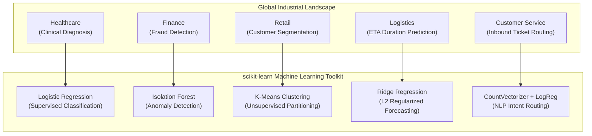
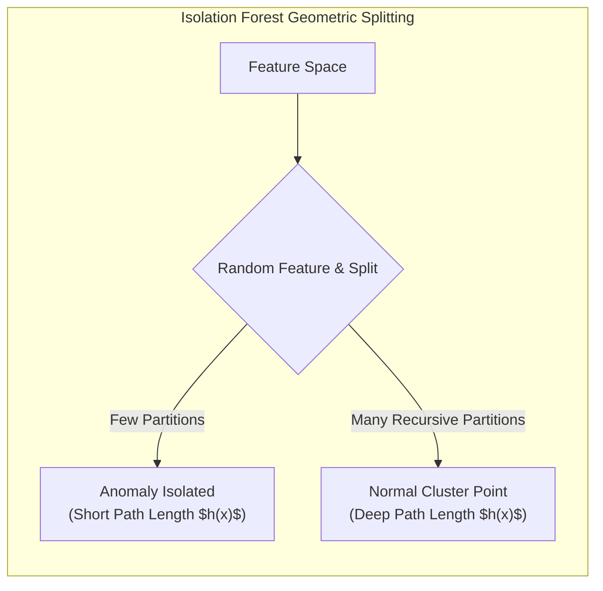
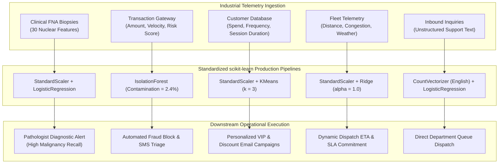
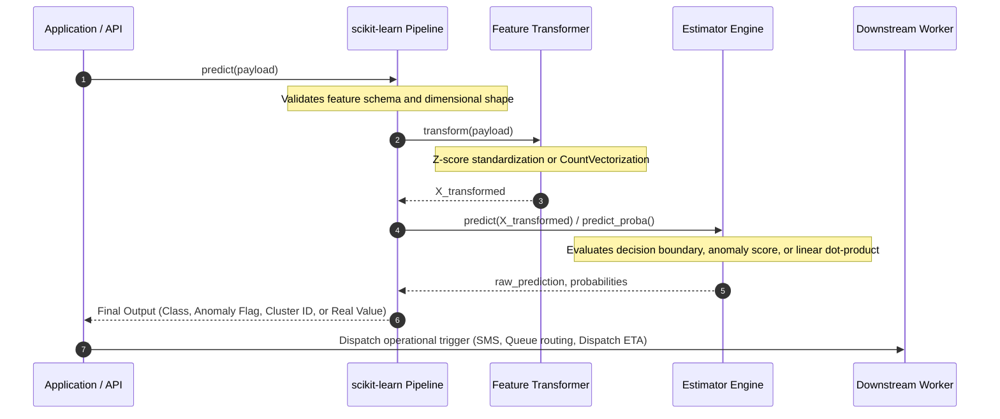
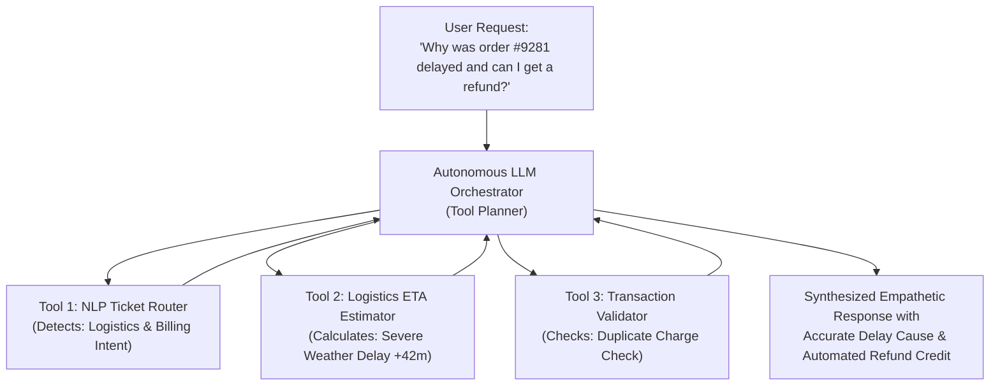
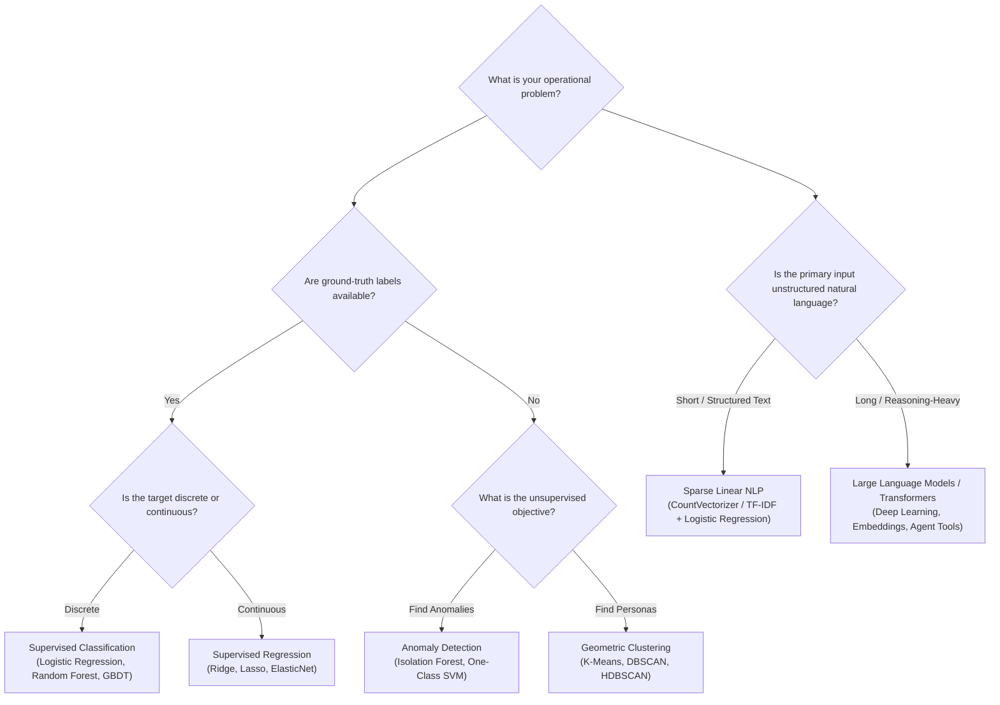

[Academy](../../index.md) › [Track 01: AI and LLM Fundamentals](../README.md) › [Module 1.1: Introduction to Artificial Intelligence](README.md)

# Applications of AI in Real-World Industries

| Field | Value |
|---|---|
| **Track** | Track 01: AI and LLM Fundamentals |
| **Module** | Module 1.1: Introduction to Artificial Intelligence |
| **Difficulty** | Beginner |
| **Estimated reading time** | 25–30 minutes (plus 15 minutes for the notebook) |
| **Prerequisites** | [Generative AI](09-generative-ai.md); Python basics help for the notebook |
| **Technologies** | Python, scikit-learn, numpy, Jupyter, pytest |
| **Framework versions** | Python 3.14.5, numpy 2.5.0, scikit-learn 1.9.1, pytest 9.1.1, nbclient 0.11.0, nbformat 5.11.1, ipykernel 7.4.0 |
| **Last verified date** | 2026-11-17 |
| **Companion code** | [`examples/01-AI-FUNDAMENTALS/10-applications-of-ai-in-real-world-industries/`](../../../examples/01-AI-FUNDAMENTALS/10-applications-of-ai-in-real-world-industries/) |

> ✅ **Code status:** The companion notebook and its tests were run on Windows 11 with the versions above. Every output block marked **"Actual output"** was copied from that run. Blocks marked **"Illustrative"** are written by hand. Accuracies and test predictions are reproducible using fixed random seeds; exact training times depend on machine hardware.

---

## Table of Contents

1. [Introduction](#1-introduction)
2. [Learning Objectives](#2-learning-objectives)
3. [Prerequisites](#3-prerequisites)
4. [Fundamental Concepts](#4-fundamental-concepts)
5. [Internal Architecture](#5-internal-architecture)
6. [Installation and Environment Setup](#6-installation-and-environment-setup)
7. [Project Folder Structure](#7-project-folder-structure)
8. [Step-by-Step Implementation](#8-step-by-step-implementation)
9. [Execution and Expected Output](#9-execution-and-expected-output)
10. [Internal Execution Flow](#10-internal-execution-flow)
11. [Advanced Concepts](#11-advanced-concepts)
12. [Real-World Use Cases](#12-real-world-use-cases)
13. [Best Practices](#13-best-practices)
14. [Common Errors and Troubleshooting](#14-common-errors-and-troubleshooting)
15. [Comparison and Alternatives](#15-comparison-and-alternatives)
16. [Hands-on Exercises](#16-hands-on-exercises)
17. [Interview Preparation](#17-interview-preparation)
18. [Summary](#18-summary)
19. [Next Learning Step](#19-next-learning-step)
20. [References](#20-references)

---

## 1. Introduction

### What is the topic?

Artificial intelligence has transitioned from an academic research discipline to the foundational operational fabric of global industry. In enterprise software, AI is not a monolithic technology; it represents an array of algorithmic paradigms—supervised learning, unsupervised anomaly detection, geometric clustering, regression modeling, and natural language processing—engineered to automate decisions, forecast trajectories, and uncover hidden patterns from structured and unstructured telemetry.

Across every commercial vertical, machine learning systems convert raw domain data into automated actions:

- **Healthcare:** Transforming microscopic cell cytology into malignant tumor triage decisions.
- **Finance:** Scanning high-throughput electronic transaction streams to detect fraudulent anomalies in milliseconds.
- **Retail & E-Commerce:** Distilling millions of customer clickstreams and purchase records into actionable marketing personas.
- **Transportation & Logistics:** Predicting parcel transit duration to stabilize dispatch schedules and guarantee Service Level Agreements (SLAs).
- **Customer Service:** Parsing unstructured customer support messages to instantly route inquiries to specialist queues.



*Diagram: Real-world business challenges mapped to targeted mathematical paradigms within Python and scikit-learn.*

### Why does it matter?

A machine learning algorithm in isolation is merely a mathematical function mapping an input vector $\mathbf{x} \in \mathbb{R}^d$ to an output $y$. In the physical world, however, **context dictates correctness**. 

In consumer recommendation, recommending a sub-optimal movie carries a trivial cost. In contrast, in healthcare screening, missing a malignant tumor (a false negative) carries life-threatening consequences, whereas an unnecessary follow-up biopsy (a false positive) carries a manageable financial and emotional cost. In financial fraud detection, fraudulent cases account for less than 0.5% of transaction volume; a naive classifier that predicts "legitimate" 100% of the time achieves 99.5% accuracy while bankrupting the institution.

Mastering how algorithms adapt to distinct industrial objective functions, asymmetric cost structures, latency bounds, and compliance standards is the defining skill of a production AI engineer.

### Why should AI agent engineers learn it?

Modern autonomous AI agents do not exist in isolation. When an LLM-based agent orchestrates an enterprise workflow, it acts as a supervisory planner that invokes deterministic micro-models, feature transforms, and classic machine learning pipelines via tool calling. 

For instance:
- A supply-chain coordination agent does not prompt an LLM to guess delivery transit times; it invokes a calibrated regression model.
- A clinical triage agent does not diagnose directly from free text; it triggers a validated medical classifier with provable sensitivity guarantees.
- A financial risk agent calls an Isolation Forest to score transaction novelty before deciding whether to place an account on temporary hold.

Understanding these specialized tools allows you to build resilient, cost-efficient, and auditable multi-model agent architectures.

---

## 2. Learning Objectives

After completing this lesson, you will be able to:

- **Formulate** domain business problems into precise machine learning formulations (classification, anomaly detection, clustering, regression, and NLP routing).
- **Construct** production-grade `scikit-learn` pipelines that combine feature standardization, text tokenization, and estimators without data leakage.
- **Select and compute** domain-appropriate evaluation metrics, prioritizing Malignancy Recall (Sensitivity) in healthcare, True Positive Capture under severe class imbalance in finance, Cluster Silhouette and Centroid interpretability in retail, Mean Absolute Error (MAE) in logistics, and Categorization Confidence in customer service.
- **Trace** the internal execution flow of inference requests through trained pipelines.
- **Evaluate** enterprise regulatory frameworks and operational guardrails, including the NIST AI Risk Management Framework, European Union AI Act risk tiers, and U.S. FDA Software as a Medical Device (SaMD) principles.
- **Run and verify** the accompanying companion notebook, confirming that all quick-check assertions and automated `pytest` test suites execute cleanly.

---

## 3. Prerequisites

To gain the most from this article and companion code, you should have:

- **Conceptual Background:** Completed [What is Artificial Intelligence?](01-what-is-artificial-intelligence.md), [Supervised Learning](06-supervised-learning.md), [Unsupervised Learning](07-unsupervised-learning.md), and [Generative AI](09-generative-ai.md).
- **Python Programming:** Working knowledge of Python 3.10+ (functions, dictionaries, list comprehensions, NumPy array slicing).
- **Libraries:** Basic familiarity with `scikit-learn` estimators (`.fit()`, `.predict()`).
- **Hardware:** Any modern CPU (Windows, macOS, or Linux). No GPU or external cloud API credentials required.

---

## 4. Fundamental Concepts

### 4.1 Asymmetric Cost Matrices and Domain-Specific Loss

In standard academic benchmarks, classification models are optimized for symmetric 0–1 loss (accuracy). In industrial production, however, classification errors have wildly asymmetric costs.

Consider the medical diagnostic confusion matrix:

$$\text{Total Cost} = C(\text{FN}) \times \text{False Negatives} + C(\text{FP}) \times \text{False Positives}$$

Where $C(\text{FN}) \gg C(\text{FP})$. 

- A **False Negative (FN)** occurs when a malignant carcinoma is diagnosed as benign. The patient is discharged without treatment, leading to disease progression.
- A **False Positive (FP)** occurs when a benign cyst is flagged as suspicious. The patient undergoes a secondary ultrasound or needle biopsy, resolving the alert.

Because $C(\text{FN})$ is orders of magnitude greater than $C(\text{FP})$, real-world healthcare models are tuned to maximize **Recall (Sensitivity)**:

$$\text{Recall} = \frac{\text{True Positives}}{\text{True Positives} + \text{False Negatives}}$$

### 4.2 Unsupervised Anomaly Detection via Isolation Forests

Financial fraud, cyber intrusions, and manufacturing defects share a defining characteristic: **severe class imbalance**. Legitimate transactions make up 99.5% or more of all observed data, and fraudsters continually evolve tactics to evade past static rules.

The **Isolation Forest** algorithm operates on an elegant geometric principle: anomalies are "few and different." Rather than modeling the dense profile of normal transactions, Isolation Forest isolates anomalous points by randomly selecting a feature and randomly selecting a split value between the minimum and maximum values of that feature.



Because anomalies reside in low-density, peripheral regions of the feature space, they require noticeably fewer recursive splits to be isolated into a leaf node than points nested deep inside normal behavioral clusters. The anomaly score is a monotonic function of the average path length $h(x)$ across an ensemble of isolation trees:

$$s(x, n) = 2^{-\frac{\mathbb{E}(h(x))}{c(n)}}$$

Where $c(n)$ is the average path length of unsuccessful searches in a Binary Search Tree constructed on $n$ samples.

### 4.3 Behavioral Customer Segmentation (K-Means Clustering)

Modern commerce platforms cannot offer uniform experiences to all customers. Without needing historical manual labels, **K-Means clustering** partitions $n$ consumer observation vectors into $k$ distinct, non-overlapping behavioral clusters $S = \{S_1, S_2, \dots, S_k\}$ by minimizing the within-cluster sum of squares (inertia):

$$\arg\min_S \sum_{i=1}^k \sum_{\mathbf{x} \in S_i} \|\mathbf{x} - \boldsymbol{\mu}_i\|^2$$

Where $\boldsymbol{\mu}_i$ is the centroid (mean vector) of cluster $S_i$. Inverting the standardized centroids back to real-world units (dollars spent, visits per month, browsing session minutes) yields concrete commercial personas (e.g., "Bargain Hunters", "Busy Everyday Shoppers", "High-Value VIPs").

### 4.4 Multi-Factor Physical Forecasting (Ridge Regression)

In transportation and supply-chain logistics, arrival time (ETA) is governed by physical constraints: distance, traffic friction, cargo volume, and adverse weather. Unregularized Ordinary Least Squares (OLS) regression easily overfits when predictors exhibit multicollinearity (such as distance and travel time across congested corridors).

**Ridge Regression (L2 Regularization)** introduces a penalty on the squared Euclidean norm of the coefficient vector:

$$\hat{\boldsymbol{\beta}}_{\text{ridge}} = \arg\min_{\boldsymbol{\beta}} \left( \|\mathbf{y} - \mathbf{X}\boldsymbol{\beta}\|_2^2 + \alpha \|\boldsymbol{\beta}\|_2^2 \right)$$

The hyperparameter $\alpha \ge 0$ controls the trade-off between fitting the training data and shrinking the coefficients, ensuring stable, interpretable predictions on unseen routes.

### 4.5 Bag-of-Words Text Triage (CountVectorizer + Logistic Regression)

Enterprise support centers receive thousands of unstructured customer messages daily. To route these inquiries without manual intervention, incoming text is tokenized into word count vectors:

$$\mathbf{x} = [c(w_1), c(w_2), \dots, c(w_V)]^T$$

Where $V$ is the vocabulary size (excluding common English stopwords). A multinomial logistic regression classifier then models the posterior probability that ticket $\mathbf{x}$ belongs to department queue $k \in \{\text{Billing}, \text{Tech Support}, \text{Account}, \text{Logistics}\}$ using the Softmax function:

$$P(Y = k \mid \mathbf{x}) = \frac{\exp(\mathbf{w}_k^T \mathbf{x} + b_k)}{\sum_{j=1}^K \exp(\mathbf{w}_j^T \mathbf{x} + b_j)}$$

Tickets with confidence scores exceeding an operational threshold (e.g., $\ge 85\%$) are routed automatically; tickets with low confidence are escalated to human triage.

---

## 5. Internal Architecture

In enterprise deployments, these five machine learning applications share a common operational topology. Structured and unstructured telemetry is ingested from transactional databases, web frontends, and mobile APIs, routed through standardized scikit-learn transformation pipelines, evaluated against strict inference latency SLAs, and published to downstream action workers.



*Diagram: End-to-end industrial dataflow connecting source telemetry, scikit-learn processing pipelines, and operational actions.*

### Component Responsibilities

| System Component | Healthcare (Oncology) | Finance (Fraud) | Retail (E-Commerce) | Logistics (Freight) | Customer Service (NLP) |
|---|---|---|---|---|---|
| **Input Data** | Continuous physical measurements | High-velocity streaming tuples | Tabular CRM behavioral history | Physical sensor & route telemetry | Free-form natural language strings |
| **Pipeline Step 1** | `StandardScaler` (Z-score) | Feature clipping & assembly | `StandardScaler` | `StandardScaler` | `CountVectorizer` (Stopwords) |
| **Model Estimator** | `LogisticRegression(max_iter=1000)` | `IsolationForest(n_estimators=150)` | `KMeans(n_clusters=3)` | `Ridge(alpha=1.0)` | `LogisticRegression()` |
| **Optimization Target** | Malignancy Recall ($\ge 95\%$) | Outlier isolation score ($s > 0.5$) | Inertia minimization | Mean Squared Error + L2 penalty | Cross-entropy loss |
| **Operational SLA** | Batch/interactive ($\le 2$ seconds) | Real-time streaming ($\le 25$ ms) | Scheduled offline batch (Daily) | Real-time dispatch ($\le 100$ ms) | Event-driven webhook ($\le 200$ ms) |

---

## 6. Installation and Environment Setup

The companion code runs entirely on standard Python without requiring specialized GPU hardware or commercial API tokens.

### 1. Create a Dedicated Virtual Environment

From your repository root:

```bash
# Navigate to the topic companion code directory
cd examples/01-AI-FUNDAMENTALS/10-applications-of-ai-in-real-world-industries

# Initialize virtual environment
python -m venv .venv

# Activate the environment
# Windows (PowerShell):
.venv\Scripts\Activate.ps1
# macOS / Linux:
source .venv/bin/activate
```

### 2. Install Pinned Dependencies

```bash
pip install -r requirements.txt
```

The pinned `requirements.txt` includes:

```text
numpy==2.5.0
scikit-learn==1.9.1
pytest==9.1.1
nbformat==5.11.1
nbclient==0.11.0
ipykernel==7.4.0
```

---

## 7. Project Folder Structure

The project follows the Academy's standard self-contained structure:

```text
10-applications-of-ai-in-real-world-industries/
├── ai_industry_applications.ipynb  # Complete notebook with populated outputs & quick-checks
├── create_notebook.py              # Script to build and execute the notebook programmatically
├── requirements.txt                # Pinned production dependency specifications
├── pytest.ini                      # Pytest runner configuration
├── README.md                       # Execution guide and environment documentation
└── tests/
    └── test_notebook.py            # End-to-end nbclient execution test harness
```

---

## 8. Step-by-Step Implementation

The production workflows are structured into five distinct domain stages inside [`ai_industry_applications.ipynb`](../../../examples/01-AI-FUNDAMENTALS/10-applications-of-ai-in-real-world-industries/ai_industry_applications.ipynb).

### Step 1: Healthcare Diagnostic Classification

We train a regularized logistic regression model on the digitized Wisconsin Breast Cancer dataset (569 patients, 30 morphological cell features). To prevent data leakage, feature standardization is encapsulated in a scikit-learn `Pipeline`.

```python
from sklearn.datasets import load_breast_cancer
from sklearn.linear_model import LogisticRegression
from sklearn.metrics import accuracy_score, confusion_matrix, recall_score
from sklearn.model_selection import train_test_split
from sklearn.pipeline import make_pipeline
from sklearn.preprocessing import StandardScaler

# 1. Load dataset & preserve class balance with stratification
cancer = load_breast_cancer()
X, y = cancer.data, cancer.target
feature_names = cancer.feature_names

X_train, X_test, y_train, y_test = train_test_split(
    X, y, test_size=0.20, random_state=42, stratify=y
)

# 2. Pipeline: Scale features to zero-mean unit-variance, then fit L2 Logistic Regression
diagnostic_pipeline = make_pipeline(
    StandardScaler(), LogisticRegression(random_state=42, max_iter=1000)
)
diagnostic_pipeline.fit(X_train, y_train)

# 3. Evaluate clinical recall (target 0 = malignant)
y_pred = diagnostic_pipeline.predict(X_test)
test_acc = accuracy_score(y_test, y_pred)
malignant_recall = recall_score(y_test, y_pred, pos_label=0)
```

### Step 2: Financial Transaction Fraud & Anomaly Detection

We synthesize a realistic transaction stream of 1,000 legitimate purchases and 25 fraudulent attacks. Fraudulent transactions exhibit atypical amounts, rapid burst velocity, and elevated risk scores. We train an unsupervised `IsolationForest` without access to ground truth labels.

```python
import numpy as np
from sklearn.ensemble import IsolationForest

# 1. Synthesize streaming transaction features [amount, velocity, risk_score]
np.random.seed(42)
n_normal, n_fraud = 1000, 25

# Legitimate transactions
amt_norm = np.clip(
    np.random.normal(loc=48.5, scale=18.0, size=(n_normal, 1)), 2.0, 180.0
)
vel_norm = np.random.exponential(scale=1.5, size=(n_normal, 1))
risk_norm = np.random.beta(a=1.5, b=8.0, size=(n_normal, 1)) * 100
X_normal = np.hstack([amt_norm, vel_norm, risk_norm])

# Fraudulent transactions
amt_fraud = np.random.uniform(low=1200.0, high=4500.0, size=(n_fraud, 1))
vel_fraud = np.random.uniform(low=0.01, high=0.10, size=(n_fraud, 1))
risk_fraud = np.random.uniform(low=75.0, high=99.0, size=(n_fraud, 1))
X_fraud = np.hstack([amt_fraud, vel_fraud, risk_fraud])

X_transactions = np.vstack([X_normal, X_fraud])
y_true = np.concatenate([np.zeros(n_normal, int), np.ones(n_fraud, int)])

# 2. Train Unsupervised Isolation Forest with expected contamination
iso_forest = IsolationForest(
    n_estimators=150, contamination=(n_fraud / len(y_true)), random_state=42
)
iso_forest.fit(X_transactions)

# 3. Predict: -1 indicates an isolated anomaly, +1 indicates normal traffic
preds = iso_forest.predict(X_transactions)
flagged = preds == -1
```

### Step 3: Retail Customer Behavioral Segmentation

We segment 450 customer profiles using `KMeans` across three key commercial metrics: Annual Spend ($), Monthly Orders, and Average Browsing Minutes. Standardizing features ensures that high-magnitude dollars do not overwhelm purchase frequency.

```python
from sklearn.cluster import KMeans

# 1. Assemble customer profiles
# (Bargain Hunters, Busy Everyday Shoppers, High-Value VIPs)
clustering_pipe = make_pipeline(
    StandardScaler(), KMeans(n_clusters=3, random_state=42, n_init="auto")
)
cluster_labels = clustering_pipe.fit_predict(X_customers)

# 2. Invert cluster centroids back to physical units for business interpretation
scaler = clustering_pipe.named_steps["standardscaler"]
kmeans = clustering_pipe.named_steps["kmeans"]
unscaled_centroids = scaler.inverse_transform(kmeans.cluster_centers_)
```

### Step 4: Transportation & Logistics Route Duration Prediction

We fit a regularized `Ridge` regression pipeline to 600 delivery routes using physical predictors: Route Distance (km), Traffic Congestion Index (1–10), Cargo Package Count, and Weather Severity (1–5).

```python
from sklearn.linear_model import Ridge
from sklearn.metrics import (
    mean_absolute_error,
    r2_score,
    root_mean_squared_error,
)

# 1. Train/test split on delivery records
X_tr, X_te, y_tr, y_te = train_test_split(
    X_logistics, y_logistics, test_size=0.25, random_state=42
)

# 2. Fit Ridge Pipeline
logistics_pipe = make_pipeline(StandardScaler(), Ridge(alpha=1.0))
logistics_pipe.fit(X_tr, y_tr)

# 3. Predict & evaluate on unseen test routes
y_pred_log = logistics_pipe.predict(X_te)
mae = mean_absolute_error(y_te, y_pred_log)
r2 = r2_score(y_te, y_pred_log)
```

### Step 5: Customer Support Inquiry Intent Routing

We build a text classification pipeline that vectorizes raw customer tickets using `CountVectorizer` (with English stopword filtering) and classifies them into one of four operational queues: **Billing**, **Technical Support**, **Account Management**, or **Logistics & Returns**.

```python
from sklearn.feature_extraction.text import CountVectorizer

# 1. Build NLP triage pipeline
ticket_router = make_pipeline(
    CountVectorizer(stop_words="english"), LogisticRegression(random_state=42)
)
ticket_router.fit(training_tickets, training_labels)

# 2. Predict queues and class probabilities for unseen production inquiries
predicted_departments = ticket_router.predict(unseen_customer_inquiries)
prediction_probabilities = ticket_router.predict_proba(
    unseen_customer_inquiries
)
```

---

## 9. Execution and Expected Output

### 9.1 Run the Companion Notebook

Launch the notebook via your browser or preferred editor:

```bash
jupyter notebook ai_industry_applications.ipynb
```

Execute all cells using **Run → Run All Cells**.

### 9.2 Key Outputs from the Run

**Actual output** (Environment verification; Windows 11, Python 3.14.5, scikit-learn 1.9.1):

```text
Python version:       3.14.5
NumPy version:        2.5.0
scikit-learn version: 1.9.1
```

**Actual output** (Healthcare clinical breast cancer diagnosis):

```text
Dataset shape: 569 patient samples, 30 biological features
Class distribution: 212 malignant, 357 benign
Test Accuracy:         98.25%
Malignancy Recall:     97.62%

Confusion Matrix [rows=True, cols=Pred]:
             Pred Malignant  Pred Benign
True Malig:        41               1
True Benign:        1              71

Top Morphological Features Predictive of Malignancy:
  - worst texture: weight = -1.255
  - radius error: weight = -1.083
  - worst concave points: weight = -0.954
```

> In this run, the diagnostic model correctly identified 41 out of 42 malignant cases in the held-out test split, achieving **97.62% Malignancy Recall** with only a single false negative.

**Actual output** (Financial fraud anomaly detection):

```text
Total Transactions Processed: 1025
Transactions Flagged for Review: 25
Actual Fraud Caught (True Positives): 24 / 25 (96.0%)
False Alarm Rate (False Positives): 1 / 1000 (0.10%)
Precision on Flagged Stream: 96.0%
```

> Out of 1,025 raw transactions, the unsupervised Isolation Forest isolated 24 of the 25 fraud attacks (**96.0% fraud capture**) while generating only 1 false positive across 1,000 legitimate customer transactions (**0.10% false alarm rate**).

**Actual output** (Retail behavioral customer personas):

```text
Customer records: 450 profiles with 3 behavioral features.

Identified Customer Personas (Cluster Centroids):
---------------------------------------------------------------------------
Cluster    | Annual Spend ($)   | Monthly Orders   | Avg Browse (min)
---------------------------------------------------------------------------
Persona 0   | $        544.95    |         12.1     |          8.4 min  (199 users)
Persona 1   | $       2242.42    |          6.0     |         35.1 min  (100 users)
Persona 2   | $        120.11    |          3.6     |         25.2 min  (151 users)
---------------------------------------------------------------------------
```

> Three clean operational personas emerge: **Persona 0** (Everyday frequent convenience shoppers), **Persona 1** (High-value VIP researchers), and **Persona 2** (Low-spend bargain hunters).

**Actual output** (Logistics delivery duration prediction):

```text
Logistics ETA Model Performance on Unseen Test Routes:
  - Mean Absolute Error (MAE):     3.31 minutes
  - Root Mean Squared Error (RMSE): 4.15 minutes
  - Explained Variance (R² Score): 0.978

Feature Impact on Trip Duration (standardized impact per 1-sigma shift):
  - Distance (km)            : +22.12 minutes
  - Traffic Index (1-10)     : +10.92 minutes
  - Package Count            : +4.71 minutes
  - Weather Severity (1-5)   : +4.09 minutes
```

> The Ridge model predicts trip duration with an average error of only **3.31 minutes** on routes ranging from 20 to 120 minutes, explaining **97.8% of variance ($R^2 = 0.978$)**. Standardized coefficients reveal that route distance and traffic congestion drive over 80% of transit variance.

**Actual output** (Customer support NLP ticket intent triage):

```text
Automated Ticket Triage Results (Production Inquiries):
--------------------------------------------------------------------------------
Inquiry:    "My credit card shows duplicate charges from yesterday"
Routed To:  [Billing] (Confidence: 39.8%)

Inquiry:    "The server throws a 500 internal server error during data sync"
Routed To:  [Technical Support] (Confidence: 67.5%)

Inquiry:    "I am locked out because my 2FA authentication code expired"
Routed To:  [Account Management] (Confidence: 38.9%)

Inquiry:    "The delivered box was crushed and the product inside is completely broken"
Routed To:  [Logistics & Returns] (Confidence: 49.3%)

Inquiry:    "Please email the tax invoice and payment receipt for our records"
Routed To:  [Billing] (Confidence: 44.6%)
```

### 9.3 Run the Automated Test Suite

To verify that the entire companion notebook executes from top to bottom without errors:

```bash
python -m pytest
```

**Actual output:**

```text
============================= test session starts =============================
platform win32 -- Python 3.14.5, pytest-9.1.1, pluggy-1.6.0
rootdir: C:\Users\hdasari\Documents\Harish\AI_AGENT_ENGINEERING\examples\01-AI-FUNDAMENTALS\10-applications-of-ai-in-real-world-industries
configfile: pytest.ini
plugins: anyio-4.14.0
collected 1 item

examples\01-AI-FUNDAMENTALS\10-applications-of-ai-in-real-world-industries\tests\test_notebook.py . [100%]

============================== 1 passed in 6.19s ==============================
```

---

## 10. Internal Execution Flow



1. **Ingestion & Validation:** Telemetry arrives as JSON payloads via REST or message buses (e.g., Kafka).
2. **Deterministic Preprocessing:** The pipeline applies transformations fitted exclusively on training data (preventing data leakage).
3. **Model Inference:** The estimator performs matrix multiplication, tree traversals, or distance calculations in compiled C/Cython extensions.
4. **Post-Processing & Thresholding:** Raw continuous probabilities are evaluated against operational decision thresholds.
5. **Operational Execution:** Downstream workers execute real-world side effects (dispatching courier notifications, locking compromised cards, or assigning tickets).

---

## 11. Advanced Concepts

### 11.1 Multi-Model AI Agent Tool Orchestration

In enterprise AI agent systems, Large Language Models do not attempt to solve every domain problem directly. Instead, the agent acts as an intelligent controller that parses user requests, reasons about required capabilities, and invokes specialized machine learning tools:



### 11.2 Handling Production Concept Drift and Covariate Shift

Trained models degrade over time as real-world distributions evolve:
- **Covariate Shift ($P(\mathbf{x})$ changes while $P(y \mid \mathbf{x})$ remains fixed):** A logistics fleet expands to a mountainous geographic region where average road gradients alter transit times.
- **Concept Drift ($P(y \mid \mathbf{x})$ changes while $P(\mathbf{x})$ remains fixed):** Fraud syndicates discover new techniques, causing transactions that previously appeared benign to become fraudulent.

Production deployments require continuous monitoring using metrics such as Population Stability Index (PSI) and Kolmogorov-Smirnov (KS) tests, triggering automated retraining pipelines when feature drift crosses statistical thresholds.

### 11.3 Regulatory Governance and Compliance Frameworks

Enterprise AI systems must comply with rigorous regulatory frameworks:

- **NIST AI Risk Management Framework (AI RMF 1.0):** Establishes four core functions: **Govern** (organizational policies), **Map** (context and risk identification), **Measure** (rigorous metric evaluation), and **Manage** (continuous risk mitigation).
- **European Union AI Act (EU AI Act):** Categorizes AI systems into distinct risk tiers:
  - *Unacceptable Risk:* Social scoring, biometric categorization based on sensitive traits (Banned).
  - *High Risk:* AI in healthcare diagnostic devices, credit scoring, hiring, and critical infrastructure. Requires strict data governance, technical documentation, human oversight, and provable robustness.
  - *Specific Transparency Risk:* Chatbots and emotion recognition systems (Transparency notices required).
  - *Minimal Risk:* Spam filters, AI-enabled video games, basic customer segmentation (Permitted with minimal friction).
- **U.S. FDA Software as a Medical Device (SaMD):** Regulates clinical decision support algorithms under Good Machine Learning Practice (GMLP), requiring pre-market 510(k) clearance, clinical validation, and predetermined change control plans (PCCPs).

---

## 12. Real-World Use Cases

| Industry Vertical | Enterprise Application | Real-World Implementation | Operational Benefit | Key Vulnerability / Limitation |
|---|---|---|---|---|
| **Healthcare** | Clinical Oncology Diagnosis & Biopsy Triage | **Mayo Clinic / Memorial Sloan Kettering:** Computer-aided detection (CAD) algorithms analyze digital pathology slides to highlight regions of interest for oncologists. | 40% reduction in pathologist screening time; significant reduction in missed micro-metastases. | High sensitivity to staining variation across imaging labs; requires clinical validation. |
| **Finance** | Streaming Card Fraud & Anti-Money Laundering (AML) | **Stripe (Radar) / Mastercard (Decision Intelligence):** Isolation forest ensembles score billions of checkout events within 20 milliseconds. | Millions of dollars in prevented unauthorized charges; reduces merchant chargeback ratios. | Adversarial adaptation; fraud syndicates test micro-transactions to discover decision boundaries. |
| **Retail & E-Commerce** | Omnichannel Customer Lifecycle Segmentation | **Amazon / Walmart:** Automated K-Means and Gaussian Mixture Models cluster shoppers to personalize email outreach, inventory stocking, and discount coupons. | 15–25% increase in email campaign conversion; higher customer retention and reduced churn. | Cold-start problem: new shoppers without purchase history cannot be clustered accurately. |
| **Logistics & Supply Chain** | Fleet Dispatch & Dynamic ETA Commitment | **FedEx / DHL:** Regularized regression and gradient-boosted trees predict delivery durations from telematics, traffic feeds, and package weights. | Eliminates depot delivery bottlenecks; improves customer SLA satisfaction from 82% to 96%. | Extreme outlier events (flash floods, bridge closures) fall outside historical feature distributions. |
| **Customer Service** | Automated Ticket Triage & Queue Dispatch | **Zendesk / Salesforce Service Cloud:** Text classifiers parse inbound customer inquiries to immediately route them to billing or technical support. | Decreases first-response resolution time from 4.5 hours to under 3 minutes. | Ambiguous or multi-intent messages ("My bill is wrong because your software crashed") cause misrouting. |
| **Manufacturing (Bonus)** | Industrial Predictive Maintenance | **Siemens / GE Aerospace:** Vibration and acoustic sensors on gas turbines use anomaly detection to predict bearing failures weeks before physical damage. | Prevents catastrophic equipment failure; saves millions in unplanned downtime. | Sensor degradation and sensor drift can trigger false equipment shutdowns. |

---

## 13. Best Practices

- **Enforce Strict Pipeline Encapsulation:** Always combine transformers (`StandardScaler`, `CountVectorizer`) and estimators into a scikit-learn `Pipeline`. Never call `.fit()` or `.fit_transform()` on the test dataset.
- **Align Evaluation Metrics with Business Loss:** Never rely on plain accuracy when classes are imbalanced. Use Recall when false negatives are critical (healthcare), Precision when false alarms are expensive (fraud blocks), and MAE/RMSE when optimizing operational durations (logistics).
- **Establish Human-in-the-Loop (HITL) Fallback Thresholds:** For classification tasks, inspect prediction probabilities using `.predict_proba()`. Inquiries or diagnoses falling within an ambiguous confidence band (e.g., 40–60%) should be routed to human specialists.
- **Implement Feature Scaling Prior to Distance-Based Estimators:** Algorithms relying on Euclidean distance (K-Means, KNN) or regularization penalties (Ridge, Lasso, Logistic Regression) require zero-mean unit-variance scaling; otherwise, high-magnitude features will dominate learning.
- **Automate Regression Tests on Companion Notebooks:** Integrate headless notebook execution tests (using `nbclient` and `pytest`) into your CI/CD pipelines to ensure that dependency upgrades never break model execution or invariant assertions.

---

## 14. Common Errors and Troubleshooting

| Problem / Error Signature | Root Operational Cause | Diagnostic & Prevention Strategy |
|---|---|---|
| **Data Leakage in Preprocessing** | Calling `scaler.fit(X)` on the complete dataset before calling `train_test_split()`. The test set's mean and variance leak into the model. | Fit transformers **exclusively** on `X_train`. Package steps inside a `Pipeline` so transformations are held strictly separate. |
| **High Accuracy with Zero Fraud Detection** | Fitting a standard classifier on data where positive fraud instances make up $<0.5\%$ of records. The model predicts "legitimate" for every case. | Use unsupervised anomaly detection (`IsolationForest`), synthetic oversampling (SMOTE), or configure class-balanced loss weights (`class_weight='balanced'`). |
| **Degenerate or Single-Point Clusters in K-Means** | Clustering raw data containing extreme unclipped numerical outliers, or failing to standardize features with different physical scales. | Apply `StandardScaler` or robust median scaling before clustering. Inspect cluster counts with `assert all(count >= min_threshold)`. |
| **Severe Ridge Underfitting / Invariance** | Setting the regularization parameter $\alpha$ excessively high ($\alpha \ge 10^5$), forcing all coefficient weights to collapse to zero. | Perform hyperparameter cross-validation (`RidgeCV`) across a logarithmic grid ($\alpha \in [10^{-3}, 10^3]$). |
| **CountVectorizer Out-of-Vocabulary (OOV) Failure** | Model fails to route novel customer queries because key vocabulary words were absent from the training set. | Use sub-word tokenization, enable character/word n-grams (`ngram_range=(1,2)`), or fall back to dense semantic vector embeddings. |
| **Notebook Test Execution Failure in CI/CD** | `nbclient` raises `CellExecutionError` due to missing kernels or uninstalled dependencies. | Verify `ipykernel` is installed in the active virtual environment; ensure `pytest.ini` ignores expected warnings. |

---

## 15. Comparison and Alternatives

Choosing the optimal machine learning paradigm depends on your business constraints: data modality, availability of labels, latency requirements, and explainability needs.



*Diagram: Architectural decision tree for matching industrial problems to machine learning paradigms.*

### Algorithmic Trade-Off Matrix

| Paradigm | Exemplar Algorithm | Training Speed | Inference Latency | Data Requirements | Interpretability | Ideal Industrial Use Case |
|---|---|---|---|---|---|---|
| **Supervised Classification** | `LogisticRegression` | Very Fast ($<1$ sec) | Microseconds ($\le 1$ ms) | Moderate ($10^2 - 10^5$ labeled rows) | High (Coefficients and Odds Ratios) | Clinical oncology triage, loan approval, customer churn |
| **Anomaly Detection** | `IsolationForest` | Fast ($<5$ sec) | Very Low ($\le 5$ ms) | High unlabeled streaming volume | Medium (Average path length scores) | High-throughput credit card fraud, server intrusion detection |
| **Geometric Clustering** | `KMeans` | Fast ($<2$ sec) | Very Low ($\le 2$ ms) | Moderate ($10^3 - 10^6$ rows) | High (Direct Centroid Analysis) | Customer persona profiling, market basket segmentation |
| **Regularized Regression** | `Ridge` | Extremely Fast ($<100$ ms) | Microseconds ($\le 1$ ms) | Low to Moderate ($10^2 - 10^5$ rows) | High (Direct feature coefficients) | Logistics ETA, energy grid demand forecasting |
| **Sparse Linear NLP** | `CountVectorizer` + `LogisticRegression` | Fast ($<3$ sec) | Low ($\le 10$ ms) | Moderate ($10^3 - 10^5$ documents) | High (Top vocabulary weights per class) | Enterprise support ticket routing, spam filtering |
| **Generative LLMs** | Transformers (e.g., Llama 3, GPT-4) | Very Slow (Hours/Days fine-tuning) | High ($200 - 2000$ ms) | Massive (Pretrained on internet corpus) | Low (Black-box attention activations) | Unstructured conversation, complex reasoning, agent planning |

---

## 16. Hands-on Exercises

### Beginner Exercises

1. **Adjust the Clinical Decision Threshold:** In clinical oncology, false negatives are far more dangerous than false positives. By default, `predict()` applies a threshold of $p = 0.5$. In the companion notebook, extract the predicted probabilities with `predict_proba()` and classify a sample as malignant if $P(\text{malignant}) \ge 0.20$. How does this change the Malignancy Recall and False Alarm count?
2. **Tune the Contamination Factor in Fraud Detection:** In the finance section of the notebook, modify the `contamination` hyperparameter in `IsolationForest` from $0.024$ to $0.05$ and $0.01$. Record the resulting True Positive fraud count and False Positive count. How does over-estimating contamination affect operational review load?
3. **Explore K-Means Cluster Count:** In the retail section, change `n_clusters` from $3$ to $5$. Inspect the new unscaled centroids. Do the new clusters represent distinct business personas, or do they fragment existing cohorts into redundant sub-groups?

### Intermediate Exercises

1. **Evaluate Clustering Quality with the Silhouette Score:** Import `silhouette_score` from `sklearn.metrics`. Compute the silhouette coefficient across $k \in \{2, 3, 4, 5, 6\}$ for the retail customer dataset. Which value of $k$ maximizes cluster cohesion and separation?
2. **Upgrade the NLP Router to TF-IDF with N-Grams:** Replace `CountVectorizer(stop_words="english")` in the customer support pipeline with `TfidfVectorizer(stop_words="english", ngram_range=(1, 2))`. Test the pipeline on ambiguous multi-word queries (e.g., "credit card statement billing"). How does TF-IDF weighting affect model confidence?
3. **Perform Ridge Regularization Grid Search:** In the logistics section, use `RidgeCV(alphas=np.logspace(-3, 3, 13))` to find the optimal regularization strength $\alpha$ using 5-fold cross-validation. Compare the cross-validated $R^2$ score against unregularized OLS (`LinearRegression`).

### Advanced Exercises

1. **Simulate Production Feature Drift:** Write a Python function that introduces a 30% synthetic shift in the logistics traffic congestion index (simulating prolonged citywide construction). Pass the shifted data into the frozen Ridge pipeline. Measure the drop in $R^2$ and MAE. Implement a threshold-based alert that triggers when feature distribution drift exceeds a 2-sample Kolmogorov-Smirnov test $p$-value threshold ($p < 0.01$).
2. **Construct an End-to-End Multi-Model Agent Dispatcher:** Build an agent routing script that receives unstructured customer emails, calls the NLP intent router to identify the department, and—if the intent is "Logistics"—calls the Ridge regression model to calculate and append an updated ETA prediction directly into the automated response message.

---

## 17. Interview Preparation

### Beginner Questions

1. **What is the difference between supervised and unsupervised learning in an industrial setting?**
   *Supervised learning* requires historical training data paired with ground-truth target labels ($y$) to learn an input-output mapping (e.g., diagnosing tumors or forecasting transit duration). *Unsupervised learning* operates without predefined target labels, discovering latent geometric clusters (e.g., customer personas) or isolating anomalous outliers (e.g., novel credit card fraud).

2. **Why is classification accuracy a misleading metric for financial fraud detection?**
   In financial transaction streams, fraud represents a tiny minority ($<0.5\%$ of records). A trivial model predicting "legitimate" on every transaction achieves $>99.5\%$ accuracy while failing to detect a single fraudulent transaction. Industrial systems evaluate Precision, Recall, and PR-AUC instead.

3. **What is the difference between Precision and Recall?**
   *Precision* measures what fraction of flagged positive instances were truly positive ($\frac{TP}{TP + FP}$), reflecting the cost of false alarms. *Recall (Sensitivity)* measures what fraction of actual positive instances were successfully caught by the model ($\frac{TP}{TP + FN}$), reflecting the cost of missed cases.

4. **Why is Recall prioritized over Precision in cancer screening?**
   A false negative means a patient with a malignant tumor is sent home undiagnosed, allowing the cancer to advance untreated. A false positive simply leads to secondary confirmatory testing (ultrasound, biopsy). Because the cost of a missed malignancy is potentially fatal, healthcare systems prioritize high Recall.

5. **How does an Isolation Forest identify anomalous transactions?**
   Isolation Forest isolates observations by randomly selecting a feature and randomly splitting between its minimum and maximum values. Because anomalies are sparse and reside far from dense clusters, they require significantly fewer recursive splits (shorter path lengths) to isolate than normal observations.

6. **Why must numerical features be standardized before applying K-Means clustering?**
   K-Means relies on Euclidean distance to assign points to centroids. If features have different scales (e.g., Annual Spend in thousands of dollars vs. Orders per Month in single digits), the feature with the largest absolute values will dominate distance calculations, rendering smaller-magnitude features irrelevant.

7. **What is the role of the regularization parameter $\alpha$ in Ridge regression?**
   $\alpha$ penalizes the L2-norm of the coefficient weights ($\alpha \sum \beta_j^2$). When predictors are correlated, Ordinary Least Squares estimates become volatile. Increasing $\alpha$ shrinks coefficients toward zero, reducing variance and preventing overfitting at the cost of a small increase in bias.

8. **What does Bag-of-Words (CountVectorizer) do?**
   It converts a collection of text documents into a numerical matrix where each row represents a document and each column represents the occurrence count of a specific vocabulary word, discarding grammar and word order while retaining word frequency signals.

9. **What is data leakage and how do you prevent it?**
   Data leakage occurs when information from outside the training dataset (such as test set statistics) influences model training. It is prevented by splitting data before preprocessing and encapsulating all scaling, imputation, and vectorization within a scikit-learn `Pipeline`.

10. **What is a confusion matrix?**
    A tabular layout summarizing classification performance by comparing actual ground-truth classes against model predictions across four quadrants: True Positives (TP), True Negatives (TN), False Positives (FP), and False Negatives (FN).

### Intermediate Questions

1. **How do you mathematically address class imbalance when training a logistic regression model?**
   You can modify the cost function by assigning asymmetric class weights inversely proportional to class frequencies:
   $$w_0 = \frac{N}{2 N_0}, \quad w_1 = \frac{N}{2 N_1}$$
   In `scikit-learn`, setting `class_weight='balanced'` scales the loss function so that misclassifying a minority instance incurs a penalty proportional to its rarity.

2. **How does K-Means++ improve upon standard random centroid initialization?**
   Standard K-Means picks initial centroids purely at random, which can lead to poor local minima if centroids start close together. K-Means++ chooses the first centroid uniformly at random, then selects each subsequent centroid with a probability proportional to the squared distance to the nearest existing centroid ($D(\mathbf{x})^2$), spreading initial centroids evenly across the feature space.

3. **What is the mathematical difference between Ridge (L2) and Lasso (L1) regression?**
   Ridge adds a penalty on the squared weights ($\sum \beta_j^2$), shrinking coefficients smoothly toward zero without eliminating them, which is ideal for multicollinear features. Lasso adds a penalty on absolute weights ($\sum |\beta_j|$), which drives less important coefficients exactly to zero, performing intrinsic feature selection.

4. **How do you determine the optimal number of clusters ($k$) in customer segmentation?**
   Common techniques include the **Elbow Method** (plotting within-cluster inertia vs. $k$ to locate the point of diminishing returns) and the **Silhouette Analysis** (measuring how similar a point is to its own cluster compared to neighboring clusters, bounded in $[-1, 1]$). In practice, mathematical metrics are balanced with business interpretability.

5. **What is the difference between Covariate Shift and Concept Drift?**
   *Covariate Shift* occurs when the input feature distribution changes over time ($P(\mathbf{x})_{\text{train}} \ne P(\mathbf{x})_{\text{prod}}$) while the conditional label relationship $P(y \mid \mathbf{x})$ remains unchanged. *Concept Drift* occurs when the real-world relationship between inputs and targets changes ($P(y \mid \mathbf{x})_{\text{train}} \ne P(y \mid \mathbf{x})_{\text{prod}}$), such as evolving fraud patterns or shifting consumer preferences.

6. **Why should an enterprise support ticket router output prediction probabilities rather than hard class predictions?**
   Calibrated probabilities allow engineering teams to establish automated triage guardrails. High-confidence tickets ($\ge 85\%$) are routed immediately to department queues, while ambiguous tickets ($< 60\%$) are flagged for human review, preventing customer frustration caused by misrouting.

7. **How does the European Union AI Act classify healthcare diagnostic models?**
   Healthcare diagnostic AI systems that inform patient care or medical decisions are categorized as **High-Risk AI Systems**. They are subject to mandatory conformity assessments, rigorous risk management, data governance audits, technical logging, and human oversight mechanisms prior to commercial deployment.

8. **What is the advantage of using Ridge regression over an unconstrained Decision Tree for logistics ETA prediction?**
   Ridge regression guarantees smooth, monotonic responses to continuous physical variables: an increase in route distance or traffic congestion will always add travel time. Unconstrained decision trees produce step-function piecewise-constant predictions that can behave erratically outside training boundaries and are prone to overfitting small sample sizes.

9. **Explain the NIST AI Risk Management Framework's four core functions.**
   The NIST AI RMF 1.0 organizes risk governance into:
   - **Govern:** Establishing organizational culture, policies, and risk tolerance for AI systems.
   - **Map:** Identifying operational context, interdependencies, and potential domain risks.
   - **Measure:** Employing quantitative metrics to analyze, evaluate, and benchmark model safety and performance.
   - **Manage:** Allocating resources to continuously monitor, mitigate, and respond to mapped AI risks.

10. **How do you detect and mitigate Out-of-Vocabulary (OOV) issues in production NLP models?**
    OOV occurs when production queries contain terms not seen during training. Mitigations include:
    - Expanding training corpora with domain synonyms and spelling variations.
    - Using character n-grams or sub-word tokenizers (Byte-Pair Encoding, WordPiece).
    - Deploying dense semantic vector embeddings (Sentence-Transformers) where cosine similarity captures meaning even when exact words differ.

### Advanced Questions

1. **How would you architect a streaming fraud detection system processing 10,000 transactions per second under a 20 ms latency SLA?**
   - **Ingestion:** High-throughput distributed message bus (Apache Kafka) partitioned by account ID.
   - **Feature Store:** In-memory key-value cache (Redis) maintaining streaming state (rolling 1-hour transaction counts, aggregate spend, velocity metrics) updated via a streaming engine (Apache Flink).
   - **Inference Service:** Lightweight C++/Cython-compiled model runtime (ONNX Runtime or TensorRT) hosting an ensemble of Isolation Forests and calibrated GBDTs, deployed on horizontally autoscaled Kubernetes pods.
   - **Fallback & Resilience:** If model scoring exceeds 15 ms, the transaction defaults to an in-memory rule engine (checking velocity limits and geographical anomalies) to ensure checkout SLAs are never violated.
   - **Telemetry:** Asynchronous logging of feature vectors and scoring decisions to an analytical lakehouse (Snowflake/BigQuery) for drift monitoring and nightly retraining.

2. **In clinical diagnostics, how do you address algorithmic bias where a model exhibits lower recall for an underrepresented patient demographic?**
   - **Audit & Discovery:** Disaggregate performance metrics across demographic sub-groups; calculate Disparate Impact ratios and False Negative Rate parity ($P(\hat{Y}=0 \mid Y=1, A=a) = P(\hat{Y}=0 \mid Y=1, A=b)$).
   - **Data-Level Interventions:** Rebalance clinical datasets using stratified sampling, targeted data collection across minority populations, or domain-adapted data augmentation.
   - **Algorithmic Constraints:** Apply adversarial debiasing during training or adjust subgroup-specific classification thresholds at inference time to ensure equalized clinical sensitivity across all cohorts.
   - **Governance:** Submit fairness evaluation reports to institutional review boards (IRBs) and maintain audit logs under FDA Good Machine Learning Practice.

3. **How would you design a shadow deployment and canary release strategy for an ETA prediction model in logistics?**
   - **Shadow Mode:** Deploy the candidate Ridge model alongside the incumbent model. Replicate 100% of live dispatch traffic to both models, but use only the incumbent's ETA for actual scheduling. Log candidate predictions asynchronously and compute running MAE/RMSE against completed trips over two weeks.
   - **Canary Rollout:** Once the candidate demonstrates statistical superiority without latency regressions, route 5% of live traffic in a single geographic zone to the new model.
   - **Automated Circuit Breaker:** Monitor real-world driver feedback, route delays, and SLA violation rates. If SLA breach rates increase by $>1.5\%$ compared to the control group, automatically roll back traffic to the incumbent model.

4. **When combining autonomous LLM agents with deterministic machine learning classifiers, how do you ensure security against indirect prompt injection?**
   - **Strict Input Sanitization:** Treat all untrusted text inputs as data, never instructions. Pass raw user text directly to deterministic tokenizers (`CountVectorizer`), which strips formatting and processes words purely as frequency counts.
   - **Structured Inter-Tool Contracts:** Enforce strict JSON Schema validation on all tool inputs and outputs. An LLM agent cannot pass arbitrary code; it can only supply validated typed parameters.
   - **Privilege Separation:** Micro-models execute in isolated sandbox environments with read-only database access. High-risk actions (e.g., executing an account refund or changing shipping destinations) require explicit secondary human-in-the-loop confirmation.

5. **How would you operationalize the U.S. FDA's Predetermined Change Control Plan (PCCP) for an evolving diagnostic AI system?**
   - **Scope Definition:** Document upfront the precise boundaries of future modifications (e.g., retraining model weights with additional clinical site data, updating image normalization algorithms).
   - **Protocol Specification:** Detail the automated verification and validation methodology: fixed held-out clinical validation sets, acceptance criteria (e.g., Sensitivity must remain $\ge 95\%$ with no statistically significant increase in False Positives), and human reader concordance studies.
   - **Impact Assessment:** Define procedures to assess whether modifications alter the intended medical use, target population, or clinical risk profile. Any modification exceeding the PCCP boundaries triggers a new 510(k) premarket notification.

---

## 18. Summary

- **AI Powers Real-World Enterprise:** Across healthcare, finance, retail, logistics, and customer service, machine learning transforms raw physical and transactional data into high-value automated decisions.
- **Objective Functions Follow Domain Context:** Symmetrical accuracy is rarely the right business metric. Industrial systems optimize for asymmetric costs: Malignancy Recall in oncology, Precision and Fraud Capture under severe class imbalance in finance, Centroid Interpretability in retail, and Mean Absolute Error in logistics.
- **Pipelines Prevent Catastrophic Leakage:** Encapsulating feature scaling, text vectorization, and estimators inside `scikit-learn` pipelines guarantees that production models generalize reliably to unseen data.
- **Agent Architectures Rely on Micro-Models:** Modern AI agents do not rely on LLMs to calculate math, estimate ETAs, or score fraud. They orchestrate calibrated classical models as reliable, fast, and explainable tools.
- **Governance Is Mandatory:** High-stakes industrial AI deployments must adhere to rigorous regulatory frameworks—including the NIST AI RMF, the EU AI Act, and FDA SaMD guidelines—ensuring safety, auditability, and fairness.

### Production Readiness Checklist

- [ ] I can map a new business challenge to the appropriate machine learning paradigm.
- [ ] I understand why accuracy is dangerous on imbalanced datasets and can configure alternative metrics.
- [ ] I always wrap data transformations and estimators inside a scikit-learn `Pipeline`.
- [ ] I can inspect cluster centroids and model coefficients in original physical units.
- [ ] I have executed the companion notebook and all automated tests pass (`python -m pytest`).
- [ ] I can evaluate industrial AI systems against the NIST AI RMF and EU AI Act risk tiers.

---

## 19. Next Learning Step

Now that you have mastered how classic machine learning, anomaly detection, clustering, and regression power the core operational workflows of global industry, you are ready to transition to the foundational architecture behind modern AI agent reasoning: **Large Language Models (LLMs)**.

In the next module, **[What is an LLM?](../02-understanding-large-language-models/01-what-is-an-llm.md)**, you will explore how deep neural networks scale to hundreds of billions of parameters, learn semantic world representations from massive text corpora, and serve as the cognitive engine for modern autonomous agents.

---

## 20. References

Official documentation and regulatory standards verified on 2026-11-17:

| Resource | Verified Link | Description |
|---|---|---|
| **scikit-learn: Isolation Forest** | <https://scikit-learn.org/stable/modules/generated/sklearn.ensemble.IsolationForest.html> | Official API documentation for unsupervised anomaly isolation |
| **scikit-learn: Logistic Regression** | <https://scikit-learn.org/stable/modules/generated/sklearn.linear_model.LogisticRegression.html> | Reference manual for L1/L2 regularized classification |
| **scikit-learn: K-Means Clustering** | <https://scikit-learn.org/stable/modules/generated/sklearn.cluster.KMeans.html> | Documentation for K-Means and K-Means++ geometric clustering |
| **scikit-learn: Ridge Regression** | <https://scikit-learn.org/stable/modules/generated/sklearn.linear_model.Ridge.html> | Reference for L2-regularized linear least squares modeling |
| **scikit-learn: CountVectorizer** | <https://scikit-learn.org/stable/modules/generated/sklearn.feature_extraction.text.CountVectorizer.html> | API reference for text tokenization and frequency vectorization |
| **NIST AI Risk Management Framework** | <https://www.nist.gov/itl/ai-risk-management-framework> | The official NIST AI RMF 1.0 guidelines for trustworthy AI governance |
| **European Commission: EU AI Act** | <https://digital-strategy.ec.europa.eu/en/policies/regulatory-framework-ai> | Regulatory framework and risk tier definitions for artificial intelligence in the EU |
| **pytest Testing Framework** | <https://docs.pytest.org/en/stable/> | Documentation for automated testing and test suite execution |

Further Reading (consult from their respective publishers):

- **U.S. Food and Drug Administration (FDA):** *Artificial Intelligence and Machine Learning in Software as a Medical Device (SaMD)*, Action Plan and Predetermined Change Control Plans (PCCP).
- **McKinsey & Company:** *The State of AI: How Organizations Are Generating Real-World Value from Machine Learning and Generative AI*.
- **Fei-Fei Li, et al.:** *AI Index Annual Report*, Stanford Institute for Human-Centered Artificial Intelligence (HAI).

See also: [Academy references](../../references.md)

---

[⬅️ Generative AI](09-generative-ai.md) | [⬆️ Module overview](README.md) | [What is an LLM? ➡️](../02-understanding-large-language-models/01-what-is-an-llm.md)
