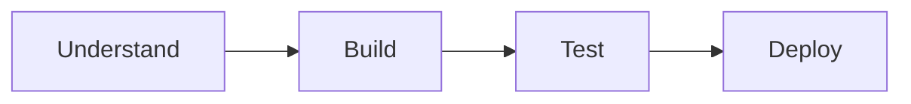

# AI Agent Engineering Academy

## From Beginner to Professional AI Agent Engineer

Welcome to AI Agent Engineering Academy!

Learn how to design, develop, evaluate and deploy intelligent AI agents using modern frameworks and tools.

### What you will learn

- Python for AI Engineering
- Large Language Models
- LangChain
- LangGraph
- Retrieval-Augmented Generation (RAG)
- Model Context Protocol (MCP)
- Multi-Agent Systems
- Enterprise AI Engineering
- AWS and Deployment

## Start Learning

### Beginner

Start with [AI fundamentals](01-AI-FUNDAMENTALS/README.md) and [Python programming](02-PYTHON-FOR-AI/README.md).

### Intermediate

Learn [LangChain](03-LANGCHAIN/README.md), [LangGraph](04-LANGGRAPH/README.md) and [RAG](05-RAG/README.md).

### Advanced

Explore [multi-agent systems](07-AGENT-ENGINEERING/README.md), [MCP](06-MCP/README.md) and [enterprise AI](09-ENTERPRISE-AI/README.md).

### Projects

Build real-world AI applications with complete source code. See [all projects](projects.md).

## All Tracks

| # | Track | Difficulty | Topics | Projects |
|---|---|---|---|---|
| 01 | [AI and LLM Fundamentals](01-AI-FUNDAMENTALS/README.md) | Beginner | 58 | 4 |
| 02 | [Python for AI Engineering](02-PYTHON-FOR-AI/README.md) | Beginner | 64 | 4 |
| 03 | [LangChain from Beginner to Advanced](03-LANGCHAIN/README.md) | Intermediate | 86 | 5 |
| 04 | [LangGraph from Beginner to Advanced](04-LANGGRAPH/README.md) | Intermediate | 57 | 5 |
| 05 | [Advanced RAG and Vector Databases](05-RAG/README.md) | Intermediate | 62 | 5 |
| 06 | [Model Context Protocol (MCP)](06-MCP/README.md) | Intermediate | 43 | 5 |
| 07 | [Agent Architectures and Context Engineering](07-AGENT-ENGINEERING/README.md) | Advanced | 43 | 4 |
| 08 | [Evaluation, Testing and Observability](08-EVALUATION-AND-OBSERVABILITY/README.md) | Advanced | 37 | 4 |
| 09 | [Enterprise AI Engineering](09-ENTERPRISE-AI/README.md) | Advanced | 47 | 4 |
| 10 | [Cloud, AWS and Deployment](10-CLOUD-AND-DEPLOYMENT/README.md) | Intermediate | 51 | 4 |
| 11 | [End-to-End AI Agent Projects](11-PRACTICAL-PROJECTS/README.md) | Mixed | 0 | 22 |
| 12 | [AI Engineering Career and Interview Preparation](12-CAREER-AND-INTERVIEWS/README.md) | Intermediate | 40 | 0 |

Follow your progress in the [learning roadmap](roadmap.md).

## Our Learning Philosophy

Every topic includes conceptual explanations, architecture diagrams, practical code, exercises and interview questions.

Start your AI engineering journey today!
