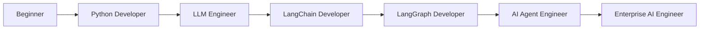

# AI Agent Engineering Academy

> **Complete Learning Roadmap, Blog Curriculum & Project Plan**

| | |
|---|---|
| **Project** | AI Agent Engineering Knowledge Hub |
| **Level** | Beginner → Advanced → Enterprise |
| **Primary Language** | Python |
| **Core Ecosystem** | LangChain, LangGraph, LangSmith |
| **Additional Technologies** | RAG, MCP, Vector Databases, FastAPI, Docker, AWS |
| **Target Audience** | Beginners, Python Developers, AI Engineers and Software Engineers |
| **Content Format** | Detailed Technical Blogs, Tutorials, Diagrams, Code Examples and Projects |

---

## Table of Contents

1. [Project Vision](#1-project-vision)
2. [Technology Stack](#2-technology-stack)
3. [Complete Learning Curriculum](#3-complete-learning-curriculum)
4. [Standard Blog Writing Template](#4-standard-blog-writing-template)
5. [Content Quality Standards](#5-content-quality-standards)
6. [Suggested Publishing Strategy](#6-suggested-publishing-strategy)
7. [Website Structure](#7-website-structure)
8. [Monetization Strategy](#8-monetization-strategy)
9. [First 30-Day Execution Plan](#9-first-30-day-execution-plan)
10. [Official Learning Resources](#10-official-learning-resources)
11. [Important Curriculum Maintenance Rules](#11-important-curriculum-maintenance-rules)
12. [Final Project Vision](#12-final-project-vision)

---

## 1. Project Vision

The objective is to create a comprehensive educational platform that teaches people how to **design, develop, evaluate, deploy and maintain AI agents**.

The platform should help someone with no previous AI experience gradually become capable of building production-oriented AI agent applications.

The learning experience will combine:

- Beginner-friendly explanations
- Technical deep dives
- Step-by-step implementation guides
- Architecture diagrams
- Complete working source code
- Real-world examples
- Troubleshooting guides
- Practical assignments
- End-to-end projects
- Interview preparation

The content should be independently researched and written, using official documentation and reliable technical references.

### Primary Objectives

1. Teach AI and LLM fundamentals.
2. Teach Python for AI engineering.
3. Explain the LangChain ecosystem.
4. Build AI agents using LangChain.
5. Build stateful workflows using LangGraph.
6. Implement Retrieval-Augmented Generation.
7. Understand MCP and external integrations.
8. Evaluate and monitor AI applications.
9. Build secure and reliable enterprise AI systems.
10. Deploy AI applications to cloud infrastructure.
11. Build a practical AI engineering portfolio.
12. Create career and freelancing opportunities.

---

## 2. Technology Stack

| Category | Technologies |
|---|---|
| Programming | Python |
| IDE | VS Code |
| Version control | Git, GitHub |
| LLM frameworks | LangChain, LangGraph |
| Observability | LangSmith, Langfuse |
| Model providers | OpenAI, Anthropic, Google, Ollama |
| API development | FastAPI |
| Validation | Pydantic |
| RAG | LangChain, LangGraph |
| Vector databases | FAISS, Chroma, Qdrant, Pinecone |
| Relational databases | PostgreSQL |
| Cache | Redis |
| Protocol | MCP |
| Containers | Docker |
| Cloud | AWS |
| Testing | Pytest |
| Deployment | Docker, cloud hosting |
| Documentation | Markdown, Mermaid |

> **Note:** Not every technology is required in every project. We will introduce tools when their purpose becomes clear.

---

## 3. Complete Learning Curriculum

### Track 01: AI and LLM Fundamentals

**Objective:** Understand the foundations of artificial intelligence and large language models.

#### Module 1.1: Introduction to Artificial Intelligence

- What is Artificial Intelligence?
- History of Artificial Intelligence
- Types of AI
- Narrow AI vs General AI
- Machine Learning vs Deep Learning
- Supervised Learning
- Unsupervised Learning
- Reinforcement Learning
- Generative AI
- Applications of AI in real-world industries

#### Module 1.2: Understanding Large Language Models

- What is an LLM?
- How do LLMs work?
- Training vs inference
- Pre-training and fine-tuning
- Foundation models
- Open-source vs proprietary models
- Model parameters
- Context windows
- Temperature and sampling
- Hallucinations and limitations

#### Module 1.3: Tokens and Tokenization

- What is a token?
- How tokenization works
- Word-based vs subword tokenization
- Tokenizers
- Token counting
- Context length
- Token limits
- Token usage and API costs

#### Module 1.4: Embeddings

- What are embeddings?
- Text embeddings
- Vector representations
- Semantic similarity
- Cosine similarity
- Embedding models
- Embedding dimensions
- Practical embedding implementation

#### Module 1.5: Transformer Architecture

- What is a Transformer?
- Encoder and decoder
- Self-attention
- Multi-head attention
- Positional encoding
- Feed-forward networks
- Layer normalization
- Residual connections
- Transformer inference
- How modern LLMs use Transformers

#### Module 1.6: Prompt Engineering

- What is prompt engineering?
- System prompts
- User prompts
- Role-based prompting
- Few-shot prompting
- Zero-shot prompting
- Chain-of-thought concepts
- Structured prompting
- Prompt templates
- Prompt injection and defensive prompting
- Prompt evaluation
- Prompt optimization

#### Practical Projects

- [ ] Build a basic LLM chatbot
- [ ] Compare responses from different models
- [ ] Create a prompt library
- [ ] Build a structured information extraction application

---

### Track 02: Python for AI Engineering

**Objective:** Learn the Python concepts required to build advanced AI applications.

#### Module 2.1: Python Fundamentals

- Installing Python
- Python interpreter
- Variables and data types
- Strings and numbers
- Lists and tuples
- Dictionaries and sets
- Conditional statements
- Loops
- Functions
- Lambda functions
- List comprehensions
- Exception handling
- File handling
- JSON processing

#### Module 2.2: Advanced Python

- Object-oriented programming
- Classes and objects
- Inheritance
- Polymorphism
- Encapsulation
- Abstraction
- Decorators
- Closures
- Generators
- Iterators
- Context managers
- Mutable vs immutable objects
- Scope and namespaces
- Type hints
- Dataclasses
- Pydantic

#### Module 2.3: Asynchronous Python

- Synchronous vs asynchronous execution
- Concurrency
- Parallelism
- Threads and processes
- `async` and `await`
- Event loops
- `asyncio`
- Async API calls
- Concurrent LLM requests
- Error handling in asynchronous applications

#### Module 2.4: Python Development Environment

- Installing Python
- Installing VS Code
- Python virtual environments
- `pip` and package management
- `requirements.txt`
- `pyproject.toml`
- Environment variables
- `.env` files
- Logging
- Debugging
- Git fundamentals
- GitHub repositories

#### Module 2.5: APIs and Backend Development

- What is an API?
- HTTP fundamentals
- REST APIs
- HTTP methods
- Status codes
- Authentication
- API keys
- Requests library
- FastAPI introduction
- Pydantic request validation
- Response models
- Streaming APIs

#### Practical Projects

- [ ] Python REST API
- [ ] Asynchronous API client
- [ ] Environment configuration manager
- [ ] FastAPI-based LLM endpoint

---

### Track 03: LangChain from Beginner to Advanced

**Objective:** Learn to build LLM-powered applications and agents using modern LangChain.

#### Module 3.1: Introduction to LangChain

- What is LangChain?
- Why do we need LangChain?
- LangChain architecture
- LangChain ecosystem
- LangChain vs direct model APIs
- LangChain vs LangGraph
- LangChain package ecosystem
- LangChain v1 architecture

#### Module 3.2: Installation and Setup

- Python environment setup
- Installing LangChain
- Installing model provider integrations
- Configuring API keys
- Environment management
- Creating a project structure
- Running the first application

#### Module 3.3: Models and Messages

- What is a chat model?
- Chat model integrations
- Model initialization
- System messages
- Human messages
- AI messages
- Tool messages
- Model parameters
- Streaming responses
- Model selection

#### Module 3.4: Prompt Engineering with LangChain

- Prompt templates
- Chat prompt templates
- Dynamic prompts
- Few-shot prompts
- Message placeholders
- Reusable prompts
- Prompt configuration
- Prompt testing

#### Module 3.5: Structured Output

- What is structured output?
- JSON output
- Pydantic schemas
- Typed responses
- Schema validation
- Structured model responses
- Handling invalid outputs

#### Module 3.6: Tools and Tool Calling

- What are tools?
- Why agents need tools
- Creating custom tools
- Tool descriptions
- Tool arguments
- Tool schemas
- Tool execution
- Tool error handling
- Multiple tools
- External API integration

#### Module 3.7: AI Agents

- What is an AI agent?
- Agent architecture
- Agent execution loop
- Model-driven tool selection
- Creating agents with `create_agent`
- Agent instructions
- Tool integration
- Middleware
- Agent state
- Streaming agent responses
- Error handling
- Human approval workflows

#### Module 3.8: Retrieval-Augmented Generation

- What is RAG?
- Why do we need RAG?
- RAG architecture
- Document loaders
- Document processing
- Text splitters
- Chunking strategies
- Embeddings
- Vector stores
- Retrievers
- Similarity search
- Metadata filtering
- Building a RAG application
- Evaluating RAG responses

#### Module 3.9: Advanced LangChain

- Middleware architecture
- Custom middleware
- Model fallbacks
- Structured agent outputs
- Streaming events
- Tool execution control
- Runtime context
- State management
- Error handling
- Application testing

#### Practical Projects

- [ ] LLM chatbot
- [ ] AI research assistant
- [ ] Tool-calling agent
- [ ] PDF question-answering application
- [ ] Customer support assistant

---

### Track 04: LangGraph from Beginner to Advanced

**Objective:** Build stateful, controllable and multi-step AI workflows.

#### Module 4.1: Introduction

- What is LangGraph?
- Why do we need LangGraph?
- LangChain vs LangGraph
- Graph-based execution
- Agent orchestration
- LangGraph architecture

#### Module 4.2: Core Concepts

- State
- Nodes
- Edges
- Conditional edges
- Entry points
- End points
- Graph compilation
- State updates
- Reducers
- Message state

#### Module 4.3: Building Workflows

- Creating a basic graph
- Defining state schemas
- Creating nodes
- Connecting nodes
- Conditional routing
- Loops
- Parallel execution
- Error handling
- Workflow testing

#### Module 4.4: Agent Development

- Building a ReAct-style agent
- Tool integration
- Model-driven routing
- Tool execution nodes
- Agent loops
- Agent termination
- Custom agent workflows

#### Module 4.5: Persistence and Memory

- Checkpointing
- Thread identifiers
- Persistent state
- Conversation history
- Short-term memory
- Long-term memory
- State recovery
- Resuming interrupted workflows

#### Module 4.6: Human-in-the-Loop

- What is human-in-the-loop?
- Interrupts
- Human approval
- Workflow pauses
- Resume execution
- Manual review
- Approval-based tool execution

#### Module 4.7: Multi-Agent Systems

- What is a multi-agent system?
- Single-agent vs multi-agent architecture
- Supervisor architecture
- Network architecture
- Hierarchical agents
- Agent collaboration
- Agent handoffs
- Shared state
- Agent communication
- Multi-agent evaluation

#### Practical Projects

- [ ] Research workflow
- [ ] Multi-step customer support agent
- [ ] Human-approved email agent
- [ ] Multi-agent research system
- [ ] Stateful document processing workflow

---

### Track 05: Advanced RAG and Vector Databases

**Objective:** Build knowledge-grounded applications that retrieve information from external documents and databases.

#### Module 5.1: RAG Fundamentals

- What is RAG?
- RAG architecture
- Retrieval vs generation
- Why LLMs need external knowledge
- RAG vs fine-tuning
- RAG limitations

#### Module 5.2: Document Ingestion

- PDF ingestion
- Word documents
- Excel documents
- CSV files
- Web page ingestion
- Database ingestion
- Metadata extraction
- Document normalization
- Data cleaning

#### Module 5.3: Chunking Strategies

- Fixed-size chunking
- Recursive chunking
- Sentence-based chunking
- Semantic chunking
- Parent-child chunking
- Overlapping chunks
- Chunk size optimization
- Chunking evaluation

#### Module 5.4: Vector Databases

- What is a vector database?
- Vector indexing
- Similarity search
- Cosine similarity
- Euclidean distance
- Metadata filtering
- FAISS
- Chroma
- Qdrant
- Pinecone
- PostgreSQL with pgvector

#### Module 5.5: Advanced Retrieval

- Dense retrieval
- Sparse retrieval
- Hybrid search
- Keyword search
- Query rewriting
- Multi-query retrieval
- Reranking
- Contextual retrieval
- Parent document retrieval
- Retrieval optimization

#### Module 5.6: Advanced RAG Architectures

- Corrective RAG
- Adaptive RAG
- Self-RAG
- Agentic RAG
- Graph RAG
- Multi-hop RAG
- Hybrid RAG
- Multi-modal RAG

#### Module 5.7: RAG Evaluation

- Retrieval precision
- Retrieval recall
- Context relevance
- Answer relevance
- Faithfulness
- Groundedness
- RAGAS
- DeepEval
- Evaluation datasets
- Improving retrieval quality

#### Practical Projects

- [ ] PDF assistant
- [ ] Company knowledge assistant
- [ ] Multi-document RAG
- [ ] SQL and document hybrid assistant
- [ ] Agentic research system

---

### Track 06: Agent Architectures and Context Engineering

**Objective:** Understand how to design agents that perform reliable and complex tasks.

#### Module 6.1: Agent Fundamentals

- Agent architecture
- Perception and reasoning
- Planning and execution
- Tool selection
- Observation and feedback
- Agent execution loops

#### Module 6.2: Agent Patterns

- ReAct
- Plan and execute
- Reflection
- Self-correction
- Routing
- Parallelization
- Orchestrator-worker
- Evaluator-optimizer
- Supervisor agents
- Hierarchical agents

#### Module 6.3: Context Engineering

- What is context engineering?
- Context windows
- System instructions
- Conversation history
- Retrieved context
- Tool descriptions
- Context compression
- Context selection
- Context management
- Context quality evaluation

#### Module 6.4: Agent Memory

- Short-term memory
- Long-term memory
- Episodic memory
- Semantic memory
- Procedural memory
- Memory storage
- Memory retrieval
- Memory summarization
- Memory evaluation

#### Module 6.5: Advanced Agent Design

- Single-agent architecture
- Multi-agent architecture
- Agent communication
- Agent handoffs
- Task decomposition
- Agent coordination
- Failure recovery
- Workflow optimization

#### Practical Projects

- [ ] Autonomous research assistant
- [ ] Planning and execution agent
- [ ] Memory-enabled assistant
- [ ] Multi-agent task management system

---

### Track 07: Model Context Protocol (MCP)

**Objective:** Understand how AI applications connect with external tools and context sources through MCP.

#### Module 7.1: MCP Fundamentals

- What is MCP?
- Why MCP exists
- MCP architecture
- MCP host
- MCP client
- MCP server
- JSON-RPC fundamentals
- MCP lifecycle

#### Module 7.2: MCP Capabilities

- Tools
- Resources
- Prompts
- Sampling
- Notifications
- Transport mechanisms
- Protocol communication

#### Module 7.3: Building MCP Servers

- MCP development environment
- Installing the Python SDK
- Creating an MCP server
- Registering tools
- Creating resources
- Creating prompts
- Running the server
- Testing the server

#### Module 7.4: MCP Client Development

- What is an MCP client?
- Connecting to MCP servers
- Discovering available tools
- Calling MCP tools
- Handling tool responses
- Managing connections
- Error handling

#### Module 7.5: MCP and AI Agents

- MCP with LangChain
- MCP with LangGraph
- Tool integration
- Multiple MCP servers
- Agent-driven MCP execution
- Building an MCP-powered assistant

#### Module 7.6: MCP Security

- Authentication
- Authorization
- Tool permissions
- Untrusted input
- Prompt injection
- Server security
- Secure deployment

#### Practical Projects

- [ ] File system MCP server
- [ ] Database MCP server
- [ ] Weather MCP server
- [ ] MCP-powered research assistant
- [ ] Multi-server AI assistant

---

### Track 08: Evaluation, Testing and Observability

**Objective:** Learn how to test and monitor AI agents.

#### Module 8.1: Observability Fundamentals

- What is observability?
- Logging
- Tracing
- Metrics
- Distributed tracing
- Agent execution traces

#### Module 8.2: LangSmith

- Introduction to LangSmith
- Project configuration
- Tracing
- Debugging
- Datasets
- Evaluation
- Monitoring
- Production observability

#### Module 8.3: Evaluation

- Model evaluation
- Agent evaluation
- Tool selection accuracy
- Task completion
- Response quality
- Faithfulness
- Latency evaluation
- Cost evaluation
- Human evaluation
- Regression testing

#### Module 8.4: Testing

- Unit testing
- Integration testing
- End-to-end testing
- Mocking model responses
- Tool testing
- Agent workflow testing
- Evaluation datasets
- Continuous evaluation

#### Module 8.5: Additional Tools

- Langfuse
- RAGAS
- DeepEval
- OpenTelemetry
- Pytest

#### Practical Projects

- [ ] Agent evaluation dashboard
- [ ] RAG quality testing
- [ ] LangSmith tracing application
- [ ] Automated agent regression testing

---

### Track 09: Enterprise AI Engineering

**Objective:** Understand how to build secure, scalable and reliable AI systems.

#### Module 9.1: Enterprise Architecture

- Enterprise AI architecture
- Microservices
- API gateways
- Event-driven architecture
- Message queues
- Distributed systems
- Agent orchestration architecture
- Multi-tenant applications

#### Module 9.2: Security

- API key management
- Secrets management
- Authentication
- Authorization
- Role-based access control
- Data privacy
- Prompt injection
- Jailbreak risks
- Data leakage
- Tool permission management
- Human approval
- Audit logging

#### Module 9.3: Reliability

- Retry strategies
- Exponential backoff
- Timeouts
- Circuit breakers
- Model fallbacks
- Rate limiting
- Idempotency
- Fault tolerance
- Error recovery
- Graceful degradation

#### Module 9.4: Performance Optimization

- Token optimization
- Model selection
- Caching
- Semantic caching
- Parallel execution
- Async processing
- Batch processing
- Latency optimization
- Cost optimization
- Throughput optimization

#### Module 9.5: Guardrails

- Input validation
- Output validation
- Content filtering
- Structured output validation
- Tool execution policies
- Human approval workflows
- Safety evaluation

#### Practical Projects

- [ ] Secure enterprise assistant
- [ ] Multi-tenant customer support agent
- [ ] Production-ready document assistant
- [ ] Enterprise AI workflow with approval controls

---

### Track 10: Cloud, AWS and Deployment

**Objective:** Learn how to deploy AI agent applications.

#### Module 10.1: Cloud Fundamentals

- What is cloud computing?
- IaaS, PaaS and SaaS
- Compute
- Storage
- Networking
- IAM
- Cloud monitoring

#### Module 10.2: AWS Fundamentals

- AWS account and console
- IAM
- EC2
- S3
- Lambda
- API Gateway
- CloudWatch
- Secrets Manager
- Bedrock

#### Module 10.3: AWS Bedrock

- What is Amazon Bedrock?
- Foundation models
- Model invocation
- Model access
- Knowledge bases
- Guardrails
- Agent capabilities
- Model evaluation
- Cost management

#### Module 10.4: AgentCore

- AgentCore overview
- Runtime concepts
- Identity
- Gateway
- Memory
- Observability
- Secure agent deployment
- Integration with agent frameworks

#### Module 10.5: Docker

- What is Docker?
- Containers
- Images
- Dockerfile
- Docker Compose
- Environment variables
- Container networking
- Deploying FastAPI applications

#### Module 10.6: Production Deployment

- Application packaging
- CI/CD
- Environment configuration
- Cloud deployment
- Database connections
- Monitoring
- Logging
- Scaling
- Rollbacks
- Cost management

#### Practical Projects

- [ ] Deploy a LangChain application
- [ ] Dockerize a FastAPI agent
- [ ] Deploy a RAG application
- [ ] Deploy an AWS Bedrock-based agent

---

### Track 11: End-to-End AI Agent Projects

**Objective:** Apply the concepts through complete applications.

#### Beginner Projects

- [ ] Basic LLM chatbot
- [ ] AI writing assistant
- [ ] AI calculator
- [ ] Tool-calling assistant
- [ ] Structured data extractor

#### Intermediate Projects

- [ ] PDF question-answering agent
- [ ] Website research assistant
- [ ] Customer support agent
- [ ] AI email assistant
- [ ] Database query assistant
- [ ] Personal knowledge assistant
- [ ] Meeting summarization application

#### Advanced Projects

- [ ] Multi-agent research system
- [ ] Agentic RAG application
- [ ] MCP-powered assistant
- [ ] Human-in-the-loop agent
- [ ] Enterprise knowledge assistant
- [ ] AI workflow automation platform

#### Enterprise Projects

- [ ] Multi-tenant AI support platform
- [ ] Secure enterprise RAG
- [ ] Production multi-agent workflow
- [ ] Cloud-deployed AI assistant

#### Required Deliverables for Each Project

Every project must include:

1. Problem statement
2. Business use case
3. Requirements
4. Technology stack
5. Architecture diagram
6. Component explanation
7. Project folder structure
8. Installation instructions
9. Environment configuration
10. Complete source code
11. Step-by-step implementation
12. Expected output
13. Testing instructions
14. Troubleshooting
15. Security considerations
16. Cost considerations
17. Deployment instructions
18. GitHub repository

---

### Track 12: AI Engineering Career and Interview Preparation

**Objective:** Prepare learners for real-world AI engineering opportunities.

#### Module 12.1: AI Engineer Roadmap

- Skills required for AI engineering
- Python requirements
- LLM knowledge
- Agent frameworks
- RAG development
- Backend engineering
- Cloud fundamentals
- Production engineering
- Portfolio building

#### Module 12.2: Technical Interview Preparation

- Python interview questions
- OOP questions
- Async Python
- LLM fundamentals
- Prompt engineering
- LangChain
- LangGraph
- RAG
- Vector databases
- MCP
- Agent architectures
- Evaluation
- System design
- Enterprise architecture

#### Module 12.3: System Design

- Design an AI chatbot
- Design a document RAG system
- Design a multi-agent system
- Design a customer support assistant
- Design a scalable inference service
- Design an enterprise AI platform
- Design an AI workflow automation system

#### Module 12.4: Freelancing

- Finding AI development clients
- Understanding business requirements
- Identifying automation opportunities
- Preparing proposals
- Project estimation
- Pricing AI development services
- Delivering client projects
- Building a portfolio
- Maintaining applications
- Providing technical support

---

## 4. Standard Blog Writing Template

Every article should follow this format.

### Article Metadata

```yaml
Title:
Track:
Module:
Difficulty:
Estimated reading time:
Prerequisites:
Technologies:
Framework versions:
Last verified date:
```

### Article Structure

| # | Section | Purpose |
|---|---|---|
| 1 | **Introduction** | Explain the topic and why it matters. |
| 2 | **Learning Objectives** | List what the reader will learn. |
| 3 | **Prerequisites** | Explain required knowledge. |
| 4 | **Conceptual Explanation** | Start with simple definitions and practical analogies. |
| 5 | **Technical Deep Dive** | Explain internal architecture and important components. |
| 6 | **Architecture Diagram** | Use Mermaid or another clear diagram format. |
| 7 | **Installation and Setup** | Include exact installation commands. |
| 8 | **Project Structure** | Explain each directory and file. |
| 9 | **Implementation** | Provide complete working source code. |
| 10 | **Code Explanation** | Explain the important statements, functions, parameters and execution flow. |
| 11 | **Execution** | Explain how to run the project. |
| 12 | **Expected Output** | Show realistic terminal output or application results. |
| 13 | **Internal Workflow** | Explain what happens behind the scenes. |
| 14 | **Troubleshooting** | Cover common installation, configuration and runtime errors. |
| 15 | **Real-World Applications** | Explain practical industry use cases. |
| 16 | **Best Practices** | Explain maintainability, security and performance. |
| 17 | **Hands-on Exercises** | Provide tasks for learners. |
| 18 | **Interview Questions** | Include beginner, intermediate and advanced questions. |
| 19 | **Summary** | Recap the main concepts. |
| 20 | **Next Article** | Provide the next lesson and its prerequisites. |
| 21 | **References** | Link to official documentation and reliable resources. |

---

## 5. Content Quality Standards

To maintain educational quality, every article must satisfy the following standards.

### Technical Accuracy

- Use official documentation.
- Verify framework versions.
- Avoid outdated APIs unless teaching historical approaches.
- Run code examples before publishing.
- Include complete imports.
- Verify package compatibility.
- Never invent expected outputs.

### Beginner Friendliness

- Explain every new technical term.
- Avoid assuming previous AI knowledge.
- Introduce one concept at a time.
- Provide simple examples before complex examples.
- Explain why a particular approach is used.

### Code Quality

- Use clear naming conventions.
- Include type hints where useful.
- Handle exceptions.
- Avoid hardcoded credentials.
- Use environment variables.
- Include dependency files.
- Follow Python best practices.

### Security

- Never publish real API keys.
- Avoid exposing private data.
- Discuss prompt injection.
- Explain tool permissions.
- Include human approval where appropriate.
- Distinguish demonstrations from production-ready implementations.

### Originality

- Write original explanations.
- Create original examples.
- Design original diagrams.
- Attribute external references.
- Do not reproduce third-party course materials.

---

## 6. Suggested Publishing Strategy

### Recommended Schedule

Publish **2–3 detailed articles every week**.

| Day | Activity |
|---|---|
| Monday | Research and outline |
| Tuesday | Write technical article |
| Wednesday | Test code and diagrams |
| Thursday | Publish article |
| Friday | Create practical tutorial |
| Saturday | Publish project or tutorial |
| Sunday | Review and plan |

### Suggested Content Formats

- Long-form technical blogs
- Step-by-step tutorials
- Architecture explainers
- Code walkthroughs
- Practical project guides
- Troubleshooting articles
- Interview preparation
- Short educational videos
- Downloadable study notes

---

## 7. Website Structure

Suggested navigation:

```text
AI-AGENT-ENGINEERING-ACADEMY/
│
├── README.md
│
├── 01-AI-FUNDAMENTALS/
│   ├── 01-introduction-to-ai.md
│   ├── 02-generative-ai.md
│   ├── 03-understanding-llms.md
│   ├── 04-tokenization.md
│   ├── 05-embeddings.md
│   └── 06-transformer-architecture.md
│
├── 02-PYTHON-FOR-AI/
│   ├── 01-python-fundamentals.md
│   ├── 02-advanced-python.md
│   ├── 03-decorators.md
│   ├── 04-generators.md
│   ├── 05-async-python.md
│   └── 06-fastapi.md
│
├── 03-LANGCHAIN/
│   ├── 01-introduction.md
│   ├── 02-installation.md
│   ├── 03-models-and-messages.md
│   ├── 04-prompt-templates.md
│   ├── 05-structured-output.md
│   ├── 06-tools.md
│   ├── 07-agents.md
│   └── 08-rag.md
│
├── 04-LANGGRAPH/
│   ├── 01-introduction.md
│   ├── 02-state-nodes-edges.md
│   ├── 03-conditional-routing.md
│   ├── 04-checkpointing.md
│   ├── 05-human-in-the-loop.md
│   └── 06-multi-agent-systems.md
│
├── 05-RAG/
│   ├── 01-rag-fundamentals.md
│   ├── 02-document-ingestion.md
│   ├── 03-chunking.md
│   ├── 04-embeddings.md
│   ├── 05-vector-databases.md
│   ├── 06-hybrid-search.md
│   └── 07-agentic-rag.md
│
├── 06-MCP/
│   ├── 01-mcp-introduction.md
│   ├── 02-mcp-architecture.md
│   ├── 03-building-mcp-server.md
│   ├── 04-building-mcp-client.md
│   └── 05-mcp-with-langchain.md
│
├── 07-AGENT-ENGINEERING/
│   ├── 01-agent-architectures.md
│   ├── 02-react-pattern.md
│   ├── 03-context-engineering.md
│   ├── 04-agent-memory.md
│   └── 05-multi-agent-design.md
│
├── 08-EVALUATION-AND-OBSERVABILITY/
│   ├── 01-langsmith.md
│   ├── 02-tracing.md
│   ├── 03-agent-evaluation.md
│   └── 04-testing.md
│
├── 09-ENTERPRISE-AI/
│   ├── 01-enterprise-architecture.md
│   ├── 02-security.md
│   ├── 03-guardrails.md
│   ├── 04-reliability.md
│   └── 05-performance-optimization.md
│
├── 10-CLOUD-AND-DEPLOYMENT/
│   ├── 01-cloud-fundamentals.md
│   ├── 02-aws-bedrock.md
│   ├── 03-agentcore.md
│   ├── 04-docker.md
│   └── 05-production-deployment.md
│
├── 11-PRACTICAL-PROJECTS/
│   ├── beginner/
│   ├── intermediate/
│   ├── advanced/
│   └── enterprise/
│
└── 12-CAREER-AND-INTERVIEWS/
    ├── 01-ai-engineer-roadmap.md
    ├── 02-python-interview-questions.md
    ├── 03-langchain-interview-questions.md
    ├── 04-langgraph-interview-questions.md
    └── 05-ai-system-design.md
```

---

## 8. Monetization Strategy

The educational platform can eventually generate revenue through several channels.

### Phase 1: Audience Building

- Publish free tutorials
- Share code repositories
- Build a newsletter
- Create educational videos
- Participate in developer communities

### Phase 2: Digital Products

- LangChain study notes
- LangGraph project guides
- AI agent architecture templates
- Practical assignments
- Downloadable project source code

### Phase 3: Paid Education

- Beginner AI agent courses
- Live workshops
- Hands-on coding sessions
- Mentorship
- Advanced project courses

### Phase 4: Consulting and Freelancing

- Business process automation
- Customer support agents
- Knowledge assistants
- RAG solutions
- MCP integrations
- Enterprise agent development

### Initial Revenue Goal

**Target:** ₹5,000–₹10,000 per month.

Possible revenue combinations:

- Paid beginner workshops
- Digital learning products
- Freelance AI agent development
- Technical mentoring

> **Disclaimer:** These are possible business models, not guaranteed income.

---

## 9. First 30-Day Execution Plan

### Week 1: Establish the Foundation

- [ ] Finalize website identity
- [ ] Set up GitHub
- [ ] Install Python and VS Code
- [ ] Create the curriculum repository
- [ ] Research AI fundamentals
- [ ] Write the first two articles

### Week 2: Python and LLM Foundations

- [ ] Write Python fundamentals
- [ ] Explain APIs and environment variables
- [ ] Explain LLM architecture
- [ ] Explain tokens and embeddings
- [ ] Build a basic LLM application

### Week 3: LangChain

- [ ] Explain LangChain architecture
- [ ] Install modern LangChain
- [ ] Connect an LLM
- [ ] Build a prompt-based application
- [ ] Implement tool calling
- [ ] Create the first simple agent

### Week 4: LangGraph and Practical Projects

- [ ] Introduce LangGraph
- [ ] Explain state, nodes and edges
- [ ] Build a basic workflow
- [ ] Build a tool-calling agent
- [ ] Publish the first complete GitHub project
- [ ] Review and improve all articles

---

## 10. Official Learning Resources

| Resource | Link |
|---|---|
| LangChain | <https://docs.langchain.com/oss/python/langchain/overview> |
| LangGraph | <https://docs.langchain.com/oss/python/langgraph/overview> |
| LangSmith | <https://docs.langchain.com/langsmith/home> |
| LangChain GitHub | <https://github.com/langchain-ai/langchain> |
| MCP | <https://modelcontextprotocol.io/> |
| Python | <https://docs.python.org/3/> |
| FastAPI | <https://fastapi.tiangolo.com/> |
| Pydantic | <https://docs.pydantic.dev/> |
| AWS Bedrock | <https://docs.aws.amazon.com/bedrock/> |
| AWS AgentCore | <https://docs.aws.amazon.com/bedrock-agentcore/> |
| Docker | <https://docs.docker.com/> |
| GitHub | <https://docs.github.com/> |

---

## 11. Important Curriculum Maintenance Rules

AI frameworks change frequently. The educational platform must remain current.

For each published tutorial:

- Record the tested Python version.
- Record framework and package versions.
- Include the date last tested.
- Verify APIs against official documentation.
- Test all installation commands.
- Revisit tutorials after major framework updates.
- Clearly label deprecated approaches.
- Keep project dependencies reproducible.
- Update broken examples.
- Maintain a changelog for important revisions.

> ⚠️ **Do not claim a project is production-ready merely because it runs locally.**

---

## 12. Final Project Vision

The final objective is to establish an independent **AI Agent Engineering Academy**.

The academy should provide a complete learning journey:



Every learner should be able to move from understanding basic AI concepts to developing and deploying real-world AI applications.

The platform should emphasize three pillars:

| Pillar | Focus |
|---|---|
| **Understand** | Learn the concepts and architecture. |
| **Build** | Implement practical applications with complete code. |
| **Deploy** | Test, evaluate, secure and deploy applications. |

### Our Guiding Principle

> *Don't just teach people how to use AI frameworks. Teach them how to think, design, build, debug and engineer reliable AI agent systems.*
